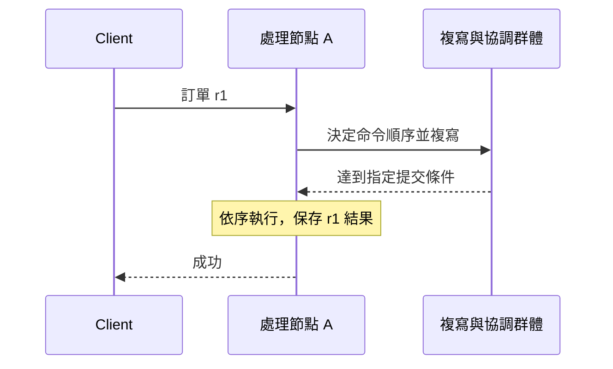

# Chapter 00 — 課程簡介與系統設計視角 (Course Introduction)

## 1. 一個庫存數字為何需要多台電腦?

> 課程依據: P3–P5.

商店剩下最後一件商品. 若所有訂單都到同一台機器, 它只要在本地依次檢查庫存, 第一筆成功, 第二筆便看到零. 現在希望機器壞掉時還有人能接單, 於是把庫存複製到另一台. 兩台都看見庫存 1 時, 可以各自扣款嗎? 如果它們必須先通訊, 一個請求又該等到什麼時候才算完成?

由不同電腦上的元件透過網路互相傳送訊息, 協調共同服務, 就是分散式系統 (Distributed System). 副本 (Replica) 讓服務有機會在個別機器故障後繼續運作. 平行運算則把原本集中在單機的工作分散給多台. 兩個目標都使訊息的送達, 先後與等待成本變成設計問題.

P3 從 Client–Server, P2P, Cloud Computing 到 Decentralized Ledgers 說明系統演進, 並列出 MapReduce, HBase/Cassandra, Kafka, Blockchain 等應用. 這些系統共用許多原理, 卻不採用完全相同的故障模型, 資料介面或一致性保證.

P4–P5 的課程定位是先建立理論, 再觀察實務系統如何實現機制; 不以逐行拆解所有專案原始碼為目標. 分析一個系統時, 應先問問題與保證, 再對照架構, 最後才談個別 API.

## 2. 用一個訂單服務看取捨

> [教學補充/推導] 依 P3–P6 的原理與系統對照, 自製假設情境; 不是講義原例或實測產品.

假設用戶端 (Client) 把訂單送給 A, 庫存只剩 1 件, A 可以向其他副本協調. 複寫 (Replication) 在此保存的是"嘗試扣一件"這道命令, 這樣每個副本都能用同一套庫存規則執行. 先假設副本都能正常通訊:

1. Client 產生唯一`request_id=r1`, 送到 A.
2. A 檢查請求, 協調命令順序, 將"嘗試扣一件庫存"寫入複寫流程.
3. 達到該協定規定的提交條件後, 狀態機按順序執行; 庫存 $1\to0$.
4. A 在應用狀態保存 r1 的結果, 再回覆成功. 落後的副本按協定追上相同命令與狀態.

圖 0.1 - 一筆訂單從進入複寫群體到執行並回覆. 圖把群體內部協調合在一欄, 多數與持久保存條件留到 Chapter 02. 自繪, 參考成大講義 P3–P6 與 MIT 6.5840 Lecture 6.

### 2.1 回覆遺失與部分故障

把正常路徑改一個地方. 步驟 4 的成功回覆遺失時, A 已將庫存減到 0, Client 看到的卻只是逾時 (Timeout). 用新 ID 下單會被服務視為另一筆操作, 有重複執行的風險. 用相同 r1 重試, 接手副本從共同狀態找到並回傳 r1 的原結果, 庫存仍為 0. 這叫請求去重 (Request Deduplication). 前提是結果和庫存更新一同受到複寫與回復的保護.

若 A 與 B 失聯, 兩台仍各自運作, 這是部分故障 (Partial Failure). 若兩邊都把最後一件商品賣掉, 連線恢復後已發出的成功回覆也無法收回. 讓無法協調的一側暫停寫入, 可以保護只賣一次的要求, 代價是有些請求暫時得不到結果. 這對應兩個問題: 一致性 (Consistency) 約束使用者能看到什麼結果, 可用性 (Availability) 關心故障時服務能否繼續回答.

若 A 扣款後, B 入帳前各拍一張備份, 可能少算在途款項; 恢復時又可能收到沒有對應傳送紀錄的訊息. Chapter 01 的 Consistent Cut 與 Snapshot 正是處理這種全域狀態問題.

### 2.2 架構比較

| 設計 | 可取得的好處 | 明確成本與限制 | 需再回答的問題 |
| --- | --- | --- | --- |
| 單節點保存全部狀態 | 本地排序與交易邊界較單純 | 節點故障會中斷服務; 受單機資源限制 | 如何持久化與備份? |
| 非同步複寫 | 回覆可不等待遠端持久化; 讀副本可分散流量 | failover 可能缺少尚未複寫的更新; 讀值可能落後 | 接受多少資料遺失與讀取延遲? |
| 協調式日誌複寫 | 在故障模型與 quorum 規則內保護已提交順序 | 寫入需跨節點往返與可靠保存; 失去多數時停止進展 | 如何選 Leader, 恢復歷史與提供讀取? |
| 分區儲存 (Sharding) | 不同鍵由不同節點承擔, 分散容量與負載 | 跨分區操作需額外協調; hot key 仍可能集中 | 鍵如何路由與遷移? 跨分區交易如何完成? |

分區儲存與網路分區 (Network Partition) 是兩個不同概念: 前者是主動分配資料, 後者是網路故障造成的隔離. 它們可以同時出現.

## 3. 課程各單元的原理連結

> 課程依據: P6, P16–P17. 以下以主題整理, 不以 P6 的週次取代正式課表.

先從節點 A, B 各自留下的訂單紀錄開始. 邏輯時間 (Logical Time) 讓讀者追蹤從傳送到接收的因果順序. 快照與回復 (Snapshot and Recovery) 進一步追問, 哪些局部備份能一起使用. 這是 [Chapter 01](01-logical-clocks-checkpointing.md).

如果服務要在兩個並行請求間主動決定先後, 就進入 [Chapter 02 的共識](02-fault-tolerance-paxos-raft.md). 共識 (Consensus) 讓副本選定相同命令, 多數決的交集保護跨輪次的資訊. 把共同決定按位置寫進附加式日誌 (Append-Only Log) 後, 副本可順序套用與重播; 全序廣播 (Total Order Broadcast) 關心接收各方是否依同一順序交付訊息. [Chapter 03 的 ZooKeeper](03-zookeeper.md) 會把這些共同狀態做成應用可操作的設定, 成員名單與排隊機制.

若情境是由大量節點分攤檔案, 就得先找到誰存有資料. [Chapter 04](04-peer-to-peer-gossip.md) 由 P2P 路由, Gossip 和分散式雜湊表建立定位與傳播機制. 找到資料位置以後, 又會碰到一致性模型 (Consistency Models) 與多版本併行控制 (Multi-Version Concurrency Control, MVCC), 例如 Client 能看到哪個版本, 何時能按特定版本讀取. P6 的課程原理在後續的資料庫, Kafka, 運算與區塊鏈系統中會再次出現, 各自的保證仍要看協定細節.

P6 是原理對應表, 不表示同一列的系統都實作相同協定. 例如 Kafka ISR 不應直接視為 Basic Paxos 的 Acceptor Quorum, ZAB 也不等於 Basic Paxos. 後續章節要重新讀各自講義與官方文件.

## 4. 課程安排與評分: 忠實保留暫定性

> [課程講義] P1–P2, P7–P17. 本節只記錄 PDF 上的課程政策; 不是即時課務公告.

課程為 National Cheng Kung University, Prof. Hung-Chang Hsiao (蕭宏章), Fall 2026. P2 寫週五 09:00–12:00, 以連續 150 分鐘授課區段進行, 並允許彈性個人移動; 助教 TBA, 沒有指定必備教科書. 時段與實際授課區段照原頁記錄, 不自行補出休息規則.

### 4.1 評分與試題形式

| 項目 | P7 的比例與規則 |
| --- | --- |
| Written Examination | 70%; Week 13, 20 題單選 |
| Student Presentation | 20%; 小組專題或文獻報告 |
| Attendance | 10%; 每次點名 1%, 最多 10% |

P10 補充考試為全英文單選. P8–P10 的示例分別測 Marker 邊界, ZooKeeper 避免 Thundering Herd 的前驅觀察策略, Paxos 歷史值採用, 依次對應 Chapter 01, 03, 02.

**P15 明確說明以上政策, 評分與週次均為暫定, 可能依實際教學調整.** 本地 PDF 不證明目前實際課務仍未修改.

### 4.2 小組報告與主題

P11: 全班 12 組, 每組約 5 人; 每組 25 分鐘, 含 18 分鐘報告, 5 分鐘 Q&A, 2 分鐘換場. 上台主講限一人, 其餘組員可參與 Q&A. 題目先選先得. 評分看機制能否對應理論, 架構與時間控制; 微型叢集類另看展示流暢度與容錯驗證.

| 分類 | P12–P13 的四個方向 |
| --- | --- |
| Paper Review | Google Spanner, Raft, Amazon Dynamo, PBFT |
| Architecture Analysis | Apache Pulsar vs. Kafka, Redis Cluster, Elasticsearch, TiDB |
| Mini-Project & Live Demo | ZooKeeper 容錯與選舉, Spark RDD 容錯, HDFS NameNode 高可用性, 分散式鎖與狀態還原 |

P12 對 Raft 報告方向寫"原論文中未提及"的 Membership Change 與日誌壓縮; **技術補充/更精確說法**: 已核對的 [Raft Extended Version](https://raft.github.io/raft.pdf) 實際在 §6, §7 討論這兩者. 因此把它理解為報告深化主題, 不能引用成"Raft 原論文完全沒有這些內容".

P14 建議 3–4 節點, 示意為 1 Master 加 2–3 Workers; 每節點至少 2 vCPU, 4 GB RAM, 20 GB Disk. 這是教材建議, 不是各產品的正式最低需求或保證. 該頁另提 GCP 新戶額度與 GitHub Student Developer Pack; 雲端優惠會變動, 本筆記不將其當成已查證的當前方案, 也不以此安排付費資源.

### 4.3 逐週課表

以下依 P16–P17, 日期照投影片列示; 不表示本筆記已完成該週內容.

| Week | 日期 | 主題/安排 |
| --- | --- | --- |
| 1 | 09/11 | Introduction, System Models, Logical Clocks & Global States |
| 2 | 09/18 | Instructor Away/External Speech; No Class |
| 3 | 09/25 | Mid-Autumn Festival; No Class |
| 4 | 10/02 | Fault Tolerance & Paxos |
| 5 | 10/09 | National Day Substituted Holiday; No Class |
| 6 | 10/16 | ZooKeeper |
| 7 | 10/23 | P2P & Gossip |
| 8 | 10/30 | Consistency, Replication, Transactions |
| 9 | 11/06 | Departmental Review/Flexible Learning; No Class |
| 10 | 11/13 | LevelDB & HBase |
| 11 | 11/20 | HDFS, MapReduce, YARN, Spark |
| 12 | 11/27 | Kafka/Stream Processing |
| 13 | 12/04 | Blockchain 與 Written Examination |
| 14 | 12/11 | Student Presentations I |
| 15 | 12/18 | Student Presentations II 與 Course Conclusion |
| 16 | 12/25 | Constitution Day; No Class |
| 17 | 01/01 | Founding Day; No Class |
| 18 | 01/08 | Flexible Learning; No Class |

P18 deck 封面寫 Week 2, 與上述安排不同; P6 的部分系統週次也不同. 引用筆記時以實體頁碼與標題為定位, 不推測是否由不同版本的課表合併而來.

## 5. 如何閱讀後續技術筆記?

> [教學補充/推導] 對照 P4–P6 的"原理 → 架構 → 應用"目標.

閱讀任何協定時先固定模型: 節點是否只會 crash? 網路是否 FIFO? 哪些資料已可靠落盤? 接著列出角色, 狀態與訊息; 逐步記錄何時某個結果只是被一台接收, 何時已滿足協定決定條件, 何時應用真正執行.

驗證不只看正常路徑. 應把 crash 放在"保存前/保存後""送出前/送出後""多數完成但通知前"等位置, 檢查重試是否仍滿足不變量. 比較方案時, 則指出需要多少控制訊息, 同步儲存與回復工作, 而不是只寫快慢.

下一章從最小的可驗證證據開始. 先把一則跨機訊息的送出與接收畫成箭頭, 問哪些事件必須在它之前發生. 之後再把這個判斷用來檢查故障時留下的狀態.

## 6. 英文選擇題與逐項解析

以下為自製練習, 不是教授原題.

### Q1 — Partial failure

Which scenario best illustrates partial failure in a distributed system?

- A. One server is unreachable while other servers continue processing requests.
- B. Every component is guaranteed to stop at exactly the same time.
- C. A local variable is renamed without changing behavior.
- D. Two processes on one host always share the same state.

**答案: A.** A: 系統仍局部運作, 符合定義. B: 全體同時停止不呈現部分可達的困難. C: 不是故障行為. D: 不是分散式故障模型, 也非一般程序保證.

### Q2 — Replication

Why is copying data to multiple servers insufficient by itself to guarantee a consistent service?

- A. Replicas cannot communicate over networks.
- B. Replicas may observe concurrent requests in different orders unless a protocol defines the required behavior.
- C. Every replicated service must use Blockchain.
- D. Physical clocks automatically determine a unique correct command order.

**答案: B.** A: 複寫本來可透過訊息. B: 命令順序與故障行為需要協定. C: 有多種複寫與協調方法. D: 時鐘誤差與並行操作不能自動解決應用競爭.

### Q3 — Course policies

How should the grading percentages and weekly schedule in the introduction slides be interpreted?

- A. They are permanent guarantees unaffected by later announcements.
- B. They may be freely replaced with a generic university policy.
- C. They are the policies recorded in the provided slides and are explicitly tentative.
- D. Their presence proves that every listed chapter has already been studied.

**答案: C.** A: 違反 P15 的暫定聲明. B: 不能以無來源政策替換教材. C: 保留來源與效力界線. D: 課表規劃不等於閱讀進度.

### Q4 — Timeout and retry

A client times out after submitting an order. Which design most directly helps prevent duplicate execution when it retries?

- A. Treat every retry as a new unrelated order.
- B. Assume a timeout proves that no state changed.
- C. Remove all durable records to make the retry faster.
- D. Reuse a unique request ID and preserve the processed result in the service's state.

**答案: D.** A: 可能重複處理. B: 無法從無回覆推得未執行. C: 破壞恢復與去重資訊. D: 讓服務辨認同一邏輯請求; 仍需可靠保存與正確複寫.

## 7. 參考資料與投影片對應

| 講義 | 主題與原理 | 圖解與推演 | 下一個問題 |
| --- | --- | --- | --- |
| P1–P5 | 透過訊息合作與共用資源 | 圖 0.1, 庫存 $1\to0$, 重送 r1 | 如何約束順序及故障行為? |
| P6 | 因果, 回復, 共識與路由 | 訂單案例和 01–04 的連結 | 如何檢驗一個機制? |
| P7–P10 | 從機制, 情境與安全性出題 | Marker, 前驅 Watch, 歷史值採用 | 如何在報告中展示? |
| P11–P17 | 報告, 暫定政策與課表 | 三類主題與週次 | P18, 事件的先後如何比較? |

- [原文書/延伸補充] van Steen, Tanenbaum, 第 4 版, PDF P19–P20, P26–P27, P31–P32, 網路化系統與資源共享, 透明性及介面語義.
- [大學教材/延伸補充] [MIT 6.5840 Lecture 1 — Introduction](https://pdos.csail.mit.edu/6.824/notes/l01.txt) 的部分故障與設計取捨, 以及 [Lecture 6 — RSM and Raft](https://pdos.csail.mit.edu/6.824/notes/l-raft.txt) 的複寫與回覆路徑.
- [原始論文/延伸補充] [Raft Extended Version](https://raft.github.io/raft.pdf) §6–§7, 核對 Membership Change 與 Log Compaction.

教材身份, 頁序與版本差異集中在 [教材紀錄](../reference/README.md); 本章課程政策只依提供的 PDF, 未宣稱核對過最新課務公告.
