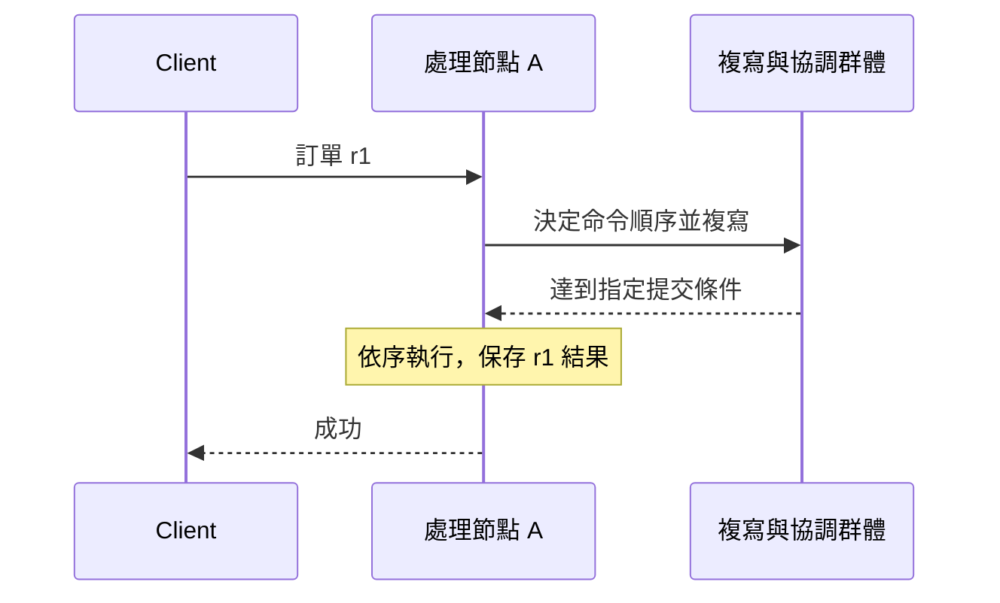

# Chapter 00 — 課程簡介與系統設計視角 (Course Introduction)

## 1. 一個庫存數字為何需要多台電腦?

商店剩下最後一件商品. 兩筆訂單都送到同一台機器時, 服務可以依序處理. 第一筆買走商品, 第二筆便看到庫存為 0. 如果加一台機器接手故障, 兩台都可能在同一時間看到庫存為 1. 這時得先約定誰能扣庫存, 以及收到哪些回覆才能告知客戶下單成功.

**分散式系統 (Distributed System)** 由多台透過網路連接的電腦組成, 各元件互傳訊息以協調工作. 把狀態複製給其他機器, 是為了一台壞掉時還有副本 (Replica) 可以接手. 把運算拆給多台機器, 則是為了同時處理更多工作. 例如 MapReduce 把大批資料分給多台機器運算, 資料庫則可把同一筆資料存到多處. 兩種設計都要面對訊息多久會到, 以什麼順序到, 以及沒有收到回覆時該怎麼辦.

## 2. 用一個訂單服務看取捨

沿用只剩一件商品的例子. 用戶端 (Client) 把訂單送給 A. 這個方案用複寫 (Replication) 保留 "嘗試扣一件庫存" 這道命令. 副本依共同順序執行, 都會讓排在第一筆的訂單買到商品.

1. Client 產生唯一 `request_id=r1`, 送到 A.
2. A 檢查請求, 協調命令順序, 將"嘗試扣一件庫存"寫入複寫流程.
3. 命令達到協定的提交條件後, A 才按順序執行, 把庫存從 1 扣到 0.
4. 庫存和 `r1` 的結果一併寫入應用狀態, A 再回覆成功. 落後副本依序補上相同命令, 也就得到相同的結果.

圖 0.1 - 一筆訂單從進入複寫群體到執行並回覆. 圖把群體內部協調合在一欄, 多數與持久保存條件留到 Chapter 02 (成大講義 P3–P6 與 MIT 6.5840 Lecture 6).

### 2.1 回覆遺失與部分故障

如果成功回覆在路上遺失, A 已扣完庫存, Client 只看得到逾時 (Timeout). 以相同的 `r1` 重試時, 已追上這筆命令的副本會回傳原本的成功結果. 這叫請求去重 (Request Deduplication). 庫存變更和去重紀錄要一起複寫與回復, 否則接手副本可能找不到舊結果, 把同一筆請求當成新訂單.

A 與 B 失聯時, 兩台可能都還能接請求. 這是部分故障 (Partial Failure). 如果兩邊各自賣出最後一件商品, 網路修好後也無法收回已交付的成功結果. 一致性 (Consistency) 在此要求只讓一筆訂單成功. 要守住這項承諾, 無法取得寫入權限的一側得暫停接單, 因而犧牲這一側的可用性 (Availability).

### 2.2 架構比較

| 設計 | 可取得的好處 | 明確成本與限制 | 需再回答的問題 |
| --- | --- | --- | --- |
| 單節點保存全部狀態 | 本地排序與交易邊界較單純 | 節點故障會中斷服務; 受單機資源限制 | 如何持久化與備份? |
| 非同步複寫 | 回覆可不等待遠端持久化; 讀副本可分散流量 | failover 可能缺少尚未複寫的更新; 讀值可能落後 | 接受多少資料遺失與讀取延遲? |
| 協調式日誌複寫 | 在故障模型與 quorum 規則內保護已提交順序 | 寫入需跨節點往返與可靠保存; 失去多數時停止進展 | 如何選 Leader, 恢復歷史與提供讀取? |
| 分區儲存 (Sharding) | 不同鍵由不同節點承擔, 分散容量與負載 | 跨分區操作需額外協調; hot key 仍可能集中 | 鍵如何路由與遷移? 跨分區交易如何完成? |

分區儲存與網路分區 (Network Partition) 是兩個不同概念: 前者是主動分配資料, 後者是網路故障造成的隔離. 它們可以同時出現.

## 3. 課程各單元的原理連結

- [01 邏輯時鐘與全域狀態](01-logical-clocks-checkpointing.md) 從跨機訊息找出事件先後. 轉帳已扣款但尚未入帳時, 快照還得把在途的款項一起記下.
- [02 容錯與共識](02-fault-tolerance-paxos-raft.md) 處理並行訂單該先執行哪一筆. 共識 (Consensus) 決定每個日誌位置的命令, 副本再依序執行.
- [03 ZooKeeper](03-zookeeper.md) 用共同的更新順序維護設定, 成員名單與排隊狀態. 全序廣播 (Total Order Broadcast) 關心參與者是否以同樣的順序交付更新.
- [04 對等網路與 Gossip](04-peer-to-peer-gossip.md) 回答大型網路的兩個問題. 要找指定檔案, 可以用分散式雜湊表定位. 要傳播更新, 則可讓對等節點分攤通知工作.

後續的一致性模型 (Consistency Model) 會接著問, 即使找到了存資料的節點, 它回傳的版本是否符合讀寫承諾. 同樣的問題也會出現在 HBase, Kafka 與區塊鏈中, 各系統採用的機制和保證各有前提.

## 4. 課程安排與評分

成大 2026 年秋季分散式系統課程由蕭宏章 (Hung-Chang Hsiao) 教授授課. 課表時段為週五 09:00–12:00, 講義列連續授課區段為 150 分鐘, 並未指定必備教科書. 下列評分與課表為開學講義的暫定安排.

### 4.1 評分與試題形式

| 項目 | 比例與規則 |
| --- | --- |
| Written Examination | 70%; Week 13, 20 題單選 |
| Student Presentation | 20%; 小組專題或文獻報告 |
| Attendance | 10%; 每次點名 1%, 最多 10% |

筆試為全英文單選. 三個示例分別問快照的 Marker 如何畫出通道邊界, ZooKeeper 的鎖為何監看前一位, 以及 Paxos 何時必須沿用舊值.

### 4.2 小組報告與主題

全班 12 組, 每組約 5 人. 每組有 25 分鐘, 分為 18 分鐘報告, 5 分鐘問答和 2 分鐘換場. 由一人主講, 其他組員可答詢. 題目採先選先得. 評分看是否能用課堂理論解釋系統機制, 報告結構和時間控制. 微型叢集展演另評估操作流暢度與故障情境驗證.

| 分類 | 報告主題 |
| --- | --- |
| Paper Review | Google Spanner, Raft, Amazon Dynamo, PBFT |
| Architecture Analysis | Apache Pulsar vs. Kafka, Redis Cluster, Elasticsearch, TiDB |
| Mini-Project & Live Demo | ZooKeeper 容錯與選舉, Spark RDD 容錯, HDFS NameNode 高可用性, 分散式鎖與狀態還原 |

Raft 的兩個報告方向可直接從 [Raft Extended Version](https://raft.github.io/raft.pdf) §6 的成員變更與 §7 的日誌壓縮開始讀.

微型叢集的課堂建議為 3–4 個節點, 每個節點配置 2 vCPU, 4 GB RAM 和 20 GB 磁碟空間. 講義列出 Google Cloud Platform 與 GitHub Student Developer Pack 作為準備展演環境的管道.

### 4.3 逐週課表

| Week | 日期 | 主題/安排 |
| --- | --- | --- |
| 1 | 09/11 | Introduction, System Models, Logical Clocks & Global States |
| 2 | 09/18 | Instructor Away/External Speech; No Class |
| 3 | 09/25 | Mid-Autumn Festival; No Class |
| 4 | 10/02 | Fault Tolerance & Paxos |
| 5 | 10/09 | National Day Substituted Holiday; No Class |
| 6 | 10/16 | ZooKeeper |
| 7 | 10/23 | P2P & Gossip |
| 8 | 10/30 | Consistency, Replication, Transactions |
| 9 | 11/06 | Departmental Review/Flexible Learning; No Class |
| 10 | 11/13 | LevelDB & HBase |
| 11 | 11/20 | HDFS, MapReduce, YARN, Spark |
| 12 | 11/27 | Kafka/Stream Processing |
| 13 | 12/04 | Blockchain 與 Written Examination |
| 14 | 12/11 | Student Presentations I |
| 15 | 12/18 | Student Presentations II 與 Course Conclusion |
| 16 | 12/25 | Constitution Day; No Class |
| 17 | 01/01 | Founding Day; No Class |
| 18 | 01/08 | Flexible Learning; No Class |

講義的週次標示有出入. 後續章節的 P 編號一律指合併講義的實體頁碼.

## 5. 如何閱讀後續技術筆記?

先用一筆請求走完正常流程. 寫下誰收到訊息, 哪一刻保存資料, 何時能回覆成功. 然後把故障插在兩個步驟之間, 例如 A 已保存訂單結果卻還沒回覆. 此時換 B 接手, 應能說清楚 B 憑哪一筆紀錄判斷這是重試, 以及還有哪些資料得從其他副本取回.

## 6. 英文選擇題與逐項解析

### Q1 — Partial failure

Which scenario best illustrates partial failure in a distributed system?

- A. One server is unreachable while other servers continue processing requests.
- B. Every component is guaranteed to stop at exactly the same time.
- C. A local variable is renamed without changing behavior.
- D. Two processes on one host always share the same state.

**答案: A.** A: 系統仍局部運作, 符合定義. B: 全體同時停止不呈現部分可達的困難. C: 不是故障行為. D: 不是分散式故障模型, 也非一般程序保證.

### Q2 — Replication

Why is copying data to multiple servers insufficient by itself to guarantee a consistent service?

- A. Replicas cannot communicate over networks.
- B. Replicas may observe concurrent requests in different orders unless a protocol defines the required behavior.
- C. Every replicated service must use Blockchain.
- D. Physical clocks automatically determine a unique correct command order.

**答案: B.** A: 複寫本來可透過訊息. B: 命令順序與故障行為需要協定. C: 有多種複寫與協調方法. D: 時鐘誤差與並行操作不能自動解決應用競爭.

### Q3 — Selling during a partition

Two replicas both report one item in stock, then lose contact with each other. Which policy protects against confirming two sales?

- A. Allow either replica to confirm whenever its local stock is nonzero.
- B. Allow a replica to confirm only after meeting the write protocol's coordination requirement.
- C. Treat every network timeout as proof that the other replica stopped.
- D. Merge both successful orders after connectivity returns.

**答案 B.** A 的本地庫存可能在兩側都還是 1. B 讓無法取得寫入權限的一側先暫停. C 無法從逾時判定遠端是否仍在接單. D 事後合併已來不及撤銷兩份成功回覆.

### Q4 — Timeout and retry

A client times out after submitting an order. Which design most directly helps prevent duplicate execution when it retries?

- A. Treat every retry as a new unrelated order.
- B. Assume a timeout proves that no state changed.
- C. Remove all durable records to make the retry faster.
- D. Reuse a unique request ID and preserve the processed result in the service's state.

**答案: D.** A: 可能重複處理. B: 無法從無回覆推得未執行. C: 破壞恢復與去重資訊. D: 讓服務辨認同一邏輯請求. 仍需可靠保存與正確複寫.

## 7. 參考資料與投影片對應

| 講義 | 主題 | 算例與圖解 |
| --- | --- | --- |
| P1–P5 | 透過訊息合作與共用資源 | 圖 0.1, 庫存 $1\to0$, 重送 r1 |
| P6 | 因果, 回復, 共識與路由 | 訂單案例和 01–04 的連結 |
| P7–P10 | 從機制, 情境與安全性出題 | Marker, 前驅 Watch, 歷史值採用 |
| P11–P17 | 報告, 暫定政策與課表 | 三類主題與週次 |

- van Steen 與 Tanenbaum, [Distributed Systems, 第 4 版](https://www.distributed-systems.net/index.php/books/ds4/), PDF P19–P20, P26–P27, P31–P32. 網路化系統, 資源共享與透明性.
- 大學教材 [MIT 6.5840 Lecture 1 — Introduction](https://pdos.csail.mit.edu/6.824/notes/l01.txt) 的部分故障與設計取捨, 以及 [Lecture 6 — RSM and Raft](https://pdos.csail.mit.edu/6.824/notes/l-raft.txt) 的複寫與回覆路徑.
- 原始論文 [Raft Extended Version](https://raft.github.io/raft.pdf) §6–§7, 核對 Membership Change 與 Log Compaction.

教材身份, 頁序與版本差異集中在 [教材紀錄](../reference/README.md). 本章課程政策只依提供的 PDF, 未宣稱核對過最新課務公告.
