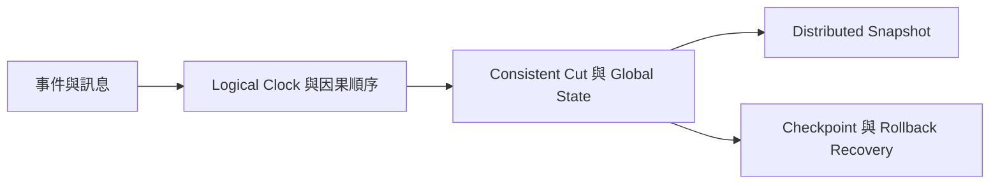
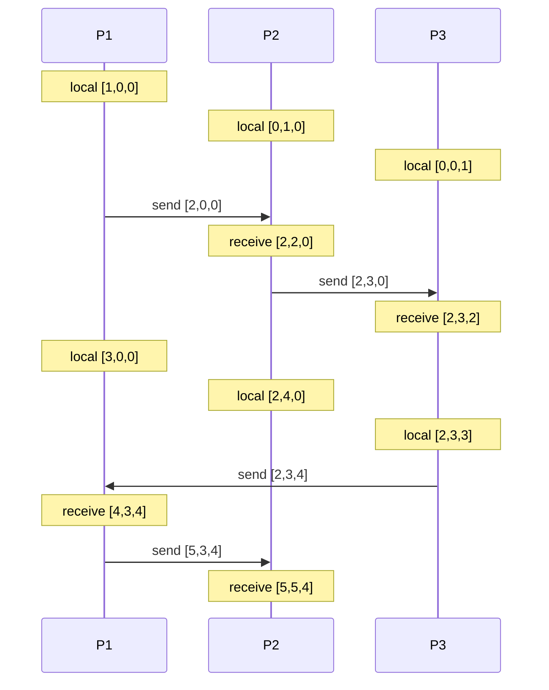
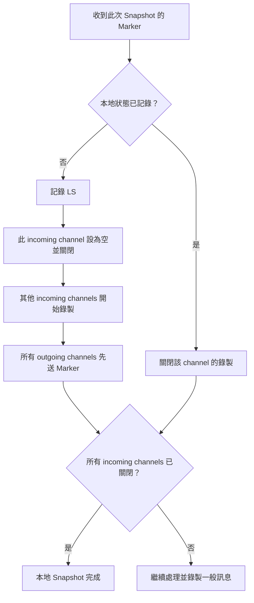
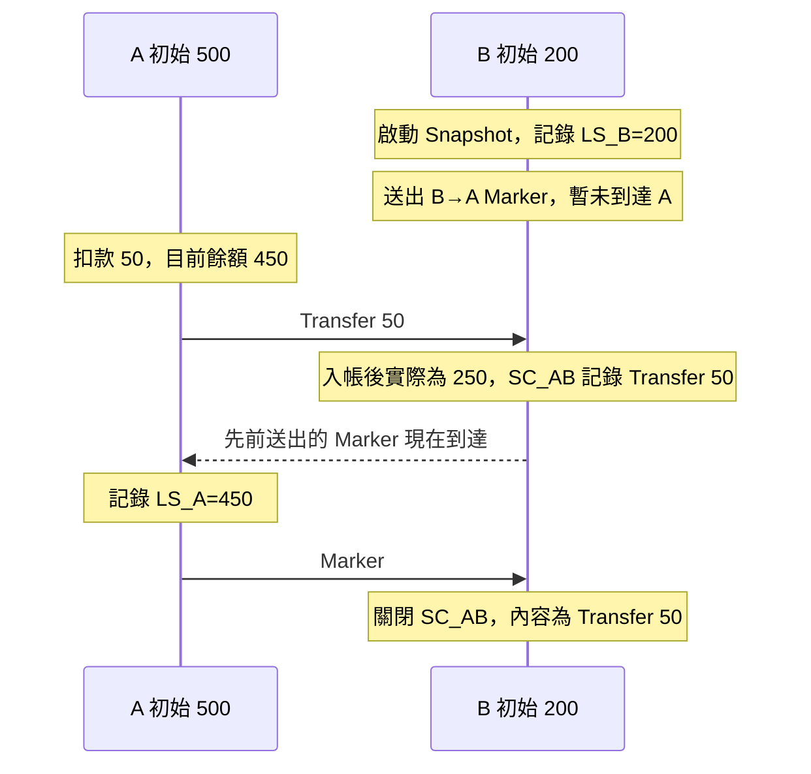
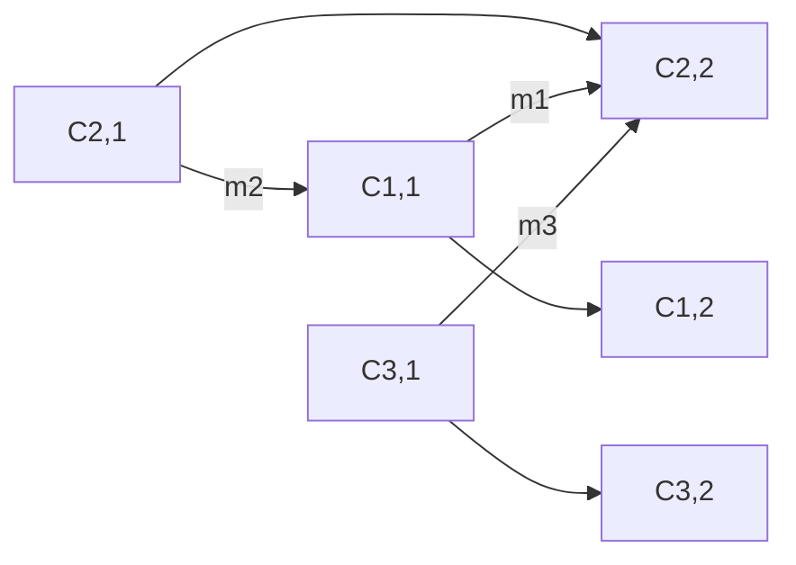

# Chapter 01 — 邏輯時鐘、全域狀態與檢查點（Logical Clocks, Global States, & Checkpointing）

## 1. 本章要解決什麼問題？

> 課程依據：P19–P22、P28、P35。延伸：原文書 §5.2（PDF P276–P287）、§8.6（PDF P552–P558）。

分散式程式沒有能原子讀取所有節點的共享記憶體。即使每台機器都能讀取自己的時間，訊息的延遲、時鐘漂移與處理暫停，仍使「哪件事先發生」和「大家現在的狀態」成為兩個不同問題。

第一個問題是**因果關係（Causality）**：若 B 的執行可能受到 A 的影響，就不能把 B 排在 A 之前。邏輯時間用事件與訊息建立順序，不要求全體時鐘顯示同一秒。

第二個問題是**全域狀態（Global State）**：若 A 已扣款、B 尚未入帳，這筆錢並沒有消失，而是存在傳輸中的訊息內。只把所有節點的記憶體各拍一張照片，可能漏掉在途資料，甚至記錄出「已收款、但從未付款」的矛盾。

第三個問題是**回復（Recovery）**：節點故障後，最新的各自備份不一定能共同構成合法狀態。若 B 保留了 A 回滾後不再存在的訊息，B 也可能被迫回滾。



圖為概念依賴，不表示所有 Snapshot 實作都必須先交換 Vector Clock。Chandy–Lamport 本身使用 Marker 與 channel 順序建立邊界。

## 2. 事件模型與 Happens-before

> 課程依據：P21–P23。延伸：原文書 PDF P276–P278；[Lamport 1978 原論文](https://lamport.azurewebsites.net/pubs/time-clocks.pdf)，事件偏序與 Clock Condition。

### 2.1 定義與假設

將執行視為歷史 `H` 中的事件集合。每個處理程序 `P_i` 的事件有本地順序，事件可為本地計算、`send(m)` 或 `recv(m)`。一次訊息接收與其傳送配對；此處不將訊息副本當作新的原始傳送。

**先發生關係（Happens-before Relationship，也常寫 Happened-before）** 記作 `a → b`，是下列規則形成的最小傳遞關係：

1. 同一程序中，a 在 b 之前執行，則 `a → b`。
2. `send(m) → recv(m)`。
3. 若 `a → b` 且 `b → c`，則 `a → c`。

若既無 `a → b`，也無 `b → a`，稱為**並行事件（Concurrent Events）**，記作 `a ∥ b`。這代表模型內沒有因果路徑，不代表兩事件在實體世界同時發生，也不保證它們寫入相同資料時不會衝突。

例如 P1 編輯文件後傳給 P2，P2 收到後產生摘要，編輯先於摘要；P3 在未取得文件或相關訊息前獨立修改另一份副本，則與 P1 的編輯可能並行。人類透過電話傳遞的資訊若未建模，也不會出現在本系統的因果圖中。

### 2.2 因果偏序與實體時間不能互換

**偏序（Partial Order）** 允許某些事件不可比較；**全序（Total Order）** 則要求任兩個不同事件均可排序。為並行事件決定固定先後可便利排程，但這個額外順序不是新發現的因果關係。

| 機制 | 回答的問題 | 可依賴的語義 | 成本與限制 | 用途 |
| --- | --- | --- | --- | --- |
| 實體時鐘（Physical Clock） | 大約何時、經過多久？ | 取決於同步誤差與單調性保證 | 需校時；wall clock 可能調整；未知誤差不能證明跨機因果 | 時間顯示、帶誤差界限的時間協定 |
| Lamport Clock | 能否給出符合因果的數字順序？ | `a → b` 必有 `L(a) < L(b)` | 每事件與每訊息一個計數器；反向不成立 | 事件排序、協定編號的設計背景 |
| Vector Clock | 哪個事件已知哪些因果歷史？ | 在固定程序模型下可辨認因果與並行 | 每訊息 O(N) metadata、合併 O(N)；成員變動需額外設計 | 因果除錯、版本衝突判讀 |

技術補充：程序內測量 timeout 應使用適當的 monotonic clock；邏輯時鐘不以秒為單位，不能直接取代 timeout。只有在明確同步誤差界限下，實體時間才可支援更強的時間判斷。

## 3. Lamport Logical Clock

> 課程依據：P22–P24。延伸：原文書 §5.2.1；[Time, Clocks, and the Ordering of Events in a Distributed System](https://lamport.azurewebsites.net/pubs/time-clocks.pdf)。

### 3.1 狀態與更新規則

每個 `P_i` 維護非負整數 `L_i`，初值為 0。本章採每事件增加 1；講義的增量 d 以 1 為典型值。

```text
local_event at P_i:
    L_i := L_i + 1
    timestamp(event) := L_i

send(m) at P_i:
    L_i := L_i + 1
    attach L_i to m

receive(m, t) at P_i:
    L_i := max(L_i, t) + 1
    timestamp(receive) := L_i
    deliver m to application
```

一次接收只算一個事件，不能合併後再額外增加兩次。傳送所夾帶的是傳送事件遞增後的值。延遲訊息仍可接收：舊 timestamp 不會使本地計數器倒退。

### 3.2 講義 P24 的完整核算

下表依圖中箭頭重建。P1→P2 傳送值 2，P2→P3 傳送值 4，P3→P1 傳送值 7，P1→P2 傳送值 9。橫列只展示各程序本地事件順序，不將不同程序的同欄視為同時。

| 程序 | 由左至右的本地事件與 timestamp |
| --- | --- |
| P1 | local 1 → send 2 → local 3 → recv 8 → send 9 |
| P2 | local 1 → recv 3 → send 4 → local 5 → recv 10 → local 11 |
| P3 | local 1 → recv 5 → local 6 → send 7 |

逐次接收核算：

1. P2 原為 1，收到 P1 的 2：`max(1,2)+1 = 3`。
2. P3 原為 1，收到 P2 的 4：`max(1,4)+1 = 5`。
3. P1 原為 3，收到 P3 的 7：`max(3,7)+1 = 8`。
4. P2 原為 5，收到 P1 的 9：`max(5,9)+1 = 10`。

每條箭頭都滿足 send timestamp 小於 receive timestamp；各程序本地值嚴格遞增。這兩項查核足以檢查本例是否遵循更新規則。

### 3.3 為何滿足 Clock Condition？

[教學補充／推導] 同一程序的事件都遞增，故保留本地先後；接收時取最大值再加一，故接收必大於傳送。任一因果路徑都是這兩種邊串接，整數 `<` 具有傳遞性，因此 `a → b ⇒ L(a) < L(b)`。

但逆向不成立。假設 P1 在沒有收發訊息時執行兩個事件，timestamp 為 1、2；P2 獨立執行三個事件，timestamp 為 1、2、3。P1 的第二個事件值 2 小於 P2 的第三個事件值 3，兩者仍可能沒有因果關係。

為取得全序，可將事件標為 `(L_i, process_id)` 並採字典序：先比計數器，再比唯一程序 ID。這只會替並行事件補上固定順序，沒有增加因果資訊。

### 3.4 故障與實作邊界

- 訊息重送會產生額外接收事件，時鐘規則本身不去重；應用若不可重複執行，仍需 request ID。
- 程序重啟若重用 ID 且計數器歸零，事件標記可能重複。需要持久化計數器、incarnation／epoch，或重新分配身份；單純加一無法處理身份重用。
- 對所有 timestamp 排序不等於所有節點已知道完整事件集合。即使本地已收到事件 20，仍可能有事件 10 延遲中；可安全交付的全序廣播還需要訊息協定。

## 4. Vector Clock：用向量保存因果歷史

> 課程依據：P25–P27。延伸：原文書 §5.2.2，PDF P282–P287（印刷 pp.266–271）。

### 4.1 為何是一個向量？

若只保存所有歷史事件 ID，接收者可把兩份歷史取聯集來知道因果關係，但資訊會持續膨脹。同一程序的事件形成前綴：知道 P1 第 5 個事件，就隱含知道前 4 個。因此每個程序只需保留每個來源目前已知的最大事件序號。

**向量時鐘（Vector Clock）** `V_i[1..N]` 中，`V_i[i]` 是 P_i 已執行的事件數；`V_i[j]` 是 P_i 已知 P_j 至少執行到哪個事件。它不是 P_j「當下」的即時狀態。

假設程序集合固定、身份唯一、每一相關事件均計數、所有因果訊息攜帶 timestamp，且沒有未建模的共享通道。初始皆為零向量。

```text
local/send event at P_i:
    V_i[i] := V_i[i] + 1
    if sending: attach a COPY of V_i

receive(message_vector W) at P_i:
    for k = 1..N:
        V_i[k] := max(V_i[k], W[k])
    V_i[i] := V_i[i] + 1
```

傳送時要附上值的副本，不能讓後續本地修改改變已送訊息的 timestamp。

### 4.2 講義 P26 的向量時間軸

沿用 P24 的四條訊息箭頭，這次維度固定為 `[P1,P2,P3]`：

| 程序 | 由左至右的事件向量 |
| --- | --- |
| P1 | `[1,0,0]` → send `[2,0,0]` → `[3,0,0]` → recv `[4,3,4]` → send `[5,3,4]` |
| P2 | `[0,1,0]` → recv `[2,2,0]` → send `[2,3,0]` → `[2,4,0]` → recv `[5,5,4]` → `[5,6,4]` |
| P3 | `[0,0,1]` → recv `[2,3,2]` → `[2,3,3]` → send `[2,3,4]` |

例如 P1 收到 `[2,3,4]` 時，本地為 `[3,0,0]`。逐分量最大為 `[3,3,4]`，再將第一分量加一，得到 `[4,3,4]`。P2 最後接收前為 `[2,4,0]`，與 `[5,3,4]` 合併成 `[5,4,4]`，第二分量增加後為 `[5,5,4]`。



圖省略 P2 最後的 local `[5,6,4]`；不同程序 local Note 的垂直位置僅為一個可行交錯，不增加原圖沒有的因果邊。

### 4.3 比較規則與可核算例子

對同維度向量 X、Y：

- `X ≤ Y`：每個分量都滿足 `X[k] ≤ Y[k]`。
- `X < Y`：`X ≤ Y` 且 `X ≠ Y`；不要求每個分量都嚴格小於。
- `X ∥ Y`：既非 `X ≤ Y`，也非 `Y ≤ X`。

講義 P27：`[2,1,0] < [2,2,0]`，因為所有分量不大於、第二分量嚴格較小；`[2,1,0] ∥ [1,2,0]`，因為第一分量前者大、第二分量後者大。

回到完整時間軸：P1 的 local `[3,0,0]` 與 P2 的 send `[2,3,0]` 不可比較，因此並行；P2 的 send `[2,3,0] < P1` 的 recv `[4,3,4]`，存在 P2→P3→P1 的因果路徑。

在本節模型內，事件 `a → b` 當且僅當 `V(a) < V(b)`。合併會保留所見來源前綴，自己的分量又區分本地新事件，因此向量能表達因果歷史包含關係。若漏傳 metadata 或重用身份，便不能直接套用這個等價式。

| 比較面向 | Lamport Clock | Vector Clock |
| --- | --- | --- |
| 表示 | 一個非負整數 | N 個計數器 |
| 因果推論 | `a → b` 可推出數字遞增；反向不成立 | 在完整事件模型下，向量嚴格偏序與因果等價 |
| 並行辨識 | 不同數值也可能並行，無法僅靠兩 timestamp 判定 | 分量不可比較即並行 |
| 全序 | 可用程序 ID 打破平手 | 自然保留偏序；要全序仍需額外規則 |
| 網路與 CPU 成本 | 每訊息 O(1)，更新 O(1) | 每訊息 O(N)，合併 O(N) |
| 成員變動 | ID／重啟編號仍需管理 | 維度、退休 ID、歷史壓縮均需額外協定 |

### 4.4 真實用途與限制

[延伸補充] 原文書 §5.2.2 用因果歷史解釋向量。工程上可讓兩份資料版本攜帶向量，判定一份是否涵蓋另一份的更新；若並行，應交給合併規則或使用者解衝突。向量只能指出並行，不能替應用選出「正確內容」。P12 將 Amazon Dynamo 的 Vector Clocks 列為報告方向；此處不把所有 Dynamo 系統或現行產品概括為採用同一版本機制。

網路分區時，各側仍能產生自己的事件，合併時會保留並行資訊；但這不等於完成 Consensus，也不會保證所有副本即時相同。

[原始論文／延伸補充] [Dynamo: Amazon's Highly Available Key-value Store](https://cdn.amazon.science/ac/1d/eb50c4064c538c8ac440ce6a1d91/dynamo-amazons-highly-available-key-value-store.pdf)（2007），§4.4 使用 Vector Clock 追蹤物件版本因果：可比較時捨棄被涵蓋的舊版本；無法比較時保留分歧，由應用進行語義合併。自製例：共同版本 `[1,0]` 之後，兩側分別更新為 `[2,0]`、`[1,1]`，兩者並行，不能只因第一分量 2 較大就覆蓋另一份。這是該論文的版本管理設計，不等同宣稱現行 DynamoDB 仍以相同外部介面暴露此機制。

## 5. Global State 與 Consistent Cut

> 課程依據：P28–P30。延伸：[Distributed Snapshots](https://lamport.azurewebsites.net/pubs/chandy.pdf)，§2–§3。

### 5.1 Local State 加上 Channel State

令 `LS_i` 為 P_i 的本地狀態，`SC_ij` 為有向 channel P_i→P_j 的狀態。全域狀態可寫成 `GS = ({LS_i}, {SC_ij})`；使用集合族／tuple 表示避免將不同節點的變數混在一起。`SC_ij` 包含已送出但未在接收端快照內收到的訊息，稱為**在途訊息（In-transit Messages）**。

**截面（Cut）** 在每個程序選擇一個本地事件前綴。截面內是 PAST，之後是 FUTURE。**一致截面（Consistent Cut）** 必須對因果前驅封閉：若 `b` 在 Cut 內且 `a → b`，則 a 也必須在內。

對一次可靠、非重複訊息傳遞，P29 的 C1／C2 可改寫為下表：

| send 在 Cut 內？ | receive 在 Cut 內？ | Channel State | 判定 |
| --- | --- | --- | --- |
| 是 | 是 | 不再包含該訊息 | 已完整處理 |
| 是 | 否 | 必須包含該訊息 | 合法在途 |
| 否 | 否 | 不包含該訊息 | 尚未傳送 |
| 否 | 是 | 無法補救 | 不一致：收到來自 FUTURE 的訊息 |

因此「send 在內、receive 在外」是合法情況，不是每條跨越 Cut 的箭頭都錯誤。若模型容許丟包或重複，channel 狀態與接收語義要重新定義，不能直接用這張守恆表。

### 5.2 一致與不一致的具體截面

[教學補充／推導] P1 的事件依序為 `a=send(m)`、`b=local`；P2 依序為 `c=local`、`d=recv(m)`。

```text
P1: ---- a:send(m) -------- b:local -------->

              \ m
P2: ---- c:local --------- d:recv(m) ------->

Cut X = (P1 到 a，P2 到 c)：m 在途，合法。
Cut Y = (P1 到 a 之前，P2 到 d)：有 recv 無 send，不合法。
Cut Z = (P1 到 b，P2 到 d)：send、recv 都已包含，合法。
```

講義 P30 的 C1 屬 Cut Y，m1 從 FUTURE 進入 PAST；C2 為一致截面，但 m4 的 send 已包含、receive 尚未包含，故 channel state 必須記錄 m4。

### 5.3 為何不能只同時向所有節點詢問？

不同節點收到詢問的時間不同。若接收端在入帳後回覆、送出端卻回報扣款前的狀態，兩份結果可能雙算金額。實體時間約略接近也不能消除此交錯；需要建立相互一致的邏輯邊界與 channel state。

## 6. Chandy–Lamport Distributed Snapshot

> 課程依據：P31–P34。延伸：[Chandy 與 Lamport 1985](https://lamport.azurewebsites.net/pubs/chandy.pdf)，Marker 規則、可達狀態與 stable property；原創流程補全如下。

### 6.1 典型版本的前提

**分散式快照（Distributed Snapshot）** 要在正常運算繼續時，取得一個邏輯一致的全域狀態。典型 Chandy–Lamport 假設：

- 有向 channel 可靠、**先進先出（First-In, First-Out, FIFO）**，傳送的訊息最終到達。
- 參與節點在此次 Snapshot 期間不故障；每個需要參與的程序均可由啟動者沿 channel 到達。
- 本地記錄與 Marker 排序可正確執行：記錄後，在各 outgoing channel 上先送 Marker，再送後續一般訊息。
- Marker 與一般訊息遵循同一 channel 的 FIFO 順序；不能讓控制通道任意超車資料通道。

Snapshot 不要求全域暫停。只有本地記錄與發 Marker 的必要順序需要原子性或適當同步；不是把所有業務一直凍結到快照完成。

### 6.2 角色、狀態與完整規則

Marker 是界定 channel 邊界的控制訊息，不是時間戳或故障投票。每個程序針對此次 Snapshot 維護：`recorded`、已記錄的 `LS`、各 incoming channel 是否仍在錄製、各 `SC`。若支援多個 Snapshot，Marker 與狀態還須帶 snapshot ID。

1. **啟動者** 先記錄自己的 LS，對所有 incoming channel 開始錄製一般訊息，再在所有 outgoing channel 發 Marker。
2. **首次收到 Marker 的程序** 先記錄 LS，將該 Marker 進入的 channel 記為空且已關閉；對其他 incoming channel 開始錄製，再對所有 outgoing channel 發 Marker。
3. **已記錄 LS 的程序再收到 Marker**：關閉該 incoming channel；其 SC 為本地記錄後、該 Marker 到達前收到的一般訊息。
4. 一般訊息照常交給應用；若相應 channel 正錄製，再把訊息副本加入該 SC。
5. 當本地 LS 已記錄且所有 incoming channel 均關閉，本地部分完成；全域完成還需要收集所有參與者的結果。收集者與完成通知不是 Marker 核心規則自動提供的服務。



圖不包含啟動者的主動開始分支；啟動者遵循第 1 步。首次 Marker channel 為空，是因為該 channel 在 Marker 前的訊息都已先到，且已包含於剛記錄的 LS。

### 6.3 講義 P33：轉帳 50 元的完整推演

初始 A 有 500 元，B 有 200 元。一次傳送代表 A 扣款 50；一次接收代表 B 入帳 50。假設 A→B、B→A 各為 FIFO channel，本例無其他轉帳。



圖以 Note 標示 B 提早送出但尚未到達的 Marker，待轉帳入帳後才畫出其到達；以下事件表列出同一個精確交錯。

| 步驟 | 事件 | 實際餘額 A／B | 快照錄製結果 |
| --- | --- | --- | --- |
| 0 | 尚未啟動 | 500／200 | 無 |
| 1 | B 記錄並送 Marker | 500／200 | `LS_B=200`；開始錄 A→B |
| 2 | A 尚未收到 Marker，扣款並送 50 | 450／200 | 快照 A 尚未記錄 |
| 3 | B 收到 50 | 450／250 | `SC_AB={50}`；`LS_B` 仍為 200 |
| 4 | A 收到 B 的 Marker | 450／250 | `LS_A=450`；`SC_BA=空`；送 Marker |
| 5 | B 收到 A 的 Marker | 450／250 | `SC_AB` 關閉 |

快照總額為 `450 + 200 + 50 = 700`。若只加本地狀態，會得到 650，漏掉在途款項；若又把 B 的當下 250 加入，則混用不同時間的狀態而雙算。

### 6.4 正確性的核心理由

[教學補充／推導] 對任一 channel P_i→P_j，考慮訊息 m：

- 若 send(m) 在 P_i 記錄前，Marker 排在 m 後。若 P_j 在記錄前收到 m，它已進入 LS_j；若在記錄後收到，則因 FIFO 必先於 Marker 到達，會進入 SC_ij。
- 若 send(m) 在 P_i 記錄後，Marker 必先於 m 送出，故 P_j 不會把 m 當成記錄前的訊息：首次 Marker 會先使它記錄 LS，或既有錄製已被該 Marker 關閉。

所以每筆記錄前的傳送，恰好被接收端 LS 或 SC 收錄；記錄後的傳送不會倒流到快照過去。這是 FIFO 與 Marker-before-data 順序共同造成的結果。

### 6.5 非 FIFO、延遲與故障反例

**非 FIFO 反例**：A 先送 m，再記錄狀態並送 Marker；若 Marker 超車先到 B，B 首次記錄時將 A→B 記為空。稍後 m 才到，已不會錄到 SC。A 的快照包含傳送、B 的快照未包含接收、channel 也沒有 m，資料遺失。不能只把 Marker 放到另一個更快的控制連線就宣稱適用。

另一個反例是 A 記錄後先送 Marker 再送 m，但 m 超車；B 可能先接收 m 再記錄，形成記錄後傳送卻進入記錄前接收的不一致。

訊息延遲只會延長典型演算法完成時間；若 Marker 永不到達、節點 crash 或拓樸不涵蓋全部參與者，就可能永遠無法完成。timeout 能標示快照未完成，不能把尚未關閉的 channel 擅自視為空。故障期間要取得 Snapshot，需另設重試、成員管理與可恢復狀態協定。

### 6.6 快照不一定在某個實體瞬間出現過

P34 的重點是：快照可對應到保留因果關係的另一種合法事件交錯，而不一定是原始 wall-clock 執行當下曾存在的狀態。並行事件可重排，不可重排有因果依賴的事件。

**穩定性質（Stable Property）** 一旦為真就不再變假，例如在適當封閉模型內的全域終止。若它在開始前已成立，快照也成立；若快照判定成立，依可達性可推出結束時成立。普通餘額條件可能先真後假，不能套用同一結論。偵測「目前沒人在運算」也不夠：若尚有在途工作訊息，系統未必終止。

## 7. Checkpoint、Rollback 與 Z-Cycle

> 課程依據：P35–P40。延伸：原文書 §8.6；[Netzer 與 Xu，Necessary and Sufficient Conditions for Consistent Global Snapshots](https://cs.brown.edu/research/pubs/techreports/reports/93/cs93-32.pdf)，§3。

### 7.1 快照與檢查點的差別

**檢查點（Checkpoint）** 是保存的程序中間狀態，供故障後重啟；`C_i,k` 表示 P_i 的第 k 個 checkpoint，k 只在該程序內排序。`C_i,0` 為初始 checkpoint。

**回滾回復（Rollback Recovery）** 把程序還原到較早正確狀態，再繼續或重播。所有程序各選一個 checkpoint，若包含 recv 卻沒有相應 send，就產生**孤兒訊息（Orphan Message）** 所反映的不一致。還原到記憶體快照並不會自動撤銷銀行外部付款或已寄出的 email；外部副作用需要額外的提交與去重設計。

| 面向 | Distributed Snapshot | Local Checkpoint | Consistent Global Checkpoint |
| --- | --- | --- | --- |
| 核心目標 | 取得可分析的全域狀態 | 保存單一程序重啟點 | 多程序可一起回復 |
| 一致性 | 必須包含 channel 與因果邊界 | 單獨存在不保證跨程序一致 | 每程序一份且無 orphan |
| 持久性 | 演算法本身不要求一定寫入可靠磁碟 | 回復用狀態需可靠保存 | 還需 channel／訊息回復方案 |
| 用途 | 除錯、終止／死結偵測、回復基礎 | 程序復原 | 分散式故障復原 |

### 7.2 講義 P36–P39：逐步重建依賴

以下依原圖順序重寫，並補上初始 `C_i,0`。`m3` 由 P3 傳向 P2，不能誤畫成 P2→P3。

```text
P1: C1,0 -- recv(m2) -- C1,1 -- send(m1) ----------- C1,2
P2: C2,0 -- C2,1 -- send(m2) -- recv(m1) -- recv(m3) -- C2,2
P3: C3,0 -------------------- C3,1 -- send(m3) ----- C3,2
```

這是本地順序清單，實際 send 必先於相應 recv；橫向字距不是全域時間比例。

| 訊息 | 傳送相對 checkpoint | 接收相對 checkpoint | 不能同選的組合 |
| --- | --- | --- | --- |
| m2 | P2 的 C2,1 之後 | P1 的 C1,1 之前 | C2,1 與 C1,1 |
| m1 | P1 的 C1,1 之後 | P2 的 C2,2 之前 | C1,1 與 C2,2 |
| m3 | P3 的 C3,1 之後 | P2 的 C2,2 之前 | C3,1 與 C2,2 |

先從初始集合 `{C1,0,C2,0,C3,0}` 出發，沒有訊息已接收，因而合法。若嘗試固定 C1,1：

1. 選 C2,1 或更早，P1 已有 recv(m2)，P2 卻尚未有 send(m2)，不合法。
2. 選 C2,2，P2 已有 recv(m1)，P1 卻尚未有 send(m1)，也不合法。
3. P2 在 send(m2) 與 recv(m1) 之間沒有 checkpoint，故已保存候選中沒有可搭配 C1,1 的版本。P3 如何選都不能修補這個矛盾。

C1,1 因而是此次已保存歷史中的無用 checkpoint；未來若只新增更晚的 P2 checkpoint，也不能移除其已包含的 recv(m1)。

### 7.3 Z-Path 的精確條件

[延伸補充] **之字路徑（Zigzag Path，Z-Path）** 由一串訊息構成：第一筆在起點 checkpoint 之後送出，最後一筆在終點 checkpoint 之前收到；相鄰訊息在中介程序的接收與下一次傳送，位於同一或後續 checkpoint interval。若位於同一 interval，下一次傳送允許早於前一次接收。

因此 Z-Path 不一定是 Happens-before 路徑。**之字循環（Zigzag Cycle，Z-Cycle）** 從一個 checkpoint 出發又回到自己，表示它無法延伸為一組一致的全域 checkpoint。

P37 中，自 C1,1 後送出的 m1 到達 P2；P2 在同一 checkpoint interval 已先送出 m2，而 m2 在 C1,1 前到達 P1。沿 m1、m2 形成回到 C1,1 的 Z-Cycle。這不是訊息穿越時間，也不是因果圖中有循環；允許同 interval 內反向銜接才是差別。

### 7.4 課程 R-Graph 與一致集合的選擇

**回滾依賴圖（Rollback-Dependency Graph，R-Graph）** 在 P38 以 checkpoint 作頂點。邊 `A → B` 表示選 B 時不能同選 A，必須在 A 所屬程序選更晚 checkpoint。它不是「A 故障就把 B 還原到 A」的指令。



圖重畫 P38，包含本地先後與原例的三條跨程序依賴。用路徑檢查排除直接與傳遞衝突；對「部分指定 checkpoint 能否擴充成全域集合」的普遍判定，仍須考慮可用候選與 Z-Path，不能把這張簡化圖當成所有模型的充分實作。

固定 `S={C1,2}`，依 P39：

1. C2,1 有 `C2,1→C1,1→C1,2` 路徑，排除；選 C2,2。
2. C3,1 有通往 C2,2 的 m3 邊，排除；選 C3,2。
3. 得到 `{C1,2,C2,2,C3,2}`。逐訊息核對 m1、m2、m3 的 send 與 recv 均已包含，沒有 orphan。

這是該例的成功選擇，不代表任意圖都能用一次不回頭的 greedy selection 找到所需集合。

### 7.5 Recovery Line 與 Domino Effect

**回復線（Recovery Line）** 是故障條件下可恢復的一組最近一致 checkpoints。比較「最近」須依各程序的本地順序及可用存檔，不把所有 k 相加就當成真實時間。

P40 是另一個時間軸：P1 在 C1,2 之後送出 mx，P2 在 C2,2 之前收到；P1 crash 後只能還原到 C1,2，send(mx) 遺失。P2 若保留 C2,2 就成為 orphan，因此回到 C2,1。圖中 P3 選 C3,2；沒有畫出其他訊息依賴，不能憑空要求 P3 也回到 C3,1。

[教學補充／推導] 以下補一個會一路回到初始狀態的 **骨牌效應（Domino Effect）** 完整例子：

```text
P: C_P,0 -- send(a) -- recv(b) -- C_P,1 -- send(c) -- CRASH
Q: C_Q,0 -- recv(a) -- send(b) -- recv(c) -- C_Q,1
```

1. 故障後初選 `{C_P,1,C_Q,1}`。Q 的 recv(c) 尚在，P 的 send(c) 已遺失。
2. Q 只有 C_Q,0 能回到 recv(c) 之前，故改成 `{C_P,1,C_Q,0}`。
3. 現在 P 的 recv(b) 還在，Q 的 send(b) 已遺失，故 P 也必須回到 C_P,0。
4. `{C_P,0,C_Q,0}` 沒有接收事件，是合法 Recovery Line；此前所有運算都要重做。

不是每次回滾都會 Domino；關鍵在互相依賴與可用 checkpoint 的位置。若 Q 在 recv(a) 後、send(b) 後且 recv(c) 前另有 checkpoint，可能保留更多工作。

### 7.6 回復選擇的通用檢查方法

[教學補充／推導] 在只有回滾、保存有限 checkpoints、未使用 Message Logging 的簡化模型中：

```text
S := 每個程序目前允許選擇的最新可用 checkpoint
repeat:
    找到一個訊息 m：recv(m) 被 S 包含，但 send(m) 未被 S 包含
    若不存在，停止
    將接收者改選為 recv(m) 之前最新可用 checkpoint
    若無此 checkpoint，無法在此候選集合中恢復
```

每次至少讓一個程序嚴格回到更早 checkpoint，候選有限，故會停止或回報缺少候選。終止後只證明沒有 orphan；還需把「send 已有、recv 未有」的訊息從可靠儲存恢復或重播。若 channel 狀態完全遺失，單純通過 orphan 檢查不代表可啟動正確系統。

P40 的 checkpoint 垃圾回收說法也要加條件：只有確認保留的全域 Recovery Line、必要訊息／日誌與故障涵蓋範圍都足夠，才可刪除更舊狀態。不能只選到一份 local checkpoint 就刪掉別台可能需要的歷史。

## 8. Checkpoint 技術的取捨與真實系統設計

> 課程依據：P35–P40。以下技術分類為延伸補充：原文書 PDF P552–P558，尤其 §8.6.2–§8.6.3。

| 方法 | 執行時機制與成本 | 故障後行為 | 主要限制 | 適用情境 |
| --- | --- | --- | --- | --- |
| 非協調式（Uncoordinated Checkpointing） | 各程序自行落盤；正常期間少協調訊息 | 分析依賴、多次回滾 | 無用 checkpoint、Domino、舊存檔保留壓力 | 能接受回復分析且依賴可追蹤的工作 |
| 協調式（Coordinated Checkpointing） | 共同建立一致邊界；可能阻塞或額外控制訊息 | 可直接選已完成的全域 checkpoint | 協調者故障與未完成批次需處理；落盤仍可能昂貴 | 希望回復流程單純的固定參與群體 |
| 通訊誘發式（Communication-Induced Checkpointing） | 夾帶依賴 metadata，必要時強制 checkpoint | 避免特定無用 checkpoint／Z-Cycle | 強制存檔時機難預測；正確性依協定而定 | 想保留局部自主性並限制回滾 |
| Checkpoint + Message Logging | 保存 checkpoint 與非決定事件／訊息順序；可能增加同步 I/O | 從 checkpoint 重播，減少重做工作 | 漏記非決定性會導致重播分歧；須處理 duplicate 與外部輸出 | 需精確重播且可負擔 logging 成本的服務 |

Message Logging 不只是把訊息 payload 寫檔。若程序會讀取隨機數、系統時間或競爭式執行緒結果，還要記錄會改變重播的非決定事件，或限制應用為可重播模型。少取 checkpoint 可以減少大型狀態落盤，但增加訊息日誌與回復設計成本。

實際設計可問三個可檢查問題：checkpoint 是否已可靠完成？回復所需的 channel／log 是否仍存在？重播的外部副作用能否去重？這些問題比「有備份所以容錯」更接近可實作的保證。

本章的 Snapshot／Checkpoint 也不等於下一章 Consensus 的 Replicated Log：前者在既有執行上找一致回復邊界，後者在執行之前先決定命令順序。兩者可結合，例如把已套用的日誌前綴壓成應用快照，但需額外記錄前綴位置與恢復規則。

### 8.1 實際系統：Flink 的 Barrier 與重播

[官方文件／延伸補充] [Apache Flink 2.1 Stateful Stream Processing](https://nightlies.apache.org/flink/flink-docs-release-2.1/docs/concepts/stateful-stream-processing/)以分散式快照與來源重播支援回復。Source 將 checkpoint barrier 插入串流，Operator 依 barrier 界定狀態；aligned checkpoint 在多輸入間對齊邊界，unaligned checkpoint 則記錄在途資料，以降低背壓時等待 barrier 的成本。它借用 Chandy–Lamport 的一致邊界思想，但配合 dataflow 與可重播來源設計，不能直接把所有模式當成第 6 節的原始 Marker 協定。

自製情境：快照記錄來源 offset=100 與累計總額=500，故障時已處理到 offset=105。回復先載入這份狀態，再從快照規定的位置重播後續資料，而不是只回復總額卻繼續從 106 讀取。否則 101–105 的效果可能遺失；若輸出端已對外寫入，又沒有交易或冪等機制，重播也可能造成外部重複。這說明一致快照與端到端輸出語義必須一起設計。

## 9. 常見誤解與速查

| 誤解 | 精確說法 |
| --- | --- |
| Lamport 值較小就一定造成較大的事件 | 只能由因果推出遞增，不能反推 |
| Concurrent 就是同一毫秒 | 是沒有已建模的因果路徑 |
| Vector 每分量都嚴格較小才算先於 | 全部分量不大於，至少一個嚴格較小即可 |
| 所有跨 Cut 的訊息都違法 | 已送未收是合法 channel state；已收未送才矛盾 |
| Marker 會同步各機實體時鐘 | Marker 建立 channel 邏輯邊界 |
| Snapshot 一定是某個真實瞬間 | 可以是因果等價重排中的可達狀態 |
| Snapshot 完成等於回復能力完成 | 還需持久化、訊息重建與外部輸出處理 |
| 各程序最新 checkpoint 一定最好 | 可能不一致並觸發連鎖回滾 |
| Z-Cycle 表示時間旅行 | 它是 checkpoint interval 上的 zigzag 依賴，不是因果循環 |

速查：`recv := max + 1`；Vector 使用逐分量 max 後只增自己的分量；Cut 要因果封閉；Snapshot 要記 local states 與 channels；Recovery Line 要避免 orphan 並具備可恢復的資料。

## 10. 英文選擇題與逐項解析

以下為自製練習，非教授原題；每題只有一個最佳答案。

### Q1 — Scalar timestamps

For events a and b on different processes, L(a)=4 and L(b)=9. Which statement is guaranteed?

- A. a happened before b.
- B. b happened before a.
- C. a and b are concurrent.
- D. b did not happen before a.

**答案：D。** A：數值順序不充分，可能並行。B：若 b→a，應有 9<4，矛盾。C：也可能 a→b，不能保證並行。D：由 Clock Condition 的逆否命題可排除 b→a。

### Q2 — Vector comparison

Let X=[3,1,2] and Y=[3,2,1] be valid event vector timestamps in the same execution. What is their relation?

- A. X happened before Y.
- B. Y happened before X.
- C. X and Y are concurrent.
- D. X and Y denote the same event.

**答案：C。** A：第三分量 2>1，X 不≤Y。B：第二分量 2>1，Y 不≤X。C：兩向均不成立。D：向量不同；在本章完整事件模型內也不會代表同一事件。

### Q3 — Channel state

A cut includes send(m) but excludes receive(m). Under reliable message delivery, how should a consistent snapshot represent m?

- A. Exclude m from every state.
- B. Include m in the corresponding channel state.
- C. Add receive(m) to the receiver's recorded local state without changing the cut.
- D. Declare every such cut inconsistent.

**答案：B。** A：漏掉已傳送的訊息。B：這正是在途訊息。C：會改變已選本地前綴，不能假裝 Cut 不變。D：只要 channel state 正確，這種截面合法。

### Q4 — Marker overtaking

A sends m before recording its local state, then sends a marker. The channel is not FIFO, and B receives the marker before m. What may go wrong in the standard algorithm?

- A. m may be absent from both B's recorded local state and the recorded channel state.
- B. All physical clocks must move backward.
- C. A marker necessarily becomes a Byzantine vote.
- D. The algorithm automatically retransmits every old message.

**答案：A。** A：B 首次 Marker 把 channel 設為空，m 遲到而漏記。B：Marker 不更新實體時間。C：故障模型與投票均無關。D：原始 Marker 規則沒有這個自動補救機制。

### Q5 — First marker

A process has not recorded its state when it receives the first marker on channel C. What is the recorded state of C in the standard FIFO algorithm?

- A. Every message ever sent on C.
- B. Every message received after the marker.
- C. The empty sequence.
- D. An arbitrary estimate based on elapsed time.

**答案：C。** A：過去已接收訊息反映於 LS，不應全部重記。B：Marker 之後屬快照邊界後的訊息。C：FIFO 保證 Marker 前訊息已先抵達。D：無已知延遲上界，不能靠 timeout 估計 channel 為空。

### Q6 — Rollback

P rolls back to a checkpoint before sending m, while Q's selected checkpoint includes receiving m. Without message logging, what must recovery do?

- A. Keep Q unchanged because receiving is always final.
- B. Roll Q back to a checkpoint before receiving m and recheck dependencies.
- C. Increase Q's Lamport clock until the inconsistency disappears.
- D. Treat Q's receipt as proof that P's lost state is still available.

**答案：B。** A：留下 orphan。B：先移除孤兒接收，再查是否引發其他依賴。C：改 timestamp 無法補回應用狀態。D：發生過傳送不代表其可恢復狀態仍在。

### Q7 — Zigzag paths

What distinguishes a zigzag path from an ordinary causal message path?

- A. A message may be received before it was physically sent.
- B. Every zigzag path is a causal path.
- C. The next send may precede the previous receive within the same checkpoint interval.
- D. Checkpoint intervals are irrelevant.

**答案：C。** A：個別訊息仍遵守 send→receive。B：Z-Path 較一般，不必為因果路徑。C：這是允許形成 Z-Cycle 的關鍵。D：是否同一或後續 interval 正是定義條件。

## 11. 可重跑的算例檢查

[教學補充／推導] 在 Repository 根目錄執行 `python tools/verify-examples.py`，不需第三方套件。程式核算 P24／P26 的全部事件、以事件祖先集合交叉檢查 225 組向量關係、驗證 P33 金額守恆、枚舉三程序各三份 checkpoint 的 27 種組合，並檢查本章的 Domino 回滾順序。

預期輸出包含 `PASS: P24/P26 timestamps and 225 event-pair causality checks`、`PASS: P33 conservation; 27 checkpoint combinations; R-Graph; domino trace`，最後為 `All finite example checks passed; this is not a full protocol proof.`。這是有限算例驗證，不是 Chandy–Lamport 或回復服務的完整實作測試。

## 12. 參考資料與閱讀定位

| 來源層級 | 來源與本章用途 |
| --- | --- |
| [課程講義] | `整包.pdf` P18–P40；逐節頁碼見各節引文，來源身份見 [教材核對紀錄](../reference/README.md) |
| [延伸補充：原文書] | van Steen 與 Tanenbaum，Distributed Systems，4.03x；§5.2，PDF P276–P287；§8.6，PDF P552–P558。[作者頁](https://www.distributed-systems.net/index.php/books/ds4/) |
| [原始論文] | Lamport，1978，[Time, Clocks, and the Ordering of Events in a Distributed System](https://lamport.azurewebsites.net/pubs/time-clocks.pdf)：事件偏序與時鐘條件 |
| [原始論文] | Chandy 與 Lamport，1985，[Distributed Snapshots: Determining Global States of Distributed Systems](https://lamport.azurewebsites.net/pubs/chandy.pdf)：FIFO Snapshot、Marker 與可達性 |
| [原始論文] | Netzer 與 Xu，1993，[Necessary and Sufficient Conditions for Consistent Global Snapshots](https://cs.brown.edu/research/pubs/techreports/reports/93/cs93-32.pdf)：Z-Path、Z-Cycle 與可擴充快照條件 |
| [原始論文／延伸補充] | DeCandia 等，2007，[Dynamo: Amazon's Highly Available Key-value Store](https://cdn.amazon.science/ac/1d/eb50c4064c538c8ac440ce6a1d91/dynamo-amazons-highly-available-key-value-store.pdf)，§4.4：物件版本因果與語義合併 |
| [官方文件／延伸補充] | [Apache Flink 2.1 Stateful Stream Processing](https://nightlies.apache.org/flink/flink-docs-release-2.1/docs/concepts/stateful-stream-processing/)：barrier、aligned／unaligned checkpoint 與重播 |

線上來源查閱日期：2026-11-19。本文的自製圖、Domino 算例與選擇題是教學推導；不代表部署過任何 checkpoint 服務或真實故障叢集。
