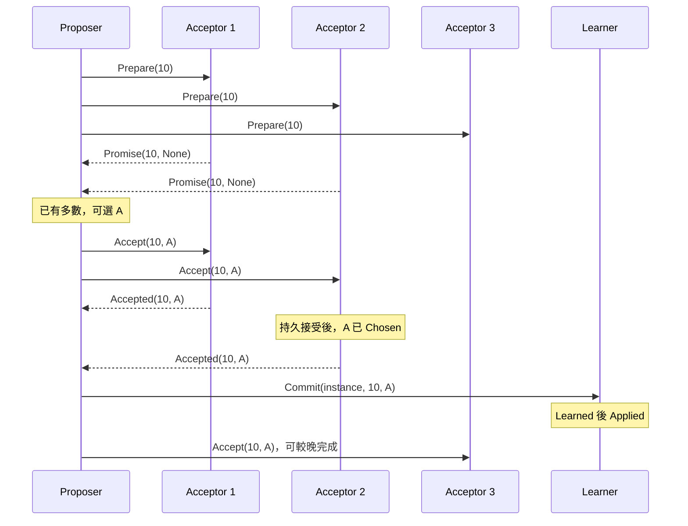
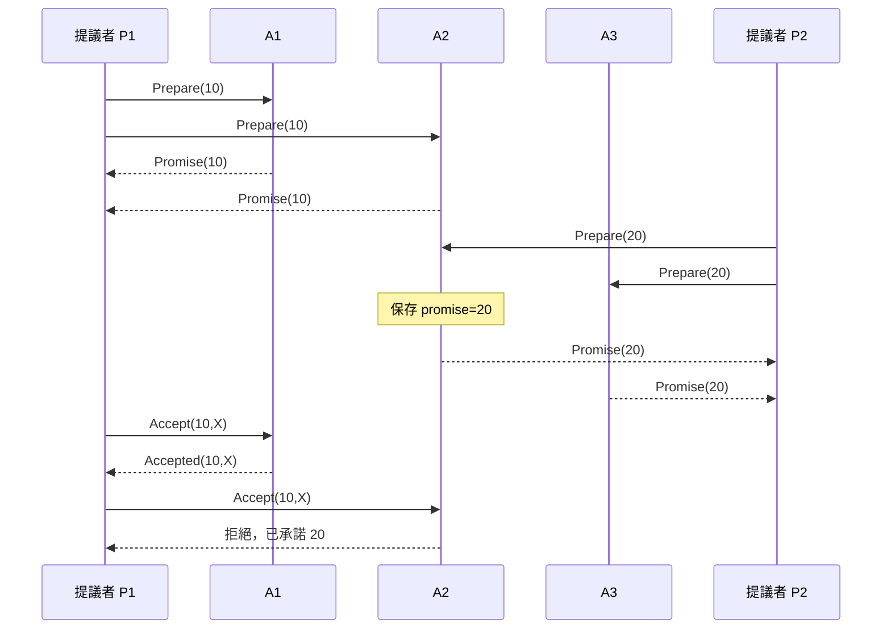
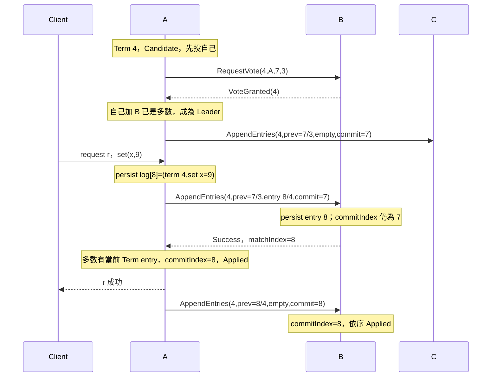
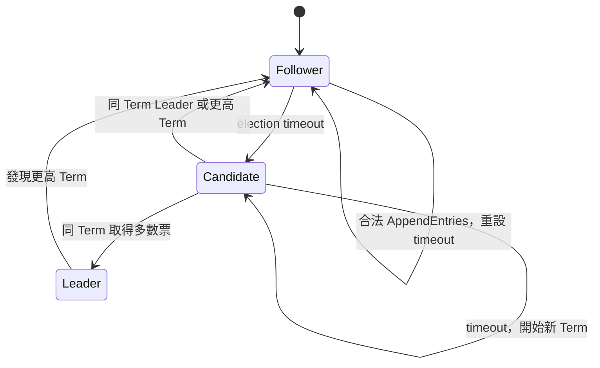

# Chapter 02 — 容錯, Paxos 與 Raft (Fault Tolerance, Paxos & Raft)

## 1. 最後一個座位可以賣給誰?

> 課程依據: P42–P47. 延伸: 原文書 §8.2.3–§8.2.4, PDF P491–P506.

三台伺服器都顯示只剩一個座位. X 的預訂先到 A, Y 的預訂先到 B. 兩台各扣掉手上的一個座位並回覆成功, 就會賣出同一個座位兩次. [Chapter 01](01-logical-clocks-checkpointing.md) 的因果關係可以解釋兩筆請求為何並行, 這裡還要讓兩個副本從並行請求中選出同一個執行順序.

共識 (Consensus) 讓參與者在同一次決定 (Instance) 採用同一個值, 例如先執行 X 的預訂. 另一輪決定再排 Y. 所有副本都從庫存 1 開始, 先讓 X 成功, Y 接著讀到庫存 0 並失敗. 把決定排成命令序列, 讓每台依同樣規則執行, 就是狀態機複寫 (State Machine Replication, SMR). 要做到這點, 先得知道其中一台收不到回覆時, 其他兩台手上實際有什麼證據.

三台機器收到相同命令集合也不夠: `set(x,1)` 後`set(x,2)` 的結果與反向順序不同. 要共同決定的是每個日誌位置的命令及順序, 不只是最後誰的網路比較快.

## 2. Fault Models 與 Failure Detection

> 課程依據: P44–P46. 延伸: 原文書 Ch.8 的 Failure Models, Failure Detection.

### 2.1 故障模型是演算法保證的邊界

**部分故障 (Partial Failure)** 指某些元件故障時, 其他節點仍在運作. 程式看到的是訊息與本地狀態, 無法直接讀取遠端是否"真的壞了".

若 A 掉電停止執行, 就是當機故障 (Crash Failure). 若它還在處理請求, 但某個封包沒有收發成功, 則是遺漏故障 (Omission Failure). 兩者都可使 B 一時沒收到回覆. 再把情況改成 A 有意在同一編號對 B 和 C 發出互相矛盾的接受回覆, 這屬於拜占庭故障 (Byzantine Failure). 標準 Paxos 和 Raft 依賴投票節點遵守協定, 無法把這第三種情況當成普通失聯處理.

本章主要採 crash-recovery 與非 Byzantine 網路: 訊息可能延遲, 遺失, 重複或重排, 但不會被無法偵測地偽造成別人的協定訊息. 節點重啟後, 必須仍保有必要的 durable state. 磁碟遺失, 程式錯誤或惡意撒謊不會自動被 Crash Tolerance 保證涵蓋.

"無限延遲"與"遺失"在等待者眼中可能無法區分, 但在形式模型內應區別: 可靠通道可以允許任意大的有限延遲, 同時要求正確接收者最終收到訊息.

### 2.2 非同步, Timeout 與懷疑

**非同步網路 (Asynchronous Network)** 不給可依賴的訊息延遲或相對程序速度上界. 若設定 500 ms timeout, 600 ms 尚未回覆的原因可能是 crash, 網路延遲, 磁碟停頓, 排程或 garbage collection.

```text
執行 A：Leader 已 crash                → 500 ms 無回覆
執行 B：Leader 正常，但網路延遲 2 s    → 500 ms 無回覆
觀測者在 500 ms 時看到的資訊相同。
```

**故障偵測器 (Failure Detector)** 可輸出懷疑, 並驅動重試或新選舉; 它不應讓節點以"我覺得對方死了"為理由跳過 Promise, 投票或 quorum 規則. 誤判時舊 Leader 與新候選者可能同時活著, 協定必須仍安全.

**部分同步 (Partial Synchrony)** 可作為進展條件: 系統在未知時間後, 延遲與速度進入足夠穩定的範圍, 使 timeout 與 Leader 最終能穩定工作. Safety 不應依賴每次 timeout 都準確; Liveness 則通常需要這類額外假設.

## 3. Safety, Liveness 與 FLP

> 課程依據: P47–P49. 延伸: [Fischer, Lynch, Paterson, Impossibility of Distributed Consensus with One Faulty Process](https://groups.csail.mit.edu/tds/papers/Lynch/jacm85.pdf).

### 3.1 正確性有不同的量化方式

- **安全性 (Safety)**: 不會出現不合法結果. 單一 instance 只能選定一個值, 且必為某個合法提議值; Learner 不能把尚未 Chosen 的值宣稱為已選定.
- **活性 (Liveness)**: 在指定進展條件下, 最終會選到值, 且結果可被學到. 必須說明條件, 例如可用多數, 訊息最終傳遞, 穩定協調者與持續重試.

不一致決定一旦發生, 後來統一結果也不能抹去先前的 Safety violation; 相反地, 暫時未完成可以只是等待, 無法僅憑有限等待證明永不終止.

### 3.2 FLP 的假設與結論

**FLP 不可能性 (Fischer–Lynch–Paterson Impossibility)** 針對完全非同步, 確定性 message-passing 共識, 即使最多只有一個程序可能 crash, 且通道可靠, 也不能對所有 admissible executions 保證終止, 同時維持非平凡決定與 Agreement.

這不是"每次 crash 都無法決定", 也不是"網路一定要丟包才會卡住". 證明透過維持 **雙價狀態 (Bivalent State)** 的排程, 構造一直尚可導向 0 或 1 的執行; 公平執行中的訊息不必永遠不送達, 仍可持續延後關鍵轉移而避免決定.

P49 的 A 提 0, B 提 1, 等待 C 是直覺示意, 不是 FLP 的形式證明. A 與 B 若依正確 quorum 協定已可決定, C 的遲到票不會自動推翻結果; Consensus 也不是把所有初始票收齊才進行一次政治投票.

### 3.3 工程上如何面對限制?

即使 timeout 誤判, 我們仍可以禁止少數副本獨自售出座位. 至於讓合法請求完成, 可以在網路穩定後由一位穩定 Leader 協調, 或用隨機逾時降低同時競選的機率. 安全性的規則先獨立成立, 才有空間調整這些進展策略. 接下來先算清楚需要聽到多少節點的回覆.

## 4. Majority Quorum: 相交為何必要而不充分?

> 課程依據: P50, P52–P53; 推導為教學補充. 延伸: 原文書 §8.2.4; [Paxos Made Simple](https://lamport.azurewebsites.net/pubs/paxos-simple.pdf), §2.

**多數法定人數 (Majority Quorum)** 只計算 Acceptor. 固定共有 N 個 Acceptor, quorum 大小 $q=\left\lfloor\frac{N}{2}\right\rfloor+1$.

| N | q | 為進展最多可不可達的個數 $N-q$ |
| --- | --- | --- |
| 3 | 2 | 1 |
| 4 | 3 | 1 |
| 5 | 3 | 2 |

兩個多數集合 Q1, Q2 必相交, 因為 $\lvert Q_1\cap Q_2\rvert\ge \lvert Q_1\rvert+\lvert Q_2\rvert-N\ge 2q-N>0$. $N=5$ 時, $\{A_1,A_2,A_3\}$ 與 $\{A_3,A_4,A_5\}$ 交於 A3.

相交提供跨回合傳遞歷史的節點, 但若 A3 不記得接受過什麼, 或新 Proposer 忽略歷史, 就仍可能改選不同值. Safety 還需要 Promise, 持久 Accepted 狀態與 Value Adoption 規則.

對 $N=2f+1$ 的固定成員 Crash 模型, 多數可容許 f 個不可達者而繼續工作, 但前提仍含訊息與協調者的進展條件. 超過 f 個不可達不代表既有決定自動變錯, 只是通常不能再取得 quorum. 若為了恢復可用性任意縮小配置, 可能讓兩個不相交群體各自提交, 破壞保證.

## 5. Paxos 的角色, 狀態與術語

> 課程依據: P50–P57. 延伸: 原文書 PDF P495–P500; [Paxos Made Simple](https://lamport.azurewebsites.net/pubs/paxos-simple.pdf), §2.3–§2.5.

### 5.1 邏輯角色與實體伺服器

設 X 的預訂請求已到處理節點. 提議者 (Proposer) 替它發起一輪協商, 需要從多數接受者 (Acceptor) 查詢以前留下的記錄, 才知道能否提自己的值. 接受者把承諾和自己已接受的提案保存下來, 這是跨輪維持決定的記憶. 學習者 (Learner) 等到有已選定的證據, 才把結果交給應用. 角色可以在同一個程序內共存, 計算 quorum 時只計入 Acceptor 身份. 只讀 Learner 也有追趕成本, 本地進度可能落後.

### 5.2 不可混用的狀態

| 名稱 | 意義 | 不能推論 |
| --- | --- | --- |
| Proposed | 某值被提出, 或某個 $(n,v)$ 已進入提議流程 | 任何 Acceptor 已接受 |
| Promise(n) | 該 Acceptor 不再接受 $<n$ 的提案 | 已接受 n 的值, 或 n 將必然成功 |
| Accepted(n,v) | 一個 Acceptor 已持久接受該對 | 多數已接受 |
| Chosen | 同一 instance 的同一 $(n,v)$ 被多數接受 | 所有節點已收到通知 |
| Learned | 某 Learner 已確認該值 Chosen | 所有 Learner 都知道, 應用已執行 |
| Applied | 已按應用順序執行至狀態機 | Client 必定收到回覆或外部副作用自動去重 |

Chosen 是協定歷史中的事實; 不要求有人當下知道. 若最後一個形成多數的 Acceptor 已接受, 但回覆遺失, 值仍可 Chosen.

### 5.3 每個 Acceptor 的持久狀態

對一個 Basic Paxos instance:

```text
promised_n = -infinity       # 已承諾不再接受更小編號
accepted_n = None           # 最高已接受提案的編號
accepted_v = None           # 對應的值；None 在此表示尚無記錄
```

三者不能合成一個"目前提案". 例如`promised_n=20, accepted_n=12, accepted_v=Y` 合法: 它答應未來拒絕 $<20$, 但過去確實接受過 $(12,Y)$. 新 Promise 不能抹除舊 Accepted.

**提案編號 (Proposal Number, 也稱 Ballot)** 是全域唯一且可排序的編號, 常實作為`(counter, proposer_id)` 字典序. 每個 Proposer 要能選出比已知高編號更大的新編號, 重啟也不得將同一編號用於不同值. 本文用 10, 12, 20 表示已確保唯一的編號, 不靠實體時間正確同步.

先將狀態可靠保存, 再回 Promise/Accepted; 否則重啟可能背棄已送出的承諾. 若日誌與磁碟永久遺失, 必須透過安全的重新加入流程恢復, 不能直接清空當成原 Acceptor 回來投票.

## 6. Happy Path: Prepare(10) 到 Applied

> 課程依據: P58 的 $(10,A)$ 原例; 本節補上狀態表與 Learner 通知. 固定三個 Acceptor, $q=2$, 皆初始無記錄.



圖 2.1 - 編號 10 從詢問歷史, 接受到學習. A2 一持久接受就達到多數, Proposer 與 Learner 稍後才得知. 自繪, 參考成大講義 P52–P54, P58. A3 即使未回 Promise, 也可在 promised_n≤10 時接受 Phase 2.

停在兩張 Promise 到達時, A1 和 A2 的狀態都是`(promise=10, accepted=None)`. 這個多數只限制未來能接受什麼. 下一步 A1 先持久接受 $(10,A)$, 仍只有一份. 等 A2 也持久接受, A 才成為 Chosen, 即使第二張 Accepted 回覆還在網路上. P 收到回覆再通知 L, L 確認結果成為 Learned, 交給應用執行後才算 Applied. A3 可以稍後追趕.

P58 主要展示前兩階段. 圖 2.1 的 Learn 與 Applied 另依 P54 接上.

## 7. Basic Paxos: 完整協定

> 課程依據: P52–P57. 以下 pseudocode 補明 instance, 編號與持久化條件; 它是教學版, 不含生產環境的配置變更, 認證或日誌截斷.

### 7.1 Phase 1: Prepare/Promise

1. Proposer 為此 instance 選唯一編號 n, 向 Acceptor 發`Prepare(n)`.
2. Acceptor 若`n > promised_n`, 先持久更新 promised_n=n, 再回`Promise(n, accepted_n, accepted_v)`.
3. 若 n 較小, 拒絕或忽略; 實作可回目前 promised_n 以加速重試.
4. 若等於 promised_n, 可用冪等方式重送目前 Promise; 這是重複傳送處理, 不得讓同編號對應兩個不同 Proposer/值.
5. Proposer 收到同一 instance, 同一 n 的多數不同 Acceptor Promise 後, 才能進入 Phase 2. 不能把同一節點的重送票算兩次.

### 7.2 Value Adoption: 本輪值的選擇

從採用的 Phase 1 quorum 中:

- 若所有 Promise 都沒有 Accepted 記錄, 可選自己的合法提議值.
- 否則在所有回報的 Accepted 中, 取`accepted_n` 最大者, 使用其`accepted_v`.

最大的是 **歷史提案編號**, 不是 Value 的大小, 也不是回覆最先抵達的次序. 選值完成後, 同一 instance, 同一 n 不得換值.

### 7.3 Phase 2: Accept/Accepted

```text
on Prepare(n):
    if n < promised_n: reject(promised_n)
    else:
        persist promised_n := n
        reply Promise(n, accepted_n, accepted_v)

on Accept(n, v):
    if n < promised_n: reject(promised_n)
    else:
        # 合法 Proposer 保證同一 n 只發一個 v
        persist (promised_n, accepted_n, accepted_v) := (n, n, v)
        reply Accepted(n, v)
```

Accept 到達時, Acceptor 不必曾經回覆這位 Proposer 的 Prepare; 條件是沒有承諾更大的編號. 故 Phase 1 與 Phase 2 quorum 可以不同, 只要採用保證相交的 quorum 規則.

當多數不同 Acceptor 接受相同 $(n,v)$, v 即 Chosen. 不能把 A1 的 $(10,X)$ 與 A2 的 $(20,Y)$ 加起來當成某個值的兩票.

### 7.4 Learn/Commit 與應用

P54 將結果通知稱作 **Phase 3 (Commit/Learn)**. 經典 Basic Paxos 的標準核心為 Phase 1 和 Phase 2; Learner 得知結果可用協調者通知, Acceptor 直接通知或其他傳播機制.

若 Learner 相信正確, 非 Byzantine Proposer 的通知, Proposer 可在確認多數後送`Commit(instance,n,v)`; 若由 Accepted 通知自行判斷, 必須驗證 instance, n, v, 不同 Acceptor 與 quorum. 不能收到單一 Acceptor 的 Accepted 就 Applied.

Learner/應用分離時, Learned 不等於 Applied. 多個日誌 instance 也必須按 log index 順序套用, 不能跳過前面尚未決定的位置.

## 8. 競爭, 拒絕與 Value Adoption

> 課程依據: P59–P60. 以下分開討論"尚未 Chosen"與"已 Chosen", 不以單次 Accepted 代替多數決定.

### 8.1 P59: 較高 Promise 打斷較低提案

固定 A1, A2, A3, $q=2$:

1. P1 以`Prepare(10)` 向 A1, A2 取得 Promise, 原本想提 X.
2. P2 以`Prepare(20)` 向 A2, A3 取得 Promise.
3. P1 的`Accept(10,X)` 到 A1, A1 未答應更大編號, 接受.
4. 同訊息到 A2 時, A2 已 promised_n=20, 拒絕.
5. P1 只知道一個 Accepted, 不能宣稱 Chosen. 稍後要重試, 需選大於已知 20 的新編號, 重新查歷史.

這時若 P2 的 Phase 1 quorum 是 $\{A_2,A_3\}$, 且兩者都無 Accepted, 它可以合法選 Y. A1 單獨接受過 X 不會永久鎖住全系統只能選 X.



圖 2.2 - A2 更新承諾後拒絕舊請求, A1 單獨接受 X 仍不足 $q=2$. 自繪, 參考成大講義 P59.

### 8.2 P60: 採用 quorum 回報的歷史

P60 另畫 A1 已接受 $(10,X)$, P2 的新回合`Prepare(20)` 收到 A1 的歷史, 因此採用 X. 安全的讀法是: P2 用來決定 Phase 2 的 quorum 包含 A1; 若還有其他歷史, 須比較全部回報後選最大 accepted_n.

不能把兩張圖硬接成"P2 已以 20 發 Y, 後來收到 A1 就又改以 20 發 X". 一旦同一編號的值已發出, 就不能改值. 需要新編號重新做 Phase 1, 或在第一次選值前就使用包含 A1 的 quorum.

### 8.3 自製例: Prepare(20) 收到 (12,Y)

收到`Prepare(20)` 前, A1 的承諾為 12, 已接受 $(12,Y)$. A2 的承諾為 8, 已接受 $(8,X)$. 兩台把承諾提高到 20, 再各自回傳`Promise(20,12,Y)` 和`Promise(20,8,X)`. A3 尚未回覆.

P 的 quorum 為 $\{A_1,A_2\}$. 比較歷史編號 12 與 8, 取 12 對應的 Y, 然後發 **`Accept(20,Y)`**.

- **20**: 本輪 Proposal Number, Acceptor 將依此編號判斷是否接受.
- **12**: 已收到的歷史 Accepted Proposal Number, 用於選值.
- **Y**: 沿用的 Value.

不能發`Accept(12,Y)` 代替本輪, 因為節點已 Promise 20, 會拒絕 12; 也不能選"數值較大"的 X 或 Y, Value 未必是可比較的數字. 此例沒有宣稱 Y 過去已 Chosen, 即使只有 A1 接受過, 它仍是本 quorum 規則要求採用的值.

### 8.4 已 Chosen 後為何不能改值?

[教學補充/推導] 假設 X 已在編號 10 被 $\{A_1,A_2\}$ 選定. 較高編號 20 的 Phase 1 quorum 若為 $\{A_2,A_3\}$, 必碰到 A2. A2 必回報歷史, 且 Promise 20 後不再接受低於 20 的新請求.

若回報中最高 accepted_n 是 10, 20 必採 X. 若最高歷史更大, 例如 15, 不能僅憑相交就說它一定是 X; 還要用歸納不變量: 在 10 已 Chosen 的前提下, 每個介於 10 與 20 的合法較高提案都已被相同規則約束為 X. 因此最高歷史仍帶 X.

另一種時間順序是: 20 先取得 quorum Promise, 10 尚未形成多數. 此後 10 無法再從另一個多數取得接受, 因為每個低編號多數都與已承諾 20 的集合相交. 若 10 在更早已形成多數, 其歷史就不能被 20 的 quorum 全部避開.

Safety 的組合是: **quorum 相交 + 不背棄 Promise + 保留歷史 + 取最高 Accepted 的值 + 同編號不改值**. 只有"多數集合會相交"不足以完成證明.

### 8.5 移除 Adoption 的具體反例

1. A1, A2 已接受 $(10,X)$, 所以 X Chosen.
2. P2 從 A2, A3 取得 Promise 20; A2 正確回報 $(10,X)$.
3. 若 P2 忽略回報, 自選 Y, A2, A3 又接受 $(20,Y)$.
4. 同一 instance 的 X, Y 都 Chosen, 違反 Agreement.

Acceptor 能接受較大編號本來合法; 錯的是 Proposer 沒有遵守跨回合選值規則.

## 9. Timeout, Crash, Retry 與 Lifecycle

> 課程依據: P55–P57; 延伸: Paxos Made Simple §2.4–§2.5, 原文書 §8.2.4.

### 9.1 四種中斷位置

| 中斷時點 | 可能已發生的事 | 正確恢復方式 |
| --- | --- | --- |
| Phase 1 前後 | 部分 Promise 留在磁碟 | 新 Proposer 用更高編號查詢; 不能假設全體初始 |
| 只有部分 Accepted | 值尚未 Chosen, 或觀測資訊不足 | 重新 Phase 1, 依 quorum 歷史選值 |
| 多數 Accepted, 回覆遺失 | 已 Chosen, 但 Proposer 不知道 | 新回合仍須採用被保護的值 |
| 已 Chosen, 通知前 crash | Learner 尚未 Learned | 重新學習/傳播, 不能因通知未送就撤銷決定 |

Acceptor 重啟後恢復 promised_n 與 Accepted pair; Learner 可重新取得結果並以 instance/log index 避免重複 Applied. Proposer 的 retry 要保證編號唯一, 並避免把上輪 Promise 與本輪 Promise 混算.

### 9.2 Client timeout 不代表操作沒生效

Client 發出`withdraw(10)`, Leader 已 Applied, 但回覆遺失. Client 若直接把它當成新請求重送, 可能扣款兩次. 共識保證每個位置決定一致, 不保證不同位置的兩次相同操作自動去重.

[延伸補充/推導] 以`(client_id, request_id)` 作唯一識別, 狀態機保存已執行結果; 重送同 ID 回傳原結果, 才可避免同一邏輯請求重複執行. 去重狀態也必須被複寫與納入快照. 這是應用協定, 不是把 timeout 調長就能取代.

### 9.3 Dueling Proposers 與進展

P1 取得 Promise 10, P2 先取得 20, P1 再升 30, P2 再升 40; Phase 2 持續被更高 Promise 打斷. 所有人均守規則, Safety 仍成立, 但一直沒有 Chosen.

退避, Leader 選擇與較穩定的網路能降低競爭, 讓某個 Proposer 有足夠時間完成兩階段; 這是 Liveness 設計, 不是修改 Safety 規則. 進展仍需可用多數, 而不是"只要其中一台沒壞就可以".

## 10. Multi-Paxos, Replicated Log 與 SMR

> 課程依據: P61. 延伸: 原文書 §8.2.4, Paxos Made Simple §3; 本節為穩定 Leader 版本的概念與工程補全.

### 10.1 一個值如何擴充成命令序列?

Basic Paxos 決定單一 instance 的值. **Multi-Paxos** 將每個日誌位置看作一個共識 instance, 讓系統決定一連串命令. **複寫日誌 (Replicated Log)** 的位置稱為 **日誌索引 (Log Index/Slot)**, 與 Proposal Number 不同.

```text
slot 1: ballot 10 -> set(x, 1)
slot 2: ballot 10 -> add(x, 2)
slot 3: ballot 20 -> set(y, 7)
```

Ballot 10 可以服務多個 slot; slot 2 也可能曾經在 ballot 8 接受過命令, 後來由 ballot 10 恢復同一值. Slot 表示"哪個位置", Ballot 表示"哪一輪協調權限". 不能用比較 Ballot 判斷兩命令的應用先後.

### 10.2 Stable Leader 到底省下什麼?

**穩定領導者 (Stable Leader)** 先以某個 Ballot 完成涵蓋適用 slots 的 Phase 1, 取得多數承諾與相關歷史. 只要權限仍有效, 對後續可安全使用的位置, 可直接做 Phase 2, 而不必每筆命令重新 Prepare/Promise.

不能把"曾在 slot 1 做過 Prepare"自動當成全體未來 slots 的權限; 實作必須定義 Promise 的範圍, 以及如何取得各 slot 已接受的值. 換 Leader 後也必須恢復未完成 slots, 保留可能已 Chosen 的命令, 必要時以合法 no-op 補洞, 不能任意覆蓋未知位置.

在相同 Leader, 無競爭, 穩定 quorum 的教學模型下, Basic Paxos 決定新值需要兩輪 quorum request/response; Multi-Paxos 穩態可只需一輪 Phase 2. 這裡的"輪"不包含 Client→Leader, 結果傳播, 磁碟同步與應用時間, 亦不是實測 latency.

### 10.3 Applied 順序與確定性

即使 slot 8 先 Chosen, slot 7 未決時也不應把 slot 8 提前 Applied. 狀態機需按照已決定的連續前綴執行. 每個副本執行相同命令, 相同順序, 且狀態轉移為確定性, 才能得到相同結果.

隨機數, wall-clock 時間與外部服務回覆若會影響結果, 須把決定結果編碼進命令或另設協調; 同一份程式碼不代表每次執行都確定. 與 [Chapter 01 的 Checkpoint](01-logical-clocks-checkpointing.md) 結合時, 快照還需記錄已套用的日誌前綴位置與安全追趕方式.

## 11. Raft: 將共識拆成可理解的子問題

> [課程講義] P62: Understandability, Leader Election, Log Replication, Safety 與 Strong Leader.
> [延伸補充] 下列完整規則依 [Ongaro 與 Ousterhout, In Search of an Understandable Consensus Algorithm, Extended Version](https://raft.github.io/raft.pdf), Figure 2, §5.1–§5.4, §8. 原文書 PDF P305–P306, P493–P495 僅作概念對照.

### 11.1 完整正常案例: 三節點, Term 4, index 8

[教學補充/推導] A, B, C 都有已提交至 index 7 的相同日誌, 最後 entry Term=3. A 的 timeout 先到, 無其他競爭; $q=2$.

任期 (Term) 標記一輪領導權, 日誌索引 (Index) 標記命令的位置. 讀圖時先看 A 如何用選票取得第 4 任期, 再看它如何把第 8 筆命令寫入兩台. 兩次多數各回答自己的問題.



圖 2.3 - A 先透過 RequestVote 取得任期 4 的領導權, 之後才用 AppendEntries 複寫 index 8. 自繪, 參考成大講義 P62 及 MIT 6.5840 Lecture 6.

C 可較晚用相同前綴檢查追上. A 收到 B 的持久 ACK 後得知多數已複寫, B 在收到更新的 leaderCommit 前只知道自己已存入 entry 8. 這兩個進度影響各副本何時能執行命令.

### 11.2 假設與狀態

固定 N 個 voting servers, Crash 模型, 可持久化儲存, 基本 quorum 仍為多數. 成員變更, 快照傳輸與 PreVote 等實作擴充不在這份核心流程內; 它們需要另行規範.

**任期 (Term)** 是單調增加的邏輯 epoch; 每個 Term 最多一個成功當選的 Leader, 也可能沒有 Leader. 不同 Term 的 Leader 可在分區中暫時都自認為在任, 但舊 Term 不能繞過多數與任期檢查繼續提交.

| 狀態 | 用途 | 保存方式 |
| --- | --- | --- |
|`currentTerm` | 已見最大任期 | 持久化 |
|`votedFor` | 此 Term 已投給誰, 或 None | 持久化 |
|`log[]` | 每項的 term 與 command, 位置為 index | 持久化 |
|`commitIndex` | 已知已提交的最大 index | 核心論文列為 volatile; 重啟後須安全重建 |
|`lastApplied` | 本地已套用最大 index | 核心論文列為 volatile; 與持久應用狀態需一致恢復 |
|`nextIndex[f]` | Leader 下次向 follower f 傳送的位置 | Leader 的 volatile state |
|`matchIndex[f]` | 已確認 follower f 複寫到哪裡 | Leader 的 volatile state |

$\mathrm{lastApplied}\le\mathrm{commitIndex}$. 跟隨者擁有某個 log entry, 不代表已知道它 Committed, 更不代表已 Applied.

### 11.3 Leader Election 與 RequestVote

**追隨者 (Follower)** 等待 Leader 的 AppendEntries/heartbeat; 若 election timeout 到期, 轉為 **候選者 (Candidate)**:

1.`currentTerm += 1`, 持久化, 投自己一票並保存 votedFor.
2. 發投票請求 (`RequestVote`), 帶上`term`, `candidateId`, `lastLogIndex` 及`lastLogTerm`. 重設隨機選舉逾時.
3. 對同一 Term, 收到多數不同 voting servers 的票才成為 Leader.
4. 若逾時仍未勝選, 進入新 Term 重試; 若收到同 Term 合法 Leader 的 AppendEntries, 退為 Follower.
5. 任一角色處理 RPC/回覆時若看到更高 Term, 更新並保存 Term, 清除該新 Term 的舊投票選擇, 退為 Follower.



圖 2.4 - 選舉逾時推進任期, 收到更高任期時退回追隨者. 自繪, 參考成大講義 P62 與 MIT 6.5840 Lecture 6. 實作可另加失去多數時主動退位的規則.

接收 RequestVote 時, 不能只看誰先來. 需同時滿足: 請求 Term 不舊, 此 Term 尚未投票或已投給同候選者, 以及候選者日誌至少一樣新. 比較日誌新舊使用 **`(lastLogTerm,lastLogIndex)` 字典序**, 先比最後 entry 的 Term, 再比長度位置.

| 本地最後 entry | 候選者最後 entry | 可通過日誌新舊檢查? |
| --- | --- | --- |
| term=4,index=8 | term=3,index=100 | 否; 更長但最後 Term 較舊 |
| term=4,index=8 | term=4,index=7 | 否; 同 Term 但較短 |
| term=4,index=8 | term=5,index=6 | 是; 最後 Term 較新 |

通過日誌檢查不等於一定投票, 還須滿足 Term 與 votedFor 條件.

### 11.4 Log Replication 與 AppendEntries

Leader 收到 Client command, 先寫入自己的日誌, 然後發:

```text
AppendEntries(
    term, leaderId,
    prevLogIndex, prevLogTerm,
    entries[], leaderCommit
)
```

Follower 的處理順序:

1. 若 term 小於 currentTerm, 拒絕; 若大於則先更新 Term 並退為 Follower.
2. 確認`prevLogIndex` 上有 entry, 且 Term 等於 prevLogTerm; 否則拒絕.
3. 若新 entries 與既有同 index 的 entry 發生 Term 衝突, 刪除衝突位置及其後綴, 再追加尚未存在的 entries.
4. 保存修改後才回成功. 若 leaderCommit 較大, 提交上限取`min(leaderCommit, 本次確認匹配的最後 index)`; 空 entries 時該 index 是`prevLogIndex`. 只向前更新本機 commitIndex.
5. 依 index 順序將尚未套用, 且不超過 commitIndex 的 entry Applied.

Empty entries 的 heartbeat 仍須做前綴檢查, 不能為了"只是心跳"而無條件回成功. 若已匹配 entries, 重送不應無條件刪掉後綴; 只有真正衝突才截斷.

Leader 收到拒絕後, 調整 nextIndex, 回退尋找共同前綴; 收到成功後更新 matchIndex 與 nextIndex. 工程實作可回傳 conflict hint 減少 RPC, 但正確性仍依前綴匹配規則.

### 11.5 Leader 如何推進 Commit Index?

Leader 找某個 index k, 滿足:

-`k > commitIndex`.
- 多數 voting servers (包含自己) 的 matchIndex ≥ k.
- **`log[k].term == currentTerm`**.

滿足時可將 commitIndex 推至 k; 它之前的連續前綴也隨之提交. 當前任期以外的 entry 不能只靠"現在看起來在多數"直接套用同樣計票規則; 應讓當前任期 entry 提交後間接涵蓋.

若應用狀態有持久副作用, lastApplied 與狀態儲存必須能一起正確恢復. 不能因論文將 lastApplied 列為 volatile, 就在重啟後把已落盤的非冪等操作全部再執行一次.

### 11.6 Failure Case: 新 Leader 修補舊未提交尾端

[教學補充/推導] 初始共同前綴至 index 5. Term 2 的 A 將`index6=(2,X)` 只寫在自己, 尚未到達多數, 然後與 B, C 分區.

1. B, C 的最後位置均為 5, B 在 Term 3 取得自己與 C 的票, 成為 Leader.
2. B 將`index6=(3,Y)` 複寫至 B, C, 多數且屬當前 Term, 故提交 Y.
3. A 恢復連線, 收到 Term 3 RPC 後退為 Follower.
4. B 若先用 prev=6/3 做 heartbeat, A 只有 6/2, 回覆不匹配.
5. B 回退到共同前綴 5, 再送 entry 6/3; A 驗證前綴, 刪掉衝突的 6/2 與其後綴, 接受 Y.

此處 X 能被覆蓋是因為它沒有 Committed. 若 X 已在正確 quorum 下提交, 後續選舉與日誌規則必須阻止缺少它的 Leader 當選, 不能把任意落後副本的內容提升為權威.

### 11.7 為什麼舊 Term 的"多數"還不夠?

[教學補充/推導; 對照原論文 Figure 8] 五節點 S1–S5, q=3, 共同前綴到 index1:

1. Term 2, S1 的`index2=(2,X)` 到達 S1, S2, 尚無多數, 之後 S1 離線.
2. Term 3, S5 由 $\{S_3,S_4,S_5\}$ 選出, 在自己記下`index2=(3,Y)`, 尚未複寫至多數, 之後離線.
3. Term 4, S1 從 S2, S3 加自己取得選票, 並把 X 複寫到 S3. 此時 X 在 S1, S2, S3, 卻是舊 Term 2 entry.
4. 若 S1 此時只因三份 X 就宣稱提交, 然後離線, S5 可在更高 Term 由 $\{S_2,S_4,S_5\}$ 當選: 其最後 entry Term 3 比 S2 的最後 entry Term 2 新, S2 的日誌檢查不會阻擋它.
5. 新 Leader S5 可把 Y 複寫到多數, 覆蓋未提交的 X; 若第 4 步曾錯誤提交 X, 就造成 Safety violation.

若 S1 在 Term 4 先把新的`index3=(4,no-op)` 複寫至多數並提交, 則 X 會作為其前綴一起提交. 之後上述缺少 Term 4 前綴的 S5 無法以 Term 3 尾端取得相交投票者的支持. 這就是 currentTerm 提交條件與選舉限制需要一起工作的原因.

### 11.8 Raft 的 Safety 性質如何串接?

| 性質 | 意義 | 依靠的規則 |
| --- | --- | --- |
| Election Safety | 一個 Term 最多一個 Leader | 每節點每 Term 一票且多數相交 |
| Leader Append-Only | Leader 在任時只追加自己的日誌 | 不以 follower 回覆任意改寫自己的前綴 |
| Log Matching | 兩份日誌同 index, 同 Term 時, 該位置前綴相同 | AppendEntries 的 prev index/term 檢查 |
| Leader Completeness | 已提交 entry 出現在所有後續 Leader 日誌中 | 投票日誌限制, 相交, 當前 Term 提交規則 |
| State Machine Safety | 若一節點在 index i 已 Applied 某命令, 其他節點不會在 i Applied 不同命令 | Leader Completeness, Log Matching, 只套用已提交前綴 |

這些是互相支援的約束, 不是五個可以任意刪除的標籤. Election Safety 只限制同一 Term; 它本身不能保證跨 Term 的命令不被覆蓋.

### 11.9 讀取, 分區與 Client 語義

單純向任一 Follower 讀取可得到落後資料; 孤立的舊 Leader 也可能尚未知道新 Term. 若要線性一致讀取, 必須有確認領導權與已套用進度的機制, 不能只因本機角色仍叫 Leader 就直接讀.

原論文 §8 討論先確認當前 Term 的提交資訊, 再以 quorum 交互確認權限; lease 類最佳化需要額外時鐘/時間假設. 讀取處理與 Client 去重是完整服務的一部分, 不是 Leader Election 自動解決.

分區為 3/2 的五節點群體時, 若原配置未改, 多數側可在適當條件下前進, 少數側不能提交新 entry. timeout 可觸發選舉, 不能讓少數側把 q 從 3 改成 2.

## 12. Basic Paxos, Multi-Paxos, Raft 比較

> 課程依據: P61–P62. 以下比較固定成員, 非 Byzantine, 穩定網路與 Leader 的常見版本; 不是所有 Paxos 變體的完整分類.

| 協定 | 穩定時如何寫入 | 更換協調者時如何保留決定 |
| --- | --- | --- |
| Basic Paxos | 決定一值, 兩輪多數往返 | 依多數回報採用歷史值 |
| Multi-Paxos | 每個位置一值, 穩態只做 Phase 2 | 建立權限, 逐位置恢復歷史, 補洞 |
| Raft | 領導者推送日誌, 穩態一輪多數複寫 | 用日誌新舊限制選舉, 再修補副本尾端 |

"Raft 有 Leader, Paxos 沒 Leader"是錯誤二分; 實用 Multi-Paxos 也常依賴 Stable Leader. Raft 與 Multi-Paxos 不只是改名: 前者把日誌與選舉規則一起限制, 後者常以各 slot 的 Accepted 歷史恢復安全值.

上述 RPC 輪數排除 Client 往返, 落盤, 排隊, batching 與 follower 結果通知. 若同步儲存是主成本, 少一輪控制訊息不一定等於端到端延遲減半.

## 13. 當應用把命令交給複寫服務

> 課程依據: P42, P51, P61–P62; 官方補充查詢日期: 2026-11-19.

講義 P61 用 Spanner 說明穩定 Leader 的價值. P62 的 Raft 案例 etcd 另有非投票成員, 可先趕上日誌, 再按配置規則升為投票成員. 這說明"持有日誌"與"能在 quorum 計一票"是兩項權限, 也與 Basic Paxos 的 Learner 概念有所差異. [etcd v3.6 Learner 設計](https://etcd.io/docs/v3.6/learning/design-learner/)

回到開頭的訂票服務, 複寫層排好預訂命令, 應用仍須在執行時檢查庫存, 保存重試識別碼, 並約定讀取的保證. 同樣的分工可做成提供設定版本及工作註冊的服務. [Chapter 03](03-zookeeper.md) 會用 ZooKeeper 的 ZAB 看應用如何在有序更新之上建立更高階的協調功能.

## 14. 英文選擇題與逐項解析

以下為自製題, 非教授原題. 所有 Paxos 題均固定三個 Acceptor, $q=2$, 除非題目另有說明.

### Q1 — Timeout

A server receives no response before a timeout in a fully asynchronous system. What can it conclude?

- A. The remote server has certainly crashed.
- B. The operation was certainly not chosen.
- C. The remote server is suspected; delay and crash remain indistinguishable from this observation.
- D. It may safely reduce the configured quorum size.

**答案: C.** A: 延遲與暫停也可能造成 timeout. B: 多數可能已接受, 只是回覆遺失. C: 精確描述本地資訊. D: 擅改 quorum 會破壞相交保證.

### Q2 — Adoption

For Prepare(20), a Proposer's Phase 1 quorum reports (12,Y) and (8,X). What must it send?

- A. Accept(12,Y).
- B. Accept(20,X).
- C. Accept(20,Y).
- D. Accept(20,max(X,Y)).

**答案: C.** A: 12 是歷史編號, 不是本輪. B: 8 低於 12. C: 沿用最高歷史的值, 配本輪 20. D: 規則不比較 Value 數值.

### Q3 — Chosen without knowledge

Two Acceptors durably accept (10,A), but all their replies are lost. Which statement is correct?

- A. A cannot be chosen until the Proposer reads the replies.
- B. A is chosen, although the Proposer may not know it.
- C. A Learner may apply any other value after a timeout.
- D. The Acceptors should erase A to unblock the system.

**答案: B.** A: Chosen 以接受歷史定義, 不以回覆到達定義. B: 已形成多數. C: timeout 不撤銷選定結果. D: 刪除必要歷史可能使後續違反 Safety.

### Q4 — Raft log freshness

A Raft voter ends at (lastLogTerm=4,lastLogIndex=8). Which candidate passes the log freshness check, assuming voting and current-term conditions are otherwise satisfied?

- A. (3,100).
- B. (4,7).
- C. (5,6).
- D. All three.

**答案: C.** A: 先比 Term, 較長無法彌補較舊. B: 同 Term 卻 index 較小. C: 最後 Term 較新. D: 前兩者均不通過.

### Q5 — Old-term commitment

A Raft leader in term 4 observes that an entry from term 2 is stored on a majority. Which action follows the standard commitment rule?

- A. Commit it immediately by counting replicas alone.
- B. Delete it because old-term entries can never be committed.
- C. Wait until a current-term entry is safely committed, which can commit the preceding entry indirectly.
- D. Ask a Learner to cast an additional vote.

**答案: C.** A: 缺少 currentTerm 條件, 可能出現 Figure 8 類反例. B: 舊 entry 可隨前綴間接提交. C: 正確保護跨 Term 的完整性. D: Learner 不補足投票多數, 亦無法解此問題.

## 15. 可重跑的算例檢查

[教學補充/推導] 在 Repository 根目錄執行`python tools/verify-examples.py`. 共識部分枚舉 N=3, 4, 5 的多數集合交集, 核算 $(12,Y)$ 的 Adoption, Raft 三組日誌新舊比較, 以及五節點舊 Term 反例的選票可行性. 預期有`PASS: quorum intersections; adoption; Raft freshness and old-term counterexample`.

這些檢查支持本文有限案例的算術與狀態條件, 沒有探索所有訊息交錯, 不等於完整 Paxos/Raft model checking, 實際磁碟故障測試或叢集驗收.

## 16. 參考資料與投影片對應

| 講義 | 主題與原理 | 圖解與推演 | 下一個問題 |
| --- | --- | --- | --- |
| P41–P49 | 部分故障, 觀測, 共識保證 | 500 ms 兩種相同觀測 | 可以憑哪些回覆推進? |
| P50–P58 | 角色, 多數相交, 持久歷史 | 圖 2.1, 10/A 到 Applied | 有兩輪競爭怎麼辦? |
| P59–P60 | 拒絕與歷史值採用 | 圖 2.2, 10/X 與 20/Y 分支 | 如何協調一串命令? |
| P61 | 穩定 Leader 與日誌位置 | 三個 slot 與兩個 Ballot | 新 Leader 如何承接歷史? |
| P62 | 選舉限制, 前綴與提交 | 圖 2.3–2.4, index 8 與五節點反例 | 應用如何使用共識? |

| 來源 | 本章定位 |
| --- | --- |
| [延伸補充: 原文書] | van Steen, Tanenbaum, Distributed Systems, 4.03x; PDF P305–P306, P491–P506. [作者頁](https://www.distributed-systems.net/index.php/books/ds4/); 版本差異見 [教材紀錄](../reference/README.md) |
| [原始論文] | Lamport, [Paxos Made Simple](https://lamport.azurewebsites.net/pubs/paxos-simple.pdf), 2001, §2–§3; [The Part-Time Parliament](https://lamport.azurewebsites.net/pubs/lamport-paxos.pdf), 1998, 作者提供的歷史論文 |
| [原始論文] | Fischer, Lynch, Paterson, [Impossibility of Distributed Consensus with One Faulty Process](https://groups.csail.mit.edu/tds/papers/Lynch/jacm85.pdf), JACM 1985, pp.374–382 |
| [原始論文] | Ongaro, Ousterhout, [In Search of an Understandable Consensus Algorithm (Extended Version) ](https://raft.github.io/raft.pdf), 2014, Figure 2, Figure 8, §5, §8 |
| [官方文件] | [Raft 官方資源](https://raft.github.io/), [etcd v3.6 Learner 設計](https://etcd.io/docs/v3.6/learning/design-learner/), [ZooKeeper Internals](https://zookeeper.apache.org/doc/current/zookeeperInternals.html); 只引用角色與架構關係 |
| [大學教材] | [MIT 6.5840 Lecture 6 — RSM and Raft](https://pdos.csail.mit.edu/6.824/notes/l-raft.txt), 狀態機, 選舉與正常寫入的教學順序 |

線上資料查閱日期: 2026-11-19, MIT 教材於 2026-11-22 查閱. 數值時間軸是可手動檢查的教學模型, 未執行真實叢集, 效能量測或故障注入.
