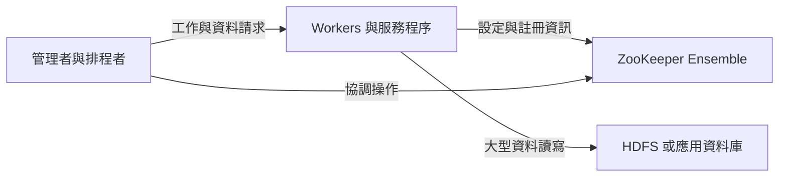
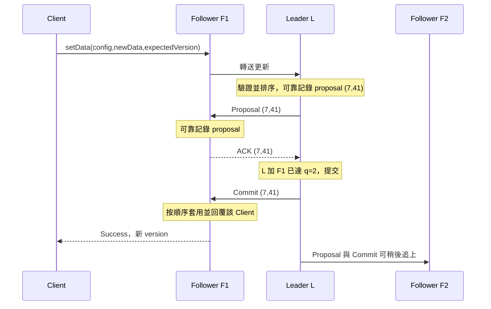
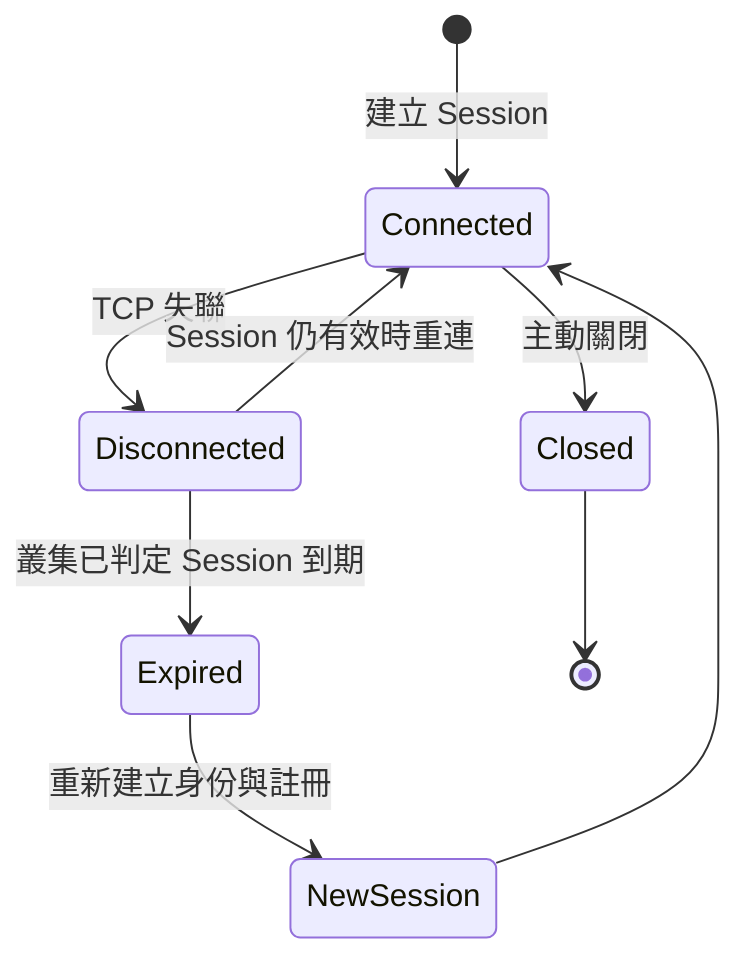
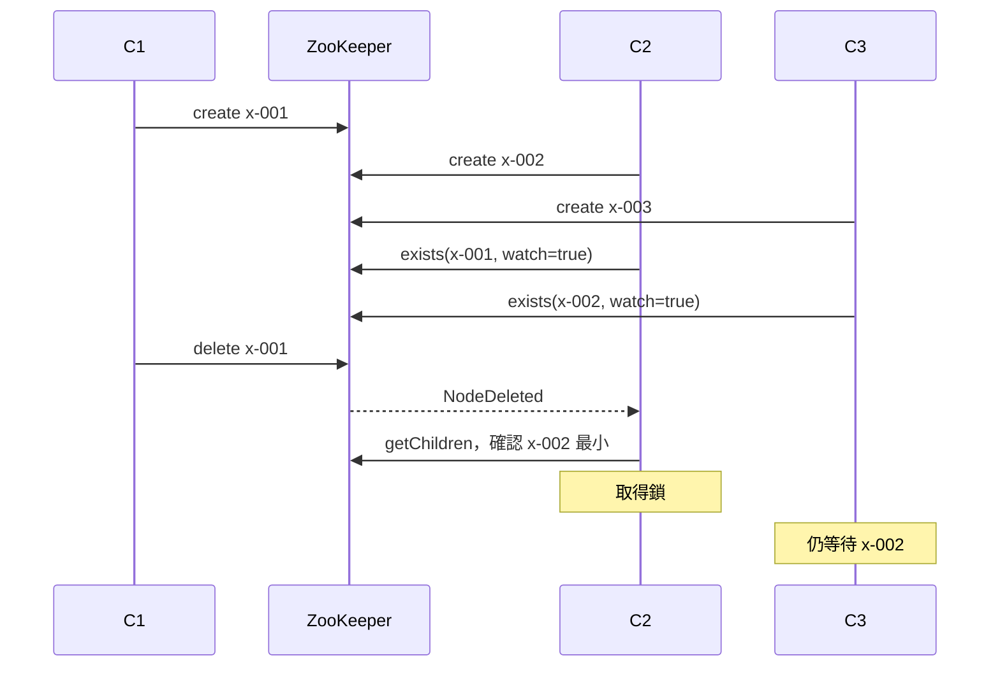

# Chapter 03 — 分散式協調服務（Distributed Coordination Services: ZooKeeper）

## 1. 為什麼資料平台需要協調服務？

> [課程講義] P63–P70：章節定位、Hadoop 生態系與 ZooKeeper 的位置。

分散式運算的主要資料流可以很大，控制它的資訊卻通常很小：目前誰是工作排程者、有哪些 Worker、設定版本是多少、誰可以更新某個共享資源。這些資訊若各節點自行猜測，可能出現兩個排程者、重複執行工作或使用不相容的設定。

**協調服務（Coordination Service）** 提供共享的命名、狀態與順序，讓應用用一小組操作組合出設定管理、成員註冊、選舉與互斥。ZooKeeper 的工作是保存這些協調用中繼資料（Metadata），不是代替 HDFS 存放大量檔案，也不是代替 Spark 執行計算。

### 1.1 依講義理解 Hadoop 生態系

| 元件 | P66–P70 的角色 | 與協調服務的關係 |
| --- | --- | --- |
| HDFS | 檔案切成 blocks 並複寫 | 大型資料的儲存層，與協調用 metadata 分工 |
| YARN | 配置 CPU、memory 等叢集資源 | 管理運算資源；「叢集 OS」是教材類比，非取代各主機 OS |
| MapReduce／Spark | 批次與一般分散式運算 | 執行資料處理；本章不展開排程與回復細節 |
| HBase | 建於 HDFS 上的 wide-column store | 資料庫層，可使用協調機制管理服務狀態 |
| Hive／Phoenix | 面向不同儲存與運算引擎的 SQL 介面 | 不是每次查詢都經過 ZooKeeper 儲存資料 |
| ZooKeeper | 設定、命名、同步與成員資訊 | 提供小型共享狀態與通知，供其他服務建立協調邏輯 |

P66 以 GFS、MapReduce 論文與 Hadoop 的誕生交代歷史背景；本章不把這段背景擴張成後續 Storage 章節。P67 的堆疊圖是概念定位，不應讀成「每個 MapReduce 輸出都必須寫進 HBase」。



自製圖將主要資料與協調資訊分開；箭頭不代表任意 Hadoop 版本都必須依賴 ZooKeeper。P69 的「Spark 最多快 100 倍」、P70 的「缺少它整個生態系便失序」是教材的概括敘述，不是所有工作負載或部署的保證。

## 2. Ensemble 架構、讀寫路徑與 Wait-free

> [課程講義] P71–P74。延伸：[Hunt 等，ZooKeeper: Wait-free coordination for Internet-scale systems](https://www.usenix.org/events/atc10/tech/full_papers/Hunt.pdf)，§2–§3。

**伺服器群體（Ensemble）** 共同維護資料樹。Client 通常連接一台伺服器，並由 client library 管理重新連線。一般讀取由連線端的本地副本處理；更新則經過 Leader 排序、複寫與提交。

| 請求 | 典型路徑 | 得到的好處 | 代價與界線 |
| --- | --- | --- | --- |
| `getData` 等一般讀取 | Client → 連線端副本 → Client | 省去每次讀取的 quorum 往返，可分散讀流量 | 副本可能落後，不能自動視為跨 Client 的最新讀取 |
| `setData` 等更新 | Client → 連線端 → Leader → quorum → 提交／回覆 | 更新順序與已確認結果受複寫協定保護 | 有網路、持久化與排隊成本；失去多數時停止正常寫入進展 |
| Watch 通知 | 由連線與 Session 管理送達 Client | 狀態失效時再重新讀取，減少輪詢 | 通知不是完整事件日誌，斷線時也可能收不到 |

P71–P72 的讀寫比例、microsecond latency、P88 的讀取吞吐成長描述，應理解為設計動機。本文沒有測量 latency，也不將「資料樹在 RAM」解釋為更新無需磁碟。成功更新仍需要協定要求的持久化。

### 2.1 Wait-free 不等於請求不等待網路

**無等待協調介面（Wait-free Coordination Interface）** 在本章指核心 API 不要求某個 Client 先釋放一把服務內建的阻塞鎖，其他 Client 才能更新共享資料。慢 Client 的 Watch callback 不應成為所有更新都要等它同意的同步屏障。

這不代表 RPC 在任意分區下都有固定完成時間，也不代表應用無法死結。同步 API 仍可阻塞呼叫端，quorum 不可達時操作也不能任意成功。應用若自行組合鎖並以相反順序取得資源，仍可能形成死結。

## 3. 多數 Quorum 與 ZAB：從寫入到提交

> [課程講義] P75–P79。延伸：[ZooKeeper 3.9.4 Internals](https://zookeeper.apache.org/doc/r3.9.4/zookeeperInternals.html)，Atomic Broadcast、Leader Activation、Quorums。

### 3.1 計票對象與可用性前提

普通等權重配置中，有 N 個投票伺服器，**多數法定人數（Majority Quorum）** 為 `q = ⌊N/2⌋ + 1`。Leader 自己也是投票群體的一員。非投票 Observer 不增加分母；本節不涵蓋 weighted／hierarchical quorum 或配置變更。

例如 N=5，q=3；三台仍能互通且恢復協定完成時，可以繼續處理更新。N=4 時 q=3，不是 2。P78 畫 Leader 加三個 Followers，其「2 out of 3」可安全讀為 Leader 自身已可靠記錄，再加三個 Followers 中的兩個 ACK，共三個 voting servers。

多數相交避免兩個不相交群體各自形成有效提交，但不是「任何時間只能有一台機器自認是 Leader」的證明。分區中的舊 Leader 可能尚未發現失去權限；epoch、恢復與提交規則才共同保護 Safety。與 [Chapter 02 的 quorum 與狀態規則](02-fault-tolerance-paxos-raft.md)相同，不能只靠集合相交就刪掉其餘條件。

### 3.2 Epoch、zxid 與有序前綴

**ZooKeeper 原子廣播（ZooKeeper Atomic Broadcast，ZAB）** 把更新排成一致的順序。**領導世代（Epoch）** 區別不同領導權期間；**交易識別碼（ZooKeeper Transaction ID，zxid）** 表示更新順序，官方文件以 64 bits 的高 32 bits epoch 與低 32 bits counter 說明。

本章以 `(7,41)` 表示 epoch 7 的第 41 個交易計數。這個編號不是 znode 的 `version`，也不是 lock node 名稱的 sequential suffix；三者作用不同。

Leader activation 的目標是先建立可延續既有決定的合法歷史，再接受新工作。P76 將其濃縮成「選舉與同步」；不能實作成誰先 timeout 就直接把自己那份較短資料覆蓋其他副本。

### 3.3 三節點正常路徑：更新設定

[教學補充／推導] 固定投票者 L、F1、F2，q=2，epoch=7 已啟用，皆已套用至 `(7,40)`。Client 連到 F1，要更新 `/app/config`。



圖省略流水線、其他 outstanding requests 與 Watch 訊息；不是完整 ZAB wire protocol。F2 較慢不必阻擋這筆更新，但不能在尚未得知提交時任意把 proposal 交給應用。

| 時點 | 已有什麼資訊 | 尚不能宣稱什麼 |
| --- | --- | --- |
| Leader 指派 zxid | 更新已有順序位置 | 已可靠複寫至多數 |
| 一個 Follower ACK | 該副本已滿足保存條件 | 只看 ACK 本身，不能忘記計票基數與 Leader 狀態 |
| 合法 quorum 完成 | Leader 可依 ZAB 規則提交此前綴 | 所有副本與 Client 都已知道 |
| F1 套用並回覆成功 | Client 的更新已成功完成 | 外部檔案／資料庫操作也已完成 |

### 3.4 Leader 故障：恢復先於新寫入

[教學補充／推導] 三台已提交至 `(7,40)`；L、F1 有此前綴，F2 尚落後至 `(7,39)`。L 另把 `(7,41)` 只記在自己，未複寫成多數，隨後 crash。

1. F1、F2 偵測失聯並進入恢復。這是懷疑，不是 timeout 對 crash 的形式證明。
2. 選舉與 activation 必須採取保留已提交 `(7,40)` 的歷史；本例由有該歷史的 F1 擔任新 Leader。
3. F2 同步到合法前綴，確認新 epoch 的領導權；協調者尚未啟用前不處理新 Client 寫入。
4. 僅在舊 L 的 `(7,41)` 可以不成為最終已提交歷史；本例沒有 Client 成功回覆。
5. 新 epoch 中再接受更新，與舊 epoch 的延遲訊息區分。

若 Client timeout 的真實情況其實是 proposal 已到合法 quorum、只是回覆遺失，便不能直接套用第 4 步說它不存在。恢復需處理未知結果，Client 也應查詢狀態或使用去重識別，不能盲目認為重送不會多建立一個節點。

### 3.5 ZAB、Multi-Paxos 與 2PC 的界線

| 機制 | 要共同決定什麼 | 正常路徑與恢復重點 | 不可混用的概念 |
| --- | --- | --- | --- |
| ZAB | Primary 所產生更新的有序前綴 | Leader activation 後廣播，維持跨 Leader 的歷史順序 | FIFO 傳輸本身不足以推得全部讀寫線性一致 |
| Stable-leader Multi-Paxos | 每個 log slot 的安全值 | 穩態 Phase 2；換 Leader 以 quorum 歷史恢復 slots | 實作也可有單一 Stable Leader，不是「Paxos 天生沒有 Leader」 |
| 兩階段提交（Two-Phase Commit，2PC） | 不同交易參與者是否一起 commit／abort | 參與者 prepare 後由 coordinator 決定；有 blocking 情境 | 交易的全體參與者與複寫的多數 quorum 是不同角色 |

P77 的「Simplified Two-Phase Commit」是 proposal／ACK／commit 的教學類比，不等同完整分散式交易 2PC。P79 說 FIFO 保證 A、B 的順序，仍須搭配合法 Leader、提交與回復規則；TCP 並不能讓任意舊 Leader 的更新變合法。

## 4. Znode 資料模型與條件更新

> [課程講義] P80–P81。延伸：[ZooKeeper 3.9.4 Programmer's Guide](https://zookeeper.apache.org/doc/r3.9.4/zookeeperProgrammers.html)，Data Model、Sessions、Stat Structure。

**資料節點（Znode）** 同時可有小型資料與子節點，位置以 path 命名，例如 `/app/config` 與 `/app/workers/w1`。它不是供任意大型檔案讀寫的一般檔案系統；沒有因為使用路徑就自動取得資料庫交易或 POSIX 檔案語義。

| 節點／旗標 | 存活與命名規則 | 典型用途 | 限制 |
| --- | --- | --- | --- |
| Persistent | 顯式建立、刪除；Client Session 結束不自動刪除 | 設定、目錄、固定入口 | 需自行管理生命周期 |
| Ephemeral | 建立者 Session 結束／到期後清理，也可顯式刪除 | 成員註冊、候選者 | 不以單次 TCP 斷線為刪除條件；一般 Ephemeral 不可有 children |
| Sequential | 在指定前綴後附加同父節點範圍的序號 | 排隊、候選順序 | 不是全系統永久不重複的業務 ID；需考慮父節點重建與 counter 範圍 |
| Ephemeral Sequential | 結合 Session 清理與排序 | lock queue、應用 Leader 選舉 | 外部資源權限仍需處理 stale holder |

### 4.1 API 與它真正回報的資訊

| API | 機制 | 需處理的情況 |
| --- | --- | --- |
| `create(path,data,flags)` | 建節點；Sequential 回傳實際名稱 | ConnectionLoss 可能代表已建立但回覆未到 |
| `delete(path,version)` | 版本符合才刪除 | NoNode、BadVersion；不可誤刪別人的新請求 |
| `exists(path,watch)` | 查存在與 Stat，可對尚不存在的 path 設 Watch | 查詢為不存在時應重新判斷，不直接睡眠 |
| `getData(path,watch)` | 取資料與 Stat，並可註冊資料 Watch | NoNode 不等於已成功替不存在節點建立資料 Watch |
| `setData(path,data,version)` | 比對資料版本後更新 | BadVersion 表示需重新讀取與重新決策 |
| `getChildren(path,watch)` | 列出 children，可對子節點集合變動設 Watch | 回傳順序不是 lock queue 已排序的保證；child 的 data 更新也不等於 child list 變動 |
| `sync(path)` | 要求與 Leader 的更新傳播順序協調 | 非同步版本需等待 callback；保證邊界見第 9 節 |

`version=-1` 常用來省略版本檢查，不代表「只接受最新版」。若要避免覆蓋並行更新，應傳自己讀到的 version。

### 4.2 實際數值：避免 Lost Update

[教學補充／推導] A、B 都讀到 `/config` 的 `data={limit:10}, version=4`。

1. A 計算新資料 `{limit:11}`，送 `setData(...,version=4)`，成功後資料 version=5。
2. B 仍依舊內容計算 `{limit:12}`，也以 expectedVersion=4 寫入。
3. ZooKeeper 拒絕 B，回 BadVersion。B 必須讀取 version=5 後，再依應用規則決定是否重試。

這相當於**比較後更新（Compare-and-Set，CAS）** 式的樂觀併行控制，不要求讀取期間持有鎖。它防止「不知資料已變就覆蓋」，卻不保證 B 的重試永遠不飢餓。若 B 改用 -1，等於明確放棄這項保護。

資料 `version=5` 是該 znode 的資料修改次數，`zxid=(7,41)` 是 ensemble 更新位置，`x-0000000012` 是同父節點的排隊名稱；不能因數字接近就互相替換。

## 5. Session、斷線與 Ephemeral 的時間軸

> [課程講義] P81、P87。技術補充：Programmer's Guide 的 ZooKeeper Sessions。

**工作階段（Session）** 跨越 Client 與伺服器的單次 TCP 連線。Client 可重新連到其他伺服器，並在有效期間內繼續原 Session；ensemble 依協商的 Session timeout 與活動判斷是否到期。



圖中的 Expired 是服務端已判定的狀態；隔離中的 Client 可能到重新連線才知道到期。不能把圖解讀成「隔離端必定準時收到到期通知」。

| 時點 | 叢集視角 | Client 能知道什麼 |
| --- | --- | --- |
| t0 | Session S 有效，`/workers/w1` 存在 | 已成功註冊 |
| t1 斷線 | 尚未必判定過期 | 只知道 Disconnected，應進入保守模式 |
| t2 短暫重連 | 若 S 仍有效，保留 Ephemeral | 可驗證 Session 與狀態後恢復 |
| t3 長時間隔離 | 叢集判 S 到期，清理其 Ephemeral | Client 可能仍未收到通知 |
| t4 再連線 | S 不可復活 | 必須新 Session、重新註冊，不延用舊 lock ownership |

P87 寫 Ephemeral 綁定 TCP session，作為直覺可理解；實作時應修正為 ZooKeeper Session。清理也不是 crash 的瞬間發生。若叢集本身無法形成正常提交，不能承諾到期刪除與交接在固定期限內完成。

## 6. Watch：狀態失效通知，而非完整變更串流

> [課程講義] P74、P82。延伸：Programmer's Guide 的 Watches；以下核心 recipe 使用標準 one-shot Watch。

**監看通知（Watch）** 讓 Client 在讀取時註冊變動通知。標準 Watch 觸發一次後，若仍需追蹤，必須再次註冊；3.9.4 也有 Persistent／Recursive Watch，不能把它們與本章標準模式混為一談。

正確模式是：**讀取並設 Watch → 收事件後把 cache 視為失效 → 再讀取並重設 Watch → 依新狀態決策**。通知不攜帶完整新資料，也不保證每次中間修改都有獨立 callback。

### 6.1 連續更新的具體例子

1. Worker 以 `getData('/app/config',watch=true)` 讀到 v4。
2. 管理者寫成 v5，標準 Watch 觸發並被消耗。
3. Worker 尚未重新讀取前，設定又更新至 v6。
4. Worker 重讀取得 v6，重新設 Watch。它不一定看見 v5，也不應靠 callback 次數推斷改過幾次。

P74 的通知排序是同一 Client 觀測串流的保證：它看到對應新資料前會先看到相關 Watch 事件；不是「所有 Client 都已處理 Watch，寫入才成功」。若應用需要逐筆處理每次設定變更，應另外保留可重播事件／版本紀錄。

### 6.2 Watch 與連線狀態

斷線期間收不到 Watch；重連後 client library 可重新註冊既有監看，但「原本不存在的節點在隔離期間建立又刪除」可能完全看不到。收到 Session／connection event 後應重新讀取狀態，而不是假定所有中間事件都能補回。

Watch callback 也不宜執行長時間工作而堵住事件派送；應交給工作佇列，再以重新讀取的狀態作決定。這是 Client 邏輯，不是 ZooKeeper 保證每個 callback 都及時完成。

## 7. Configuration 與 Group Membership 完整案例

> [課程講義] P82。延伸：Hunt 等 §2.4。

### 7.1 Configuration Management

管理者建立 Persistent `/app/config`，Workers 啟動時讀資料並設 Watch。單一資料節點中的完整設定可透過 version CAS 原子替換；Worker 收到通知後重新驗證格式、載入並再監看。

若設定分散在多個 znodes，一次 `setData` 的原子性不會自動擴張到整組。自製補充方案：先建立不可變的 `/configs/v8/...` 完整內容，再原子切換 `/app/currentConfig` 指向 v8；Worker 依指標取得同一版本的整組資料。舊版本應保留到無讀者需要，不能切完就刪除所有歷史。

### 7.2 Group Membership

W1 用 Session S1 建立 `/app/workers/w1`，資料為 endpoint；W2 用 S2 建 w2。Monitor 讀取 children 並設 Watch，得 `[w1,w2]`。S1 到期後，w1 被刪除，Monitor 收到 child event，再讀得 `[w2]` 並重新監看。

這代表「有效 Session 的註冊名單」，不等於 Worker 的每個業務執行緒都健康。程序卡住卻仍能送 heartbeat 時，節點可能繼續存在；需區分服務健康檢查與 Session 存活。

## 8. Distributed Lock：排隊、競爭與恢復

> [課程講義] P83–P87。延伸：[ZooKeeper 3.9.4 Recipes：Locks](https://zookeeper.apache.org/doc/r3.9.4/recipes.html)、Hunt 等 §2.4。

**分散式鎖（Distributed Lock）** 的直接目標是讓遵循同一 recipe 的有效 Client 按協定排隊；被保護的外部資源是否能拒絕過期持有者，還需第 8.4 節的約束。

### 8.1 完整 recipe 與前提

假設 `/locks/job` 為持久父節點，目錄只保存同一鎖的請求；每個請求有可辨識且唯一的前綴，clients 有正確 ACL，依 sequential suffix 解析與排序。以下是語義 pseudocode，非可直接執行的 SDK：

```text
myNode := create('/locks/job/<request-id>-', EPHEMERAL_SEQUENTIAL)
loop:
    if Session invalid: abandon ownership and recover
    children := getChildren('/locks/job', watch=false)
    queue := sort valid lock requests by sequential suffix
    if myNode not in queue: recover instead of assuming ownership
    if myNode is queue minimum: return acquired
    predecessor := immediate predecessor of myNode in queue
    stat := exists(predecessor, watch=true)
    if stat is absent: continue              # 不可直接睡眠
    wait for relevant watch/session event
    # callback 可能已在 wait 前到達；本地 condition/event 必須保留喚醒
release:
    delete myNode
```

P84 的最後「go to step 2」要同時涵蓋前驅查詢已不存在的情況。`getChildren` 與 `exists` 之間不是原子區段；`exists` 的結果與 Watch 註冊則用來封住漏通知的競爭。

### 8.2 三個 Client 正常排隊

自製名稱簡寫為 `x-001`、`x-002`、`x-003`，非 SDK 實際補零長度：

| 請求 | 初始狀態 | 監看的前驅 | x-001 被刪後 |
| --- | --- | --- | --- |
| C1：x-001 | 最小，已取得鎖 | 無 | 釋放 |
| C2：x-002 | 等待 | x-001 | 重讀後成為最小，取得 |
| C3：x-003 | 等待 | x-002 | 繼續等待，不必因 C1 釋放而競爭 |



**驚群效應（Thundering Herd）** 指所有等待者監看同一節點，釋放一次便使所有人醒來重試。前驅鏈在穩定隊列中讓一次釋放只喚醒直接後繼，減少不必要通知與 RPC；不能把 P86 的「exactly one」擴張成 Session 批次清理、重連或所有併行情境都只有一個 callback。

### 8.3 競爭與失敗時間軸

- **前驅在設 Watch 前消失**：C2 讀到 x-001，C1 刪除，C2 再 `exists` 得不存在；立刻回 loop，不能等永不再發生的 deletion event。
- **前驅在設 Watch 後消失**：Watch 負責喚醒，但 callback 到達後仍回 loop。若中間等待者取消，它被喚醒也不保證已成隊首。
- **建立成功但回覆遺失**：Client 不知道實際 sequential 名稱。以 request UUID／GUID 前綴查 children，找出原請求後再決定重試，避免同一邏輯請求建出兩個 queue entries。
- **等待者取消**：刪自己的節點；不要讓無人使用的有效 Session 請求永久排在前面。
- **持有者 crash**：叢集判其 Session 到期後刪 Ephemeral，下一個 Client 重讀後接手；不是 crash 當下立即交接。
- **叢集失去多數**：不能以 timeout 自行跳過隊列、宣稱取得鎖。應用是否暫停外部寫入，要有保守的權限策略。

### 8.4 外部資源的 stale holder 與 Fencing

[教學補充／推導] 假設 C1 已持鎖，但與 ZooKeeper 隔離；它仍能連到資料庫。Session 到期後 C2 取得新鎖，C1 卻因長暫停恢復而繼續送舊寫入。Ephemeral 清理不能撤回另一條網路連線已送出的請求。

可在應用設計**隔離代碼（Fencing Token）**：每次授權給出嚴格遞增的 generation，外部儲存與更新原子地保存已接受最大值。例：C1 的 41、C2 的 42；儲存端先接受 42 後，對 41 的延遲操作回拒絕。

```text
atomic external_write(token, operation):
    if token < greatest_accepted_token: reject stale owner
    else:
        greatest_accepted_token := token
        apply operation under the resource's own atomicity rules
```

這是保護外部資源的補充設計，並非 ZooKeeper 自動附上的能力。Token 的來源與永久遞增範圍必須被設計並持久保存；不能不加條件把可能重建父節點、溢位或重設的 sequential suffix 當成永遠可靠的 fencing generation。同一 generation 的重送去重也仍要另外處理。

## 9. Consistency、sync() 與教材簡化

> [課程講義] P74、P88。技術補充：ZooKeeper 3.9.4 Internals 的 Consistency Guarantees；查詢日期 2026-11-20。

**線性一致性（Linearizability）** 要求操作可視為在呼叫與回覆間的一個瞬間生效，並保留真實時間先後。ZooKeeper 的更新提供強順序，但本地讀取可能落後；**Client FIFO Order** 也不是不同 Client 間共享一個最新觀測點。

自製反例：A 寫入 v8 並收到成功，再經另一個通訊管道告知 B。B 連到尚停在 v7 的 Follower，其一般讀取可能仍得到 v7；B 沒有違反自己原本觀察的 FIFO 順序，卻未滿足「在 A 完成後必讀到 A 的更新」的期望。

P88 建議先 `sync()` 再讀取，並使用「保證所有 pending updates」的表述。應先記住課堂用途：讓連線端與 Leader 的進度協調，而不是只看本地落後副本。

**技術補充／更精確的說法**：3.9.4 官方 Internals 明確指出，`sync` 不是 quorum operation；在舊 Leader 尚未察覺失去領導權等角落情境，`sync` 後的 read 仍不構成無條件的最新值保證。非同步 API 也須等 callback，不能發出 sync 後立刻平行讀就當屏障完成。不能以它宣稱所有跨 Client 讀寫都已線性一致。

若應用需要更強保證，應按服務與版本的正式讀取設計，利用已確認的 quorum 操作與順序，並檢查所需版本；不要以固定 sleep 或只看角色名稱補足證明。配置版本、CAS 與不可變快照可以縮小需要協調的範圍。

## 10. 正確性、成本與常見誤解

| 問題 | 正確條件／成本 |
| --- | --- |
| 為何 queue recipe 不會讓兩個有效請求同時成最小？ | 成功建立有明確序號、依相同父目錄排序；各 Client 仍須驗證自身節點、Session 與狀態 |
| Watch 是否決定 lock ownership？ | 否；Watch 只喚醒，重新讀取的隊列條件才決定 |
| 排隊成本如何？ | 每個等待者通常監看一個前驅，但 `getChildren` 仍傳回隊列清單；不是整個演算法 O(1) |
| Session 是否等於服務健康？ | 否；持續 heartbeat 的程序仍可能業務故障 |
| Read scaling 是否無上限？ | 否；資料樹、Client、網路與管理成本存在，更新仍經共同協調路徑 |
| FIFO 是否足以證明線性一致？ | 否；需要提交、跨 epoch 恢復與讀取語義等條件 |
| ACL 是否可省略？ | 不能在不受信任 Client 模型中省略；若別人能刪你的 lock node，recipe 的前提就失效 |
| 鎖能否保護任意外部副作用？ | 需外部資源驗證授權或 fencing；Session 清理無法取消所有延遲 I/O |

速查：**小型 metadata、資料樹、本地讀、Leader 排序更新、多數提交、Session 跨 TCP、Watch 後重讀、前驅消失不睡眠、外部寫入另做 fencing**。

## 11. 英文選擇題與逐項解析

以下為自製單選題，不是教授原題。

### Q1 — Quorum counting

An ensemble has one voting leader, three voting followers, and two non-voting observers. How many voting servers form a majority?

- A. Two.
- B. Three.
- C. Four.
- D. Six.

**答案：B。** A：四名投票者的半數不夠。B：`floor(4/2)+1=3`，可包含 Leader。C：不必全體。D：Observer 不計票。

### Q2 — Session versus TCP

A client's TCP connection fails briefly, but it reconnects before its ZooKeeper session expires. What is generally correct?

- A. Every ephemeral node must have been deleted at the first lost packet.
- B. A new session is always mandatory on every disconnect.
- C. The valid session can survive the connection change.
- D. A disconnect proves that the client process crashed.

**答案：C。** A：刪除依 Session 生命周期。B：client library 可恢復原 Session。C：Session 與單次連線不同。D：可能只是網路問題。

### Q3 — Standard Watch

A znode changes twice before a notified client rereads it. What should the client assume?

- A. Two distinct callbacks are guaranteed.
- B. The first callback contains every intermediate value.
- C. No reread is necessary.
- D. Its cached data is stale; it should reread and reestablish the watch.

**答案：D。** A：one-shot 不保證逐筆通知。B：通知不是資料日誌。C：需要讀取新狀態。D：正確的失效通知模式。

### Q4 — Missing predecessor

After listing lock children, a client calls exists(predecessor,true) and gets no node. What should it do?

- A. Recheck the queue immediately.
- B. Wait forever for that predecessor's deletion event.
- C. Declare that its session has certainly expired.
- D. Delete every remaining request.

**答案：A。** A：前驅可能已在兩次 RPC 間消失。B：可能再無該刪除事件。C：不存在不證明自身 Session 到期。D：不能破壞其他請求。

### Q5 — Conditional update

Two clients read data version 4. A writes successfully with expected version 4; B then writes with expected version 4. What protects against a lost update?

- A. B automatically becomes the new leader.
- B. B's write is rejected with a version mismatch.
- C. ZooKeeper merges arbitrary application data automatically.
- D. Setting version=-1 strengthens the comparison.

**答案：B。** A：CAS 與選舉無關。B：A 已使版本前進。C：語義合併由應用決定。D：-1 通常跳過檢查。

### Q6 — sync()

Which statement matches the documented limitation of sync() in ZooKeeper 3.9.4?

- A. It turns every follower read into an unconditional linearizable read in all failure scenarios.
- B. It is identical to acquiring an external database lock.
- C. It is not itself a quorum operation, so its strongest freshness interpretation needs care.
- D. An asynchronous sync callback can always be ignored.

**答案：C。** A：官方記錄舊 Leader 情境限制。B：它不控制外部資源。C：保留真正的語義邊界。D：未等完成不能把它當已完成屏障。

### Q7 — Stale lock holder

An expired client can still reach the external storage. What most directly helps storage reject its delayed writes after a new holder takes over?

- A. Increasing the GUI refresh rate.
- B. Assuming ephemeral deletion cancels all network packets.
- C. Sorting old callback timestamps locally.
- D. An enforced, monotonically ordered fencing generation at the storage boundary.

**答案：D。** A：不影響寫入權限。B：無此撤回保證。C：本地排序無法讓儲存識別舊權限。D：儲存必須原子拒絕落後 generation，token 來源也需正確。

### Q8 — Leadership layers

Which distinction is essential when discussing leader election with ZooKeeper?

- A. Electing ZooKeeper's internal leader differs from an application electing its own leader using znodes.
- B. Every application leader is the ZooKeeper server leader.
- C. A Watch event is a quorum vote.
- D. The smallest application znode replaces the ZAB recovery protocol.

**答案：A。** A：服務實作與應用 recipe 是不同層。B：不同程序與責任。C：Watch 不投票。D：內部歷史恢復仍必要。

## 12. 來源與投影片對照

| 講義頁碼 | 本章涵蓋的內容 |
| --- | --- |
| P63–P65 | 封面、協調服務定位與範圍 |
| P66–P70 | Hadoop 歷史、平台元件與 metadata／主要資料分工 |
| P71–P74 | 架構、Wait-free、Watch 與順序 |
| P75–P79 | 多數、ZAB 恢復、廣播與 Multi-Paxos 比較 |
| P80–P82 | Znode、API、Session、設定與成員註冊 |
| P83–P87 | Lock queue、Thundering Herd、競爭與 crash |
| P88–P89 | 讀取與 sync 邊界、銜接 Consistency；P89 的預告跨過下一份 P2P deck，不改動實際頁序 |

延伸來源（查閱日期 2026-11-20）：

- [原始論文] Hunt、Konar、Junqueira、Reed，2010，[ZooKeeper: Wait-free coordination for Internet-scale systems](https://www.usenix.org/events/atc10/tech/full_papers/Hunt.pdf)，§2 的模型、Session 與 recipes；§3 的實作分工。課堂簡化與現行文件有差異時分別註明。
- [官方文件] [ZooKeeper 3.9.4 Programmer's Guide](https://zookeeper.apache.org/doc/r3.9.4/zookeeperProgrammers.html)：Znode、version、Session、Watch 與一致性。
- [官方文件] [ZooKeeper 3.9.4 Recipes](https://zookeeper.apache.org/doc/r3.9.4/recipes.html)：Lock recipe、前驅 Watch、未知 create 結果的 GUID 處理。
- [官方文件] [ZooKeeper 3.9.4 Internals](https://zookeeper.apache.org/doc/r3.9.4/zookeeperInternals.html)：ZAB、quorum、zxid、sync 的限制。
- [教學補充／推導] 數值 CAS、ZAB 交錯、Session 表、fencing 與英文題皆為自製。圖表為原創 Mermaid；沒有外部圖片授權需求。

有限案例的程式核算見 `python tools/verify-coordination-p2p.py`。本文未部署 ZooKeeper 叢集、未測量吞吐，也未執行真實 Session Expiration／故障注入；範例驗證與平台渲染驗收分開記錄。
