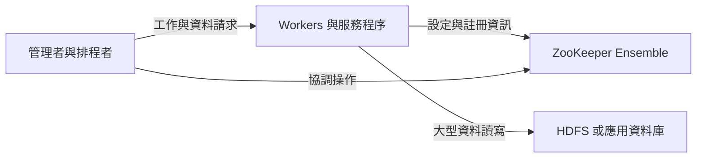
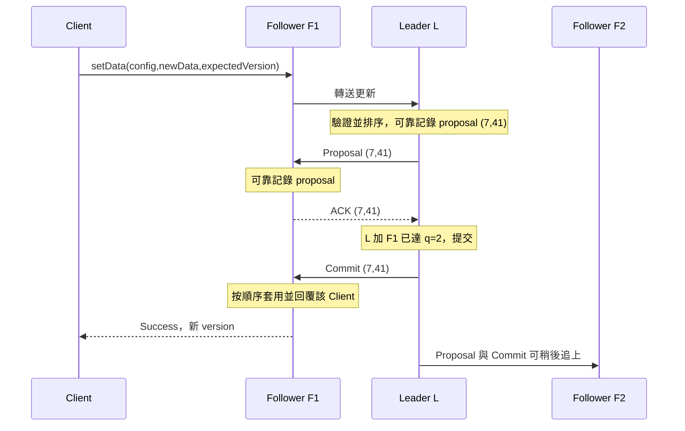
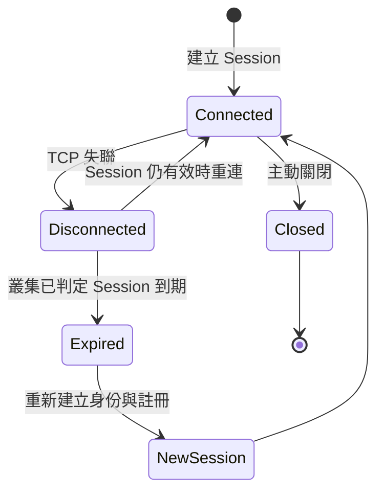
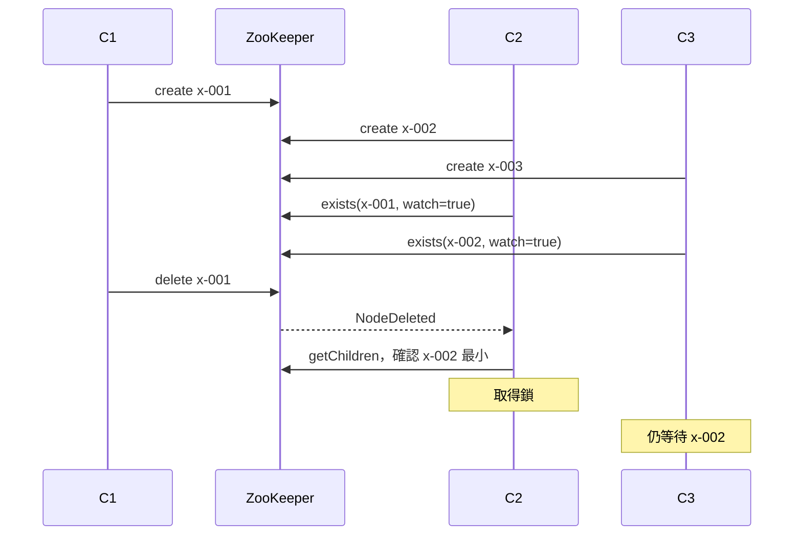
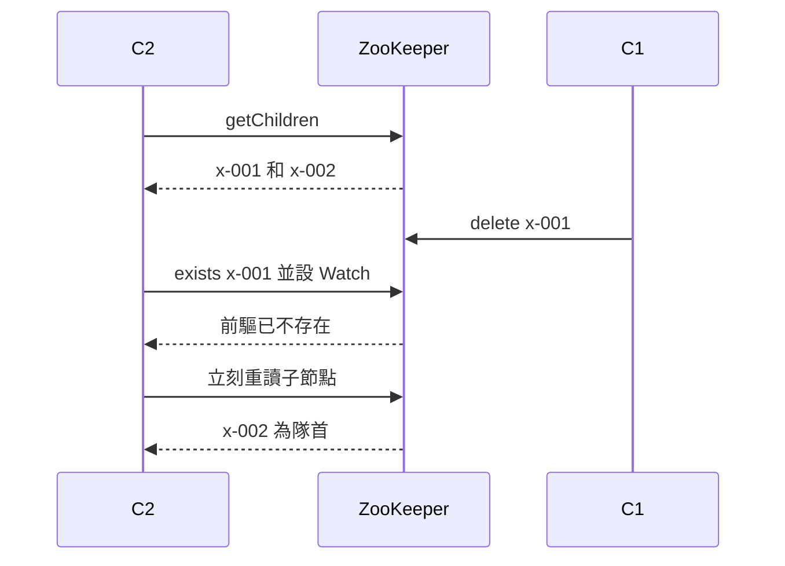

# Chapter 03 — 分散式協調服務 (Distributed Coordination Services: ZooKeeper)

## 1. Worker 要去哪裡找設定和排程者?

兩台工作節點 (Worker) 重啟後要繼續處理檔案. 兩台都能找回輸入, 但還需要知道最新設定, 去哪找排程者, 以及誰可以發布結果. 如果設定和成員資訊只存在各自的記憶體, 重啟的 Worker 可能按舊設定領工作, 兩個排程者也可能同時分配同一份任務.

ZooKeeper 是分散式協調服務 (Coordination Service). 它讓應用共用小型中繼資料 (Metadata), 例如設定版本, 工作節點位址與排隊順序. [Chapter 02](02-fault-tolerance-paxos-raft.md) 先解釋副本如何對更新順序達成共識. 這裡再看應用如何用有順序的更新協調工作.

在 Hadoop 生態系中, HDFS 儲存及複寫資料區塊, YARN 分配運算資源, MapReduce 或 Spark 執行運算. ZooKeeper 走的是另一條路徑. Worker 可從 HDFS 讀大型輸入, 再向 ZooKeeper 讀取少量設定或註冊身分. 搬檔案和協調工作可以各由專門的服務負責. 同樣使用這套生態系的 HBase 提供寬欄資料庫, Hive 提供查詢分析的 SQL 介面, Phoenix 則讓應用用 SQL 查詢 HBase. 這些是使用情境, 服務間的依賴會隨部署而變.



圖 3.1 - Worker 往儲存層搬移工作資料, 向 ZooKeeper 取得設定與註冊 (成大講義 P67, P70 與 MIT 6.5840 Lecture 9).

## 2. Ensemble 架構, 讀寫路徑與 Wait-free

**伺服器群體 (Ensemble)** 是共同維護同一棵資料樹的 ZooKeeper 伺服器. 用戶端 (Client) 平常只與其中一台保持連線, 斷線時由用戶端函式庫嘗試重連.

Worker 連到追隨者 F1 後, 可以直接讀 F1 已套用的 `/app/config`. 這省下一次多數往返, 也可能讀到舊版. 更新走得更遠: F1 先轉送給領導者 (Leader), Leader 排順序, 投票伺服器把更新寫入日誌. 讀取走本地副本, 解釋了為什麼讀取負載容易分散, 也解釋了為何 F1 和 F2 可能暫時回傳不同版本.

如果 Worker 只需要在設定改變後重讀, 可以用 §6 的 Watch 減少輪詢.

### 2.1 Wait-free 允許其他用戶端繼續更新

**無等待協調介面 (Wait-free Coordination Interface)** 說的是核心操作間的依賴. 一個 Client 暫停或卡住時, 其他 Client 仍可發出基本更新, 不必等它釋放服務內建的鎖或處理 Watch 通知. 請求仍受網路與多數可用性限制. 用戶端自行組合的分散式鎖也可能阻塞.

## 3. 多數 Quorum 與 ZAB: 從寫入到提交

### 3.1 寫入至少要經過哪些伺服器?

沿用 [Chapter 02 的多數規則](02-fault-tolerance-paxos-raft.md#4-majority-quorum-相交為何必要而不充分). 等權重配置中, $N$ 只計投票伺服器, 因此 Leader 計入, 非投票觀察者 (Observer) 不計入. 例如四台投票者要 $\left\lfloor\frac{4}{2}\right\rfloor+1=3$ 票.

P78 的圖有一位 Leader 和三位 Followers. 若 Leader 已把提案可靠寫入自己的日誌, 再收到兩位 Followers 的 ACK, 合計就是三票.

網路分區時, 舊 Leader 可能還沒發現自己失去多數. 新 Leader 要完成啟用流程才能開始寫入, 讓新一輪沿用已提交的歷史.

### 3.2 Epoch, zxid 與有序前綴

如果兩次設定更新同時到達 F1 和 F2, 所有副本得依同一順序套用. ZooKeeper 原子廣播 (ZooKeeper Atomic Broadcast, ZAB) 讓一個已啟用的 Leader 排序各筆更新, 副本再依此維護共同前綴. Leader 會把領導世代 (Epoch) 和本世代內的計數編成交易識別碼 (ZooKeeper Transaction ID, zxid), 高, 低各 32 bits.

本章以 `(7,41)` 表示 epoch 7 的第 41 個交易計數. 它與 znode 的 version 及鎖請求序號的差異見 §4.2.

### 3.3 三節點正常路徑: 更新設定

固定投票者 L, F1, F2, q=2, epoch=7 已啟用, 皆已套用至 `(7,40)`. Client 連到 F1, 要更新 `/app/config`.



圖 3.2 - 從 F1 收到 `setData`, 到 L 與 F1 組成 q=2, F1 套用後回覆. 圖省略其他請求與通知 (成大講義 P77–P78).

F1 的 ACK 表示它已保存提案. L 湊齊多數後才送 Commit, F1 套用後再向用戶端回覆. 若 F2 此時仍落後, 它可以晚一點補齊. 即使寫入端已收到成功回覆, F2 在追上前還是可能回傳舊設定.

### 3.4 Leader 故障: 恢復先於新寫入

叢集已提交到 `(7,40)`. L 和 F1 已套用到 40, F2 還停在 39. L 將 `(7,41)` 寫在自己的日誌, 其他節點還沒收到就當機.

1. F1, F2 偵測失聯並進入恢復. 這是懷疑, 不是 timeout 對 crash 的形式證明.
2. 選舉與 activation 必須採取保留已提交 `(7,40)` 的歷史. 本例由有該歷史的 F1 擔任新 Leader.
3. F1 先同步 F2, 再由多數確認 `NEW_LEADER`, 完成新 epoch 的啟用. 此例中新的歷史停在 `(7,40)`, 只有失聯 L 保存的 `(7,41)` 沒有被採用.
4. F1 開始處理新寫入. 舊 L 回來時, 先同步新歷史, 再以 Follower 的身分追上群體.

如果故障前 `(7,41)` 其實已到達多數, 新 Leader 的恢復就得保住這段歷史. 用戶端可能在這兩種情況都只看到逾時. 像建立循序節點這種操作, 要先用 §8.3 的請求識別碼找回原節點, 再決定是否重試.

### 3.5 ZAB, Multi-Paxos 與 2PC 的界線

| 機制 | 要共同決定什麼 | 正常路徑與恢復重點 | 不可混用的概念 |
| --- | --- | --- | --- |
| ZAB | Primary 所產生更新的有序前綴 | Leader activation 後廣播, 維持跨 Leader 的歷史順序 | FIFO 傳輸本身不足以推得全部讀寫線性一致 |
| Stable-leader Multi-Paxos | 每個 log slot 的安全值 | 穩態 Phase 2; 換 Leader 以 quorum 歷史恢復 slots | 實作也可有單一 Stable Leader, 不是"Paxos 天生沒有 Leader" |
| 兩階段提交 (Two-Phase Commit, 2PC) | 不同交易參與者是否一起 commit/abort | 參與者 prepare 後由 coordinator 決定; 有 blocking 情境 | 交易的全體參與者與複寫的多數 quorum 是不同角色 |

ZAB 的 Proposal, ACK 和 Commit 長得像 2PC 的兩階段流程, 但它等的是同一份資料的多數投票副本, 2PC 等的是各自掌管不同交易狀態的參與者. ZAB 的 FIFO 通道讓單一 Leader 的提案順序在途中保持一致, 換 Leader 時由啟用流程接續歷史.

## 4. Znode 資料模型與條件更新

**資料節點 (Znode)** 用路徑命名, 例如 `/app/config`. 一個節點可以同時保存少量資料和擁有子節點. `/app/config` 可存整份小型設定, `/app/workers` 的子節點可各存一台 Worker 的位址.

管理者用持久節點 (Persistent Znode) 存 `/app/config`, 管理者離線後設定仍在. Worker 用暫存節點 (Ephemeral Znode) 登記 `/app/workers/w1`, 對應工作階段 (Session) 結束時註冊會清除. 一般暫存節點不能有子節點. 建立時也可加循序旗標 (Sequential Flag), 讓服務在名稱末尾加上同一父節點下可排序的序號. 結合暫存與循序, 就能建立有效期間有限的排隊紀錄.

### 4.1 兩個人同時改一份設定

讀取資料時也會回傳節點狀態 (Stat), 其中的 `version` 表示資料版本. 後續寫入可以附上先前讀到的版本. 只要中間有人先更新, 服務就能發現這次寫入沿用了舊資料.

### 4.2 用版本避免更新遺失

A 和 B 都讀到 `/app/config` 的 `data={limit:10}, version=4`. 假設 A 想加 1, B 想加 2.

1. A 計算新資料 `{limit:11}`, 送 `setData(...,version=4)`, 成功後資料 version=5.
2. B 仍依舊內容計算 `{limit:12}`, 也以 expectedVersion=4 寫入.
3. ZooKeeper 回覆 `BadVersion`. 若 B 仍要將目前上限加 2, 應先重讀 `limit=11, version=5`, 再帶著版本 5 嘗試寫入 13.

這是 **比較後更新 (Compare-and-Set, CAS)**. 競爭者可以同時讀, 更新時由版本檢查攔下基於舊資料的寫入. 一直輸掉競爭的 Client 仍可能無法完成. 傳 `version=-1` 則會跳過版本檢查.

`version=5` 計特定 znode 的資料版本. `zxid=(7,41)` 標記全群體的更新位置. `x-0000000012` 的尾碼則用來排同一父節點下的請求. 三個編號的比較範圍不同.

### 4.3 建立, 刪除與監看時會回傳什麼

`create(path,data,flags)` 回傳實際建立的路徑, 循序節點的回傳值含尾碼. 遇到 `ConnectionLoss` 時, 依 §8.3 找回原請求. `delete(path,version)` 可附預期資料版本, 避免刪掉已被其他人更新的節點.

`exists(path,watch)` 可監看尚不存在的路徑. `getData(path,watch)` 讀取現有節點的資料和 Stat, 若回 `NoNode` 就沒有成功設置資料 Watch. `getChildren(path,watch)` 監看子節點的增刪, 子節點只改內容時清單不會變.

## 5. Session, 斷線與 Ephemeral 的時間軸

同一個 ZooKeeper Session 可跨越多次 TCP 連線. 短暫斷線後, Client 若在到期前連回群體, 就能延續原 Session 和暫存節點. Session 是否到期由群體依逾時與活動判定.



圖 3.3 - 同一個 Session 可以跨 TCP 連線, Expired 由服務端判定. 隔離中的 Client 可能在重新連線後才得知 (成大講義 P81, P87).

| 時點 | 叢集視角 | Client 能知道什麼 |
| --- | --- | --- |
| t0 | Session S 有效, `/app/workers/w1` 存在 | 已成功註冊 |
| t1 斷線 | 尚未必判定過期 | 只知道 Disconnected, 應進入保守模式 |
| t2 短暫重連 | 若 S 仍有效, 保留 Ephemeral | 可驗證 Session 與狀態後恢復 |
| t3 長時間隔離 | 叢集判 S 到期, 清理其 Ephemeral | Client 可能仍未收到通知 |
| t4 再連線 | S 不可復活 | 必須新 Session, 重新註冊, 不延用舊 lock ownership |

暫存節點在 **ZooKeeper Session 到期** 時才清除. 如果伺服器群體也失去多數, 清除操作和後續交接要等群體恢復提交能力.

## 6. Watch 如何提醒用戶端重新讀取

**監看通知 (Watch)** 讓 Client 在讀資料時一起請求變動通知. 一般 Watch 觸發一次就消耗. ZooKeeper 3.9.4 也支援持續及遞迴監看, 本章設定與鎖的例子採一次性 Watch.

收到通知時先把快取標成過期, 再透過一次讀取取得目前狀態並重新註冊 Watch. 應用依這次重讀的資料判斷要做什麼.

### 6.1 連續更新的具體例子

1. Worker 對 `/app/config` 呼叫 `getData` 並設 Watch, 讀到 v4.
2. 管理者寫成 v5, 標準 Watch 觸發並被消耗.
3. Worker 尚未重新讀取前, 設定又更新至 v6.
4. Worker 重讀取得 v6, 重新設 Watch. 它不一定看見 v5, 也不應靠 callback 次數推斷改過幾次.

Watch 的順序是對同一個 Client 保證. 在該 Client 讀到對應的新狀態前, 會先收到相關的 Watch 事件. 寫入流程無須等所有訂閱者處理 callback. 如果必須逐筆消化每次改動, 就需要可重播的版本或事件紀錄.

### 6.2 Watch 與連線狀態

斷線期間收不到 Watch. 重連後 client library 可重新註冊既有監看, 但"原本不存在的節點在隔離期間建立又刪除"可能完全看不到. 收到 Session/connection event 後應重新讀取狀態, 而不是假定所有中間事件都能補回.

Watch callback 也不宜執行長時間工作而堵住事件派送. 應交給工作佇列, 再以重新讀取的狀態作決定. 這是 Client 邏輯, 不是 ZooKeeper 保證每個 callback 都及時完成.

## 7. Configuration 與 Group Membership 完整案例

### 7.1 Configuration Management

管理者建立 Persistent`/app/config`, Workers 啟動時讀資料並設 Watch. 單一資料節點中的完整設定可透過 version CAS 原子替換; Worker 收到通知後重新驗證格式, 載入並再監看.

設定跨多個 znode 時, 逐個更新可能讓 Worker 讀到一半是舊版, 一半是新版. 可以先建立不可變的 `/configs/v8/`, 再用一次寫入讓 `/app/currentConfig` 指向 v8. Worker 先讀指標, 接著只讀該版本的檔案. 等還在讀舊版的用戶端完成後, 才能清理舊版.

### 7.2 Group Membership

W1 用 Session S1 建立 `/app/workers/w1`, 資料為 endpoint; W2 用 S2 建 w2. Monitor 讀取 children 並設 Watch, 得 `[w1,w2]`. S1 到期後, w1 被刪除, Monitor 收到 child event, 再讀得 `[w2]` 並重新監看.

清單記的是有效 Session 下的註冊. 如果 Worker 的業務執行緒卡住, 但連線仍能送心跳, 註冊就會繼續留在清單中. 要知道它還能不能接工作, 得再看業務健康狀況.

## 8. Distributed Lock: 排隊, 競爭與恢復

**分散式鎖 (Distributed Lock)** 讓遵守同一套排隊規則的 Client 輪流取得資源使用權. 這裡先看如何從請求的順序決定持有者, 再看外部儲存是否能拒絕前一位持有者的延遲操作.

### 8.1 三個 Client 正常排隊

自製名稱簡寫為 `x-001`, `x-002`, `x-003`, 非 SDK 實際補零長度:

| 請求 | 初始狀態 | 監看的前驅 | x-001 被刪後 |
| --- | --- | --- | --- |
| C1: x-001 | 最小, 已取得鎖 | 無 | 釋放 |
| C2: x-002 | 等待 | x-001 | 重讀後成為最小, 取得 |
| C3: x-003 | 等待 | x-002 | 繼續等待, 不必因 C1 釋放而競爭 |



圖 3.4 - C1 刪除自己的請求, 只喚醒這次直接等它的 C2. C2 還要重新檢查自己是否為隊首 (成大講義 P84–P86).

若 C2 和 C3 都監看隊首 C1, 一次釋放會讓兩人同時醒來查隊列. 等待者越多, 這類重試越多, 稱為 **驚群效應 (Thundering Herd)**. 改成監看直接前驅後, 上例只需叫醒 C2. 若同時到期的 Session 刪除多個請求, 仍可能有多個通知.

### 8.2 完整 recipe 與前提

假設 `/locks/job` 為持久父節點, 目錄只保存同一鎖的請求. 每個請求有可辨識且唯一的前綴, clients 有正確 ACL, 依 sequential suffix 解析與排序. 以下是語義 pseudocode, 非可直接執行的 SDK:

```text
myNode := create('/locks/job/<request-id>-', EPHEMERAL_SEQUENTIAL)
loop:
    if Session invalid: abandon ownership and recover
    children := getChildren('/locks/job', watch=false)
    queue := sort valid lock requests by sequential suffix
    if myNode not in queue: recover instead of assuming ownership
    if myNode is queue minimum: return acquired
    predecessor := immediate predecessor of myNode in queue
    stat := exists(predecessor, watch=true)
    if stat is absent: continue              # 不可直接睡眠
    wait for relevant watch/session event
    # callback 可能已在 wait 前到達；本地 condition/event 必須保留喚醒
release:
    delete myNode
```

### 8.3 競爭與失敗時間軸



圖 3.5 - 刪除落在列舉與監看之間, C2 得到不存在就重查. 若刪除發生在成功登記之後, 則由通知叫醒 C2 (成大講義 P84–P86).

- **前驅在設 Watch 前消失**: C2 讀到 x-001, C1 刪除, C2 再 `exists` 得不存在. 立刻回 loop, 不能等永不再發生的 deletion event.
- **前驅在設 Watch 後消失**: Watch 負責喚醒, 但 callback 到達後仍回 loop. 若中間等待者取消, 它被喚醒也不保證已成隊首.
- **建立成功但回覆遺失**: Client 不知道實際 sequential 名稱. 以 request UUID/GUID 前綴查 children, 找出原請求後再決定重試, 避免同一邏輯請求建出兩個 queue entries.
- **等待者取消**: 刪自己的節點. 不要讓無人使用的有效 Session 請求永久排在前面.
- **持有者 crash**: 叢集判其 Session 到期後刪 Ephemeral, 下一個 Client 重讀後接手. 不是 crash 當下立即交接.
- **叢集失去多數**: 不能以 timeout 自行跳過隊列, 宣稱取得鎖. 應用是否暫停外部寫入, 要有保守的權限策略.

### 8.4 外部資源的 stale holder 與 Fencing

假設 C1 已持鎖, 但與 ZooKeeper 隔離. 它仍能連到資料庫. Session 到期後 C2 取得新鎖, C1 卻因長暫停恢復而繼續送舊寫入. Ephemeral 清理不能撤回另一條網路連線已送出的請求.

可在應用設計 **Fencing Token**: 每次授權給出嚴格遞增的 generation, 外部儲存與更新原子地保存已接受最大值. 例: C1 的 41, C2 的 42. 儲存端先接受 42 後, 對 41 的延遲操作回拒絕.

```text
atomic external_write(token, operation):
    if token < greatest_accepted_token: reject stale owner
    else:
        greatest_accepted_token := token
        apply operation under the resource's own atomicity rules
```

外部儲存第一次接受 42 之前, 仍可能接受 C1 的 41. 因此新持有者若要先切斷舊操作, 要先讓資源確認新 token. Token 還得跨重啟及鎖父節點重建保持遞增. 順序尾碼可能因重建或溢位而失去這項性質. 若同一個 token 可以重送多筆請求, 要另外以請求 ID 去重.

## 9. 讀取一致性與 sync 的限制

**線性一致性 (Linearizability)** 要求操作可視為在呼叫與回覆間的一個瞬間生效, 並保留真實時間先後. ZooKeeper 的更新提供強順序, 但本地讀取可能落後; **Client FIFO Order** 也不是不同 Client 間共享一個最新觀測點.

自製反例: A 寫入 v8 並收到成功, 再經另一個通訊管道告知 B. B 連到尚停在 v7 的 Follower, 其一般讀取可能仍得到 v7; B 沒有違反自己原本觀察的 FIFO 順序, 卻未滿足"在 A 完成後必讀到 A 的更新"的期望.

若先呼叫 `sync(path)`, 要等成功回呼後, 再用同一 Session 送出讀取. 這能在正常路徑上讓連線端先追上 Leader 的進度.

ZooKeeper 3.9.4 的 `sync` 本身不經過多數確認. 舊 Leader 若還以為自己在任, 可能從落後的歷史處理這次 `sync`, 後續讀取仍會看到舊值. [ZooKeeper Internals: Consistency Guarantees](https://zookeeper.apache.org/doc/r3.9.4/zookeeperInternals.html)

需要更強的讀取保證時, 3.9.4 文件給出的做法是同一 Client 先完成真正經過多數提交的操作, 例如成功寫入, 再按其操作順序讀取. 若只要求看到特定版本, 也可以先檢查回傳的版本是否已達要求.

## 10. 從共同順序走向分散式查找

只監看前一位等待者能減少同時重試, 但每次重查仍要用 `getChildren` 取得整份隊列. 目錄的權限也要限制誰能刪除請求, 否則有效的請求可能在持有者尚未釋放時就被別人移除.

[Chapter 04](04-peer-to-peer-gossip.md) 換成每個節點只知道附近同伴的情境. 要讓更新逐步散布或查到檔案位置時, 節點如何交換局部資訊, 便比替每筆更新排出同一順序更重要.

## 11. 英文選擇題與逐項解析

### Q1 — Quorum counting

An ensemble has one voting leader, three voting followers, and two non-voting observers. How many voting servers form a majority?

- A. Two.
- B. Three.
- C. Four.
- D. Six.

**答案: B.** A: 四名投票者的半數不夠. B: $\left\lfloor\frac{4}{2}\right\rfloor+1=3$, 可包含 Leader. C: 不必全體. D: Observer 不計票.

### Q2 — Standard Watch

A znode changes twice before a notified client rereads it. What should the client assume?

- A. Two distinct callbacks are guaranteed.
- B. The first callback contains every intermediate value.
- C. No reread is necessary.
- D. Its cached data is stale; it should reread and reestablish the watch.

**答案: D.** A: one-shot 不保證逐筆通知. B: 通知不是資料日誌. C: 需要讀取新狀態. D: 正確的失效通知模式.

### Q3 — Missing predecessor

After listing lock children, a client calls exists(predecessor,true) and gets no node. What should it do?

- A. Recheck the queue immediately.
- B. Wait forever for that predecessor's deletion event.
- C. Declare that its session has certainly expired.
- D. Delete every remaining request.

**答案: A.** A: 前驅可能已在兩次 RPC 間消失. B: 可能再無該刪除事件. C: 不存在不證明自身 Session 到期. D: 不能破壞其他請求.

### Q4 — sync()

Which statement matches the documented limitation of sync() in ZooKeeper 3.9.4?

- A. It turns every follower read into an unconditional linearizable read in all failure scenarios.
- B. It is identical to acquiring an external database lock.
- C. It is not itself a quorum operation, so its strongest freshness interpretation needs care.
- D. An asynchronous sync callback can always be ignored.

**答案: C.** A: 官方記錄舊 Leader 情境限制. B: 它不控制外部資源. C: 保留真正的語義邊界. D: 未等完成不能把它當已完成屏障.

### Q5 — Stale lock holder

An expired client can still reach the external storage. What most directly helps storage reject its delayed writes after a new holder takes over?

- A. Increasing the GUI refresh rate.
- B. Assuming ephemeral deletion cancels all network packets.
- C. Sorting old callback timestamps locally.
- D. An enforced, monotonically ordered fencing generation at the storage boundary.

**答案: D.** A: 不影響寫入權限. B: 無此撤回保證. C: 本地排序無法讓儲存識別舊權限. D: 儲存必須原子拒絕落後 generation, token 來源也需正確.

## 12. 來源與投影片對照

| 講義 | 主題 | 算例與圖解 |
| --- | --- | --- |
| P63–P70 | 協調與資料路徑分工 | 圖 3.1, Worker 啟動 |
| P71–P74 | 本地讀取與監看 | F1 讀/寫路徑 |
| P75–P79 | ZAB, 多數與合法歷史 | 圖 3.2, zxid (7,41) |
| P80–P82 | Znode, 版本, Session, Watch | 圖 3.3, v4→v5, w1 到期 |
| P83–P87 | 隊首, 前驅監看與失效 | 圖 3.4–3.5, C1→C2, token 41→42 |
| P88–P89 | 本地讀取與 sync 的邊界 | v8 更新後讀到 v7 |

- 大學教材 [MIT 6.5840 Lecture 9 — ZooKeeper](https://pdos.csail.mit.edu/6.824/notes/l-zookeeper.txt), 協調器與資料儲存分工, 以及讀取, 版本和通知的使用方式.

- 原始論文 Hunt, Konar, Junqueira, Reed, 2010, [ZooKeeper: Wait-free coordination for Internet-scale systems](https://www.usenix.org/events/atc10/tech/full_papers/Hunt.pdf), §2 的模型, Session 與 recipes; §3 的實作分工. 課堂簡化與現行文件有差異時分別註明.
- 官方文件 [ZooKeeper 3.9.4 Programmer's Guide](https://zookeeper.apache.org/doc/r3.9.4/zookeeperProgrammers.html): Znode, version, Session, Watch 與一致性.
- 官方文件 [ZooKeeper 3.9.4 Recipes](https://zookeeper.apache.org/doc/r3.9.4/recipes.html): Lock recipe, 前驅 Watch, 未知 create 結果的 GUID 處理.
- 官方文件 [ZooKeeper 3.9.4 Internals](https://zookeeper.apache.org/doc/r3.9.4/zookeeperInternals.html): ZAB, quorum, zxid, sync 的限制.

執行 `python tools/verify-coordination-p2p.py` 可檢查本章的多數計票, 版本競爭及鎖交接算例.
