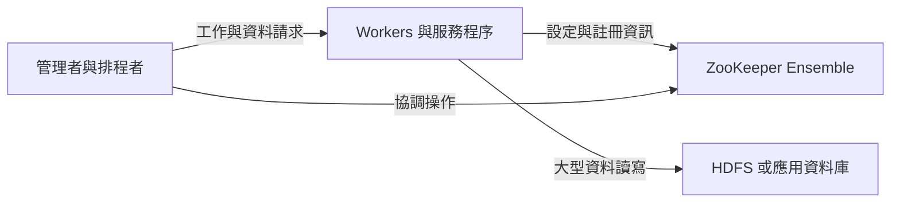
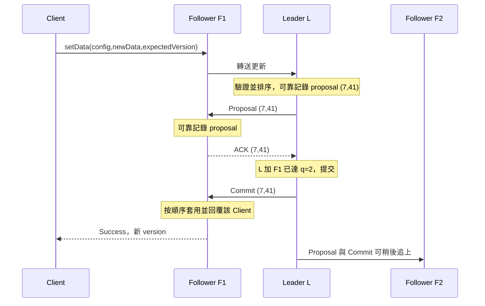
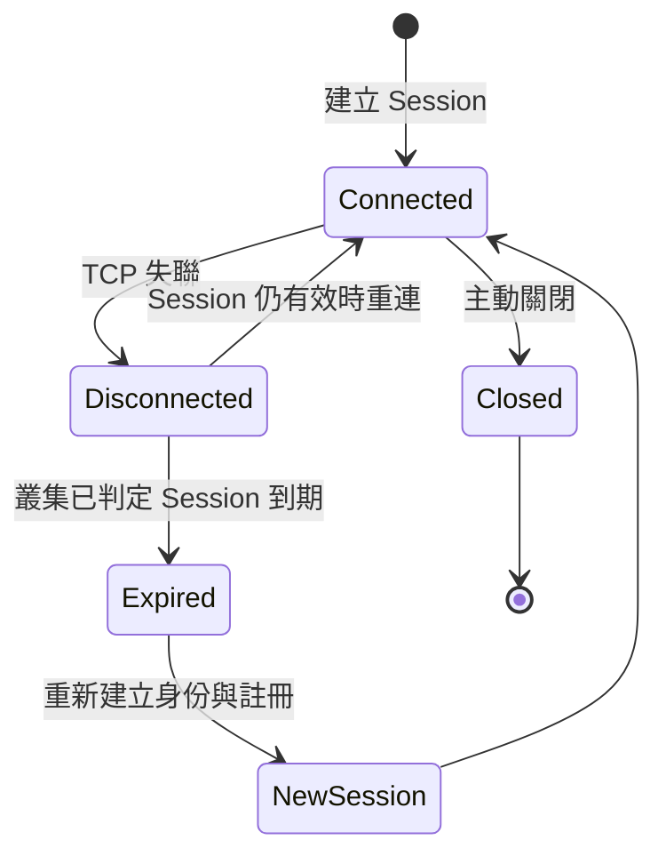
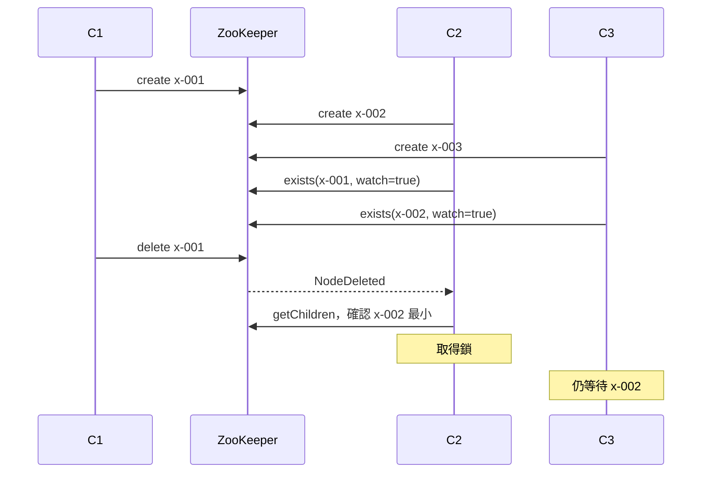
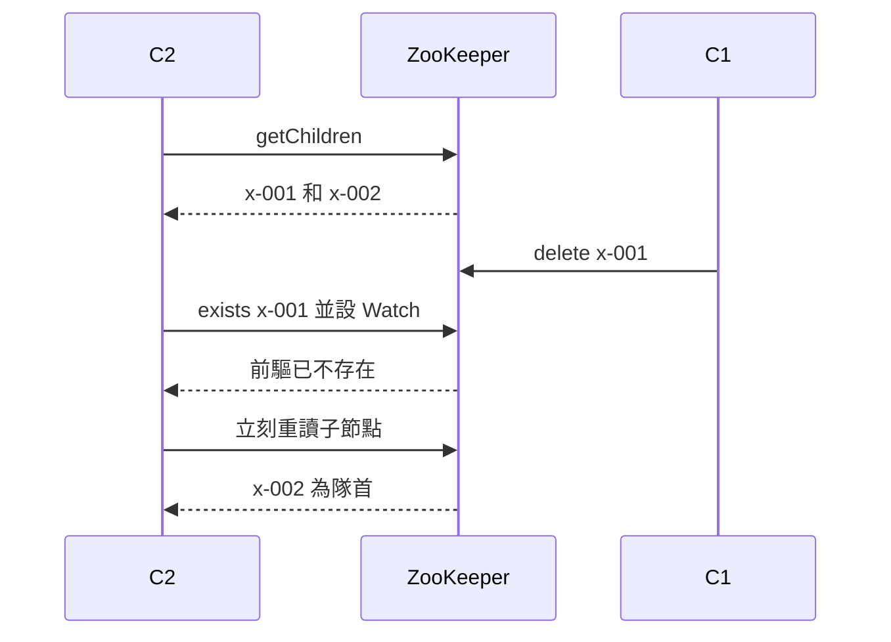

# Chapter 03 — 分散式協調服務（Distributed Coordination Services: ZooKeeper）

## 1. Worker 要去哪裡找設定和排程者？

> [課程講義] P63–P70：章節定位、Hadoop 生態系與 ZooKeeper 的位置。

兩台工作節點（Worker）重啟後要繼續處理同一批檔案。它們可以從檔案系統找回輸入，但還得知道排程者是誰、每台能同時跑幾個工作，以及誰有權發布結果。如果各自把這些資訊留在記憶體，一台重啟就可能回到舊版設定，兩個排程者也可能同時將工作交給不同人。

ZooKeeper 把這些應用共同依賴的小型中繼資料（Metadata）放在協調服務（Coordination Service），讓應用用共享狀態、名稱及通知來組合設定管理、成員註冊與互斥。這接續 [Chapter 02](02-fault-tolerance-paxos-raft.md) 的問題：如果多台機器先同意更新順序，應用可以把哪些責任交給這個共同狀態？

講義從 GFS、MapReduce 論文帶到 Hadoop。沿著同一批資料看，HDFS 儲存並複寫資料區塊，YARN 分配執行資源，MapReduce 或 Spark 負責運算。HBase 將資料組織成寬欄資料庫（Wide-Column Store），Hive 和 Phoenix 分別透過 SQL 介面使用相關運算／儲存元件。圖 3.1 用兩條路徑標出 ZooKeeper 的位置。P67 描述的是元件定位，各部署的依賴和資料路徑取決於所用元件。



圖 3.1｜Worker 往儲存層搬移工作資料，向 ZooKeeper 取得設定與註冊。自繪，參考成大講義 P67、P70 與 MIT 6.5840 Lecture 9。

## 2. Ensemble 架構、讀寫路徑與 Wait-free

> [課程講義] P71–P74。延伸：[Hunt 等，ZooKeeper: Wait-free coordination for Internet-scale systems](https://www.usenix.org/events/atc10/tech/full_papers/Hunt.pdf)，§2–§3。

**伺服器群體（Ensemble）** 共同維護資料樹。Client 通常連接一台伺服器，並由 client library 管理重新連線。一般讀取由連線端的本地副本處理；更新則經過 Leader 排序、複寫與提交。

Worker 連到 F1 後就能讀 `/app/config`，F1 直接用自己已套用的狀態答覆，因此省去每次讀取的多數往返。管理者若向同一台 F1 寫入，請求則得經過領導者（Leader）排序，再由足夠副本持久保存。這條路有更多網路與磁碟成本，也使 F1 和 F2 的讀取進度可能短暫不同。

設定變動不頻繁時，Worker 可以在讀取時登記監看通知（Watch）。收到通知便重新讀取，平常不必一直輪詢。這把應用等待設定變動的工作留給 Client，寫入端仍可繼續處理其他請求。

P71–P72 的讀寫比例、microsecond latency、P88 的讀取吞吐成長描述，應理解為設計動機。本文沒有測量 latency，也不將「資料樹在 RAM」解釋為更新無需磁碟。成功更新仍需要協定要求的持久化。

### 2.1 Wait-free 不等於請求不等待網路

**無等待協調介面（Wait-free Coordination Interface）** 在本章指核心 API 不要求某個 Client 先釋放一把服務內建的阻塞鎖，其他 Client 才能更新共享資料。慢 Client 的 Watch callback 不應成為所有更新都要等它同意的同步屏障。

這不代表 RPC 在任意分區下都有固定完成時間，也不代表應用無法死結。同步 API 仍可阻塞呼叫端，quorum 不可達時操作也不能任意成功。應用若自行組合鎖並以相反順序取得資源，仍可能形成死結。

## 3. 多數 Quorum 與 ZAB：從寫入到提交

> [課程講義] P75–P79。延伸：[ZooKeeper 3.9.4 Internals](https://zookeeper.apache.org/doc/r3.9.4/zookeeperInternals.html)，Atomic Broadcast、Leader Activation、Quorums。

### 3.1 寫入至少要經過哪些伺服器？

普通等權重配置中，有 N 個投票伺服器，**多數法定人數（Majority Quorum）** 為 $q=\left\lfloor\frac{N}{2}\right\rfloor+1$。Leader 自己也是投票群體的一員。非投票 Observer 不增加分母；本節不涵蓋 weighted／hierarchical quorum 或配置變更。

例如 N=5，q=3；三台仍能互通且恢復協定完成時，可以繼續處理更新。N=4 時 q=3，不是 2。P78 畫 Leader 加三個 Followers，其「2 out of 3」可安全讀為 Leader 自身已可靠記錄，再加三個 Followers 中的兩個 ACK，共三個 voting servers。

多數相交避免兩個不相交群體各自形成有效提交，但不是「任何時間只能有一台機器自認是 Leader」的證明。分區中的舊 Leader 可能尚未發現失去權限；epoch、恢復與提交規則才共同保護 Safety。與 [Chapter 02 的 quorum 與狀態規則](02-fault-tolerance-paxos-raft.md)相同，不能只靠集合相交就刪掉其餘條件。

### 3.2 Epoch、zxid 與有序前綴

如果兩次設定更新同時到達 F1 和 F2，所有副本得依同一順序套用。ZooKeeper 原子廣播（ZooKeeper Atomic Broadcast，ZAB）讓一個已啟用的 Leader 排序各筆更新，副本再依此維護共同前綴。Leader 會把領導世代（Epoch）和本世代內的計數編成交易識別碼（ZooKeeper Transaction ID，zxid），高、低各 32 bits。

本章以 `(7,41)` 表示 epoch 7 的第 41 個交易計數。這個編號不是 znode 的 `version`，也不是 lock node 名稱的 sequential suffix；三者作用不同。

Leader activation 的目標是先建立可延續既有決定的合法歷史，再接受新工作。P76 將其濃縮成「選舉與同步」；不能實作成誰先 timeout 就直接把自己那份較短資料覆蓋其他副本。

### 3.3 三節點正常路徑：更新設定

[教學補充／推導] 固定投票者 L、F1、F2，q=2，epoch=7 已啟用，皆已套用至 `(7,40)`。Client 連到 F1，要更新 `/app/config`。



圖 3.2｜從 F1 收到設定更新，到 L 與 F1 組成 q=2、F1 套用後回覆。自繪，參考成大講義 P77–P78。圖省略其他請求與通知。

把時間停在 F1 送 ACK 的位置。F1 保存了提案，L 尚須依多數規則提交，才會通知 F1 套用。F2 落後時仍可稍後補齊，這筆 Client 回覆不用等到三台全數套用。若 L 在途中消失，下一位 Leader 得先判斷這筆更新必須保留，還是可以捨棄。

### 3.4 Leader 故障：恢復先於新寫入

[教學補充／推導] 三台已提交至 `(7,40)`；L、F1 有此前綴，F2 尚落後至 `(7,39)`。L 另把 `(7,41)` 只記在自己，未複寫成多數，隨後 crash。

1. F1、F2 偵測失聯並進入恢復。這是懷疑，不是 timeout 對 crash 的形式證明。
2. 選舉與 activation 必須採取保留已提交 `(7,40)` 的歷史；本例由有該歷史的 F1 擔任新 Leader。
3. F2 同步到合法前綴，確認新 epoch 的領導權；協調者尚未啟用前不處理新 Client 寫入。
4. 僅在舊 L 的 `(7,41)` 可以不成為最終已提交歷史；本例沒有 Client 成功回覆。
5. 新 epoch 中再接受更新，與舊 epoch 的延遲訊息區分。

若 Client timeout 的真實情況其實是 proposal 已到合法 quorum、只是回覆遺失，便不能直接套用第 4 步說它不存在。恢復需處理未知結果，Client 也應查詢狀態或使用去重識別，不能盲目認為重送不會多建立一個節點。

### 3.5 ZAB、Multi-Paxos 與 2PC 的界線

| 機制 | 要共同決定什麼 | 正常路徑與恢復重點 | 不可混用的概念 |
| --- | --- | --- | --- |
| ZAB | Primary 所產生更新的有序前綴 | Leader activation 後廣播，維持跨 Leader 的歷史順序 | FIFO 傳輸本身不足以推得全部讀寫線性一致 |
| Stable-leader Multi-Paxos | 每個 log slot 的安全值 | 穩態 Phase 2；換 Leader 以 quorum 歷史恢復 slots | 實作也可有單一 Stable Leader，不是「Paxos 天生沒有 Leader」 |
| 兩階段提交（Two-Phase Commit，2PC） | 不同交易參與者是否一起 commit／abort | 參與者 prepare 後由 coordinator 決定；有 blocking 情境 | 交易的全體參與者與複寫的多數 quorum 是不同角色 |

P77 的「Simplified Two-Phase Commit」是 proposal／ACK／commit 的教學類比，不等同完整分散式交易 2PC。P79 說 FIFO 保證 A、B 的順序，仍須搭配合法 Leader、提交與回復規則；TCP 並不能讓任意舊 Leader 的更新變合法。

## 4. Znode 資料模型與條件更新

> [課程講義] P80–P81。延伸：[ZooKeeper 3.9.4 Programmer's Guide](https://zookeeper.apache.org/doc/r3.9.4/zookeeperProgrammers.html)，Data Model、Sessions、Stat Structure。

**資料節點（Znode）** 同時可有小型資料與子節點，位置以 path 命名，例如 `/app/config` 與 `/app/workers/w1`。它不是供任意大型檔案讀寫的一般檔案系統；沒有因為使用路徑就自動取得資料庫交易或 POSIX 檔案語義。

管理者建立持久節點（Persistent Znode）保存 `/app/config`，離線後設定仍在。Worker 則用暫存節點（Ephemeral Znode）登記 `/app/workers/w1`，它的工作階段（Session）結束時註冊會被清除。一般暫存節點不能有子節點。如果為每次鎖請求加上循序旗標（Sequential Flag），ZooKeeper 會在同一父目錄範圍的名稱後附加序號。結合兩個旗標，就有了可以排序、也能在 Session 到期後清理的請求。

### 4.1 兩個人同時改一份設定

除了資料本身，讀取會回傳節點狀態（Stat），其中包含資料版本。這讓寫入附帶「我讀過的是哪一版」。下面先追蹤版本 4 的正常寫入與競爭結果。

### 4.2 實際數值：避免更新遺失（Lost Update）

[教學補充／推導] A、B 都讀到 `/config` 的 `data={limit:10}, version=4`。

1. A 計算新資料 `{limit:11}`，送 `setData(...,version=4)`，成功後資料 version=5。
2. B 仍依舊內容計算 `{limit:12}`，也以 expectedVersion=4 寫入。
3. ZooKeeper 拒絕 B，回 BadVersion。B 必須讀取 version=5 後，再依應用規則決定是否重試。

這相當於**比較後更新（Compare-and-Set，CAS）** 式的樂觀併行控制，不要求讀取期間持有鎖。它防止「不知資料已變就覆蓋」，卻不保證 B 的重試永遠不飢餓。若 B 改用 -1，等於明確放棄這項保護。

資料 `version=5` 是該 znode 的資料修改次數，`zxid=(7,41)` 是 ensemble 更新位置，`x-0000000012` 是同父節點的排隊名稱。設定如今可以更新了，接著用 Session 辨識哪些 Worker 還保有註冊，再用 Watch 通知它們何時重讀設定。

### 4.3 在實作時查 API 語義

建立或刪除請求時，`create(path,data,flags)` 會回傳循序節點的實際名稱。若遇到 ConnectionLoss，可能已建立但沒收到名稱，後續用第 8 節的唯一請求前綴找回原節點。`delete(path,version)` 先核對版本，若收到 NoNode 或 BadVersion，應先重新判斷目標和權限。

查找時，`exists(path,watch)` 會檢查存在與 Stat，並可對尚不存在的路徑設 Watch。`getData(path,watch)` 用來取得現有節點的資料與 Stat，回 NoNode 時沒有成功設置資料 Watch。`getChildren(path,watch)` 則監看子節點集合，父節點下某個子節點只更新自己的資料，不會因此改變清單。列出的名稱也須自行依鎖的序號排序。

更新時，`setData(path,data,version)` 用版本保護並行修改，遇到 BadVersion 要重讀再決定。讀取前若需要呼叫 `sync(path)`，非同步介面應等 callback，具體保證見第 9 節。

`version=-1` 常用來省略版本檢查，不代表「只接受最新版」。若要避免覆蓋並行更新，應傳自己讀到的 version。

## 5. Session、斷線與 Ephemeral 的時間軸

> [課程講義] P81、P87。技術補充：Programmer's Guide 的 ZooKeeper Sessions。

**工作階段（Session）** 跨越 Client 與伺服器的單次 TCP 連線。Client 可重新連到其他伺服器，並在有效期間內繼續原 Session；ensemble 依協商的 Session timeout 與活動判斷是否到期。



圖 3.3｜同一個 Session 可以跨 TCP 連線，Expired 由服務端判定。隔離中的 Client 可能在重新連線後才得知。自繪，參考成大講義 P81、P87。

| 時點 | 叢集視角 | Client 能知道什麼 |
| --- | --- | --- |
| t0 | Session S 有效，`/workers/w1` 存在 | 已成功註冊 |
| t1 斷線 | 尚未必判定過期 | 只知道 Disconnected，應進入保守模式 |
| t2 短暫重連 | 若 S 仍有效，保留 Ephemeral | 可驗證 Session 與狀態後恢復 |
| t3 長時間隔離 | 叢集判 S 到期，清理其 Ephemeral | Client 可能仍未收到通知 |
| t4 再連線 | S 不可復活 | 必須新 Session、重新註冊，不延用舊 lock ownership |

P87 寫 Ephemeral 綁定 TCP session，作為直覺可理解；實作時應修正為 ZooKeeper Session。清理也不是 crash 的瞬間發生。若叢集本身無法形成正常提交，不能承諾到期刪除與交接在固定期限內完成。

## 6. Watch：狀態失效通知，而非完整變更串流

> [課程講義] P74、P82。延伸：Programmer's Guide 的 Watches；以下核心 recipe 使用標準 one-shot Watch。

**監看通知（Watch）** 讓 Client 在讀取時註冊變動通知。標準 Watch 觸發一次後，若仍需追蹤，必須再次註冊；3.9.4 也有 Persistent／Recursive Watch，不能把它們與本章標準模式混為一談。

正確模式是：**讀取並設 Watch → 收事件後把 cache 視為失效 → 再讀取並重設 Watch → 依新狀態決策**。通知不攜帶完整新資料，也不保證每次中間修改都有獨立 callback。

### 6.1 連續更新的具體例子

1. Worker 對 `/app/config` 呼叫 `getData` 並設 Watch，讀到 v4。
2. 管理者寫成 v5，標準 Watch 觸發並被消耗。
3. Worker 尚未重新讀取前，設定又更新至 v6。
4. Worker 重讀取得 v6，重新設 Watch。它不一定看見 v5，也不應靠 callback 次數推斷改過幾次。

P74 的通知排序是同一 Client 觀測串流的保證：它看到對應新資料前會先看到相關 Watch 事件；不是「所有 Client 都已處理 Watch，寫入才成功」。若應用需要逐筆處理每次設定變更，應另外保留可重播事件／版本紀錄。

### 6.2 Watch 與連線狀態

斷線期間收不到 Watch；重連後 client library 可重新註冊既有監看，但「原本不存在的節點在隔離期間建立又刪除」可能完全看不到。收到 Session／connection event 後應重新讀取狀態，而不是假定所有中間事件都能補回。

Watch callback 也不宜執行長時間工作而堵住事件派送；應交給工作佇列，再以重新讀取的狀態作決定。這是 Client 邏輯，不是 ZooKeeper 保證每個 callback 都及時完成。

## 7. Configuration 與 Group Membership 完整案例

> [課程講義] P82。延伸：Hunt 等 §2.4。

### 7.1 Configuration Management

管理者建立 Persistent `/app/config`，Workers 啟動時讀資料並設 Watch。單一資料節點中的完整設定可透過 version CAS 原子替換；Worker 收到通知後重新驗證格式、載入並再監看。

若設定分散在多個 znodes，一次 `setData` 的原子性不會自動擴張到整組。自製補充方案：先建立不可變的 `/configs/v8/...` 完整內容，再原子切換 `/app/currentConfig` 指向 v8；Worker 依指標取得同一版本的整組資料。舊版本應保留到無讀者需要，不能切完就刪除所有歷史。

### 7.2 Group Membership

W1 用 Session S1 建立 `/app/workers/w1`，資料為 endpoint；W2 用 S2 建 w2。Monitor 讀取 children 並設 Watch，得 `[w1,w2]`。S1 到期後，w1 被刪除，Monitor 收到 child event，再讀得 `[w2]` 並重新監看。

這代表「有效 Session 的註冊名單」，不等於 Worker 的每個業務執行緒都健康。程序卡住卻仍能送 heartbeat 時，節點可能繼續存在；需區分服務健康檢查與 Session 存活。

## 8. Distributed Lock：排隊、競爭與恢復

> [課程講義] P83–P87。延伸：[ZooKeeper 3.9.4 Recipes：Locks](https://zookeeper.apache.org/doc/r3.9.4/recipes.html)、Hunt 等 §2.4。

**分散式鎖（Distributed Lock）** 的直接目標是讓遵循同一 recipe 的有效 Client 按協定排隊；被保護的外部資源是否能拒絕過期持有者，還需第 8.4 節的約束。

### 8.1 三個 Client 正常排隊

自製名稱簡寫為 `x-001`、`x-002`、`x-003`，非 SDK 實際補零長度：

| 請求 | 初始狀態 | 監看的前驅 | x-001 被刪後 |
| --- | --- | --- | --- |
| C1：x-001 | 最小，已取得鎖 | 無 | 釋放 |
| C2：x-002 | 等待 | x-001 | 重讀後成為最小，取得 |
| C3：x-003 | 等待 | x-002 | 繼續等待，不必因 C1 釋放而競爭 |



圖 3.4｜C1 刪除自己的請求，只喚醒這次直接等它的 C2。C2 還要重新檢查自己是否為隊首。自繪，參考成大講義 P84–P86。

**驚群效應（Thundering Herd）** 指所有等待者監看同一節點，釋放一次便使所有人醒來重試。前驅鏈在穩定隊列中讓一次釋放只喚醒直接後繼，減少不必要通知與 RPC；不能把 P86 的「exactly one」擴張成 Session 批次清理、重連或所有併行情境都只有一個 callback。

### 8.2 完整 recipe 與前提

假設 `/locks/job` 為持久父節點，目錄只保存同一鎖的請求；每個請求有可辨識且唯一的前綴，clients 有正確 ACL，依 sequential suffix 解析與排序。以下是語義 pseudocode，非可直接執行的 SDK：

```text
myNode := create('/locks/job/<request-id>-', EPHEMERAL_SEQUENTIAL)
loop:
    if Session invalid: abandon ownership and recover
    children := getChildren('/locks/job', watch=false)
    queue := sort valid lock requests by sequential suffix
    if myNode not in queue: recover instead of assuming ownership
    if myNode is queue minimum: return acquired
    predecessor := immediate predecessor of myNode in queue
    stat := exists(predecessor, watch=true)
    if stat is absent: continue              # 不可直接睡眠
    wait for relevant watch/session event
    # callback 可能已在 wait 前到達；本地 condition/event 必須保留喚醒
release:
    delete myNode
```

P84 的最後「go to step 2」要同時涵蓋前驅查詢已不存在的情況。`getChildren` 與 `exists` 之間不是原子區段；`exists` 的結果與 Watch 註冊則用來封住漏通知的競爭。

### 8.3 競爭與失敗時間軸



圖 3.5｜刪除落在列舉與監看之間，C2 得到不存在就重查。若刪除發生在成功登記之後，則由通知叫醒 C2。自繪，參考成大講義 P84–P86。

- **前驅在設 Watch 前消失**：C2 讀到 x-001，C1 刪除，C2 再 `exists` 得不存在；立刻回 loop，不能等永不再發生的 deletion event。
- **前驅在設 Watch 後消失**：Watch 負責喚醒，但 callback 到達後仍回 loop。若中間等待者取消，它被喚醒也不保證已成隊首。
- **建立成功但回覆遺失**：Client 不知道實際 sequential 名稱。以 request UUID／GUID 前綴查 children，找出原請求後再決定重試，避免同一邏輯請求建出兩個 queue entries。
- **等待者取消**：刪自己的節點；不要讓無人使用的有效 Session 請求永久排在前面。
- **持有者 crash**：叢集判其 Session 到期後刪 Ephemeral，下一個 Client 重讀後接手；不是 crash 當下立即交接。
- **叢集失去多數**：不能以 timeout 自行跳過隊列、宣稱取得鎖。應用是否暫停外部寫入，要有保守的權限策略。

### 8.4 外部資源的 stale holder 與 Fencing

[教學補充／推導] 假設 C1 已持鎖，但與 ZooKeeper 隔離；它仍能連到資料庫。Session 到期後 C2 取得新鎖，C1 卻因長暫停恢復而繼續送舊寫入。Ephemeral 清理不能撤回另一條網路連線已送出的請求。

可在應用設計**隔離代碼（Fencing Token）**：每次授權給出嚴格遞增的 generation，外部儲存與更新原子地保存已接受最大值。例：C1 的 41、C2 的 42；儲存端先接受 42 後，對 41 的延遲操作回拒絕。

```text
atomic external_write(token, operation):
    if token < greatest_accepted_token: reject stale owner
    else:
        greatest_accepted_token := token
        apply operation under the resource's own atomicity rules
```

這是保護外部資源的補充設計，並非 ZooKeeper 自動附上的能力。Token 的來源與永久遞增範圍必須被設計並持久保存；不能不加條件把可能重建父節點、溢位或重設的 sequential suffix 當成永遠可靠的 fencing generation。同一 generation 的重送去重也仍要另外處理。

## 9. Consistency、sync() 與教材簡化

> [課程講義] P74、P88。技術補充：ZooKeeper 3.9.4 Internals 的 Consistency Guarantees；查詢日期 2026-11-20。

**線性一致性（Linearizability）** 要求操作可視為在呼叫與回覆間的一個瞬間生效，並保留真實時間先後。ZooKeeper 的更新提供強順序，但本地讀取可能落後；**Client FIFO Order** 也不是不同 Client 間共享一個最新觀測點。

自製反例：A 寫入 v8 並收到成功，再經另一個通訊管道告知 B。B 連到尚停在 v7 的 Follower，其一般讀取可能仍得到 v7；B 沒有違反自己原本觀察的 FIFO 順序，卻未滿足「在 A 完成後必讀到 A 的更新」的期望。

P88 建議先 `sync()` 再讀取，並使用「保證所有 pending updates」的表述。應先記住課堂用途：讓連線端與 Leader 的進度協調，而不是只看本地落後副本。

**技術補充／更精確的說法**：3.9.4 官方 Internals 明確指出，`sync` 不是 quorum operation；在舊 Leader 尚未察覺失去領導權等角落情境，`sync` 後的 read 仍不構成無條件的最新值保證。非同步 API 也須等 callback，不能發出 sync 後立刻平行讀就當屏障完成。不能以它宣稱所有跨 Client 讀寫都已線性一致。

若應用需要更強保證，應按服務與版本的正式讀取設計，利用已確認的 quorum 操作與順序，並檢查所需版本；不要以固定 sleep 或只看角色名稱補足證明。配置版本、CAS 與不可變快照可以縮小需要協調的範圍。

## 10. 從共同順序走向分散式查找

ZooKeeper 讓參與者在有多數投票者可工作的情況下，共用設定、成員清單與排隊順序。前驅監看省下驚群造成的通知與重試，但每次 `getChildren` 仍會傳回清單，成本會隨隊列增長。互斥也依賴參與者遵循相同排序與存取控制。若有其他 Client 能任意刪掉仍有效的請求，隊首條件便失去依據。

講義 P89 預告一致性模型。按合併講義實際頁序，中間先讀 [Chapter 04 的對等網路](04-peer-to-peer-gossip.md)，看每個 Peer 只知道局部資訊時如何找資料。兩種架構一比較，正好能辨認哪些狀態容許逐步傳播，哪些更新需要共同順序。

## 11. 英文選擇題與逐項解析

以下為自製單選題，不是教授原題。

### Q1 — Quorum counting

An ensemble has one voting leader, three voting followers, and two non-voting observers. How many voting servers form a majority?

- A. Two.
- B. Three.
- C. Four.
- D. Six.

**答案：B。** A：四名投票者的半數不夠。B：$\left\lfloor\frac{4}{2}\right\rfloor+1=3$，可包含 Leader。C：不必全體。D：Observer 不計票。

### Q2 — Standard Watch

A znode changes twice before a notified client rereads it. What should the client assume?

- A. Two distinct callbacks are guaranteed.
- B. The first callback contains every intermediate value.
- C. No reread is necessary.
- D. Its cached data is stale; it should reread and reestablish the watch.

**答案：D。** A：one-shot 不保證逐筆通知。B：通知不是資料日誌。C：需要讀取新狀態。D：正確的失效通知模式。

### Q3 — Missing predecessor

After listing lock children, a client calls exists(predecessor,true) and gets no node. What should it do?

- A. Recheck the queue immediately.
- B. Wait forever for that predecessor's deletion event.
- C. Declare that its session has certainly expired.
- D. Delete every remaining request.

**答案：A。** A：前驅可能已在兩次 RPC 間消失。B：可能再無該刪除事件。C：不存在不證明自身 Session 到期。D：不能破壞其他請求。

### Q4 — sync()

Which statement matches the documented limitation of sync() in ZooKeeper 3.9.4?

- A. It turns every follower read into an unconditional linearizable read in all failure scenarios.
- B. It is identical to acquiring an external database lock.
- C. It is not itself a quorum operation, so its strongest freshness interpretation needs care.
- D. An asynchronous sync callback can always be ignored.

**答案：C。** A：官方記錄舊 Leader 情境限制。B：它不控制外部資源。C：保留真正的語義邊界。D：未等完成不能把它當已完成屏障。

### Q5 — Stale lock holder

An expired client can still reach the external storage. What most directly helps storage reject its delayed writes after a new holder takes over?

- A. Increasing the GUI refresh rate.
- B. Assuming ephemeral deletion cancels all network packets.
- C. Sorting old callback timestamps locally.
- D. An enforced, monotonically ordered fencing generation at the storage boundary.

**答案：D。** A：不影響寫入權限。B：無此撤回保證。C：本地排序無法讓儲存識別舊權限。D：儲存必須原子拒絕落後 generation，token 來源也需正確。

## 12. 來源與投影片對照

| 講義 | 主題與原理 | 圖解與推演 | 下一個問題 |
| --- | --- | --- | --- |
| P63–P70 | 協調與資料路徑分工 | 圖 3.1，Worker 啟動 | 誰能回答設定？ |
| P71–P74 | 本地讀取與監看 | F1 讀／寫路徑 | 兩次更新如何排序？ |
| P75–P79 | ZAB、多數與合法歷史 | 圖 3.2，zxid (7,41) | 應用怎麼操作狀態？ |
| P80–P82 | Znode、版本、Session、Watch | 圖 3.3，v4→v5、w1 到期 | 如何用這些操作排隊？ |
| P83–P87 | 隊首、前驅監看與失效 | 圖 3.4–3.5，C1→C2、token 41→42 | 副本讀取會落後嗎？ |
| P88–P89 | 本地讀取與 sync 的邊界 | v8 更新後讀到 v7 | P90 先轉入 P2P |

延伸來源（ZooKeeper 文件及論文 2026-11-20，MIT 2026-11-22）：

- [大學教材] [MIT 6.5840 Lecture 9 — ZooKeeper](https://pdos.csail.mit.edu/6.824/notes/l-zookeeper.txt)，協調器與資料儲存分工，以及讀取、版本和通知的使用方式。

- [原始論文] Hunt、Konar、Junqueira、Reed，2010，[ZooKeeper: Wait-free coordination for Internet-scale systems](https://www.usenix.org/events/atc10/tech/full_papers/Hunt.pdf)，§2 的模型、Session 與 recipes；§3 的實作分工。課堂簡化與現行文件有差異時分別註明。
- [官方文件] [ZooKeeper 3.9.4 Programmer's Guide](https://zookeeper.apache.org/doc/r3.9.4/zookeeperProgrammers.html)：Znode、version、Session、Watch 與一致性。
- [官方文件] [ZooKeeper 3.9.4 Recipes](https://zookeeper.apache.org/doc/r3.9.4/recipes.html)：Lock recipe、前驅 Watch、未知 create 結果的 GUID 處理。
- [官方文件] [ZooKeeper 3.9.4 Internals](https://zookeeper.apache.org/doc/r3.9.4/zookeeperInternals.html)：ZAB、quorum、zxid、sync 的限制。
- [教學補充／推導] 數值 CAS、ZAB 交錯、Session 表、fencing 與英文題皆為自製。圖表為原創 Mermaid；沒有外部圖片授權需求。

有限案例的程式核算見 `python tools/verify-coordination-p2p.py`。本文未部署 ZooKeeper 叢集、未測量吞吐，也未執行真實 Session Expiration／故障注入；範例驗證與平台渲染驗收分開記錄。
