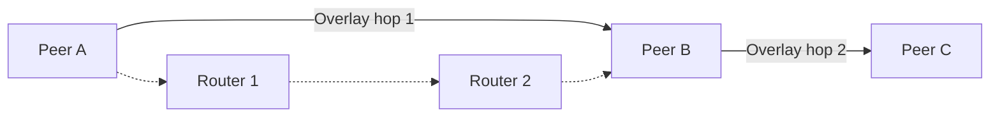
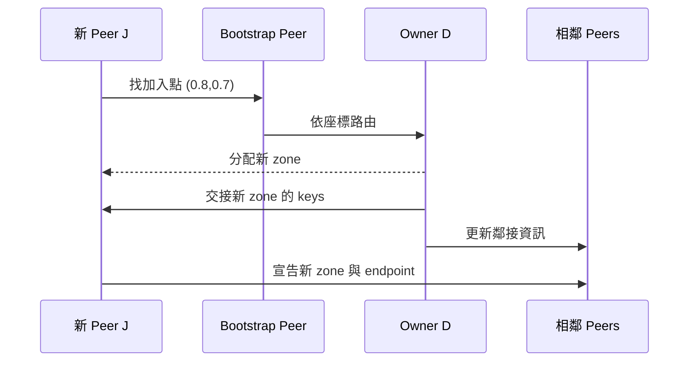
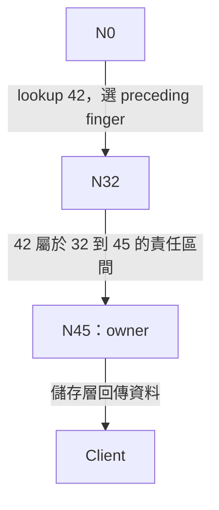
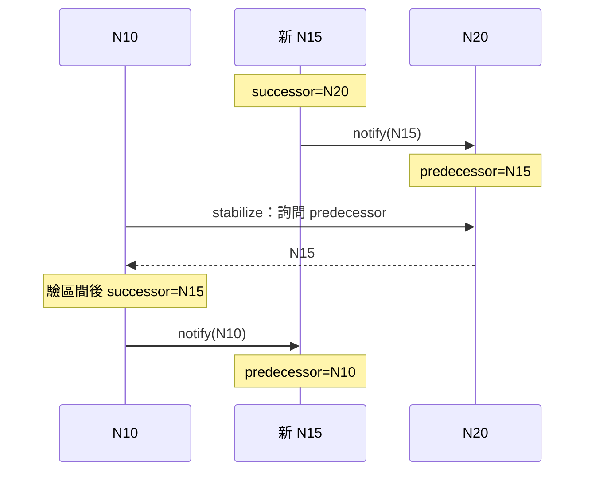
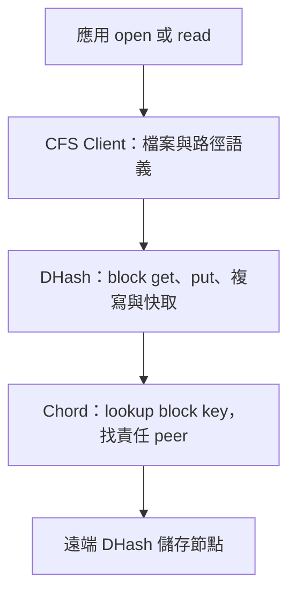

# Chapter 04 — 對等網路、Gossip 與分散式雜湊表（Peer-to-Peer Computing & Overlay Networks）

## 1. 本章的問題：沒有全域目錄，要去哪裡找資料？

> [課程講義] P90–P94：從伺服器叢集走向動態、分散的 peers。

**對等網路（Peer-to-Peer Network，P2P）** 讓參與者同時貢獻與使用儲存、運算或傳輸資源。它改變責任分工，卻不會自動解決尋址、資料耐久性、節點信任或併行寫入。要拿到一個檔案，至少需回答「誰知道它在哪」「如何到達」「內容是否正確」「提供者失聯後是否還有副本」。

**覆疊網路（Overlay Network）** 由 end hosts 在既有 IP 網路上建立邏輯連線。一個 overlay hop 可能經過多個實體 routers；邏輯上相鄰不表示地理或網路延遲接近。



自製圖的虛線只展開第一條邏輯邊的底層路徑。P94 用每跳 50 ms、五跳 250 ms 示意延遲；只有假設五個依序依賴的 hops 各需 50 ms、沒有重疊與其他成本時才可相加。不能由「直連要 50 ms」推出任意五跳 overlay 一定至少 250 ms。

P93 的 SETI@home 是利用邊緣運算資源的歷史動機，不表示工作分配系統已完全沒有中央角色。該頁的志願電腦數量與資料量保留為教材歷史敘述，不當成當前服務規模。

### 1.1 課堂問答：Overlay Hop 的延遲到底從哪裡來？

**Q：一個 Logical Hop 的傳輸時間，不就是底層 Physical Network 的路由時間嗎？**

**A：是。** 一個 overlay hop 指應用層從某個 Peer 傳到下一個 Peer；底層仍由 TCP／UDP、IP Routing 與可能經過的多台 routers 承載。它不是獨立存在的第二條實體網路，也不是另外再疊加一次完整的 IP 傳輸時間。

- 一個 logical hop 的耗時大致可拆成：**底層 IP 路徑的傳輸／傳播／排隊等延遲 + Peer 的應用層處理與轉送開銷**。
- **一個 logical hop 不等於一個 router hop**；例如 Overlay 中 A→B 只有一跳，但底層可能是 A→R1→R2→R3→B。
- 多跳 Overlay A→B→C→D 的封包可能分段經過多條 IP 路徑，且 B、C 須接收後再轉送。總耗時需逐段估算，不能只看 Overlay 圖的線條數。

**講義 P94 的 50 ms × 5 = 250 ms 是教學假設**：只有在每個 logical hop 都約需 50 ms、各段依序執行時，才能如此加總。若已知「A 直達 D 的 IP 路徑為 50 ms」，並不能直接推出 A→B→C→D 等 Overlay 路徑每一跳都要 50 ms；實際延遲依各 Peer 間的底層路徑而異。

### 1.2 課堂問答：Overlay Network 只是為了簡化拓樸圖嗎？

**Q：Overlay Network 的具體目的，是否只是把複雜的實體拓樸畫得比較簡單？**

**A：不是。圖形簡化只是呈現方式；真正目的在於讓應用程式在既有 Internet 上，自行定義邏輯鄰居、資料定位與訊息轉送規則。**

**分層職責：**

| 層次 | 回答的問題 | 主要機制 |
| --- | --- | --- |
| **IP／Physical Network** | 「已知目的 IP，封包怎麼送到那台主機？」 | IP addressing、routers、routing tables |
| **P2P Overlay Network** | 「需要的資料／服務在哪個 Peer？接下來應詢問誰？」 | 邏輯拓樸、neighbor／routing state、lookup 與 membership |

**具體例子：** Peer A 想取得某個 key 對應的檔案，但不知道由誰保存。Overlay 可以按照搜尋或 DHT 規則，將查詢從 A 經 B 轉送到負責該 key 的 C。底層每一段仍使用一般 IP Routing；找到 C 之後，實際檔案傳輸也**可能直接建立 A↔C 連線**，不必一定沿查詢路徑反向傳整份資料。若一開始就知道 C 的 IP／位置，應用程式也可以直接連接，不需要為此繞過 B。

Overlay 因此可以支援 **Resource Discovery（資源發現）**、**Application-Level Routing（應用層路由）**、**Dynamic Membership（節點加入／離開管理）**，以及依架構而異的去中心化資源協作；但增加邏輯轉送與維護成本，也**不保證最短路徑或最低延遲**。不同 P2P 設計可能仍含 bootstrap 或中央索引，不可把「有 Overlay」等同於「完全沒有中央服務」。

**結論：Overlay 不是用來取代 IP Routing，而是補上 IP 本身不知道「哪個 Peer 負責哪份資料」的應用層定位與組織機制。**

## 2. 從 Multicast、Napster 到 Gnutella

> [課程講義] P95–P97；演算與拓樸例子為自製。

### 2.1 End System Multicast 的資料路徑

**端系統多播（End System Multicast，ESM）** 又屬**應用層多播（Application-Layer Multicast，ALM）**：由 peers 複製並轉送串流，不要求所有跨 ISP routers 提供同一套 IP multicast 支援。

假設 S 把一份影片資料送 A、B，A 再送 C、D。S 只維持兩份上行流量，但 A 必須負擔轉送與上傳能力。A crash 時 C、D 失去上游，需要重新接入；不能只畫一棵樹就宣稱具有故障恢復。

Overlay 可不改 routers 便部署，代價是多次經過相同實體鏈路、來源到接收者路徑變長，以及 peer 上傳頻寬的限制。將所有人直接連回 S 可減少轉送延遲，卻把流量集中在來源。

### 2.2 集中式目錄與無結構搜尋

| 方法 | 控制／搜尋路徑 | 資料路徑 | 故障與規模限制 |
| --- | --- | --- | --- |
| Napster 式中央目錄 | 向 catalog 搜檔案與提供者 | Peer 間直接傳檔 | 目錄失效會影響發現；不是每個檔案 byte 都流經中央 |
| Gnutella 式 Flooding | 向鄰居轉送 query，逐層擴散 | 找到後另建傳輸路徑 | 訊息重複與廣播風暴；TTL 截止可能找不到仍存在的資料 |
| Gossip | 隨機找少量 peers 傳播或比對狀態 | 多輪逐步散布 | 機率性收斂，需重試與可達性，不直接提供精確查找 |
| Structured DHT | 按 key space 與 routing state 尋找責任節點 | 由儲存層決定 | 拓樸維護與 churn 成本；通常以 exact key 查找 |

Flooding 可用 message ID 去重與 TTL 限制範圍。例如六節點 A–B、A–C、B–D、C–D、D–E、C–F，A 發 Query q1。若 D 不辨認 q1，會把從 B、C 收到的同一查詢重複轉送；辨認 q1 可減少重複處理，但仍不能避免每次新 Query 消耗多條邊。

TTL=1 只看到 B、C，E 有檔案也可能找不到。這是有限搜尋範圍的 false negative，不表示檔案已不存在。DHT 則通常將 key hash 後定位，不直接回答「檔名包含某個字」；全文搜尋須另建索引。

## 3. Gossip、Anti-entropy 與收斂條件

> [課程講義] P98–P103。延伸：[Demers 等，Epidemic Algorithms for Replicated Database Maintenance](https://www.cs.cornell.edu/courses/cs614/2004sp/papers/p1-demers.pdf)，§1–§2。

**流行病式傳播（Epidemic Dissemination）** 借用更新散布的感染比喻：已知某更新的節點為 infective，尚未知的為 susceptible。**反熵（Anti-entropy）** 定期選 partner，交換資料或摘要、修補差異；**謠言傳播（Rumor Mongering）** 主要轉送近期更新，重複碰到已知者後可能停止。

兩者不相同：持續反熵可補救之前漏掉的更新；提早停止傳播的 rumor 可能留下永久缺口。P98 的「所有活節點終將收到」需建立在可達路徑、持續公平抽樣與重試、更新仍被保留等條件上；永久分區兩側無法互傳，隨機演算法也沒有每次執行固定完成的期限。

### 3.1 Push、Pull 與 Push-pull

| 方式 | 主動方與交換 | 初期／末期的成本 | 不保證什麼 |
| --- | --- | --- | --- |
| Push | 已知更新者主動送給 partner | 初期少量感染者即可發起；末期容易撞到已知者 | 一次送出就送達所有節點 |
| Pull | 缺資料者向 partner 要更新 | 末期少數缺資料者可快速補洞；初期許多查詢落空 | 所有系統都能免費知道自己缺哪一版 |
| Push-pull | 雙方比對並交換差異 | 可同時補兩方向，但每次需額外摘要與協定成本 | 不需版本判斷與衝突處理 |
| Direct Mail | 發起端直接通知全部已知節點 | 一次 O(N) 發送，集中來源頻寬 | 成員名單完整、丟包會自動補回 |

實際反熵常先交換版本摘要，必要時才送內容；不能把下面「每個缺資料者每輪發一個 request」模型當作所有產品的精確封包數。

### 3.2 固定一個 round 的模型

為解讀 P99–P101，先固定假設：

- N 個節點、單一更新，某輪開始有 S_i 個 susceptible、I_i=N−S_i 個 infective，`p_i=S_i/N`。
- partner 從全部 N 個節點均勻獨立抽樣，允許抽到自己；一輪內使用輪初狀態，收到資料者下一輪才主動傳播。
- 訊息不遺失、不限流，節點集合固定；這是同步 round 的分析模型，不是完全非同步網路的完成期限。

Push 下每個 infective 發一次：對特定 susceptible，一個 push 沒選到它的機率為 `1−1/N`，全部 I_i 次均沒選到的機率為 `(1−1/N)^I_i`。因此：

```text
E[S_(i+1) | S_i] / N = p_i * (1 - 1/N)^(N*(1-p_i))
大 N 近似：p_(i+1) ≈ p_i * exp(p_i - 1)
```

這是條件期望，再以大 N 取極限。不能把近似式當成每次隨機執行的精確節點數，也不能在多輪中任意把 `E[f(S)]` 換成 `f(E[S])` 而宣稱完全精確。

Pull 下每個 susceptible 發一次：它仍未取得更新，表示抽到的 partner 也是 susceptible，條件機率 S_i/N。所以：

```text
E[S_(i+1) | S_i] / N = p_i * p_i = p_i^2
```

此處先固定輪初 S_i，對特定 susceptible 的 partner 作抽樣；不需要假裝所有節點的未知狀態都是彼此獨立的隨機變數。若排除 self，Pull 的 partner 未更新機率應改為 `(S_i−1)/(N−1)`，不能照抄同一公式。

### 3.3 實際數值與「Pull 為何不一開始就用？」

P103 的圖以輪數比較收斂；下表依教材遞迴，用相同 `p_0=0.9` 核算，保留六位小數：

| round i | Push：`p*exp(p−1)` | Pull：`p^2` |
| --- | --- | --- |
| 0 | 0.900000 | 0.900000 |
| 1 | 0.814354 | 0.810000 |
| 2 | 0.676376 | 0.656100 |
| 3 | 0.489373 | 0.430467 |
| 4 | 0.293682 | 0.185302 |
| 5 | 0.144919 | 0.034337 |
| 6 | 0.061627 | 0.001179 |

對 `0<p<1`，`ln(p)<p−1`，故 `p^2 < p*exp(p−1)`；在這組遞迴模型中，Pull 每輪下降較快。這不是 Pull 的網路成本在所有階段都較小的證明。

P103 的假設情境是 N=10,000、只有一台知道更新：

- Push 由一台發一次；這次抽到新對象的機率為 9,999/10,000。
- Pull 由 9,999 台各發一次請求；每次只有 1/10,000 機率抽到已知者，預期成功取得更新的人數仍約 1。
- 兩者初期預期新增人數接近，主動請求數卻差近萬倍；模型還沒計算回覆、連線與摘要成本。

末期若只剩少量 susceptible，讓這些節點 Pull 可避免大量已知者繼續做重複 Push。這才是 Push→Pull 混合策略的成本理由，不是「Push 公式初期比 Pull 公式快」。

有限 N 的例子：N=100、S=90，Push 的單輪期望比例為 `0.9*(0.99)^10 ≈ 0.813944`，與大 N 近似 0.814354 略有差異；Pull 在本模型是 0.81。

### 3.4 一個完整六節點傳播交錯

[教學補充／推導] A 起初知道更新 u，其他 B–F 不知道；每輪只讓輪初 infective 主動 Push：

| round | 指定的抽樣結果 | 輪末知道 u 的集合 |
| --- | --- | --- |
| 0 | 初始 | `{A}` |
| 1 | A→B | `{A,B}` |
| 2 | A→C，B→D | `{A,B,C,D}` |
| 3 | A→B（重複）、B→E、C→F、D→A（重複） | `{A,B,C,D,E,F}` |

這是一次可能執行，不是所有抽樣都在三輪完成。若每次都抽到 A，有限輪數內可以始終未完成；若 F 永久隔離，則無法靠重試跨越不存在的通路。

### 3.5 刪除、衝突與 Anti-entropy 的工程邊界

只有「較大版本覆蓋較小版本」的規則，仍需定義版本比較與刪除表示。A 刪除 k、B 離線保有 k；若 A 只把資料完全移除，B 恢復時可能把舊值傳回，造成復活。**刪除標記（Tombstone）** 保留「已刪除及其版本」，使反熵能傳播刪除；何時清除 tombstone 要有足夠的傳播、成員與保留期條件。

並行更新的解法也不是 Gossip 自動決定。可用 [Chapter 01 的 Vector Clock](01-logical-clocks-checkpointing.md)辨認衝突，再由應用合併，或對需要強順序的項目採用共識。傳播是否到齊與寫入語義是否正確，是不同層的問題。

## 4. DHT：把查找問題放進可維護的座標空間

> [課程講義] P104–P105；延伸：[Chord 原論文](https://pdos.csail.mit.edu/papers/chord%3Asigcomm01/chord_sigcomm.pdf)，§4。

**分散式雜湊表（Distributed Hash Table，DHT）** 將 key 映到邏輯識別空間，再依拓樸把查詢送到責任節點。應用可看到 `put(key,value)`、`get(key)`，底層卻包含定位、節點維護、傳輸與儲存。

「唯一責任節點」是穩定拓樸中的邏輯 owner，不代表只有一份副本，也不保證節點異動期間所有人立即同意 owner。雜湊能分散 key，不能自動消除 hot key 的讀取負載，或防止惡意者選擇特殊 IDs。

API 分層必須清楚：Chord 本身主要提供 `lookup(key)` 找節點；block storage 或 DHT 上層才決定如何存 value、複寫與處理衝突。不能因「有 lookup」就宣稱已有 durable put。

## 5. CAN：座標區域、加入與資料遷移

> [課程講義] P106。延伸：[Ratnasamy 等，A Scalable Content-Addressable Network](https://www.gsd.inesc-id.pt/~ler/docencia/srsdI/p13-ratnasamy.pdf)，SIGCOMM 2001，§2；以發表論文補充，不是同名 2002 博士論文。

**內容定址網路（Content-Addressable Network，CAN）** 把邏輯 d 維空間分成 zones，每個 peer 負責其中一塊。原始模型為 d-torus，邊界環繞；這是虛擬座標，不是地理位置。Neighbor zones 在一維接壤、其餘維度範圍重疊，光碰到角落不一定算鄰居。

### 5.1 二維加入與發布的完整例子

[教學補充／推導] 用 `[0,1)×[0,1)`，半開區間避免邊界同時屬於兩人。初始四份區域：

| Peer | x 範圍 | y 範圍 |
| --- | --- | --- |
| A | `[0,0.5)` | `[0,0.5)` |
| B | `[0.5,1)` | `[0,0.5)` |
| C | `[0,0.5)` | `[0.5,1)` |
| D | `[0.5,1)` | `[0.5,1)` |

1. 新節點 J 先聯絡 bootstrap peer，選定加入點 `(0.8,0.7)`。
2. 請求經 CAN 路由到該點的 owner D；bootstrap 只是入口，不應成為所有資料的唯一轉送中心。
3. D 沿 x 切分：保留 `[0.5,0.75)×[0.5,1)`，J 接手 `[0.75,1)×[0.5,1)`。
4. 更新 D、J 與相鄰 peers 的 routing state，將落在 J 區域的既有資料交接。
5. 發布 `(K,V)`，假設 `hash(K)=(0.8,0.6)`，應找到 J，並由儲存層將資料保存在 J 的責任區域。之後 get(K) 用同一映射取回。



圖只表示交接責任，不宣稱資料遷移與所有通知具有單一原子交易。真實加入／故障協定需處理通知重送、部分交接與版本；P106 沒有提供足以直接部署的完整狀態機。

### 5.2 路由、故障與成本

每跳選擇座標上較接近目標的鄰居。以相近大小、規則分區的 d 維模型理解，每節點約維護 2d 個鄰居，平均查找尺度為 `O(d*N^(1/d))`；實際 zone 分裂可使鄰居數與區域形狀不規則，不應把 2d 當所有時刻的絕對上限。

提高 d 通常可減少路徑尺度，但增加每節點 routing state 與維護流量。鄰居 crash 時可試其他更接近的路徑；若某方向形成缺口、沒有可前進鄰居，greedy routing 仍可能暫時失敗。原論文討論接管與修補，必要時用受控擴散找更近節點，並非每種故障都無感。

區域 owner 恢復不等於資料副本恢復：若唯一儲存的磁碟永久消失，光把 zone 指派給別人不能生回 value，仍需 replication 或其他資料回復方案。

## 6. Chord：Ring、Finger Table 與完整 Lookup

> [課程講義] P107。延伸：Stoica 等，Chord，§4–§5。

### 6.1 ID、Owner 與環繞區間

**一致雜湊（Consistent Hashing）** 將節點與 keys 放到同一環狀空間。m-bit ID 的取值為 `0..2^m−1`；key k 的責任節點 `successor(k)` 是順時針方向第一個 ID≥k 的節點，越過最大值則回到最小節點。

P107 的 m=6，節點 `{0,10,20,32,45,55}`，空間為 `0..63`。責任區間如下：

| 節點 | 所有 keys 的責任區間 |
| --- | --- |
| N0 | `(55,0]`，即 56–63 與 0 |
| N10 | `(0,10]`，即 1–10 |
| N20 | `(10,20]` |
| N32 | `(20,32]` |
| N45 | `(32,45]` |
| N55 | `(45,55]` |

key=32 由 N32 負責；key=42 由 N45 負責，不能因 42 距離 32 較近就選 N32。

### 6.2 Finger 的完整核算

**捷徑表（Finger Table）** 第 i 項（本章 i=0..m−1）為 `successor((nodeID + 2^i) mod 2^m)`。它是「offset 對應的第一個現存節點」，不是直接把 offset 當下一台 ID。

| offset | N0 的 start → finger | N32 的 start → finger |
| --- | --- | --- |
| 1 | 1 → N10 | 33 → N45 |
| 2 | 2 → N10 | 34 → N45 |
| 4 | 4 → N10 | 36 → N45 |
| 8 | 8 → N10 | 40 → N45 |
| 16 | 16 → N20 | 48 → N55 |
| 32 | 32 → N32 | 0 → N0 |

在此 m=6 的 toy example，每節點最多 m 項；許多項可指向同一節點。常見 `O(log N)` 狀態與 lookup hops 是對隨機分布、正確維護拓樸的尺度描述，不能把識別位數 m 與目前活躍節點數 N 當成同一個變數。

### 6.3 Lookup(42)：為何不是跳到節點 42？

簡化且只適用於已正確連接的單環：

```text
find_successor(k) at n:
    if k == n.id: return n
    if k in clockwise interval (n.id, n.successor.id]:
        return n.successor
    q := closest preceding live finger in clockwise interval (n.id, k)
    if q absent: q := n.successor
    forward lookup(k) to q
```

1. 從 N0 找 42。42 不在 `(0,10]`，N0 的可用 fingers 中，最接近 42 且仍在它之前的是 N32。
2. N32 的 successor 為 N45，42 落在 `(32,45]`，故回報 owner=N45。
3. 若上層要取資料，再與 N45 通訊；在本章端到端聯絡清單可寫 `N0 → N32 → N45`，但最後一步是 owner／資料訪問，不是先找到一個真的節點 N42。



P107 的「Jump 8」可用來理解 finger start=40 的方向，但 start 40 的 finger 是 N45；42 本身不是 peer。當最後一跳跨過 key 到 successor，是在辨識 owner，不能把不斷 overshoot 當成 closest-preceding 規則。

環繞案例：從 N45 找 60，可到 N55，再發現 60∈`(55,0]`，owner=N0。普通整數比較會錯誤拒絕跨 63→0 的有效區間，故 pseudocode 必須使用 modulo interval。

### 6.4 為何能前進？有哪些限制？

在已維護好的 ring，選 `(n,k)` 中的 preceding finger，每次沿順時針嚴格靠近目標而不越過；若沒有捷徑，至少 successor 仍往前。正確 successor chain 可讓查找慢速完成，finger 主要用來降低平均 hops。

若 successor 已失效或 ring 斷裂，上述推理的前提就不成立。ID 不變、hash 看似均勻，也不能修好斷裂的指標；需要下一節的 maintenance 與 failure handling。

## 7. Chord Join、Stabilize 與故障修補

> [課程講義] P108–P109。原始流程參考 Chord §5、Figure 7；正確性界線另參考 [Zave，How to Make Chord Correct](https://www.pamelazave.com/TSE_Chord_final.pdf)及[作者的勘誤頁](https://www.pamelazave.com/chord.html)。

### 7.1 P108–P109 的單一加入完整例子

先假設 N10→N20 的局部關係正確，N20.predecessor=N10，沒有其他同時加入或故障。N15 要插入其間：

1. N15 經 bootstrap 查到 `successor(15)=N20`，令自己的 successor=N20；N10 此時仍指 N20。
2. N15 通知 N20。因 15 在 `(10,20)`，N20 將 predecessor 更新為 N15。
3. N10 執行 stabilize，問 N20：「你的 predecessor 是誰？」得到 N15。
4. N10 驗證 15 在 `(10,20)`，改 successor=N15，並 notify N15。
5. N15 接受 N10 為 predecessor。現在局部順序 N10→N15→N20。
6. 背景 fix_fingers 逐步更新 shortcuts；儲存層另外移交 `(10,15]` 的資料，不能只改 pointer 就宣稱 put／get 已完整恢復。



這裡不需要用分散式鎖阻塞整張網路；它展示局部修補的機制，不證明原始簡化協定在任意起始狀態、任意 churn 下都會收斂。

### 7.2 Successor 故障與 Successor List

**節點變動（Churn）** 包含加入、離開與 crash。若 N10 只記 N15，一旦 N15 失聯便無路可走；**後繼清單（Successor List）** 可保存多個順時針候選，在最近者不可達時換成下一個，再執行修補。

但 timeout 可能誤判；連續後繼若屬同一實體機器或同一網路分區，複數 IDs 不等於獨立容錯。若所有候選都失效、指標形成多環或無法橋接分區，不能承諾一次 stabilize 就自動恢復全球可達性。

### 7.3 必須保留的正確性警告

P109 的三階段圖說明單一加入可經週期通知接上，不是任意環狀拓樸的完整正確性證明。Zave 的後續研究指出，原 Chord maintenance 在其原先宣稱的假設下仍有缺陷，提出修正規則、初始化與不變量；作者另列有勘誤。

因此本文只對明列前提的 lookup、單一 join 算例推導，不把原始幾行 stabilize pseudocode 當成可部署且已形式證明的完整協定。這也說明「Routing eventual consistency」是想達成的維護性質，不是刪除前提後任何實作都能獲得的保證。

## 8. CFS：檔案、DHash 與 Chord 的分層

> [課程講義] P110–P111。延伸：[Dabek 等，Wide-area cooperative storage with CFS](https://pdos.csail.mit.edu/papers/cfs%3Asosp01/cfs_sosp.pdf)，§3–§5。

**合作式檔案系統（Cooperative File System，CFS）** 讓一般 Client 讀取發布者提供的檔案。資料分成 blocks，每塊可由內容雜湊識別；上層檔案結構將 block IDs 串成目錄、inode 與資料內容。



這是責任分層，不是每次讀取一定按三層各發一個獨立 RPC。查找過程可能利用 cache、選擇副本與整合操作。

### 8.1 發布與讀取的完整資料路徑

[教學補充／推導] Publisher 有檔案 F，切成 B1、B2、B3，計算 `k1=H(B1)`、`k2=H(B2)`、`k3=H(B3)`。

1. 建立 inode／目錄等 metadata blocks，內容包含下層 block IDs；它們也可用內容雜湊定址。
2. 經 DHash put 各 block，透過 Chord 找責任節點；儲存層維持副本與快取，避免唯一 owner 一故障就讀不到。
3. 建立並簽署 root block。原論文的特殊 root block 以 publisher public key 識別並由對應 private key 簽章；其他 blocks 以內容 hash 驗證，不是所有 blocks 都一一簽名。
4. Reader 從已知發布者公鑰找到 root，驗簽，再循 metadata 中的 hashes 取回 B1–B3，逐塊驗 hash 後組回 F。
5. 某提供者回傳錯誤 bytes 時 hash 檢查失敗，可改找其他副本；若所有副本都失聯，驗證能力不能代替可用性。

| 需求 | 提供它的機制 | 不提供的保證 |
| --- | --- | --- |
| 找到責任 peer | Chord lookup | 不保證 value 已持久保存 |
| 維持 block 可用 | DHash 複寫、保留期與修補 | 不保證所有副本永久在線 |
| 熱門資料加速 | 路徑快取、副本選擇 | 不代表增加了獨立永久副本 |
| 驗證 block 未變 | Content hash | 不證明發布者可信、也不證明這是最新 root |
| 驗證 root 發布身份 | 公鑰簽章 | 私鑰失竊或根版本選擇仍需處理 |

### 8.2 「Read-only」與 Publisher 更新

原始 CFS 對一般 Client 是唯讀；publisher 可重新發布檔案系統並更新已簽署的 root，資料以新 blocks 表示。這不等於多個任意 Client 同時原地修改同一 block。簽章與內容驗證可保護來源與內部一致性，仍可能讀到較舊但有效簽章的版本。

CFS 原論文也討論資料保留期與續存；不能把「存入 P2P」理解為永久免費保存。Caching、Replication、Persistence 是三個不同責任。

## 9. Paxos 可以放在哪裡？Routing 與資料一致性分開

> [課程講義] P112–P113。技術補充：這是可變資料層的設計延伸，並非原始唯讀 CFS 必備路徑。

P112 用「某 key 的 successors 組成 Paxos Quorum」說明：拓樸路由可以允許暫時不一致，某些應用更新卻要求共同順序。自製例子：key42 的儲存群體固定為 N45、N55、N0；要更新其可變根指標，三個副本可用 q=2 的共識決定一個版本／命令。

1. Chord lookup 找到能聯絡此 replica group 的入口。
2. 寫入帶上明確 key、instance／log index 與 group configuration。
3. 群體按 [Chapter 02 的 Paxos 規則](02-fault-tolerance-paxos-raft.md)處理 Promise、Accepted 與值採用，再交給應用。
4. 網路 2／1 分區時，多數側可在其他進展條件滿足時提交，少數側不能自行降低 quorum。

**不能動態重算 successors 就當配置變更完成**。若新節點加入，舊組 `{N45,N55,N0}` 與新組可能不再共享足夠歷史；群體遷移需要專門的配置與狀態轉移協定。把「目前附近的兩台」拼成多數，可能讓兩組對同一位置各自決定不同值。

P113 將 mutable state across untrusted nodes 與 quorum 並列；技術上標準 Paxos 不處理 Byzantine 節點。若 peers 能撒謊、偽造或違背 Promise，不能用一般多數規則宣稱解決信任問題。另一方面，Eventual Consistency 也不必然造成 byte corruption；應用可選擇保留並行版本或有規則的合併，只是語義不同。

## 10. Overlay 的效能、Sybil 與 Eclipse

> [課程講義] P113–P114。延伸：[Douceur，The Sybil Attack](https://www.microsoft.com/en-us/research/wp-content/uploads/2002/01/IPTPS2002.pdf)，2002。

**多重假身份攻擊（Sybil Attack）** 是一個實體建立多個邏輯身份，讓「不同節點」不再代表獨立控制者。**日蝕攻擊（Eclipse Attack）** 則使受害者可接觸的 routing／neighbor view 被攻擊者包圍，查詢與更新受其控制。大量 Sybil IDs 可以協助達成 Eclipse，但兩者不是同義詞。

自製例子：系統以三個不同 node IDs 保存 block，就宣稱可容錯一個不誠實者；若三個 IDs 都由同一攻擊者控制，副本數沒有提供所假設的獨立性。若 Client 所有 bootstrap 與 successor 回覆都來自攻擊者，它甚至可能看不到真正的其他 peers。

| 手段 | 主要作用 | 代價與限制 |
| --- | --- | --- |
| 受信任身份／憑證機構（Certificate Authority，CA） | 限制任意建立身份，建立管理責任 | 引入管理中心與發證政策；憑證數是否代表不同實體仍需規範 |
| Proof of Work／Proof of Stake | 將影響力連到可計量成本或資源 | 是特定協定的抗濫用設計，不自動驗證每個 peer 身份或杜絕鄰居操控 |
| 多來源 bootstrap、鄰居多樣性 | 降低視野全部集中同一控制者的機率 | 必須能辨識共同故障／控制域，沒有絕對免疫 |
| 內容雜湊與簽章 | 拒絕被修改的資料，驗證來源 | 攻擊者仍可不回覆、隱藏新版本或使路由不可達 |

本章不提供攻擊部署步驟；目的在於檢查設計假設。Hash 均勻、routing 可達、資料完整性、身份獨立性是不同性質，不能用其中一項替代全部。

## 11. Web3 堆疊：把路由、儲存與信任分開看

> [課程講義] P115–P116；官方補充：[IPFS Content Identifiers](https://docs.ipfs.tech/concepts/content-addressing/)、[Pin files](https://docs.ipfs.tech/how-to/pin-files/)，查詢日期 2026-11-20。

P115 用 Web 1.0／2.0／3.0 描述 Read-only、Read-write 與區塊鏈相關應用的演進；這是課程框架，不是各年代所有網站能力的嚴格分類，也不能從「Trustless」推得無需任何信任假設。

| P116 的層 | 試圖解決的問題 | 實際需檢查的信任與成本 |
| --- | --- | --- |
| Blockchain Network | 共同交易順序與驗證規則 | 安全性依共識與參與假設；鏈上儲存與執行有成本 |
| Node APIs／Gateway | 讓 Client 不必自行運作完整節點即可查詢 | Gateway 可成為可用性與資訊視野的依賴 |
| Presentation & Storage，如 IPFS | 將大型資產放鏈外，以內容識別取得 | CID 驗證內容不等於保證有人永久提供資料 |
| dApps | 結合使用者介面、鏈上邏輯與鏈外內容 | UI、私鑰、合約與鏈外服務仍有各自風險 |

IPFS 的 **內容識別碼（Content Identifier，CID）** 包含 hash 與編碼等資訊，不必等於整個原始檔案的單一 SHA-256。應用可用 CID 指向鏈外資產，並在取回後驗證，但 availability 仍需有人保留與提供內容。Pinning 可讓指定節點保留物件、避免本地垃圾回收；不表示所有節點都自動保存它，也不代表 IPFS 的 routing 就是 Chord。

本節只銜接課程示意，不展開 P239 起的 Blockchain 單元，也不作產品投資或安全程度的排名。

## 12. 技術比較、限制與速查

| 比較面向 | CAN | Chord | Gossip |
| --- | --- | --- | --- |
| 核心問題 | 以座標找 zone owner | 以環狀 key 找 successor | 讓更新／狀態逐步散布 |
| 結構 | d 維 zone 鄰接 | Ring、successor list、fingers | 隨機 partner 與成員抽樣機制 |
| 典型成本 | 規則模型 `O(d*N^(1/d))` hops | 維護正常、分布假設下 `O(log N)` hops | 常見理想模型 O(log N) 期望傳播輪數，訊息數另計 |
| 狀態維護 | 分裂、鄰居通知、zone 修補 | Join、stabilize、fix_fingers、故障接替 | 抽樣、版本摘要、重試與 tombstone |
| 不自動提供 | 任意資料的持久性與一致寫入 | 儲存複寫、完整群體共識、Byzantine 安全 | 精確查找、全序與有限時間必達 |

速查：**Overlay hop 不等於 IP hop；Gossip 的輪數與訊息成本分開；CAN 找 zone，Chord 找 successor；finger 是 start 的 successor；路由修補不等於資料回復；CFS 一般 Client 唯讀；多數決不解決 Sybil。**

## 13. 英文選擇題與逐項解析

以下為自製單選題，非教授原題。

### Q1 — Overlay hops

What is true about an overlay hop?

- A. It always corresponds to exactly one physical router hop.
- B. It may traverse several IP-layer hops between two peers.
- C. It guarantees lower latency than a direct Internet path.
- D. It removes all dependence on physical network connectivity.

**答案：B。** A：邏輯邊可經多台 routers。B：正確的層次關係。C：繞路與轉送可增加延遲。D：仍由底層網路承載。

### Q2 — Pull cost

In the lecture's round model, only one of 10,000 nodes has an update. Why can initial Push be more message-efficient than Pull?

- A. Pull never discovers an update.
- B. Push is guaranteed to finish in one round.
- C. Pull's recurrence is mathematically always slower.
- D. Only the one infective node initiates Push, while 9,999 susceptible nodes may initiate Pull.

**答案：D。** A：Pull 仍可能找到已知者。B：一輪最多按模型散到少量新者。C：P103 公式恰好呈現 Pull 每輪較快。D：差別在主動請求成本。

### Q3 — Approximation

For fixed N and S susceptible nodes at a round's start, which expression gives the expected susceptible fraction after one Push round in the stated self-inclusive model?

- A. `(S/N)*(1-1/N)^(N-S)`.
- B. `S/N - 1` in every execution.
- C. Exactly zero after any successful transmission.
- D. `exp(N)`.

**答案：A。** A：S/N 乘上逃過全部 N−S 次 Push 的機率。B：不符合機率範圍與抽樣。C：一次成功不代表其餘人也收到。D：不是未感染比例。

### Q4 — Chord responsibility

In the 6-bit ring `{0,10,20,32,45,55}`, which node owns key 42?

- A. N32, because it is numerically closest.
- B. A new node N42 must be created.
- C. N45, the first existing node clockwise from 42.
- D. N0, because every lookup begins at zero.

**答案：C。** A：責任依 successor，不依最近距離。B：Key 不等於節點。C：42∈(32,45]。D：查找起點不決定 owner。

### Q5 — Finger entry

For node N32 in that ring, what is the finger at offset 8?

- A. N8.
- B. N40, even though no such peer exists.
- C. N55.
- D. N45, because successor(40)=45.

**答案：D。** A：忘記加本地 ID。B：start 與現存 peer 不同。C：45 比 55 更先接續 40。D：套用 finger 定義。

### Q6 — Stabilization

N15 joins between N10 and N20. N20 now reports predecessor=N15 when N10 stabilizes. Under the single-join assumptions, what should N10 do?

- A. Change its successor to N15 and notify N15.
- B. Run a global Paxos instance for every finger lookup.
- C. Delete all data on N20 immediately.
- D. Infer that arbitrary future churn is now formally solved.

**答案：A。** A：驗證區間後的局部修補。B：不是此維護流程。C：資料遷移另有責任與完成條件。D：單例不能證明一般正確性，另有後續研究修正。

### Q7 — CFS layers

Which assignment of responsibilities matches the original CFS architecture?

- A. Chord provides arbitrary application-level file writes by itself.
- B. CFS interprets file structure, DHash manages blocks, and Chord locates responsible nodes.
- C. Every file read must commit a new Paxos value.
- D. A content hash guarantees that data remains available forever.

**答案：B。** A：Chord 是 lookup 層。B：分工正確。C：P112 是可變資料的設計延伸，不是原始唯讀 CFS 每次讀取路徑。D：完整性不等於可用性與保留期。

### Q8 — Replica-group changes

Why is recomputing a key's current successors insufficient to reconfigure a consensus group safely?

- A. Hash functions cannot be computed more than once.
- B. New nodes are automatically Byzantine.
- C. Old and new groups may not preserve the required quorum history and configuration relationship.
- D. Log indices become physical timestamps.

**答案：C。** A：與重算次數無關。B：加入不代表惡意。C：需處理配置與狀態轉移。D：兩種概念無此轉換。

### Q9 — Sybil and integrity

An attacker controls many node IDs and surrounds a victim's neighbor view. What can content hashes alone fail to prevent?

- A. Detecting returned bytes that do not match their content hash.
- B. Recomputing a hash locally.
- C. Comparing expected and received digests.
- D. Withholding valid data or isolating the victim from honest peers.

**答案：D。** A：這正是 hash 可支援的檢查。B、C：都是可本地執行的驗證。D：完整性檢查不能強迫對方回覆或保證路由視野。

## 14. 來源與投影片對照

| 講義頁碼 | 本章定位 |
| --- | --- |
| P90–P94 | 定位、P2P 動機、Overlay 與 latency 假設 |
| P95–P97 | End System Multicast、Napster、Gnutella |
| P98–P103 | Gossip、Push／Pull、機率推導與通信成本 |
| P104–P106 | DHT、API 與 CAN |
| P107–P109 | Chord finger、lookup、join 與 maintenance |
| P110–P112 | CFS／DHash／Chord 分層、唯讀語義與可變資料共識延伸 |
| P113–P114 | Churn、成本、Sybil／Eclipse 與信任假設 |
| P115–P117 | Web3 示意、資料／信任分層、銜接 P118 的 Consistency |

延伸資料（查閱日期 2026-11-20）：

- [原始論文] Demers 等，1987，[Epidemic Algorithms for Replicated Database Maintenance](https://www.cs.cornell.edu/courses/cs614/2004sp/papers/p1-demers.pdf)，§1–§2：反熵、rumor、傳播成本與刪除。
- [原始論文] Ratnasamy 等，2001，[A Scalable Content-Addressable Network](https://www.gsd.inesc-id.pt/~ler/docencia/srsdI/p13-ratnasamy.pdf)，§2：torus、routing、join 與維護；研究機構保存的發表論文。
- [原始論文] Stoica 等，2001，[Chord: A Scalable Peer-to-peer Lookup Service for Internet Applications](https://pdos.csail.mit.edu/papers/chord%3Asigcomm01/chord_sigcomm.pdf)，§4–§5：mapping、finger、join 與 successor 維護。
- [原始論文] Dabek 等，2001，[Wide-area cooperative storage with CFS](https://pdos.csail.mit.edu/papers/cfs%3Asosp01/cfs_sosp.pdf)，§3–§5：唯讀檔案、DHash、簽署 root、複寫與快取。
- [原始論文] Zave，2017，[Reasoning about Identifier Spaces: How to Make Chord Correct](https://www.pamelazave.com/TSE_Chord_final.pdf)；[作者頁與勘誤](https://www.pamelazave.com/chord.html)。本章僅用來限定原始 maintenance 的正確性宣稱，未重現其完整證明。
- [原始論文] Douceur，2002，[The Sybil Attack](https://www.microsoft.com/en-us/research/wp-content/uploads/2002/01/IPTPS2002.pdf)：多個身份不等於多個獨立實體。
- [官方文件] [IPFS CIDs](https://docs.ipfs.tech/concepts/content-addressing/)、[Pin files](https://docs.ipfs.tech/how-to/pin-files/)：內容驗證與保存責任。

本文數值表、CAN 分裂、Chord 路徑與英文題均為自製或明確沿用講義設定；圖為原創 Mermaid。`python tools/verify-coordination-p2p.py` 可核算有限案例；未部署真實 CAN／Chord／Gossip 網路，也未以模擬通過宣稱所有 churn 排程或真實效能已驗證。
