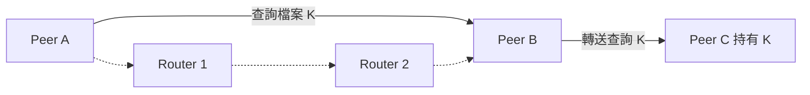
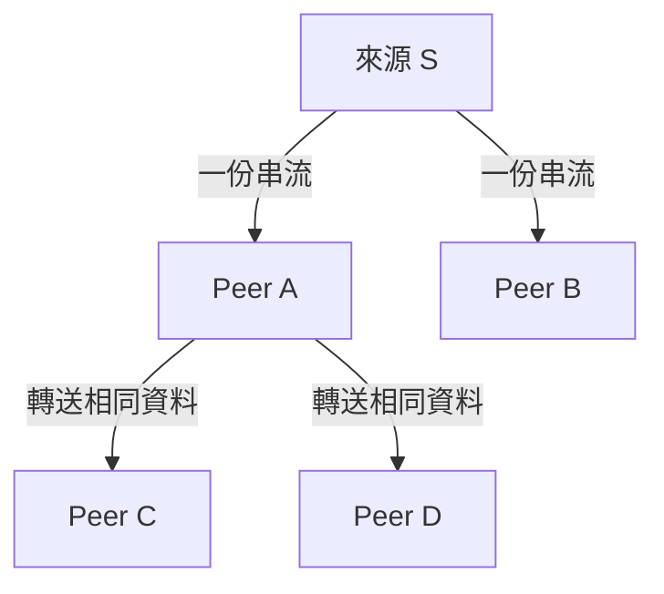
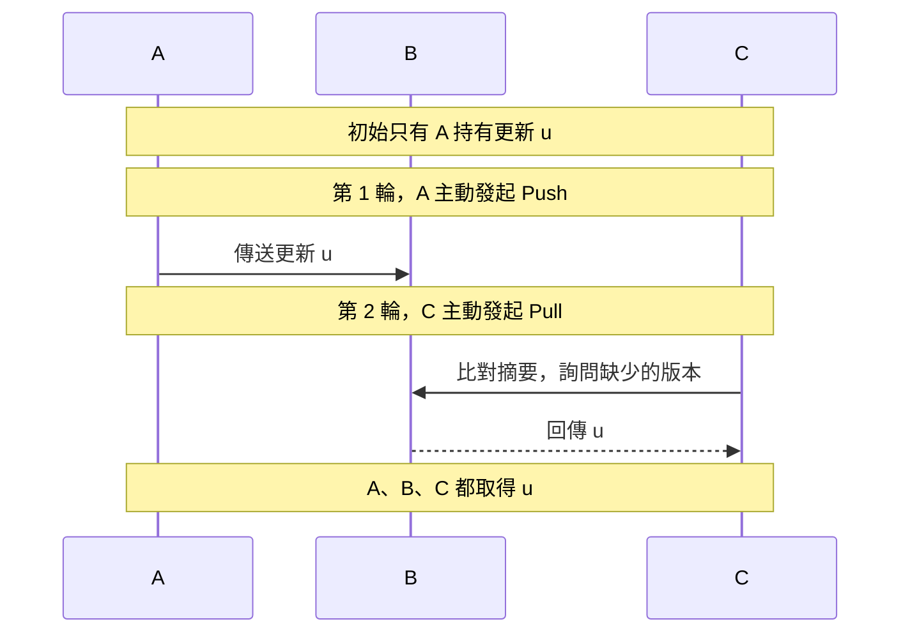
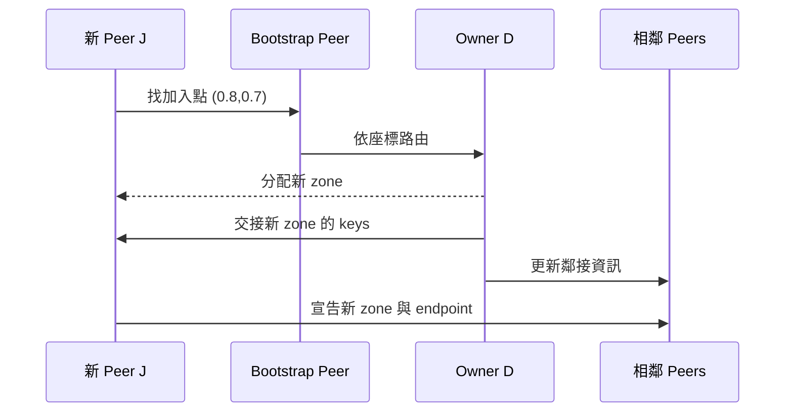
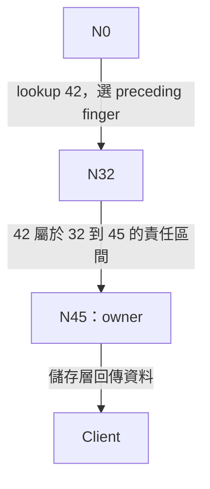
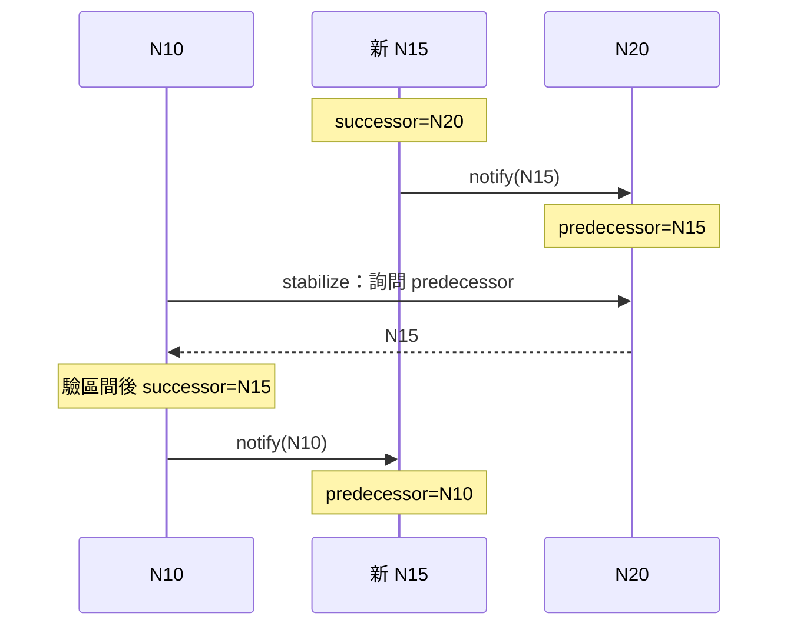
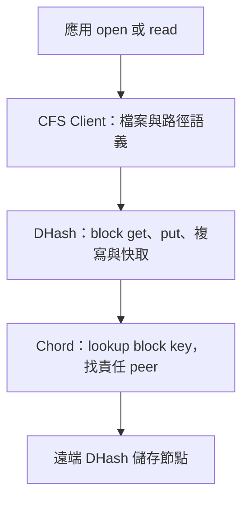
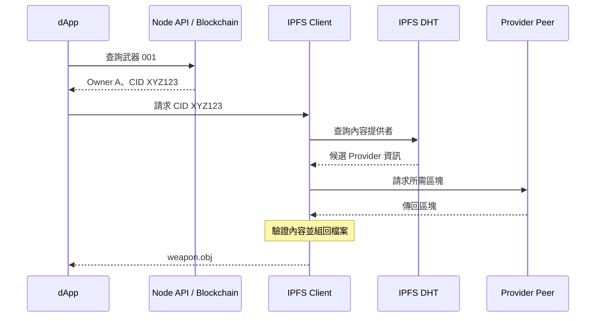

# Chapter 04 — 對等網路, Gossip 與分散式雜湊表 (Peer-to-Peer Computing & Overlay Networks)

## 1. 從一個檔案請求看懂 P2P 與 Overlay

> [課程講義] P90–P94: 從伺服器叢集走向動態, 分散的 peers.

假設同學都要下載同一份課程映像檔. 若每人都找同一台伺服器, 來源得送出每一份檔案. 若先下載的同學也能上傳, 一部分傳輸工作便移交給參與者. 這是對等運算 (Peer-to-Peer Computing, P2P) 的出發點. 講義 P93 的 SETI@home 把類似的資源分工用在邊緣運算, 工作分配仍可保有中央角色. 接下來的問題是, A 知道檔案的名稱或識別鍵, 卻不知道誰有檔案, 第一個封包要送給誰?

覆疊網路 (Overlay Network) 把應用程式知道並可聯絡的對等節點 (Peer) 連成邏輯拓樸. A 先依應用程式的查詢規則找鄰居 B, B 根據自己的路由資訊決定再找 C. 一旦得知 C 的位址, A 就可以另開 A→C 連線下載檔案. 查詢走 A→B→C, 檔案可以直接走 C→A, 因為兩者有不同任務.



圖 4.1 - 查詢的兩個邏輯跳與第一跳的 IP 路徑. 虛線逐段展開 A→B, 應用程式只在 B 決定下一個 Peer. 自繪, 參考成大講義 P94, P97.

IP 路由 (IP Routing) 拿到的是目的 IP, 依轉送表把封包交給下一台路由器. Overlay 做的是資源發現 (Resource Discovery) 與應用層路由 (Application-Layer Routing), 選擇查詢或資料接下來交給哪個 Peer. A→B 是一個邏輯跳 (Logical Hop), 底層可跨多個路由器跳 (Router Hop). 即使底層改道, 只要端點仍可連通, 應用程式仍可保留 A→B 這條邏輯邊. 這些邊是 Peer 實際維護的聯絡關係, 節點加入或離開時得更新.

以圖 4.1 的單向查詢為例, 假設 A→B 的底層延遲為 12 ms, B 收到後花 3 ms 解析並選擇 C, B→C 又耗 18 ms, 查詢約在 33 ms 到 C. 這裡的 12 與 18 ms 已包含底層傳輸, 傳播和排隊的合計, 毋須再加一次 IP 延遲. 數字未含回覆, 連線建立或檔案下載. 講義 P94 的 $50\,\mathrm{ms}\times5=250\,\mathrm{ms}$ 同樣是在逐段, 串行且每段等長的假設下加總. 單知道 A 直達 C 耗 50 ms, 無法推知 A→B 與 B→C 各需多少.

同一套"由端主機選擇下一站"的能力也能用來分送資料. 接下來先讓 A, B 替來源轉送串流, 再比較兩套檔案查詢如何決定鄰居或目錄.

## 2. 從 Multicast, Napster 到 Gnutella

> [課程講義] P95–P97; 演算與拓樸例子為自製.

### 2.1 End System Multicast 的資料路徑

**端系統多播 (End System Multicast, ESM) ** 又屬**應用層多播 (Application-Layer Multicast, ALM) **: 由 peers 複製並轉送串流, 不要求所有跨 ISP routers 提供同一套 IP multicast 支援.

假設 S 把一份影片資料送 A, B, A 再送 C, D. S 只維持兩份上行流量, 但 A 必須負擔轉送與上傳能力. A crash 時 C, D 失去上游, 需要重新接入; 不能只畫一棵樹就宣稱具有故障恢復.



圖 4.2 - 來源送兩份, A 負責複製下一層的兩份. 每條邊各自透過 IP 路徑傳輸. 自繪, 參考成大講義 P95.

Overlay 可不改 routers 便部署, 代價是多次經過相同實體鏈路, 來源到接收者路徑變長, 以及 peer 上傳頻寬的限制. 將所有人直接連回 S 可減少轉送延遲, 卻把流量集中在來源.

### 2.2 從查詢目錄到鄰居搜尋

在 Napster 的設計中, C 先向中央目錄 (Centralized Catalog) 登記檔名與可連線位址. A 請目錄查檔名, 收到 C 的位址後向 C 下載. 即使目錄暫時失效, 已建立的傳輸仍可繼續, 但新的搜尋可能無法找到 C. 這套設計把"誰有檔案"集中管理, 把檔案流量留在 Peers.

去掉目錄後, Gnutella 的節點只知道自己的鄰居, 收到新查詢便向周圍擴散. 這稱為泛洪 (Flooding). 每跨一條邏輯邊就消耗一個存活跳數 (Time to Live, TTL), 剩餘跳數耗盡時停止轉送.

Flooding 可用 message ID 去重與 TTL 限制範圍. 例如六節點 A–B, A–C, B–D, C–D, D–E, C–F, A 發 Query q1. 若 D 不辨認 q1, 會把從 B, C 收到的同一查詢重複轉送; 辨認 q1 可減少重複處理, 但仍不能避免每次新 Query 消耗多條邊.

TTL=1 只看到 B, C, E 有檔案也可能找不到. 這是有限搜尋範圍的 false negative, 不表示檔案已不存在. DHT 則通常將 key hash 後定位, 不直接回答"檔名包含某個字"; 全文搜尋須另建索引.

兩種搜尋都在問"哪裡已有檔案". 當任務變成"讓本來沒有更新的人都拿到更新", 對每一次更新泛洪會反覆經過同一批邊. 下一節改成每輪只抽少量聯絡對象, 再觀察更新如何擴散.

## 3. Gossip, Anti-entropy 與收斂條件

> [課程講義] P98–P103. 延伸: [Demers 等, Epidemic Algorithms for Replicated Database Maintenance](https://www.cs.cornell.edu/courses/cs614/2004sp/papers/p1-demers.pdf), §1–§2.

新版映像檔發布後, A 可以先通知 B. 下一輪 A 聯絡 C, 已取得更新的 B 同時聯絡 D. 新增的持有者也能分擔下一輪的傳播工作. 這種流行病式傳播 (Epidemic Dissemination) 把已知更新者稱為 infective, 還缺更新者稱為 susceptible. 對等節點隨機聯絡少量同伴的方式稱為 Gossip.

反熵 (Anti-entropy) 讓節點定期比對版本或摘要, 再補送差異, 因此上次漏掉的更新還有機會修補. 謠言傳播 (Rumor Mongering) 主動轉送近期更新, 碰到多個已知者後可能停止. 以下先用持續交換的一次正常執行看兩種發起方向, 最後再檢查何時無法收斂.

### 3.1 Push, Pull 與 Push-pull

由 A 主動把已知更新交給 B 稱為推送 (Push). 由 B 主動向某個同伴詢問自己缺的資料稱為拉取 (Pull). 一次聯絡也可以雙方都比對摘要, 交換各自缺的項目, 稱為推拉交換 (Push-pull). 若 A 一開始就有全部成員的地址, 也能直接寄送 (Direct Mail), 此時約有 $O(N)$ 次發送集中在 A.

實際反熵常先交換版本摘要, 必要時才送內容; 不能把下面"每個缺資料者每輪發一個 request"模型當作所有產品的精確封包數.



圖 4.3 - 同一筆更新可以由持有者先推一輪, 再由缺資料的節點拉取. B 在第 1 輪取得更新, 第 2 輪便能回答. 自繪, 參考成大講義 P99, P102–P103.

### 3.2 每輪有多少人仍缺更新? Push 與 Pull 的完整推導

> [課程講義] P99 (Push/Pull 定義), P100 (Push convergence), P101 (Pull convergence). 以下用 $N=10$ 的數字把講義各步連起來; 數值例子與條件期望的說明屬 [教學補充/推導].

先釐清一個容易卡住的符號: **$p_i$ 是"未更新 (susceptible) 的比例", 不是已更新比例. ** 要比較兩種演算法, 就計算"在第 i 輪仍未更新的節點, 經過下一輪後, 有多少仍然未更新".

#### 模型與符號: 如何計算 Infective 數量?

假設網路有 $N$ 個節點, 對同一筆更新, 輪次開始時每個節點只有兩種狀態:

- **Susceptible**: 尚未取得更新, 數量 $S_i$, 比例 $p_i=\frac{S_i}{N}$.
- **Infective**: 已取得更新, 數量 $I_i=N-S_i=N(1-p_i)$, 比例 $1-p_i$.

例如 $N=10$, 8 個 susceptible, 2 個 infective, 則 $p_i=\frac{8}{10}=0.8$, $1-p_i=0.2$, 因此 $N(1-p_i)=10\times0.2=2$. 在 Push 模型中, 每個 infective 每輪發起一次傳送, 所以**這一輪恰好有 2 次 Push 嘗試**. 一般情況就是 $N(1-p_i)$ 次.

本節遵守講義的簡化抽樣模型: 每個主動節點在**全部 N 個節點**中均勻隨機挑一個 partner (允許抽到自己), 各次選擇獨立; 一輪內以輪初狀態判斷是否有更新, 剛收到更新者下一輪才參與傳播; 先忽略丟包與故障. 給定輪初的 $S_i$ 後, 下一輪的結果仍是隨機變數, 下面算的是**預期比例**, 不是每次執行的精確結果.

#### Push: 先算"某個未更新節點避開所有傳送"的機率 (P100)

**步驟 1: 一次 Push 沒選中指定節點 C 的機率. ** 每個 infective 從 N 個目標中等機率選一個, 選中 C 的機率是 $\frac1N$; 因此沒選中的機率是:

$$
P(\text{單次 Push 沒選中 C})=1-\frac{1}{N}
$$

若 $N=10$, 沒選中 C 的機率為 $1-\frac1{10}=0.9$.

**步驟 2: 所有 Infective 都沒選中 C. ** 一輪有 $I_i=N(1-p_i)$ 個 infective, 各自獨立發送一次. C 想逃過所有 Push, 就必須每一次都沒被選中; 因此機率要連乘 $I_i$ 次:

$$
\begin{aligned}
P(\text{C 避開所有 Push}\mid\text{C 原本 susceptible})
&=\left(1-\frac1N\right)^{I_i}\\
&=\left(1-\frac1N\right)^{N(1-p_i)}
\end{aligned}
$$

以兩個 infective 的例子來說: $0.9\times0.9=0.81$. **指數不是傳播輪數, 而是這一輪有多少個已更新節點分別 Push 一次. **

**步驟 3: 計算下一輪仍未更新的比例. ** 從所有節點隨機挑一個節點 X, X 在下一輪後還是 susceptible, 須同時滿足:

1. X 在本輪開始時就未更新, 機率 $p_i$.
2. 在 X 原本未更新的條件下, X 沒被任何一次 Push 選中, 機率如步驟 2.

利用條件機率的乘法規則 $P(A\cap B)=P(A)P(B\mid A)$, 得到有限 N 的**單輪條件期望式**:

$$
\frac{\mathbb E[S_{i+1}\mid S_i]}{N}
=p_i\left(1-\frac1N\right)^{N(1-p_i)}
$$

例子中 $N=10$, $p_i=0.8$:

$$
\begin{aligned}
\text{預期仍未更新比例}&=0.8(1-0.1)^2\\
&=0.8\times0.81\\
&=0.648\quad(64.8\%)\\
\text{預期仍未更新節點數}&=10\times0.648=6.48
\end{aligned}
$$

$6.48$ 是**多次隨機執行的平均/期望**, 不是單次網路會出現 0.48 個節點.

**步驟 4: 為何會出現自然常數 $e$? ** P100 使用大規模網路的極限:

$$
\begin{aligned}
\lim_{N\to\infty}\left(1-\frac1N\right)^N&=e^{-1}\\
\left(1-\frac1N\right)^{N(1-p_i)}
&=\left[\left(1-\frac1N\right)^N\right]^{1-p_i}\\
&\longrightarrow (e^{-1})^{1-p_i}\\
&=e^{-(1-p_i)}=e^{p_i-1}
\end{aligned}
$$

因此得到講義的 Push 收斂遞迴:

$$
\text{Push:}\quad p_{i+1}\approx p_i e^{p_i-1}
$$

這是固定輪初比例, $N$ 很大時的近似; 與上面的有限 $N$ 式子不可直接畫等號, 也不能把每次實際執行的 $p_{i+1}$ 當成沒有隨機波動的值.

#### Pull: 為什麼未更新比例要平方? (P101)

Pull 的發起方向反過來: **每個 susceptible 節點主動向一個隨機 partner 要更新**. 若 partner 已更新, 請求者便可取得更新; 若 partner 也沒更新, 請求者仍維持 susceptible.

**步驟 1: 自身原本就未更新. ** 從全部 N 個節點中隨機挑 X, 原本 susceptible 的機率是:

$$
P(\text{X 原本 susceptible})=\frac{S_i}{N}=p_i
$$

**步驟 2: 詢問到的對象也未更新. ** 在 X 原本 susceptible 的前提下, 它從**全部 N 個節點均勻抽選** partner Y. 因有 $S_i=Np_i$ 個 susceptible:

$$
\begin{aligned}
P(\text{Y 也 susceptible}\mid\text{X 原本 susceptible},S_i)
&=\frac{S_i}{N}\\
&=p_i
\end{aligned}
$$

**步驟 3: 兩個條件同時成立. ** X 下一輪仍未更新, 表示"X 原本未更新"**而且**"Y 也未更新". 套用條件機率乘法:

$$
\begin{aligned}
\frac{\mathbb E[S_{i+1}\mid S_i]}{N}
&=P(\text{X 原本 susceptible})\\
&\quad{}\times P(\text{Y susceptible}\mid\text{X 原本 susceptible},S_i)\\
&=p_i\times p_i=p_i^2
\end{aligned}
$$

因此得到教授的 Pull 收斂遞迴:

$$
\text{Pull:}\quad p_{i+1}=p_i^2
$$

 (本節模型的單輪條件期望比例)

沿用 $N=10$, $p_i=0.8$ 的例子:

$$
\begin{aligned}
\text{預期仍未更新比例}&=0.8\times0.8=0.64\quad(64\%)\\
\text{預期仍未更新節點數}&=10\times0.64=6.4\\
\text{預期新取得更新者}&=8-6.4=1.6
\end{aligned}
$$

這裡不需要像 Push 一樣算"避開所有已更新者的多次傳送", 因為**每個缺資料的節點只主動 Pull 一次**. 教授用"兩個事件獨立"理解乘法; 更精確的寫法是上面明列的**條件機率**, 避免把固定人數下所有節點的狀態誤稱為互相獨立. 若改成**禁止選到自己**, 第二個因子會是 $\frac{S_i-1}{N-1}$, 而非完全相同的 $p_i$; 這不是本頁公式採用的抽樣假設.

#### 同一組數字看清差異

| 條件 (N=10, 原有 8 個 susceptible) | Push | Pull |
| --- | --- | --- |
| 主動者 | 2 個 infective 各 Push 一次 | 8 個 susceptible 各 Pull 一次 |
| 下一輪仍未更新的必要條件 | 原本未更新, 且避開 2 次 Push | 原本未更新, 且詢問到未更新者 |
| 單輪預期未更新比例 | $0.8\times0.9^2=0.648$ | $0.8\times0.8=0.64$ |
| 單輪預期未更新節點數 | $6.48$ | $6.4$ |

**推導的共同起點都是"下一輪仍沒有更新"**. Push 要算的是"所有已更新者都沒選中"; Pull 要算的是"自己未更新, 而且詢問對象也未更新". 下一節再根據收斂速度和主動訊息成本, 解釋為什麼常見策略是先 Push, 後 Pull.

### 3.3 實際數值與"Pull 為何不一開始就用? "

P103 的圖以輪數比較收斂; 下表依教材遞迴, 用相同 $p_0=0.9$ 核算, 保留六位小數:

| round i | Push: $p e^{p-1}$ | Pull: $p^2$ |
| --- | --- | --- |
| 0 | 0.900000 | 0.900000 |
| 1 | 0.814354 | 0.810000 |
| 2 | 0.676376 | 0.656100 |
| 3 | 0.489373 | 0.430467 |
| 4 | 0.293682 | 0.185302 |
| 5 | 0.144919 | 0.034337 |
| 6 | 0.061627 | 0.001179 |

對 $0<p<1$, $\ln p<p-1$, 故 $p^2<p e^{p-1}$; 在這組遞迴模型中, Pull 每輪下降較快. 這不是 Pull 的網路成本在所有階段都較小的證明.

P103 的假設情境是 N=10,000, 只有一台知道更新:

- Push 由一台發一次; 這次抽到新對象的機率為 9,999/10,000.
- Pull 由 9,999 台各發一次請求; 每次只有 1/10,000 機率抽到已知者, 預期成功取得更新的人數仍約 1.
- 兩者初期預期新增人數接近, 主動請求數卻差近萬倍; 模型還沒計算回覆, 連線與摘要成本.

末期若只剩少量 susceptible, 讓這些節點 Pull 可避免大量已知者繼續做重複 Push. 這才是 Push→Pull 混合策略的成本理由, 不是"Push 公式初期比 Pull 公式快".

**課堂問答: 既然在 $0<p_i<1$ 時, Push 算出的 $p_{i+1}$ 比 Pull 大, 為什麼還要先 Push? **

先分開兩個指標:

- **Convergence (收斂速度) **: 下一輪剩餘的未更新比例 $p_{i+1}$; 數值**越小**, 代表更新擴散越快. 按 P99–P101 的遞迴公式, **Pull 每輪收斂比較快**, Push 從未因"初期 $p_i$ 大"而在這項指標上勝出.
- **Message Overhead (主動通訊成本) **: 在"每個主動節點每輪聯絡一個隨機 partner"的模型中, **Push 發起 $N(1-p_i)$ 次, Pull 發起 $Np_i$ 次**. 此處先只比較主動聯絡次數, 未包含 Pull 的回覆負載, 檔案大小與重試成本.

同樣固定 $N=10{,}000$, 比較更新傳播初期與末期:

| 傳播階段 | Push 每輪發起次數 | Pull 每輪發起次數 | 原因 |
| --- | ---: | ---: | --- |
| 初期: 1 個 infective, 9,999 個 susceptible ($p_i=0.9999$) | **1** | **9,999** | 大部分 Pull 都向同樣沒資料的節點詢問; 1 次 Push 幾乎總能找到未更新者 |
| 末期: 9,999 個 infective, 1 個 susceptible ($p_i=0.0001$) | **9,999** | **1** | 大部分 Push 都送給已更新者; 唯一未更新者 Pull 幾乎總能找到已更新者 |

兩種方法在初期**預期新更新節點數都約 1 個**, 但 Pull 必須先發出 9,999 次請求; 末期則相反, Pull 幾乎只需一次查詢即可補齊剩餘節點. 這也說明**並非每次 Pull 比每次 Push 更耗成本, 而是由哪一群節點主動發訊息, 決定每輪有多少次請求**.

> [課程講義] P102–P103 (Visualizing Epidemic Dissemination; Convergence vs. Overhead). **Push → Pull 是通訊成本與收斂速度的綜合取捨, 絕非"Push 初期的 $p_{i+1}$ 更小". ** 以上假設每輪固定抽樣, 單次 Push/Pull 嘗試, 實際 bytes, 往返延遲與總訊息數仍取決於實作.


有限 N 的例子: $N=100$, $S=90$, Push 的單輪期望比例為 $0.9(0.99)^{10}\approx0.813944$, 與大 N 近似 0.814354 略有差異; Pull 在本模型是 0.81.

### 3.4 一個完整六節點傳播交錯

[教學補充/推導] A 起初知道更新 u, 其他 B–F 不知道; 每輪只讓輪初 infective 主動 Push:

| round | 指定的抽樣結果 | 輪末知道 u 的集合 |
| --- | --- | --- |
| 0 | 初始 | $\{A\}$ |
| 1 | A→B | $\{A,B\}$ |
| 2 | A→C, B→D | $\{A,B,C,D\}$ |
| 3 | A→B (重複), B→E, C→F, D→A (重複) | $\{A,B,C,D,E,F\}$ |

這是一次可能執行, 不是所有抽樣都在三輪完成. 若每次都抽到 A, 有限輪數內可以始終未完成; 若 F 永久隔離, 則無法靠重試跨越不存在的通路.

P98 的"所有活節點終將收到", 要有可達通路, 持續公平抽樣及重試, 還要確保更新仍能取得. 若節點提前停止轉送, 也可能留下缺口. 即使條件具備, 單次隨機執行仍沒有固定完成期限.

### 3.5 刪除, 衝突與 Anti-entropy 的工程邊界

只有"較大版本覆蓋較小版本"的規則, 仍需定義版本比較與刪除表示. A 刪除 k, B 離線保有 k; 若 A 只把資料完全移除, B 恢復時可能把舊值傳回, 造成復活. **刪除標記 (Tombstone) ** 保留"已刪除及其版本", 使反熵能傳播刪除; 何時清除 tombstone 要有足夠的傳播, 成員與保留期條件.

並行更新的解法也不是 Gossip 自動決定. 可用 [Chapter 01 的 Vector Clock](01-logical-clocks-checkpointing.md) 辨認衝突, 再由應用合併, 或對需要強順序的項目採用共識. 傳播是否到齊與寫入語義是否正確, 是不同層的問題.

## 4. DHT: 把查找問題放進可維護的座標空間

> [課程講義] P104–P105; 延伸: [Chord 原論文](https://pdos.csail.mit.edu/papers/chord%3Asigcomm01/chord_sigcomm.pdf), §4.

反熵回答"誰還缺更新", 但 A 下次要找一個指定的 block, 仍需要能從 key 直接推進的查找規則. 分散式雜湊表 (Distributed Hash Table, DHT) 先把識別鍵 (Key) 映到共同的邏輯空間, 再按區域或區間指派責任節點 (Owner). 本來任意相連的 Peer 現在維護特定鄰居, 因此中途的 B 即使沒存這個 block, 也能指向更接近目標的位置.

應用對同一個 key 做`put(key,value)` 和`get(key)`, 兩次運算會映到同一位置. 穩定拓樸中, 查詢可走向同一個責任節點. CAN 先展示如何用二維區域完成這件事, Chord 接著把相同問題放到一維環上.

"唯一責任節點"是穩定拓樸中的邏輯 owner, 不代表只有一份副本, 也不保證節點異動期間所有人立即同意 owner. 雜湊能分散 key, 不能自動消除 hot key 的讀取負載, 或防止惡意者選擇特殊 IDs.

API 分層必須清楚: Chord 本身主要提供`lookup(key)` 找節點; block storage 或 DHT 上層才決定如何存 value, 複寫與處理衝突. 不能因"有 lookup"就宣稱已有 durable put.

## 5. CAN: 座標區域, 加入與資料遷移

> [課程講義] P106. 延伸: [Ratnasamy 等, A Scalable Content-Addressable Network](https://www.gsd.inesc-id.pt/~ler/docencia/srsdI/p13-ratnasamy.pdf), SIGCOMM 2001, §2; 以發表論文補充, 不是同名 2002 博士論文.

**內容定址網路 (Content-Addressable Network, CAN) ** 把邏輯 d 維空間分成 zones, 每個 peer 負責其中一塊. 原始模型為 d-torus, 邊界環繞; 這是虛擬座標, 不是地理位置. Neighbor zones 在一維接壤, 其餘維度範圍重疊, 光碰到角落不一定算鄰居.

### 5.1 用區域切分交接檔案鍵

[教學補充/推導] 用 $[0,1)\times[0,1)$, 半開區間避免邊界同時屬於兩人. 初始四份區域:

| Peer | x 範圍 | y 範圍 |
| --- | --- | --- |
| A | $[0,0.5)$ | $[0,0.5)$ |
| B | $[0.5,1)$ | $[0,0.5)$ |
| C | $[0,0.5)$ | $[0.5,1)$ |
| D | $[0.5,1)$ | $[0.5,1)$ |

在 J 加入以前, $\operatorname{hash}(K)=(0.8,0.6)$ 屬於 D. 現在讓 J 加入右上角. 觀察同一個 key 為何要換 owner, 以及既有資料什麼時候才跟上:

```text
y                       x = 0       0.5     0.75      1
1.0                         +---------+--------+-------+
                            |    C    |   D    |   J   |
0.6                         |         |        | * K   |
0.5                         +---------+--------+-------+
                            |    A    |        B       |
0.0                         +---------+----------------+
```

圖 4.4a - 分裂後的 CAN 座標. 上半部在 x=0.75 新增邊界, K 的 x=0.8 落在 J 一側. 線段只示區域邊界, 通訊可經環繞的鄰居. 自繪, 參考成大講義 P106.

1. 新節點 J 先聯絡 bootstrap peer, 選定加入點 $(0.8,0.7)$.
2. 請求經 CAN 路由到該點的 owner D; bootstrap 只是入口, 不應成為所有資料的唯一轉送中心.
3. D 沿 x 切分: 保留 $[0.5,0.75)\times[0.5,1)$, J 接手 $[0.75,1)\times[0.5,1)$.
4. 更新 D, J 與相鄰 peers 的 routing state, 將落在 J 區域的既有資料交接.
5. 發布 $(K,V)$, 假設 $\operatorname{hash}(K)=(0.8,0.6)$, 應找到 J, 並由儲存層將資料保存在 J 的責任區域. 之後 get(K) 用同一映射取回.



圖 4.4 - D 切分區域後交接資料並更新鄰居. 訊息各自到達, 實作要處理重送, 部分交接與版本. 自繪, 參考成大講義 P106.

### 5.2 路由, 故障與成本

每跳選擇座標上較接近目標的鄰居. 以相近大小, 規則分區的 d 維模型理解, 每節點約維護 $2d$ 個鄰居, 平均查找尺度為 $O(dN^{1/d})$; 實際 zone 分裂可使鄰居數與區域形狀不規則, 不應把 $2d$ 當所有時刻的絕對上限.

提高 d 通常可減少路徑尺度, 但增加每節點 routing state 與維護流量. 鄰居 crash 時可試其他更接近的路徑; 若某方向形成缺口, 沒有可前進鄰居, greedy routing 仍可能暫時失敗. 原論文討論接管與修補, 必要時用受控擴散找更近節點, 並非每種故障都無感.

區域 owner 恢復不等於資料副本恢復: 若唯一儲存的磁碟永久消失, 光把 zone 指派給別人不能生回 value, 仍需 replication 或其他資料回復方案.

## 6. Chord: Ring, Finger Table 與完整 Lookup

> [課程講義] P107. 延伸: Stoica 等, Chord, §4–§5.

### 6.1 ID, Owner 與環繞區間

**一致雜湊 (Consistent Hashing) ** 將節點與 keys 放到同一環狀空間. m-bit ID 的取值為 $0,\ldots,2^m-1$; key k 的責任節點`successor(k)` 是順時針方向第一個 ID $\ge k$ 的節點, 越過最大值則回到最小節點.

P107 的 $m=6$, 節點 $\{0,10,20,32,45,55\}$, 空間為 $0,\ldots,63$. 責任區間如下:

| 節點 | 所有 keys 的責任區間 |
| --- | --- |
| N0 | $(55,0]$, 即 56–63 與 0 |
| N10 | $(0,10]$, 即 1–10 |
| N20 | $(10,20]$ |
| N32 | $(20,32]$ |
| N45 | $(32,45]$ |
| N55 | $(45,55]$ |

key=32 由 N32 負責; key=42 由 N45 負責, 不能因 42 距離 32 較近就選 N32.

```text
順時針：N0 → N10 → N20 → N32 → (key 42) → N45 → N55
        ↑                                          │
        └──────────────────── 63→0 ───────────────┘
```

圖 4.5a - 把環攤開可直接看到 42 後面的第一個節點是 N45. 括號標識 key 的位置, N 開頭的標識是節點. 自繪, 參考成大講義 P107.

### 6.2 用捷徑跳過中間節點

如果 N0 只認得下一個節點, 找 42 得一路經過 N10, N20, N32 才能判斷 N45 是 owner. Chord 讓 N0 多記一些遠近不同的聯絡人. 捷徑表 (Finger Table) 第 i 項 (本章 $i=0,\ldots,m-1$) 為 $\operatorname{successor}((\mathrm{nodeID}+2^i)\bmod 2^m)$. 先沿環算出起點 (Finger Start), 再找起點的後繼. N32 的 offset 8 先得到 40, 環上第一個不小於 40 的節點是 N45, 故該欄存 N45.

| offset | N0 的 start → finger | N32 的 start → finger |
| --- | --- | --- |
| 1 | 1 → N10 | 33 → N45 |
| 2 | 2 → N10 | 34 → N45 |
| 4 | 4 → N10 | 36 → N45 |
| 8 | 8 → N10 | 40 → N45 |
| 16 | 16 → N20 | 48 → N55 |
| 32 | 32 → N32 | 0 → N0 |

在此 $m=6$ 的 toy example, 每節點最多 m 項; 許多項可指向同一節點. 常見 $O(\log N)$ 狀態與 lookup hops 是對隨機分布, 正確維護拓樸的尺度描述, 不能把識別位數 m 與目前活躍節點數 N 當成同一個變數.

### 6.3 Lookup(42): 為何不是跳到節點 42?

簡化且只適用於已正確連接的單環:

```text
find_successor(k) at n:
    if k == n.id: return n
    if k in clockwise interval (n.id, n.successor.id]:
        return n.successor
    q := closest preceding live finger in clockwise interval (n.id, k)
    if q absent: q := n.successor
    forward lookup(k) to q
```

1. 從 N0 找 42. 42 不在 $(0,10]$, N0 的可用 fingers 中, 最接近 42 且仍在它之前的是 N32.
2. N32 的 successor 為 N45, 42 落在 $(32,45]$, 故回報 owner=N45.
3. 若上層要取資料, 再與 N45 通訊; 在本章端到端聯絡清單可寫`N0 → N32 → N45`, 但最後一步是 owner/資料訪問, 不是先找到一個真的節點 N42.



圖 4.5 - N0 用捷徑把查詢交給 N32, N32 用後繼區間找到 N45. 資料回傳由儲存層處理. 自繪, 參考成大講義 P107.

P107 的"Jump 8"可用來理解 finger start=40 的方向, 但 start 40 的 finger 是 N45. 當最後一跳跨過 key 到 successor, 是在辨識 owner, 前面的選擇仍遵照 closest-preceding 規則.

環繞案例: 從 N45 找 60, 可到 N55, 再發現 $60\in$$(55,0]$, owner=N0. 普通整數比較會錯誤拒絕跨 63→0 的有效區間, 故 pseudocode 必須使用 modulo interval.

### 6.4 為何能前進? 有哪些限制?

在已維護好的 ring, 選 $(n,k)$ 中的 preceding finger, 每次沿順時針嚴格靠近目標而不越過; 若沒有捷徑, 至少 successor 仍往前. 正確 successor chain 可讓查找慢速完成, finger 主要用來降低平均 hops.

若 successor 已失效或 ring 斷裂, 上述推理的前提就不成立. ID 不變, hash 看似均勻, 也不能修好斷裂的指標; 需要下一節的 maintenance 與 failure handling.

## 7. Chord Join, Stabilize 與故障修補

> [課程講義] P108–P109. 原始流程參考 Chord §5, Figure 7; 正確性界線另參考 [Zave, How to Make Chord Correct](https://www.pamelazave.com/TSE_Chord_final.pdf) 及[作者的勘誤頁](https://www.pamelazave.com/chord.html).

### 7.1 P108–P109 的單一加入完整例子

先假設 N10→N20 的局部關係正確, N20.predecessor=N10, 沒有其他同時加入或故障. N15 要插入其間:

1. N15 經 bootstrap 查到 $\operatorname{successor}(15)=N_{20}$, 令自己的 successor=N20; N10 此時仍指 N20.
2. N15 通知 N20. 因 15 在 $(10,20)$, N20 將 predecessor 更新為 N15.
3. N10 執行 stabilize, 問 N20: "你的 predecessor 是誰? "得到 N15.
4. N10 驗證 15 在 $(10,20)$, 改 successor=N15, 並 notify N15.
5. N15 接受 N10 為 predecessor. 現在局部順序 N10→N15→N20.
6. 背景 fix_fingers 逐步更新 shortcuts; 儲存層另外移交 $(10,15]$ 的資料, 不能只改 pointer 就宣稱 put/get 已完整恢復.



圖 4.6 - 先由 N20 發現新前驅, 再由 N10 改接新後繼. 圖只追蹤單一加入, 沒有其他故障或同時加入. 自繪, 參考成大講義 P109.

### 7.2 Successor 故障與 Successor List

**節點變動 (Churn) ** 包含加入, 離開與 crash. 若 N10 只記 N15, 一旦 N15 失聯便無路可走; **後繼清單 (Successor List) ** 可保存多個順時針候選, 在最近者不可達時換成下一個, 再執行修補.

但 timeout 可能誤判; 連續後繼若屬同一實體機器或同一網路分區, 複數 IDs 不等於獨立容錯. 若所有候選都失效, 指標形成多環或無法橋接分區, 不能承諾一次 stabilize 就自動恢復全球可達性.

### 7.3 必須保留的正確性警告

P109 的三階段圖說明單一加入可經週期通知接上, 不是任意環狀拓樸的完整正確性證明. Zave 的後續研究指出, 原 Chord maintenance 在其原先宣稱的假設下仍有缺陷, 提出修正規則, 初始化與不變量; 作者另列有勘誤.

因此本文只對明列前提的 lookup, 單一 join 算例推導, 不把原始幾行 stabilize pseudocode 當成可部署且已形式證明的完整協定. 這也說明"Routing eventual consistency"是想達成的維護性質, 不是刪除前提後任何實作都能獲得的保證.

## 8. CFS: 檔案, DHash 與 Chord 的分層

> [課程講義] P110–P111. 延伸: [Dabek 等, Wide-area cooperative storage with CFS](https://pdos.csail.mit.edu/papers/cfs%3Asosp01/cfs_sosp.pdf), §3–§5.

現在可以回到開頭的課程映像檔. 應用想開啟一個路徑, Chord 卻只認得 key. 合作式檔案系統 (Cooperative File System, CFS) 先把路徑拆成目錄與索引節點 (Inode) 等中繼資料的查找, 再由分散式區塊儲存層 (DHash) 用內容雜湊逐塊取得映像檔. 每塊落在哪些節點, 才交由 Chord 提供的定位能力決定.



圖 4.7 - 檔案操作落到區塊資料, DHash 使用 Chord 找儲存節點. 這是責任分層, 實作可以快取或合併通訊. 自繪, 參考成大講義 P110–P111.

### 8.1 發布與讀取的完整資料路徑

[教學補充/推導] Publisher 有檔案 F, 切成 B1, B2, B3, 計算 $k_1=H(B_1)$, $k_2=H(B_2)$, $k_3=H(B_3)$.

1. 建立 inode/目錄等 metadata blocks, 內容包含下層 block IDs; 它們也可用內容雜湊定址.
2. 經 DHash put 各 block, 透過 Chord 找責任節點; 儲存層維持副本與快取, 避免唯一 owner 一故障就讀不到.
3. 建立並簽署 root block. 原論文的特殊 root block 以 publisher public key 識別並由對應 private key 簽章; 其他 blocks 以內容 hash 驗證, 不是所有 blocks 都一一簽名.
4. Reader 從已知發布者公鑰找到 root, 驗簽, 再循 metadata 中的 hashes 取回 B1–B3, 逐塊驗 hash 後組回 F.
5. 某提供者回傳錯誤 bytes 時 hash 檢查失敗, 可改找其他副本; 若所有副本都失聯, 驗證能力不能代替可用性.

查到位址後能否讀取, 取決於 DHash 是否還有可聯絡的副本. 快取可以加速熱門區塊, 持久保留則要檢查副本策略與續存期限. 讀到資料之後, hash 與簽章分別檢查內容和根的發布者, 讀者仍需判斷手上的有效 root 是否夠新. 若多人要更新同一個 root, 還得先約定版本由誰決定.

### 8.2 "Read-only"與 Publisher 更新

原始 CFS 對一般 Client 是唯讀; publisher 可重新發布檔案系統並更新已簽署的 root, 資料以新 blocks 表示. 這不等於多個任意 Client 同時原地修改同一 block. 簽章與內容驗證可保護來源與內部一致性, 仍可能讀到較舊但有效簽章的版本.

CFS 原論文也討論資料保留期與續存; 不能把"存入 P2P"理解為永久免費保存. Caching, Replication, Persistence 是三個不同責任.

## 9. Paxos 可以放在哪裡? Routing 與資料一致性分開

> [課程講義] P112–P113. 技術補充: 這是可變資料層的設計延伸, 並非原始唯讀 CFS 必備路徑.

P112 用"某 key 的 successors 組成 Paxos Quorum"說明: 拓樸路由可以允許暫時不一致, 某些應用更新卻要求共同順序. 自製例子: key42 的儲存群體固定為 N45, N55, N0; 要更新其可變根指標, 三個副本可用 q=2 的共識決定一個版本/命令.

1. Chord lookup 找到能聯絡此 replica group 的入口.
2. 寫入帶上明確 key, instance/log index 與 group configuration.
3. 群體按 [Chapter 02 的 Paxos 規則](02-fault-tolerance-paxos-raft.md) 處理 Promise, Accepted 與值採用, 再交給應用.
4. 網路 2/1 分區時, 多數側可在其他進展條件滿足時提交, 少數側不能自行降低 quorum.

**不能動態重算 successors 就當配置變更完成**. 若新節點加入, 舊組 $\{N_{45},N_{55},N_0\}$ 與新組可能不再共享足夠歷史; 群體遷移需要專門的配置與狀態轉移協定. 把"目前附近的兩台"拼成多數, 可能讓兩組對同一位置各自決定不同值.

P113 將 mutable state across untrusted nodes 與 quorum 並列; 技術上標準 Paxos 不處理 Byzantine 節點. 若 peers 能撒謊, 偽造或違背 Promise, 不能用一般多數規則宣稱解決信任問題. 另一方面, Eventual Consistency 也不必然造成 byte corruption; 應用可選擇保留並行版本或有規則的合併, 只是語義不同.

## 10. Overlay 的效能, Sybil 與 Eclipse

> [課程講義] P113–P114. 延伸: [Douceur, The Sybil Attack](https://www.microsoft.com/en-us/research/wp-content/uploads/2002/01/IPTPS2002.pdf), 2002.

**多重假身份攻擊 (Sybil Attack) ** 是一個實體建立多個邏輯身份, 讓"不同節點"不再代表獨立控制者. **日蝕攻擊 (Eclipse Attack) ** 則使受害者可接觸的 routing/neighbor view 被攻擊者包圍, 查詢與更新受其控制. 大量 Sybil IDs 可以協助達成 Eclipse, 但兩者不是同義詞.

自製例子: 系統以三個不同 node IDs 保存 block, 就宣稱可容錯一個不誠實者; 若三個 IDs 都由同一攻擊者控制, 副本數沒有提供所假設的獨立性. 若 Client 所有 bootstrap 與 successor 回覆都來自攻擊者, 它甚至可能看不到真正的其他 peers.

| 手段 | 主要作用 | 代價與限制 |
| --- | --- | --- |
| 受信任身份/憑證機構 (Certificate Authority, CA) | 限制任意建立身份, 建立管理責任 | 引入管理中心與發證政策; 憑證數是否代表不同實體仍需規範 |
| Proof of Work/Proof of Stake | 將影響力連到可計量成本或資源 | 是特定協定的抗濫用設計, 不自動驗證每個 peer 身份或杜絕鄰居操控 |
| 多來源 bootstrap, 鄰居多樣性 | 降低視野全部集中同一控制者的機率 | 必須能辨識共同故障/控制域, 沒有絕對免疫 |
| 內容雜湊與簽章 | 拒絕被修改的資料, 驗證來源 | 攻擊者仍可不回覆, 隱藏新版本或使路由不可達 |

本章不提供攻擊部署步驟; 目的在於檢查設計假設. Hash 均勻, routing 可達, 資料完整性, 身份獨立性是不同性質, 不能用其中一項替代全部.

## 11. Web3 堆疊: 把路由, 儲存與信任分開看

> [課程講義] P115–P116; 官方補充: [IPFS Content Identifiers](https://docs.ipfs.tech/concepts/content-addressing/), [Pin files](https://docs.ipfs.tech/how-to/pin-files/), 查詢日期 2026-11-20.

P115 用 Web 1.0/2.0/3.0 描述 Read-only, Read-write 與區塊鏈相關應用的演進; 這是課程框架, 不是各年代所有網站能力的嚴格分類, 也不能從"Trustless"推得無需任何信任假設.

| P116 的層 | 試圖解決的問題 | 實際需檢查的信任與成本 |
| --- | --- | --- |
| Blockchain Network | 共同交易順序與驗證規則 | 安全性依共識與參與假設; 鏈上儲存與執行有成本 |
| Node APIs/Gateway | 讓 Client 不必自行運作完整節點即可查詢 | Gateway 可成為可用性與資訊視野的依賴 |
| Presentation & Storage, 如 IPFS | 將大型資產放鏈外, 以內容識別取得 | CID 驗證內容不等於保證有人永久提供資料 |
| dApps | 結合使用者介面, 鏈上邏輯與鏈外內容 | UI, 私鑰, 合約與鏈外服務仍有各自風險 |

IPFS 的 **內容識別碼 (Content Identifier, CID) ** 包含 hash 與編碼等資訊, 不必等於整個原始檔案的單一 SHA-256. 應用可用 CID 指向鏈外資產, 並在取回後驗證, 但 availability 仍需有人保留與提供內容. Pinning 可讓指定節點保留物件, 避免本地垃圾回收; 不表示所有節點都自動保存它, 也不代表 IPFS 的 routing 就是 Chord.

### 11.1 Blockchain 與 IPFS 之間靠什麼連接?

> [教學補充/推導] 依 P116 的分層架構延伸; IPFS 實作參考官方文件 [Content Identifiers](https://docs.ipfs.tech/concepts/content-addressing/), [Distributed Hash Tables](https://docs.ipfs.tech/concepts/dht/), [How IPFS works](https://docs.ipfs.tech/concepts/how-ipfs-works/), [Pin files](https://docs.ipfs.tech/how-to/pin-files/) (2026-11-25 核對).

假設遊戲交易平台管理一把武器的持有者及其 100 MB 的 3D 模型`weapon.obj`. 持有者是需要共同驗證的紀錄, 適合放在區塊鏈 (On-chain); 模型內容很大, 則可放在 IPFS (InterPlanetary File System, 星際檔案系統) 等鏈下 (Off-chain) 網路. **兩套系統之間的連結是 CID, 而不是固定伺服器的 IP 位址. **

發布時先將模型加入 IPFS, 取得代表其內容的 CID, 再把該 CID 或包含它的 URI 寫入鏈上紀錄. 以下 XYZ123 是教學用的簡化識別碼, 不是真實 CID.

```text
Blockchain                     IPFS
武器 ID：001                   CID：XYZ123
持有者：玩家 A                 weapon.obj（100 MB）
模型：ipfs://XYZ123 ─────────→ 模型內容
```

圖 4.8a - 鏈上紀錄保存鏈下資產的識別資訊, 而不是大型檔案本身. 箭頭表示資料引用, 不表示區塊鏈節點直接連線至 IPFS. 自繪, 參考成大講義 P116.

Ethereum (以太坊) 是本例維護鏈上紀錄的區塊鏈平台; Alchemy 是供應用程式查詢區塊鏈的 Node API 服務, 不必由應用自行維護完整節點. 最上層的 dApp (Decentralized Application, 去中心化應用程式) 整合所有權紀錄與模型檔案. 兩種查詢可以走不同通道, 並非每個請求都要依序通過四層.

### 11.2 IPFS 的檔案有固定位置嗎?

檔案實際上仍然存在某些機器的儲存裝置中, 但 CID 不指定哪一台機器. 傳統位置定址 (Location Addressing) 以`https://server.example/weapon.obj` 指定服務位置; IPFS 的內容定址 (Content Addressing) 則以`ipfs://XYZ123` 表示要取得哪份內容. 同一內容在相同匯入設定下可得到相同 CID, 即使提供者改變也不必改動鏈上的引用. 內容改變通常會得到新的 CID; 大型檔案的 CID 可代表由多個區塊構成的資料結構, 並非必然等於整個檔案的單一 hash.

前面 Chord 使用 DHT 找到 key 的責任節點. IPFS 也使用 DHT, 但採用 Kademlia, 而非 Chord; 其內容路由可以查詢提供者紀錄 (Provider Record), 找出哪些 Peer 宣告能提供指定內容. 簡化來看, 假設 XYZ123 的內容由 Peer A, B, C 提供, 查詢便能取得候選提供者, 再聯絡其中可達的節點. **負責保存 DHT 提供者紀錄的節點, 不一定就是保存檔案內容的節點. ** IPFS 也有其他內容路由方式, 因此 DHT 不是所有讀取必經的唯一機制.

### 11.3 完整讀取流程: 從武器編號到模型檔案

假設應用程式尚未快取模型, 且以區塊鏈 Node API 與 IPFS DHT 進行查詢:

1. 應用程式以武器 ID 001 查詢鏈上紀錄.
2. Node API 回傳持有者玩家 A, 以及`ipfs://XYZ123`.
3. IPFS Client 根據 CID 查找內容提供者; 若採用 DHT, 可查詢對應的 Provider Records.
4. Client 取得候選 Peer 的連線資訊, 聯絡可達的提供者, 下載所需區塊.
5. 依 CID 及區塊間的雜湊連結驗證內容, 再組回模型並顯示在應用程式中.



圖 4.8b - 應用程式先取得鏈上 CID, 再向 IPFS 取得鏈下資產; 為採用 DHT 的簡化正常流程, 省略快取, 失敗重試及逐區塊查詢. 自繪, 參考成大講義 P116.

這和 CFS 的分層思想相似: 識別碼, 節點定位, 實際資料傳輸是不同的責任. 不過 IPFS 的 DHT 主要協助找到內容提供者, 不能直接套用 Chord 的 successor owner 規則.

### 11.4 CID 還在, 檔案就一定存在嗎?

不一定. CID 能讓取得的資料接受完整性 (Integrity) 檢查, 卻不能保證資料可用性 (Availability). 如果所有提供所需區塊的 Peer 都離線, 刪除資料或無法聯絡, 即使鏈上仍有 CID, 模型也可能讀不到.

Pinning (固定保留) 是要求某個 IPFS 節點保留指定內容, 避免本地垃圾回收的機制; 若需要長期可用, 還須維護在線的保存節點或遠端 pinning 服務, 並考慮多份獨立副本. Pinning 不等於全網永久複寫.

**重點: 區塊鏈保存可驗證的引用與狀態, CID 識別內容, IPFS 尋找並傳輸內容; 三者分工, 不能彼此取代. **

本節只銜接課程示意, 不展開 P239 起的 Blockchain 單元, 也不作產品投資或安全程度的排名.

## 12. 技術比較, 限制與速查

| 比較面向 | CAN | Chord | Gossip |
| --- | --- | --- | --- |
| 核心問題 | 以座標找 zone owner | 以環狀 key 找 successor | 讓更新/狀態逐步散布 |
| 結構 | d 維 zone 鄰接 | Ring, successor list, fingers | 隨機 partner 與成員抽樣機制 |
| 典型成本 | 規則模型 $O(dN^{1/d})$ hops | 維護正常, 分布假設下 $O(\log N)$ hops | 常見理想模型 $O(\log N)$ 期望傳播輪數, 訊息數另計 |
| 狀態維護 | 分裂, 鄰居通知, zone 修補 | Join, stabilize, fix_fingers, 故障接替 | 抽樣, 版本摘要, 重試與 tombstone |
| 不自動提供 | 任意資料的持久性與一致寫入 | 儲存複寫, 完整群體共識, Byzantine 安全 | 精確查找, 全序與有限時間必達 |

回到 A 的下載請求, 選好路由能縮短"去哪裡問"的成本, 卻還得讓副本提供同一份可解釋的結果. 當 A 和 B 發出的讀取先後看到不同的版本, 僅知道路由如何找到伺服器已無法判斷結果是否符合承諾. 講義 P117 由此接到資料一致性模型.

## 13. 英文選擇題與逐項解析

以下為自製單選題, 非教授原題.

### Q1 — Overlay hops

What is true about an overlay hop?

- A. It always corresponds to exactly one physical router hop.
- B. It may traverse several IP-layer hops between two peers.
- C. It guarantees lower latency than a direct Internet path.
- D. It removes all dependence on physical network connectivity.

**答案: B. ** A: 邏輯邊可經多台 routers. B: 正確的層次關係. C: 繞路與轉送可增加延遲. D: 仍由底層網路承載.

### Q2 — Pull cost

In the lecture's round model, only one of 10,000 nodes has an update. Why can initial Push be more message-efficient than Pull?

- A. Pull never discovers an update.
- B. Push is guaranteed to finish in one round.
- C. Pull's recurrence is mathematically always slower.
- D. Only the one infective node initiates Push, while 9,999 susceptible nodes may initiate Pull.

**答案: D. ** A: Pull 仍可能找到已知者. B: 一輪最多按模型散到少量新者. C: P103 公式恰好呈現 Pull 每輪較快. D: 差別在主動請求成本.

### Q3 — Approximation

For fixed N and S susceptible nodes at a round's start, which expression gives the expected susceptible fraction after one Push round in the stated self-inclusive model?

- A. $\frac SN\left(1-\frac1N\right)^{N-S}$.
- B. $\frac SN-1$ in every execution.
- C. Exactly zero after any successful transmission.
- D. $e^N$.

**答案: A. ** A: $\frac SN$ 乘上逃過全部 $N-S$ 次 Push 的機率. B: 不符合機率範圍與抽樣. C: 一次成功不代表其餘人也收到. D: 不是未感染比例.

### Q4 — Finger entry

For node N32 in that ring, what is the finger at offset 8?

- A. N8.
- B. N40, even though no such peer exists.
- C. N55.
- D. N45, because successor(40)=45.

**答案: D. ** A: 忘記加本地 ID. B: start 與現存 peer 不同. C: 45 比 55 更先接續 40. D: 套用 finger 定義.

### Q5 — CFS layers

Which assignment of responsibilities matches the original CFS architecture?

- A. Chord provides arbitrary application-level file writes by itself.
- B. CFS interprets file structure, DHash manages blocks, and Chord locates responsible nodes.
- C. Every file read must commit a new Paxos value.
- D. A content hash guarantees that data remains available forever.

**答案: B. ** A: Chord 是 lookup 層. B: 分工正確. C: P112 是可變資料的設計延伸, 不是原始唯讀 CFS 每次讀取路徑. D: 完整性不等於可用性與保留期.

## 14. 來源與投影片對照

| 講義 | 主題與原理 | 圖解與推演 | 下一個問題 |
| --- | --- | --- | --- |
| P90–P94 | Peer 分攤資源, Overlay 選應用層下一站 | 圖 4.1, A→B→C 的 33 ms | 能否分攤來源流量? |
| P95–P97 | 端點多播, 中央目錄與泛洪 | 圖 4.2, S 的上行與 TTL=1 | 何時可以只聯絡少量節點? |
| P98–P103 | 隨機抽樣與反熵 | 圖 4.3, 六節點, 單輪期望與 N=10,000 成本 | 如何精確找一個 key? |
| P104–P106 | 結構化查找與 CAN 區域 | 圖 4.4, J 接手 K | 如何在環上縮短路徑? |
| P107–P109 | Chord 後繼, 捷徑, 局部維護 | 圖 4.5–4.6, key42, N15 | 拿到位址後如何讀檔? |
| P110–P112 | 區塊儲存與可變資料的共識 | 圖 4.7, 三個區塊與 q=2 群體 | 如何看待提供者與副本的獨立性? |
| P113–P117 | 路由, 完整性, 可用性及信任 | Sybil 控制域與 CID 例 | P118, 副本能承諾哪些讀寫結果? |

延伸資料 (查閱日期 2026-11-20):

- [原文書] van Steen, Tanenbaum, 第 4 版, PDF P106–P109 (結構化與非結構化覆疊), P248–P250 (應用層多播), P256–P257 (Gossip), P349–P352 (DHT).

- [原始論文] Demers 等, 1987, [Epidemic Algorithms for Replicated Database Maintenance](https://www.cs.cornell.edu/courses/cs614/2004sp/papers/p1-demers.pdf), §1–§2: 反熵, rumor, 傳播成本與刪除.
- [原始論文] Ratnasamy 等, 2001, [A Scalable Content-Addressable Network](https://www.gsd.inesc-id.pt/~ler/docencia/srsdI/p13-ratnasamy.pdf), §2: torus, routing, join 與維護; 研究機構保存的發表論文.
- [原始論文] Stoica 等, 2001, [Chord: A Scalable Peer-to-peer Lookup Service for Internet Applications](https://pdos.csail.mit.edu/papers/chord%3Asigcomm01/chord_sigcomm.pdf), §4–§5: mapping, finger, join 與 successor 維護.
- [原始論文] Dabek 等, 2001, [Wide-area cooperative storage with CFS](https://pdos.csail.mit.edu/papers/cfs%3Asosp01/cfs_sosp.pdf), §3–§5: 唯讀檔案, DHash, 簽署 root, 複寫與快取.
- [原始論文] Zave, 2017, [Reasoning about Identifier Spaces: How to Make Chord Correct](https://www.pamelazave.com/TSE_Chord_final.pdf); [作者頁與勘誤](https://www.pamelazave.com/chord.html). 本章僅用來限定原始 maintenance 的正確性宣稱, 未重現其完整證明.
- [原始論文] Douceur, 2002, [The Sybil Attack](https://www.microsoft.com/en-us/research/wp-content/uploads/2002/01/IPTPS2002.pdf): 多個身份不等於多個獨立實體.
- [官方文件] [IPFS CIDs](https://docs.ipfs.tech/concepts/content-addressing/), [Pin files](https://docs.ipfs.tech/how-to/pin-files/): 內容驗證與保存責任.

本文數值表, CAN 分裂, Chord 路徑與英文題均為自製或明確沿用講義設定; 圖為原創 Mermaid.`python tools/verify-coordination-p2p.py` 可核算有限案例; 未部署真實 CAN/Chord/Gossip 網路, 也未以模擬通過宣稱所有 churn 排程或真實效能已驗證.
