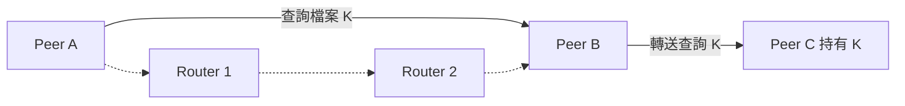
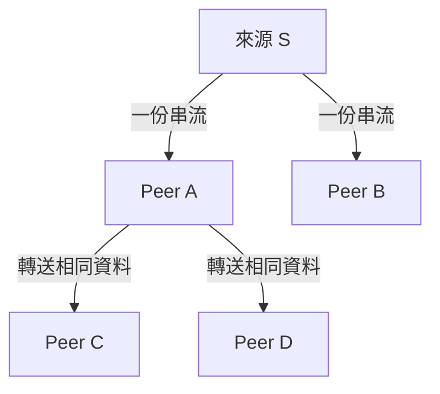
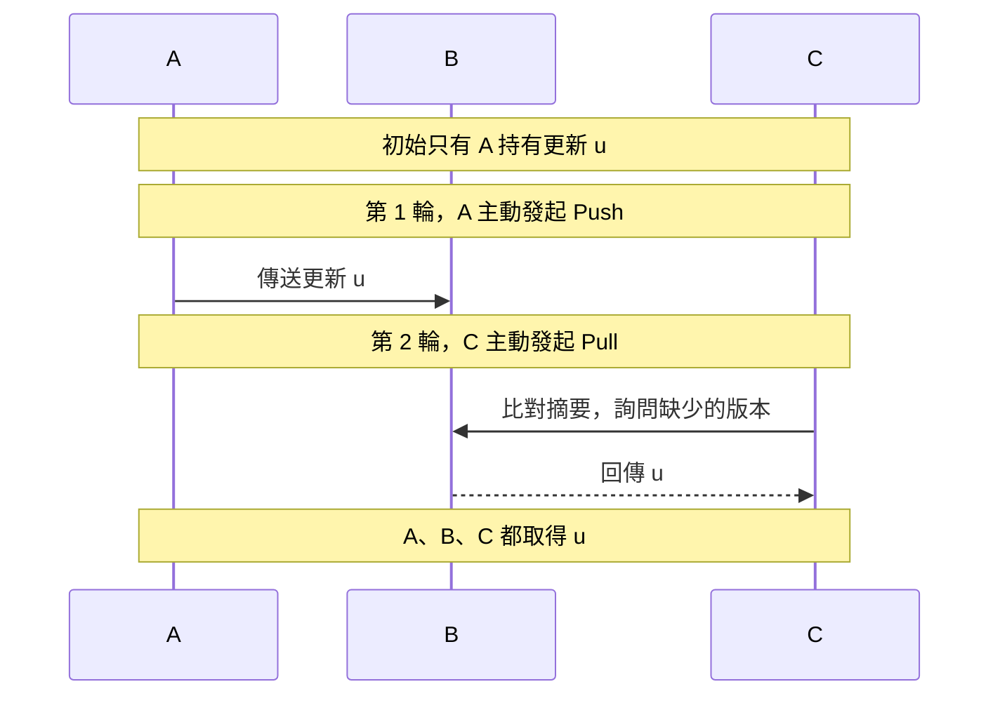
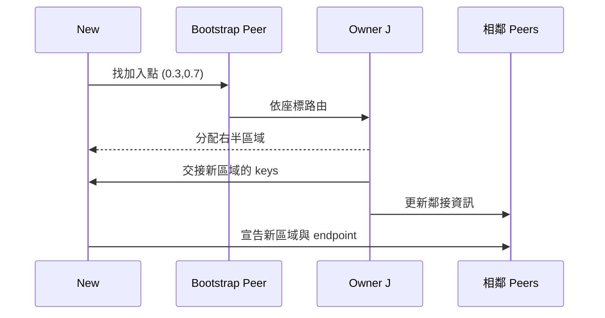
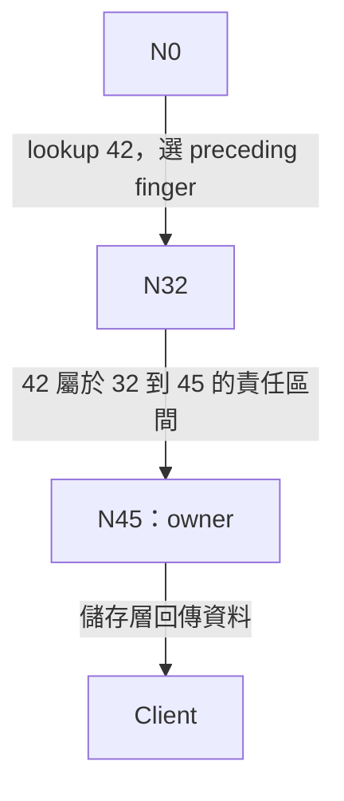
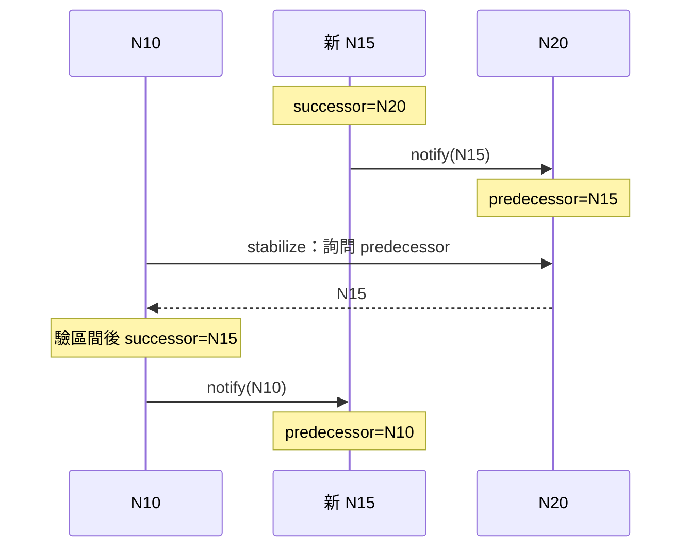
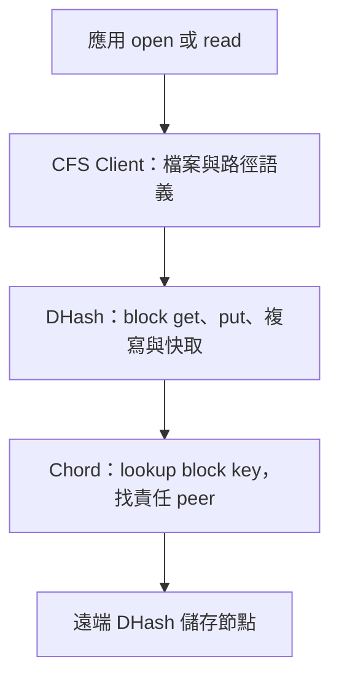
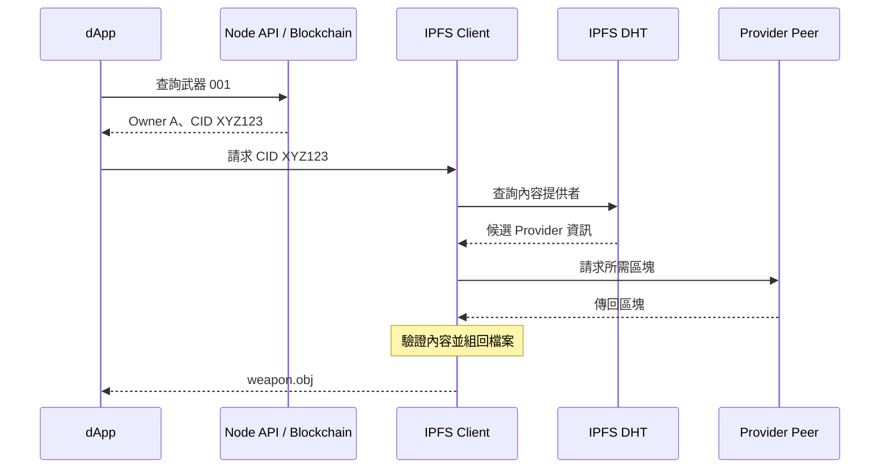

# Chapter 04 — 對等網路, Gossip 與分散式雜湊表 (Peer-to-Peer Computing & Overlay Networks)

## 1. 從一個檔案請求看懂 P2P 與 Overlay

全班要下載同一份課程映像檔. 如果每台電腦都向同一台伺服器下載, 伺服器就得把同一份檔案送很多次. 先下載完成的電腦若也能上傳, 就能和來源分攤流量. 這是對等運算 (Peer-to-Peer Computing, P2P) 的做法. SETI@home 也讓參與機器分攤工作, 同時保留中央伺服器分派任務.

A 想下載檔案 K, 但目前只知道怎麼聯絡 B. B 收到查詢後, 用自己的聯絡資訊把查詢轉給 C. 這些由應用程式維護的對等節點 (Peer) 與聯絡關係, 組成覆疊網路 (Overlay Network). A 拿到 C 的位址後, 可以直接向 C 下載, 因此查詢走 A→B→C, 檔案可走 C→A.



圖 4.1 - 查詢的兩個邏輯跳與第一跳的 IP 路徑. 虛線逐段展開 A→B, 應用程式只在 B 決定下一個 Peer (成大講義 P94, P97).

在 A→B 這一跳, 應用程式只選擇 B 當下一站. 下面的 IP 路由 (IP Routing) 再依 B 的位址把封包交給各台路由器. 因此一個邏輯跳 (Logical Hop) 可能跨多個路由器跳 (Router Hop). 網路中途改道時, 只要 A 還聯絡得到 B, 覆疊網路就能保留 A→B 這條邊.

假設 A→B 的單向網路延遲為 12 ms, B 收到後花 3 ms 找到下一個 Peer, B→C 再花 18 ms. 查詢在 $12+3+18=33$ ms 後到達 C. 回覆與下載還要另算. 講義 P94 的 $50\,\mathrm{ms}\times5=250\,\mathrm{ms}$ 同樣假設每段都各花 50 ms, 而且逐段轉送. 若只量到 A 直連 C 花 50 ms, 還不知道經過 B 的路徑要多久.

## 2. 從 Multicast, Napster 到 Gnutella

### 2.1 End System Multicast 的資料路徑

**端系統多播 (End System Multicast, ESM)** 又屬 **應用層多播 (Application-Layer Multicast, ALM)**: 由 peers 複製並轉送串流, 不要求所有跨 ISP routers 提供同一套 IP multicast 支援.

假設來源 S 各送一份串流給 A, B, 由 A 再各送一份給 C, D. S 的上傳負擔從四份降到兩份, A 多負擔兩份上傳. 若 A 離線, C, D 得找到新的上游才能繼續接收.



圖 4.2 - 來源送兩份, A 負責複製下一層的兩份. 每條邊各自透過 IP 路徑傳輸 (成大講義 P95).

端點複製讓應用程式可以在既有 IP 網路上部署多播. 如果 A→C 和 S→B 恰好共用一條實體鏈路, 相同串流可能在那條鏈路上傳兩次. 由端點分工可以降低來源壓力, 但接收者的延遲仍會受路徑長度, 轉送和 Peer 的上傳頻寬影響.

### 2.2 從查詢目錄到鄰居搜尋

在 Napster 的設計中, C 先向中央目錄 (Centralized Catalog) 登記檔名與可連線位址. A 請目錄查檔名, 收到 C 的位址後向 C 下載. 即使目錄暫時失效, 已建立的傳輸仍可繼續, 但新的搜尋可能無法找到 C. 這套設計把"誰有檔案"集中管理, 把檔案流量留在 Peers.

早期 Gnutella 沒有集中目錄. 節點只知道附近的同伴, 收到第一次見到的查詢, 就把它轉送給鄰居. 這是泛洪 (Flooding). 查詢帶有存活跳數 (Time to Live, TTL), 用完就停止轉送.

Flooding 可用 message ID 去重與 TTL 限制範圍. 例如六節點 A–B, A–C, B–D, C–D, D–E, C–F, A 發 Query q1. 若 D 不辨認 q1, 會把從 B, C 收到的同一查詢重複轉送. 辨認 q1 可減少重複處理, 但仍不能避免每次新 Query 消耗多條邊.

A 用 TTL=1 時, 查詢只到 B 和 C. 即使 E 有檔案, A 也可能得到查無結果. 分散式雜湊表可以依確切的鍵定位, 如果要搜尋檔名中的部分字詞, 仍需要另外建索引.

找檔案時, 有一個合適的提供者回答就夠. 散布新版時, 要讓還沒更新的節點陸續取得內容. 如果每次更新都泛洪, 大量節點會反覆處理同一則通知. 下一步是控制各節點每輪需要聯絡幾個對象.

## 3. Gossip, Anti-entropy 與收斂條件

新版映像檔發布後, A 先通知 B. 下一輪 A 找 C, B 同時找 D. 讓各節點隨機聯絡少量同伴, 由收到更新的節點接力, 這種做法稱為 Gossip. 流行病式傳播 (Epidemic Dissemination) 的模型把持有且願意分享更新的節點稱為 infective, 尚未更新的稱為 susceptible.

反熵 (Anti-entropy) 讓副本定期交換版本或摘要, 找出差異後補送, 因此一輪漏掉的更新後面還有機會補上. 謠言傳播 (Rumor Mongering) 則主動轉送近期更新, 碰到多個已知者後可能停止轉送, 因此可能留下一些沒收到的節點.

### 3.1 Push, Pull 與 Push-pull

由 A 主動把已知更新交給 B 稱為推送 (Push). 由 B 主動向某個同伴詢問自己缺的資料稱為拉取 (Pull). 一次聯絡也可以雙方都比對摘要, 交換各自缺的項目, 稱為推拉交換 (Push-pull). 若 A 一開始就有全部成員的地址, 也能直接寄送 (Direct Mail), 此時約有 $O(N)$ 次發送集中在 A.



圖 4.3 - 同一筆更新可以由持有者先推一輪, 再由缺資料的節點拉取. B 在第 1 輪取得更新, 第 2 輪便能回答 (成大講義 P99, P102–P103).

### 3.2 每輪有多少人仍缺更新? Push 與 Pull 的完整推導

從同一個起點比較. 十個節點中有兩個已更新, 八個還在等. Push 由兩個已更新者各找一個對象. Pull 則由八個還沒更新的節點各問一次. 要算這一輪後還剩多少, 可以先挑一個原本沒更新的節點 C, 問它這輪在什麼情況下仍然拿不到更新.

#### 模型與符號

令 $N$ 為節點總數, $S_i$ 為第 $i$ 輪開始時尚未更新的數量, $p_i=S_i/N$ 為未更新比例. 這時已有 $I_i=N-S_i=N(1-p_i)$ 個節點持有更新.

每個發起者每輪從全部 $N$ 個節點中均勻選一個對象, 包含自己. 每次抽樣獨立. 這一輪剛收到的更新要到下一輪才能提供給別人. 先假設通訊成功, 沒有節點離線.

#### Push: C 要躲過幾次傳送?

每位持有者抽中 C 的機率都是 $1/N$. 一次沒抽中是 $1-1/N$. 第 $i$ 輪一共有 $I_i$ 個人各抽一次, 所以 C 要避開全部 $I_i$ 次才能保持未更新.

$$
P(\text{C 在本輪沒收到更新}\mid S_i,\ \text{C 原本未更新})
=\left(1-\frac{1}{N}\right)^{I_i}
$$

將同一件事套到輪初未更新的 $S_i$ 個節點. 每個節點留在其中的機率都一樣, 所以期望數量是 $S_i$ 乘上該機率. 再除以 $N$, 就得到下一輪的條件期望比例.

$$
\frac{\mathbb{E}[S_{i+1}\mid S_i]}{N}
=p_i\left(1-\frac{1}{N}\right)^{N(1-p_i)}
$$

十個節點的例子中, 指數是兩次傳送. C 兩次都沒被抽中的機率是 $0.9^2=0.81$. 八個未更新者預期剩 $8\times 0.81=6.48$ 個, 佔 $64.8\%$. 單次結果只能是整數, 6.48 是重複同一初始情境的平均.

$N$ 很大時, $\left(1-\frac{1}{N}\right)^N$ 接近 $e^{-1}$, 其中 $e$ 為自然常數. 將原本的指數拆成 $N$ 和 $1-p_i$, 就得到用來估計收斂速度的近似.

$$
\frac{\mathbb{E}[S_{i+1}\mid S_i]}{N}
=p_i\left[\left(1-\frac{1}{N}\right)^N\right]^{1-p_i}
\approx p_i e^{p_i-1}
$$

#### Pull: C 問到誰才會失敗?

C 本來就沒更新, 它只問一個對象. 如果對方也沒更新, C 就繼續等下一輪. 全部 $N$ 個節點中有 $S_i$ 個屬於這種對象, 因此 C 留在未更新集合的條件機率是 $S_i/N=p_i$. 再乘以輪初未更新的比例, 就知道這輪後預期還剩多少比例.

$$
\frac{\mathbb{E}[S_{i+1}\mid S_i]}{N}=p_i\times p_i=p_i^2
$$

這裡的兩個 $p_i$ 有不同來由. 第一個是輪初未更新的比例, 第二個是 C 抽到未更新對象的機率, 抽到自己也算. 十個節點的例子預期剩 $8\times0.8=6.4$ 個, 佔 $64\%$. 若抽樣排除自己, 第二個因子改成 $\frac{S_i-1}{N-1}$.

| 同一輪的比較 ($N=10$, $S_i=8$) | Push | Pull |
| --- | --- | --- |
| 主動聯絡次數 | 2 | 8 |
| C 仍未更新的條件 | 兩次傳送都沒選中 C | 唯一詢問的對象也沒更新 |
| 預期未更新數量 | $8\times0.9^2=6.48$ | $8\times0.8=6.4$ |

兩個公式都把輪初的 $S_i$ 視為已知. 真正跑到下一輪時, $S_{i+1}$ 已是隨機結果. 把期望值直接代回非線性公式, 得到的是教材用來比較趨勢的遞迴, 不能當作有限網路逐輪的精確期望.

### 3.3 收斂速度與通訊成本: 為何先 Push 再 Pull?

P103 的圖以輪數比較收斂. 下表依教材遞迴, 用相同 $p_0=0.9$ 核算, 保留六位小數:

| round i | Push: $p e^{p-1}$ | Pull: $p^2$ |
| --- | --- | --- |
| 0 | 0.900000 | 0.900000 |
| 1 | 0.814354 | 0.810000 |
| 2 | 0.676376 | 0.656100 |
| 3 | 0.489373 | 0.430467 |
| 4 | 0.293682 | 0.185302 |
| 5 | 0.144919 | 0.034337 |
| 6 | 0.061627 | 0.001179 |

對 $0<p<1$, $\ln p<p-1$, 故 $p^2<p e^{p-1}$. 在這組遞迴模型中, Pull 每輪下降較快. 這不是 Pull 的網路成本在所有階段都較小的證明.

輪數只表達更新傳開的速度. 算通訊負擔時, 還要數這一輪有誰會發起聯絡. Push 由持有者發起 $N(1-p_i)$ 次, Pull 由缺更新者發起 $Np_i$ 次.

固定 $N=10{,}000$, 比較傳播初期與末期:

| 傳播階段 | Push 每輪發起次數 | Pull 每輪發起次數 | 原因 |
| --- | ---: | ---: | --- |
| 初期: 1 個 infective, 9,999 個 susceptible ($p_i=0.9999$) | 1 | 9,999 | 大部分 Pull 都詢問尚未更新的節點 |
| 末期: 9,999 個 infective, 1 個 susceptible ($p_i=0.0001$) | 9,999 | 1 | 大部分 Push 都送給已更新者 |

初期唯一的持有者 Push 一次, 選到新節點的機率為 $9999/10000$. 用 Pull 時, 9,999 個節點各有 $1/10000$ 的機率問到持有者. 兩者預期都新增約 1 個節點, 聯絡量卻差近萬倍. 到末期, 唯一缺更新的節點 Pull 一次, 成功機率同樣是 $9999/10000$.

因此可在初期用 Push 避免大量無效查詢, 等大多數節點已有更新後再用 Pull 補尾端. 表中只計發起次數, 完整成本還要加上回覆, 摘要, 重試與傳輸量.

有限 N 的例子: $N=100$, $S=90$, Push 的單輪期望比例為 $0.9(0.99)^{10}\approx0.813944$, 與大 N 近似 0.814354 略有差異; Pull 在本模型是 0.81.

### 3.4 一個完整六節點傳播交錯

A 起初知道更新 u, 其他 B–F 不知道. 每輪只讓輪初 infective 主動 Push:

| round | 指定的抽樣結果 | 輪末知道 u 的集合 |
| --- | --- | --- |
| 0 | 初始 | $\{A\}$ |
| 1 | A→B | $\{A,B\}$ |
| 2 | A→C, B→D | $\{A,B,C,D\}$ |
| 3 | A→B (重複), B→E, C→F, D→A (重複) | $\{A,B,C,D,E,F\}$ |

這是一次可能執行, 不是所有抽樣都在三輪完成. 若每次都抽到 A, 有限輪數內可以始終未完成. 若 F 永久隔離, 則無法靠重試跨越不存在的通路.

在固定成員且路徑可達的模型裡, 持續隨機抽樣與重試才有機會補齊最後一個節點. 如果停掉傳播之前還有人沒收到, 或更新的所有副本先消失, 之後的重試也補不回來.

### 3.5 刪除, 衝突與 Anti-entropy 的工程邊界

只有"較大版本覆蓋較小版本"的規則, 仍需定義版本比較與刪除表示. A 刪除 k, B 離線保有 k. 若 A 只把資料完全移除, B 恢復時可能把舊值傳回, 造成復活. **刪除標記 (Tombstone)** 保留"已刪除及其版本", 使反熵能傳播刪除. 何時清除 tombstone 要有足夠的傳播, 成員與保留期條件.

並行更新的解法也不是 Gossip 自動決定. 可用 [Chapter 01 的 Vector Clock](01-logical-clocks-checkpointing.md) 辨認衝突, 再由應用合併, 或對需要強順序的項目採用共識. 傳播是否到齊與寫入語義是否正確, 是不同層的問題.

## 4. DHT: 把查找問題放進可維護的座標空間

要找指定區塊時, 應用需要從鍵 (Key) 找到應該聯絡的節點. **分散式雜湊表 (Distributed Hash Table, DHT)** 把鍵雜湊成共享空間中的位置, 再按節點負責的範圍決定責任節點 (Owner). 每個 Peer 只需維護部分路由資訊. 中途的 B 即使沒有區塊, 也能把查詢送向更接近目標的位置.

應用對同一個 key 做 `put(key,value)` 和 `get(key)`, 兩次運算會映到同一位置. 穩定拓樸中, 查詢可走向同一個責任節點. CAN 先展示如何用二維區域完成這件事, Chord 接著把相同問題放到一維環上.

"唯一責任節點"是穩定拓樸中的邏輯 owner, 不代表只有一份副本, 也不保證節點異動期間所有人立即同意 owner. 雜湊能分散 key, 不能自動消除 hot key 的讀取負載, 或防止惡意者選擇特殊 IDs.

例如 Chord 的 `lookup(key)` 只回報要去找哪個節點. 複寫幾份, 什麼時候算寫入成功, 都由上面的儲存層決定.

## 5. CAN: 座標區域, 加入與資料遷移

**內容定址網路 (Content-Addressable Network, CAN)** 把 $d$ 維座標空間切成區域 (Zone), 每個 Peer 可負責一塊或多塊. 座標的兩端相接, 像把二維平面的上下, 左右邊緣接起來. 在一個維度接邊, 且其他維度也有重疊範圍, 才算相鄰區域, 只碰到角落不算.

### 5.1 用區域切分交接檔案鍵

圖 4.4a 左半邊是加入前的版圖, 右半邊是加入後的版圖. J 原先負責左上區域, New 加入後分走 J 的右半塊. 以下把整個版圖設為 $[0,1)\times[0,1)$, 右上和下方的區域分別記作 B, A.


圖 4.4a - 成大分散式系統講義 P106, CAN: Node Joining & Publishing, Node Join Mechanism 原圖裁切.

| Peer | x 範圍 | y 範圍 |
| --- | --- | --- |
| J | $[0,0.5)$ | $[0.5,1)$ |
| B | $[0.5,1)$ | $[0.5,1)$ |
| A | $[0,1)$ | $[0,0.5)$ |

假設鍵 K 雜湊到 $(0.3,0.6)$, 加入前落在 J 的區域. 加入過程只改區域的負責人, 鍵的座標始終相同.

1. New 聯絡 bootstrap peer, 隨機選定加入點, 本例假設為 $(0.3,0.7)$.
2. 透過 CAN 路由找到該座標的 Owner J.
3. J 沿 x 軸方向切分區域, 保留 $[0,0.25)\times[0.5,1)$; New 接手 $[0.25,0.5)\times[0.5,1)$.
4. J 將落在 New 區域的既有資料交接給 New, 並更新兩者及相鄰 Peers 的路由資訊. K 的座標沒有改變, 但責任節點從 J 變成 New.
5. 發布 $(K,V)$ 時, 仍使用 $\mathrm{hash}(K)=(0.3,0.6)$ 進行路由. 現在由 New 儲存資料, 後續 get(K) 也使用相同映射取回.



圖 4.4 - J 切分區域後交接資料並更新鄰居. 實作仍需處理重送, 部分交接與版本 (成大講義 P106).

### 5.2 路由, 故障與成本

CAN 每一跳從已知鄰居選一個離目標座標更近的節點. 規則且各區域大小相近時, 每個維度約有 $N^{1/d}$ 格, 一個方向有兩側鄰居. 因此每台約維護 $2d$ 個鄰居, 平均查找尺度為 $O(dN^{1/d})$ 跳. 分割後的區域若不規則, 一條邊可能接到好幾個區域, $2d$ 也就不是鄰居數上限.

提高 d 通常可減少路徑尺度, 但增加每節點 routing state 與維護流量. 鄰居 crash 時可試其他更接近的路徑. 若某方向形成缺口, 沒有可前進鄰居, greedy routing 仍可能暫時失敗. 原論文討論接管與修補, 必要時用受控擴散找更近節點, 並非每種故障都無感.

接管區域能恢復通往該座標的路由. 原資料若只有一份, 且儲存裝置永久損壞, 新節點仍需要靠其他副本或備份把值補回來.

## 6. Chord: Ring, Finger Table 與完整 Lookup

### 6.1 ID, Owner 與環繞區間

**一致雜湊 (Consistent Hashing)** 將節點與 keys 放到同一環狀空間. m-bit ID 的取值為 $0,\ldots,2^m-1$; key k 的責任節點 `successor(k)` 是順時針方向第一個 ID $\ge k$ 的節點, 越過最大值則回到最小節點.

P107 的 $m=6$, 節點 $\{0,10,20,32,45,55\}$, 空間為 $0,\ldots,63$. 責任區間如下:

| 節點 | 所有 keys 的責任區間 |
| --- | --- |
| N0 | $(55,0]$, 即 56–63 與 0 |
| N10 | $(0,10]$, 即 1–10 |
| N20 | $(10,20]$ |
| N32 | $(20,32]$ |
| N45 | $(32,45]$ |
| N55 | $(45,55]$ |

key=32 由 N32 負責; key=42 由 N45 負責, 不能因 42 距離 32 較近就選 N32.

```text
順時針：N0 → N10 → N20 → N32 → (key 42) → N45 → N55
        ↑                                          │
        └──────────────────── 63→0 ───────────────┘
```

圖 4.5a - 把環攤開可直接看到 42 後面的第一個節點是 N45. 括號標識 key 的位置, N 開頭的標識是節點 (成大講義 P107).

### 6.2 用捷徑跳過中間節點

如果 N0 只認得下一個節點, 找 42 得一路經過 N10, N20, N32 才能判斷 N45 是 owner. Chord 讓 N0 多記一些遠近不同的聯絡人. 捷徑表 (Finger Table) 第 i 項 (本章 $i=0,\ldots,m-1$) 為 $\mathrm{successor}((\mathrm{nodeID}+2^i)\bmod 2^m)$. 先沿環算出起點 (Finger Start), 再找起點的後繼. N32 的 offset 8 先得到 40, 環上第一個不小於 40 的節點是 N45, 故該欄存 N45.

| offset | N0 的 start → finger | N32 的 start → finger |
| --- | --- | --- |
| 1 | 1 → N10 | 33 → N45 |
| 2 | 2 → N10 | 34 → N45 |
| 4 | 4 → N10 | 36 → N45 |
| 8 | 8 → N10 | 40 → N45 |
| 16 | 16 → N20 | 48 → N55 |
| 32 | 32 → N32 | 0 → N0 |

在此 $m=6$ 的 toy example, 每節點最多 m 項. 許多項可指向同一節點. 常見 $O(\log N)$ 狀態與 lookup hops 是對隨機分布, 正確維護拓樸的尺度描述, 不能把識別位數 m 與目前活躍節點數 N 當成同一個變數.

### 6.3 Lookup(42): 為何不是跳到節點 42?

簡化且只適用於已正確連接的單環:

```text
find_successor(k) at n:
    if k == n.id or n.successor == n: return n
    if k in clockwise interval (n.id, n.successor.id]:
        return n.successor
    q := closest preceding live finger in clockwise interval (n.id, k)
    if q absent: q := n.successor
    forward lookup(k) to q
```

1. 從 N0 找 42. 42 不在 $(0,10]$, N0 的可用 fingers 中, 沿順時針最接近 42 且仍在它之前的是 N32.
2. N32 的 successor 為 N45, 42 落在 $(32,45]$, 故回報 owner=N45.
3. 若上層要取資料, 再與 N45 通訊. 在本章端到端聯絡清單可寫 `N0 → N32 → N45`, 但最後一步是 owner/資料訪問, 不是先找到一個真的節點 N42.



圖 4.5 - N0 用捷徑把查詢交給 N32, N32 用後繼區間找到 N45. 資料回傳由儲存層處理 (成大講義 P107).

在 N32 看到 "Jump 8" 時, 先算 $32+8=40$, 再查 40 的後繼節點 N45. 但實際查找鍵 42 時, N32 用後繼區間就能判定 N45 是 owner. 這裡的 40 只是建立捷徑時用的起點.

環繞案例: 從 N45 找 60, 可到 N55, 再發現 $60\in(55,0]$, owner=N0. 普通整數比較會錯誤拒絕跨 63→0 的有效區間, 故 pseudocode 必須使用 modulo interval.

### 6.4 為何能前進? 有哪些限制?

只沿順時針挑鍵前方的可達捷徑, 每一跳都縮短剩餘距離. 沒有捷徑時可以沿後繼指標前進, 直到目前節點能判定鍵落在下一個責任區間. 因此在環完整的情況下, 只有後繼也能完成查找, 但可能慢到逐個詢問節點.

若 successor 已失效或 ring 斷裂, 上述推理的前提就不成立. ID 不變, hash 看似均勻, 也不能修好斷裂的指標. 需要下一節的 maintenance 與 failure handling.

## 7. Chord Join, Stabilize 與故障修補

### 7.1 P108–P109 的單一加入完整例子

先假設 N10→N20 的局部關係正確, N20.predecessor=N10, 沒有其他同時加入或故障. N15 要插入其間:

1. N15 經 bootstrap 查到 $\mathrm{successor}(15)=N_{20}$, 令自己的 successor=N20; N10 此時仍指 N20.
2. N15 通知 N20. 因 15 在 $(10,20)$, N20 將 predecessor 更新為 N15.
3. N10 執行 stabilize, 問 N20: "你的 predecessor 是誰? "得到 N15.
4. N10 驗證 15 在 $(10,20)$, 改 successor=N15, 並 notify N15.
5. N15 接受 N10 為 predecessor. 現在局部順序 N10→N15→N20.
6. 背景 fix_fingers 逐步更新 shortcuts. 儲存層另外移交 $(10,15]$ 的資料, 不能只改 pointer 就宣稱 put/get 已完整恢復.



圖 4.6 - 先由 N20 發現新前驅, 再由 N10 改接新後繼. 圖只追蹤單一加入, 沒有其他故障或同時加入 (成大講義 P109).

### 7.2 Successor 故障與 Successor List

**節點變動 (Churn)** 包含加入, 離開與 crash. 若 N10 只記 N15, 一旦 N15 失聯便無路可走; **後繼清單 (Successor List)** 可保存多個順時針候選, 在最近者不可達時換成下一個, 再執行修補.

但 timeout 可能誤判. 連續後繼若屬同一實體機器或同一網路分區, 複數 IDs 不等於獨立容錯. 若所有候選都失效, 指標形成多環或無法橋接分區, 一次 stabilize 未必能恢復整個環的可達性.

### 7.3 哪些節點變動會超出加入算例

N15 的例子成立, 是因為既有環完整, 加入只有一次, 而且 N10, N15, N20 都能互相聯絡. 如果兩個加入重疊, 或後繼在更新指標途中失聯, 原始 Chord 的維護規則可能無法恢復單一可達的環. 後續研究用明確的初始配置及不變量修正這些問題. [Zave 的說明與勘誤](https://www.pamelazave.com/chord.html)

## 8. CFS: 檔案, DHash 與 Chord 的分層

開頭的映像檔有路徑, 有檔名, Chord 只會查鍵. 合作式檔案系統 (Cooperative File System, CFS) 先把路徑解析成目錄, 索引節點 (Inode) 和資料區塊. 分散式區塊儲存層 (DHash) 負責取得, 保存和複寫區塊, 並用 Chord 查找區塊應送到哪台.



圖 4.7 - 檔案操作落到區塊資料, DHash 使用 Chord 找儲存節點. 這是責任分層, 實作可以快取或合併通訊 (成大講義 P110–P111).

### 8.1 發布與讀取的完整資料路徑

Publisher 有檔案 F, 切成 B1, B2, B3, 計算 $k_1=H(B_1)$, $k_2=H(B_2)$, $k_3=H(B_3)$.

1. 建立 inode/目錄等 metadata blocks, 內容包含下層 block IDs. 它們也可用內容雜湊定址.
2. 經 DHash put 各 block, 透過 Chord 找責任節點. 儲存層維持副本與快取, 避免唯一 owner 一故障就讀不到.
3. 用發布者私鑰簽署根區塊 (Root Block). 讀者以發布者公鑰辨識檔案系統, DHash 則將公鑰雜湊成根區塊的 Chord 鍵. 樹下的資料區塊以各自的內容雜湊識別與驗證.
4. Reader 以已知的發布者公鑰算出根區塊的鍵, 取回後驗簽. 接著沿中繼資料中的雜湊取回各區塊, 逐塊驗證再組回檔案 F.
5. 某提供者回傳錯誤 bytes 時 hash 檢查失敗, 可改找其他副本. 若所有副本都失聯, 驗證能力不能代替可用性.

快取可以加速熱門區塊, 但不能取代持久副本. 讀者也需要判斷已驗簽的 root 是否為所需版本.

### 8.2 "Read-only"與 Publisher 更新

一般讀者在 CFS 中只能讀. 發布者要修改檔案時, 先發布新的內容區塊, 再以同一把私鑰簽署新版根區塊. 這個根區塊的定位鍵維持不變, 因此讀者仍可用同一把公鑰尋找新版. 如果改成多個 Client 都能更新同一指標, 接下來就得決定哪一筆更新先執行.

區塊能保存多久取決於保留期與續存. 快取讓熱門檔案比較好讀, 副本讓單台機器離線時還有其他來源. 長期保存仍要有人維護這些副本.

## 9. 可變資料的副本如何決定寫入順序

如果讀者可以共同修改一個檔案的根指標, 儲存層就要決定每次修改的先後. 可以對鍵 42 固定一組副本 N45, N55, N0, 由這三台以 $q=2$ 共同決定下一個版本. Chord 仍負責把請求帶到知道這組副本的入口.

1. Chord lookup 找到能聯絡此 replica group 的入口.
2. 寫入帶上明確 key, instance/log index 與 group configuration.
3. 群體按 [Chapter 02 的 Paxos 規則](02-fault-tolerance-paxos-raft.md) 處理 Promise, Accepted 與值採用, 再交給應用.
4. 網路 2/1 分區時, 多數側可在其他進展條件滿足時提交, 少數側不能自行降低 quorum.

新節點加入後, Chord 可以先更新它對後繼的看法, 但共識群體仍要沿用舊配置直到歷史交接完成. 若各節點直接拿自己看到的後繼清單投票, 新舊群體可能各自湊出多數, 對同一位置選出不同值.

三台副本用標準 Paxos 形成多數時, 前提是投票者依協定記住承諾並誠實回覆. 在無法信任對等節點的環境, 要另外界定身分與故障模型. 如果應用只需要副本在更新停止後逐步收斂, 也可以保留並行版本並按規則合併, 省去每次寫入都要等多數的成本.

## 10. Overlay 的效能, Sybil 與 Eclipse

**多重假身份攻擊 (Sybil Attack)** 是一個實體建立多個邏輯身份, 讓"不同節點"不再代表獨立控制者. **日蝕攻擊 (Eclipse Attack)** 則使受害者可接觸的 routing/neighbor view 被攻擊者包圍, 查詢與更新受其控制. 大量 Sybil IDs 可以協助達成 Eclipse, 但兩者不是同義詞.

自製例子: 系統以三個不同 node IDs 保存 block, 就宣稱可容錯一個不誠實者. 若三個 IDs 都由同一攻擊者控制, 副本數沒有提供所假設的獨立性. 若 Client 所有 bootstrap 與 successor 回覆都來自攻擊者, 它甚至可能看不到真正的其他 peers.

| 手段 | 主要作用 | 代價與限制 |
| --- | --- | --- |
| 受信任身份/憑證機構 (Certificate Authority, CA) | 限制任意建立身份, 建立管理責任 | 引入管理中心與發證政策; 憑證數是否代表不同實體仍需規範 |
| Proof of Work/Proof of Stake | 將影響力連到可計量成本或資源 | 是特定協定的抗濫用設計, 不自動驗證每個 peer 身份或杜絕鄰居操控 |
| 多來源 bootstrap, 鄰居多樣性 | 降低視野全部集中同一控制者的機率 | 必須能辨識共同故障/控制域, 沒有絕對免疫 |
| 內容雜湊與簽章 | 拒絕被修改的資料, 驗證來源 | 攻擊者仍可不回覆, 隱藏新版本或使路由不可達 |

內容驗證只能檢查收到的資料. 即使每份區塊都能驗證, 如果所有查詢都只找得到同一個控制者, 能否讀到正確版本仍受其可用性和回應影響.

## 11. Web3 堆疊: 把路由, 儲存與信任分開看

Web3 應用可拆成幾個問題. 誰能更改共同紀錄, 應用從哪裡讀取鏈上狀態, 大檔案由誰提供. 用遊戲資產當例子, 鏈上紀錄可以指出物品的持有者和模型識別碼, 實際模型則由鏈下節點傳送.

| P116 的層 | 試圖解決的問題 | 實際需檢查的信任與成本 |
| --- | --- | --- |
| Blockchain Network | 共同交易順序與狀態更新規則 | 安全性依共識與參與假設; 鏈上儲存與執行有成本 |
| Node APIs/Gateway | 讓 Client 不必自行運作完整節點即可查詢 | Gateway 可成為可用性與資訊視野的依賴 |
| Presentation & Storage, 如 IPFS | 將大型資產放鏈外, 以內容識別取得 | CID 驗證內容不等於保證有人永久提供資料 |
| dApps | 結合使用者介面, 鏈上邏輯與鏈外內容 | UI, 私鑰, 合約與鏈外服務仍有各自風險 |

### 11.1 Blockchain 與 IPFS 之間靠什麼連接?

假設遊戲交易平台管理一把武器的持有者及其 100 MB 的 3D 模型 `weapon.obj`. 持有者是需要共同驗證的紀錄, 適合放在區塊鏈 (On-chain). 模型內容很大, 則可放在 IPFS (InterPlanetary File System, 星際檔案系統) 等鏈下 (Off-chain) 網路. 鏈上紀錄靠 CID 引用這份模型. 即使提供者換了機器, 同一份內容仍能用原本的 CID 查找.

發布時先將模型加入 IPFS, 取得 **內容識別碼 (Content Identifier, CID)**, 再把該 CID 或包含它的 URI 寫入鏈上紀錄. 以下 XYZ123 是教學用的簡化識別碼, 不是真實 CID.

```text
Blockchain                     IPFS
武器 ID：001                   CID：XYZ123
持有者：玩家 A                 weapon.obj（100 MB）
模型：ipfs://XYZ123 ─────────→ 模型內容
```

圖 4.8a - 鏈上紀錄保存鏈下資產的識別資訊, 而不是大型檔案本身. 箭頭表示資料引用, 不表示區塊鏈節點直接連線至 IPFS (成大講義 P116).

例如 Ethereum 可保存持有者紀錄, 應用透過 Alchemy 等節點 API 讀取它. dApp (Decentralized Application) 再向 IPFS 取得模型並呈現. 查鏈上紀錄和取檔案是兩個各自發出的請求.

### 11.2 IPFS 的檔案有固定位置嗎?

檔案實際上仍然存在某些機器的儲存裝置中, 但 CID 不指定哪一台機器. 傳統位置定址 (Location Addressing) 以 `https://server.example/weapon.obj` 指定服務位置; IPFS 的內容定址 (Content Addressing) 則以 `ipfs://XYZ123` 表示要取得哪份內容. 同一內容在相同匯入設定下可得到相同 CID, 即使提供者改變也不必改動鏈上的引用. 內容改變通常會得到新的 CID. CID 包含 hash 與編碼等資訊. 大型檔案的 CID 可代表由多個區塊構成的資料結構, 並非必然等於整個檔案的單一 SHA-256.

Chord 的查詢回傳鍵的責任節點. IPFS 若使用 Kademlia DHT, 查到的是提供者紀錄 (Provider Record), 也就是哪些 Peer 宣告能提供內容. 保存這筆提供者紀錄的機器可以與真正存區塊的機器是不同台. 用戶端還要聯絡一位可達的提供者才能下載. IPFS 也能從已連上的同伴或其他內容路由服務找資料.

### 11.3 完整讀取流程: 從武器編號到模型檔案

假設應用程式尚未快取模型, 且以區塊鏈 Node API 與 IPFS DHT 進行查詢:

1. 應用程式以武器 ID 001 查詢鏈上紀錄.
2. Node API 回傳持有者玩家 A, 以及 `ipfs://XYZ123`.
3. IPFS Client 向 DHT 查 CID 對應的提供者紀錄.
4. Client 取得候選 Peer 的連線資訊, 聯絡可達的提供者, 下載所需區塊.
5. 依 CID 及區塊間的雜湊連結驗證內容, 再組回模型並顯示在應用程式中.



圖 4.8b - 應用程式先取得鏈上 CID, 再向 IPFS 取得鏈下資產. 為圖中用一次提供者查詢代表取得模型所需的區塊 (成大講義 P116).

### 11.4 CID 還在, 檔案就一定存在嗎?

CID 能驗證讀回的內容是否正確. 若所有提供者離線, 刪除了內容, 或少了一個必要的區塊, 即使鏈上的 CID 還在, 模型也讀不回來.

Pinning (固定保留) 是要求某個 IPFS 節點保留指定內容, 避免本地垃圾回收的機制. 若需要長期可用, 還須維護在線的保存節點或遠端 pinning 服務, 並考慮多份獨立副本. Pinning 不等於全網永久複寫.

## 12. CAN, Chord 與 Gossip 解決的問題

| 比較面向 | CAN | Chord | Gossip |
| --- | --- | --- | --- |
| 核心問題 | 以座標找 zone owner | 以環狀 key 找 successor | 讓更新/狀態逐步散布 |
| 結構 | d 維 zone 鄰接 | Ring, successor list, fingers | 隨機 partner 與成員抽樣機制 |
| 典型成本 | 規則模型 $O(dN^{1/d})$ hops | 維護正常, 分布假設下 $O(\log N)$ hops | 常見理想模型 $O(\log N)$ 期望傳播輪數, 訊息數另計 |
| 狀態維護 | 分裂, 鄰居通知, zone 修補 | Join, stabilize, fix_fingers, 故障接替 | 抽樣, 版本摘要, 重試與 tombstone |
| 不自動提供 | 任意資料的持久性與一致寫入 | 儲存複寫, 完整群體共識, Byzantine 安全 | 精確查找, 全序與有限時間必達 |

CAN, Chord 或內容路由先幫 A 找到可以問的節點. 如果 A, B 讀到不同資料版本, 還需要知道服務允許出現什麼樣的結果. 這個問題接到 P118 的資料一致性模型.

## 13. 英文選擇題與逐項解析

### Q1 — Overlay hops

What is true about an overlay hop?

- A. It always corresponds to exactly one physical router hop.
- B. It may traverse several IP-layer hops between two peers.
- C. It guarantees lower latency than a direct Internet path.
- D. It removes all dependence on physical network connectivity.

**答案: B.** A: 邏輯邊可經多台 routers. B: 正確的層次關係. C: 繞路與轉送可增加延遲. D: 仍由底層網路承載.

### Q2 — Pull cost

In the lecture's round model, only one of 10,000 nodes has an update. Why can initial Push be more message-efficient than Pull?

- A. Pull never discovers an update.
- B. Push is guaranteed to finish in one round.
- C. Pull's recurrence is mathematically always slower.
- D. Only the one infective node initiates Push, while 9,999 susceptible nodes may initiate Pull.

**答案: D.** A: Pull 仍可能找到已知者. B: 一輪最多按模型散到少量新者. C: P103 公式恰好呈現 Pull 每輪較快. D: 差別在主動請求成本.

### Q3 — Expected Push coverage

For fixed N and S susceptible nodes at a round's start, which expression gives the expected susceptible fraction after one Push round in the stated self-inclusive model?

- A. $\frac SN\left(1-\frac1N\right)^{N-S}$.
- B. $\frac SN-1$ in every execution.
- C. Exactly zero after any successful transmission.
- D. $e^N$.

**答案: A.** A: 將輪初未更新比例乘上避開全部傳送的機率. B: 比例可能得出負數. C: 成功傳送一次只讓一個接收者拿到更新. D: $N>0$ 時 $e^N>1$, 超出比例範圍.

### Q4 — Finger entry

For node N32 in that ring, what is the finger at offset 8?

- A. N8.
- B. N40, even though no such peer exists.
- C. N55.
- D. N45, because successor(40)=45.

**答案: D.** A: 忘記加本地 ID. B: start 與現存 peer 不同. C: 45 比 55 更先接續 40. D: 套用 finger 定義.

### Q5 — CFS layers

Which assignment of responsibilities matches the original CFS architecture?

- A. Chord provides arbitrary application-level file writes by itself.
- B. CFS interprets file structure, DHash manages blocks, and Chord locates responsible nodes.
- C. Every file read must commit a new Paxos value.
- D. A content hash guarantees that data remains available forever.

**答案: B.** A: Chord 是 lookup 層. B: 分工正確. C: 原始 CFS 的讀取只經過檔案解析, 區塊查找和取得資料. D: 完整性不等於可用性與保留期.

## 14. 來源與投影片對照

| 講義 | 主題 | 算例與圖解 |
| --- | --- | --- |
| P90–P94 | Peer 分攤資源, Overlay 選應用層下一站 | 圖 4.1, A→B→C 的 33 ms |
| P95–P97 | 端點多播, 中央目錄與泛洪 | 圖 4.2, S 的上行與 TTL=1 |
| P98–P103 | 隨機抽樣與反熵 | 圖 4.3, 六節點, 單輪期望與 N=10,000 成本 |
| P104–P106 | 結構化查找與 CAN 區域 | 圖 4.4, New 接手 K |
| P107–P109 | Chord 後繼, 捷徑, 局部維護 | 圖 4.5–4.6, key42, N15 |
| P110–P112 | 區塊儲存與可變資料的共識 | 圖 4.7, 三個區塊與 q=2 群體 |
| P113–P117 | 路由, 完整性, 可用性及信任 | Sybil 控制域與 CID 例 |

- 原文書 van Steen, Tanenbaum, 第 4 版, PDF P106–P109 (結構化與非結構化覆疊), P248–P250 (應用層多播), P256–P257 (Gossip), P349–P352 (DHT).

- 原始論文 Demers 等, 1987, [Epidemic Algorithms for Replicated Database Maintenance](https://www.cs.cornell.edu/courses/cs614/2004sp/papers/p1-demers.pdf), §1–§2: 反熵, rumor, 傳播成本與刪除.
- 原始論文 Ratnasamy 等, 2001, [A Scalable Content-Addressable Network](https://www.gsd.inesc-id.pt/~ler/docencia/srsdI/p13-ratnasamy.pdf), §2: torus, routing, join 與維護; 研究機構保存的發表論文.
- 原始論文 Stoica 等, 2001, [Chord: A Scalable Peer-to-peer Lookup Service for Internet Applications](https://pdos.csail.mit.edu/papers/chord%3Asigcomm01/chord_sigcomm.pdf), §4–§5: mapping, finger, join 與 successor 維護.
- 原始論文 Dabek 等, 2001, [Wide-area cooperative storage with CFS](https://pdos.csail.mit.edu/papers/cfs%3Asosp01/cfs_sosp.pdf), §3–§5: 唯讀檔案, DHash, 簽署 root, 複寫與快取.
- 原始論文 Zave, 2017, [Reasoning about Identifier Spaces: How to Make Chord Correct](https://www.pamelazave.com/TSE_Chord_final.pdf); [作者頁與勘誤](https://www.pamelazave.com/chord.html). 本章僅用來限定原始 maintenance 的正確性宣稱, 未重現其完整證明.
- 原始論文 Douceur, 2002, [The Sybil Attack](https://www.microsoft.com/en-us/research/wp-content/uploads/2002/01/IPTPS2002.pdf): 多個身份不等於多個獨立實體.
- IPFS 官方文件 [Content Identifiers](https://docs.ipfs.tech/concepts/content-addressing/), [Distributed Hash Tables](https://docs.ipfs.tech/concepts/dht/), [How IPFS works](https://docs.ipfs.tech/concepts/how-ipfs-works/) 和 [Pin files](https://docs.ipfs.tech/how-to/pin-files/).

執行 `python tools/verify-coordination-p2p.py` 可核算 Push/Pull, CAN 區域切分與 Chord 路由例子.
