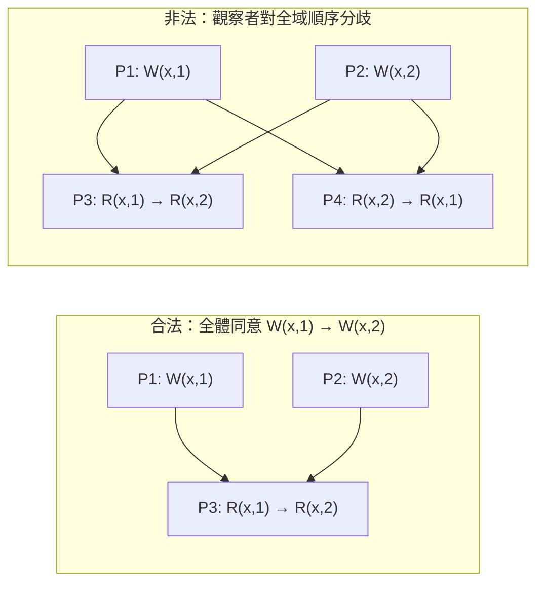
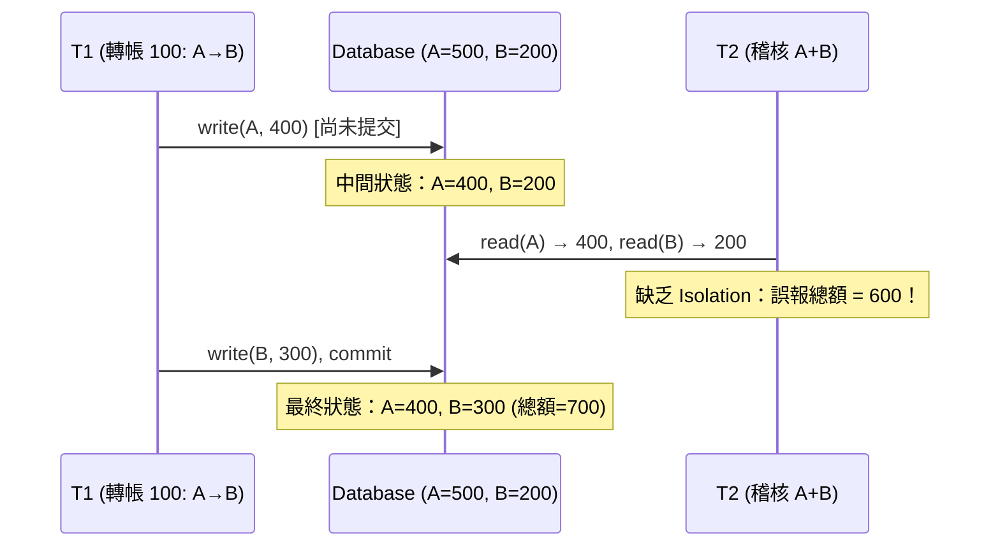
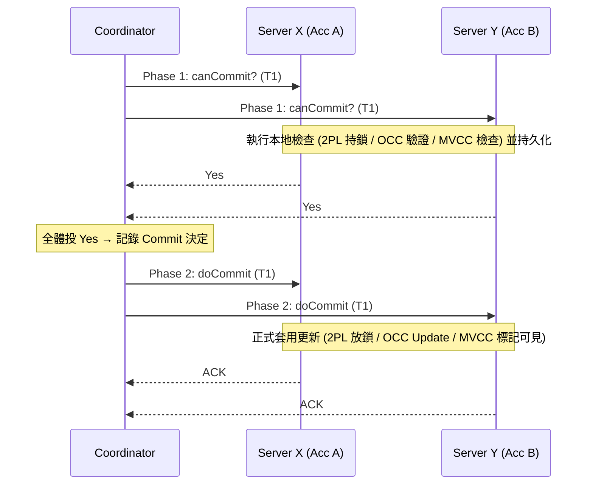

# Chapter 05 — 資料一致性, 複寫與分散式交易 (Data Consistency, Replication & Distributed Transactions)

## 1. 從單一共識到共享資料合約: 交錯爆炸與 Read 的角色

前四章分別處理了單一值的共識 ([Chapter 02](02-fault-tolerance-paxos-raft.md)), 協調中繼資料 ([Chapter 03](03-zookeeper.md)) 與節點查找 ([Chapter 04](04-peer-to-peer-gossip.md)). 當系統把多個資料變數複寫到多台機器, 並允許程序同時讀寫時, 問題就變成: **副本之間究竟允許出現哪些觀測結果?** (成大講義 P118–P120).

**分散式共享記憶體 (Distributed Shared Memory, DSM)** 讓不同機器上的程序透過共同的 `Read` 與 `Write` 介面溝通, 表面上像操作單一共享位址空間, 底層仍由非同步訊息傳遞與多副本 (Replicas) 支撐 (P121–P122). DSM 的優點是隱藏顯式 `send`/`receive` 細節並提高程式可攜性; 缺點是效能受限於底層訊息協議, 且開發者必須明確理解底層的**一致性模型 (Consistency Model)** 才能寫出正確程式.

### 1.1 交錯數量的組合爆炸

假設有 $n$ 個程序 $P_1, P_2, \dots, P_n$, 各程序內部依序發出 $s_1, s_2, \dots, s_n$ 個記憶體操作. 即使每個程序都嚴格維持自身操作順序, 跨程序的交錯 (Interleaving) 總數仍高達多項式係數 (P123):

$$
\frac{(s_1 + s_2 + \dots + s_n)!}{s_1! \, s_2! \cdots s_n!}
$$

以講義 P123 原例計算, 僅兩個程序分別發出 $s_1=5$ 與 $s_2=4$ 個操作, 合法交錯數就達到:

$$
\frac{(5+4)!}{5! \, 4!} = \frac{362{,}880}{120 \times 24} = 126
$$

這 $126$ 種排程並非每種對應用程式都有意義. **一致性模型就是系統與開發者之間的合約 (Contract)**, 明確界定在多副本並行存取下, 系統合法允許回傳哪些讀取序列.

### 1.2 為什麼 Read 也必須納入排序?

直覺上只有 `Write` 改變資料狀態, 似乎只需排序寫入即可. 但 `Read` 是程序觀測狀態的唯一管道 (P124): 當程序執行 `R(x, v)` 讀到數值 $v$ 時, 它實際上在時間軸上**錨定 (Anchor)** 了對應寫入 `W(x, v)` 已經發生並對外可見. 一致性合約正是透過限制"一連串 `Read` 允許回傳的值序列", 來間接規範系統對 `Write` 順序的共識.

### 1.3 底層通訊基石: 全序廣播 (Total Order Broadcast)

許多強一致性模型依賴 **全序廣播 (Total Order Broadcast, TOB)** 作為底層原語 (P125): 若訊息 $m_1$ 在任何一個程序上先於訊息 $m_2$ 被交付 (Deliver), 則 $m_1$ 必須在群組內**所有其他程序**上都先於 $m_2$ 被交付. 講義用"全域公佈欄"作比喻: 不同人隨時張貼紙條, 所有閱讀者由上往下讀到的順序完全一致.

## 2. 一致性模型光譜: 從嚴格到寬鬆

一致性模型越強, 程式行為越直覺, 但跨節點同步延遲與可用性代價也越高. 本節依講義 P126–P134 由強到弱推演五種核心資料中心一致性模型 (Data-Centric Consistency Models), 記號 `W(x, v)` 代表將值 $v$ 寫入位置 $x$, `R(x, v)` 代表從位置 $x$ 讀回值 $v$.

### 2.1 Strict Consistency 與 Linearizability

**嚴格一致性 (Strict Consistency)** 要求任何對變數 $x$ 的讀取, 都必須回傳依**絕對全域物理時間 (Absolute Global Time)** 衡量下最近一次對 $x$ 的寫入值 (P126).

假設初始狀態 $x=0$, 程序 $P_1$ 執行 `W(x, 4)` 完成後, $P_2$ 在絕對時間更晚的時刻執行讀取:

- **合法執行**: $P_2$ 讀到 `R(x, 4)`.
- **非法執行**: $P_2$ 在 `W(x, 4)` 完成後仍讀到舊值 `R(x, 0)`.

從實作與理論邊界來看, 講義 P126 將 Strict Consistency 與 **線性一致性 (Linearizability)** 並列介紹. 嚴格區分時, Strict Consistency 假設全宇宙存在零延遲的絕對同步時鐘, 在受光速與網路延遲限制的分散式系統中無法直接實現; Herlihy 與 Wing (1990) 定義的 Linearizability 則改以操作的呼叫 (Invocation) 與回覆 (Response) 時間區間定義, 要求每個操作都像在呼叫與回覆之間的某個瞬間原子生效, 且不重疊的操作必須維持真實時間先後. 工程文獻談到"最強的單物件實時一致性"時, 實務指的幾乎都是 Linearizability.

### 2.2 Sequential Consistency (循序一致性)

**循序一致性 (Sequential Consistency)** 由 Lamport (1979) 提出, 是分散式系統最核心的模型之一 (P127). 它**放寬絕對物理時間的限制**, 允許不同程序的操作以任意方式交錯, 但必須同時滿足兩條鐵律:

1. **單一全域順序 (Single Global Order)**: 所有程序觀察到的寫入與讀取結果, 必須等價於某一條**共同的全域線性執行序列**.
2. **保留程式順序 (Program Order Preservation)**: 在這條全域序列中, 每個個別程序自身發出的操作, 必須維持其原始程式順序.

對照講義 P127 的兩組執行 (初始 $x=0$):

- **合法執行**: $P_1$ 執行 `W(x, 1)`, $P_2$ 執行 `W(x, 2)`, 即使絕對時間上 `W(x, 2)` 可能略早完成, 只要所有觀察者都同意全域順序為 $W(x, 1) \to W(x, 2)$, 則 $P_3$ 依序讀到 `R(x, 1)` 再讀到 `R(x, 2)` 完全合法.
- **非法執行**: $P_1$ 寫入 `W(x, 1)`, $P_2$ 寫入 `W(x, 2)`, 而 $P_3$ 讀到 `R(x, 1)` 後讀到 `R(x, 2)`, 同時間 $P_4$ 卻先讀到 `R(x, 2)` 再讀到 `R(x, 1)`. 這組執行**違反循序一致性**, 因為不存在任何一條全域順序能同時讓 $1$ 在 $2$ 之前 ($P_3$ 所見) 又讓 $2$ 在 $1$ 之前 ($P_4$ 所見).

圖 5.1 - Sequential Consistency 放寬絕對時間, 但要求所有程序對同一條全域順序達成共識; $P_3$ 與 $P_4$ 看到相反順序即違反合約 (成大講義 P127).

在程式開發視角下 (P127), 若初始 $x=0, \text{flag}=\text{false}$, $P_1$ 執行 `x = 1; flag = true;`, 而 $P_2$ 執行 `while (!flag); print(x);`, 在 Sequential Consistency 下保證印出 `1`. 因為 $P_1$ 自身的程式順序保證在全域序列中 `W(x, 1)` 必先於 `W(flag, true)`, 一旦 $P_2$ 讀到 `flag == true`, 全域序列中 `x = 1` 必然已經生效.

#### Sequential Consistency 的兩種實作策略

講義 P128 給出兩種基於全序廣播 (TOB) 的實作權衡:

1. **讀取密集策略 (Intensive Reads)**: `Read` 直接從本地副本即時回傳, 延遲極低; `Write` 必須透過 TOB 廣播至所有副本並依全域順序套用後才完成.
2. **寫入密集策略 (Intensive Writes)**: `Write` 送入 TOB 後立刻向應用回覆 `ACK` 並排入待套用佇列; `Read` 若發現本地仍有未套用完的待處理寫入佇列, 就必須阻塞等待佇列清空才能讀取, 確保自身程式順序不被破壞.

#### 連結 ZooKeeper: 為什麼 ZooKeeper 屬於 Sequential Consistency?

講義 P129 將前章的 ZooKeeper 放回一致性光譜中定位: ZooKeeper 的寫入統一經 Leader 透過 ZAB (原子廣播) 排出單一全域全序, 而讀取則交由用戶端連線的本地 Follower 直接服務以擴展讀取吞吐量. 因為落後的 Follower 可能回傳比最新全局寫入稍舊的狀態, 系統整體低於 Linearizability; 然而單一 Client 透過同一連線讀取時, 所見狀態只會沿著全域 `zxid` 序列單調前進, 絕不會出現與全域序列矛盾的反序觀測. 若應用在特定時刻必須讀到最新已提交資料, 仍須留意 [Chapter 03 §9](03-zookeeper.md#9-讀取一致性與-sync-的限制) 所述 `sync()` 的實務邊界.

### 2.3 Causal Consistency (因果一致性)

**因果一致性 (Causal Consistency)** 進一步放寬合約 (P130): 只有存在**因果相依 (Causally Related)** 的寫入, 才必須被所有程序以相同順序觀測; 彼此沒有因果關係的並行寫入 (Concurrent Writes), 允許不同程序以不同順序看到.

以講義 P130 原例說明 (初始 $x=0$):

- $P_1$ 執行 `W(x, 2)`.
- $P_2$ 先讀到 `R(x, 2)`, 隨後執行 `W(x, 7)`. 由於 $P_2$ 在讀到 $2$ 之後才寫入 $7$, 形成因果鏈 $W(x, 2) \to R(x, 2) \to W(x, 7)$.
- **合法執行**: $P_3$ 讀到 `R(x, 2)` 再讀到 `R(x, 7)`.
- **非法執行**: $P_3$ 先讀到 `R(x, 7)` 再讀到 `R(x, 2)`, 違反了"果不可先於因"的因果鏈.

相對地, 若 $P_1$ 寫入 `W(x, 1)` 且 $P_2$ 在未讀過 `1` 的情況下獨立寫入 `W(x, 2)`, 這兩個寫入彼此並行. 此時 $P_3$ 看到 `1 -> 2` 而 $P_4$ 看到 `2 -> 1`, 在 **Sequential Consistency 下非法**, 但在 **Causal Consistency 下完全合法**.

### 2.4 PRAM (FIFO) Consistency 與 Slow Memory Consistency

繼續放寬對跨程序因果鏈的追蹤, 會得到更弱但實作成本更低的模型 (P131–P132):

- **PRAM (Pipelined RAM / FIFO) Consistency** (P131): 只保證**同一個程序**發出的寫入, 會依其發出順序被所有其他程序觀測; 不同程序發出的寫入可被不同觀察者以任意順序交錯, 即使存在跨程序讀取也不強制傳遞因果順序.
  - 合法例: $P_1$ 寫 `W(x, 1)`, $P_2$ 寫 `W(x, 2)`; $P_3$ 讀 `1, 2` 且 $P_4$ 讀 `2, 1`.
  - 非法例: $P_1$ 依序寫 `W(x, 1)` 與 `W(x, 2)` (或 `x=1; y=2`), 但 $P_2$ 卻先讀到 `2` 後讀到 `1` (或讀到 `y=2` 後卻讀到 `x=0`).
- **Slow Memory Consistency** (P132): 僅保證**同一個程序對同一個記憶體位置**的寫入維持發出順序; 若寫入不同位置 (`W(x, 1)` 與 `W(y, 2)`), 其他程序看到 `R(y, 2)` 後仍合法讀到舊值 `R(x, 0)`. 但同一程序寫 `W(x, 1)` 再寫 `W(x, 2)` 時, 另一程序仍不可先讀 `2` 再讀 `1`.

### 2.5 五模型對照與跨模型綜合推演例題

整理講義 P133 的鬆弛鏈, 每一層恰好放寬一項條件:

| 一致性模型 | 核心保證 | 相較上一層放寬的條件 |
| --- | --- | --- |
| Strict / Linearizability | 依絕對全域時間 (或不重疊真實時間) 讀到最新寫入 | 基準 (最嚴格) |
| Sequential Consistency | 全體同意單一全域序列且保留各程序順序 | 放寬絕對物理時間 |
| Causal Consistency | 因果相依寫入以相同順序被觀測 | 放寬並行寫入的全域順序 |
| PRAM (FIFO) Consistency | 同一程序發出的寫入維持發出順序 | 放寬跨程序因果傳遞順序 |
| Slow Memory Consistency | 同一程序對同一位置的寫入維持順序 | 放寬同程序不同位置間順序 |

檢驗講義 P134 的經典跨模型例題: 初始 $x=0, y=0$.
- $P_1$: `W(x, 1)`
- $P_2$: `R(x, 1)`, 接著 `W(y, 1)`
- $P_3$: `R(y, 1)`, 接著 `R(x, ?)`

試問 `R(x, ?)` 可以回傳什麼值?

- **Strict / Sequential / Causal Consistency**: **必須回傳 `1`**. 因為 $P_2$ 讀到 $x=1$ 後才寫入 $y=1$, 建立因果鏈 $W(x, 1) \to R(x, 1) \to W(y, 1) \to R(y, 1) \to R(x, ?)$. 只要 $P_3$ 已經看見 $y=1$, `W(x, 1)` 必然在它之前可見, 不可能讀回初始值 `0`.
- **PRAM / Slow Memory Consistency**: **可以回傳 `0` (亦可回傳 `1`)**. 因為 `W(x, 1)` 來自 $P_1$, `W(y, 1)` 來自 $P_2$, 分屬兩個不同處理器; PRAM 與 Slow Memory 都不追蹤跨處理器因果鏈, 允許 $P_3$ 先收到 $P_2$ 的寫入卻延遲收到 $P_1$ 的寫入.

## 3. 同步型一致性, CAP 定理與最終一致性

除了規範每一筆 `Read`/`Write` 的資料中心模型, 實務系統還大量採用同步界點模型與高可用最終一致模型 (P135–P139).

### 3.1 Synchronization-based Consistency (Weak / Release Consistency)

若每次記憶體讀寫都做跨節點同步, 開銷極大. **同步型一致性 (Synchronization-based Consistency)** 只在顯式同步變數操作處強制同步 (P135):

- `acquire(L)`: 進入臨界區前, 從其他節點拉取最新的共享變數更新至本地快取.
- `release(L)`: 離開臨界區時, 將本地累積的修改批次推送至其他節點.

在 `acquire(L)` 與 `release(L)` 之間, 處理器可以自由重排本地指令 (例如將 `y = 2` 排到 `x = 1` 之前) 以最佳化執行速度; 只要其他程序遵守相同的鎖定協議, 便不會觀測到中間重排狀態.

### 3.2 CAP 定理與 Eventual Consistency

**CAP 定理** (Brewer 猜想, Gilbert 與 Lynch 2002 證明, 講義 P136) 指出, 在非同步網路的分散式資料儲存中, 無法同時保證以下三項性質:

- **Consistency (C, 線性一致性)**: 每次讀取都回傳最新已完成的寫入值或回傳錯誤.
- **Availability (A, 可用性)**: 每個到達非故障節點的請求都必須收到非錯誤回應, 但不保證回傳最新資料.
- **Partition Tolerance (P, 分區容忍性)**: 即使網路任意丟失或延遲訊息形成分區, 系統仍持續運作.

現實網路中分區不可避免, 因此實務架構在**分區發生時**必須取捨: 選擇拒絕少數派請求以守住強一致 (**CP**, 如 etcd, ZooKeeper 寫入, Google Spanner), 或允許兩側繼續服務並接受暫時資料分歧 (**AP**).

**最終一致性 (Eventual Consistency)** 是 AP 系統的核心哲學 (P137): "若停止新寫入並等待足夠長的時間, 所有副本最終會收斂至相同狀態."其工程支柱包含 [Chapter 04](04-peer-to-peer-gossip.md) 的 **Anti-Entropy (Gossip)** 背景同步, 以及處理並行寫入分歧的衝突解決策略 — 例如保留並行版本並用 [Chapter 01](01-logical-clocks-checkpointing.md) 的 **Vector Clocks** 交給應用合併, 或採用時間戳較大者勝出的 **Last-Write-Wins (LWW)** (代價是可能靜默丟失較舊時間戳的並行更新).

| 一致性層級 | 代表系統 (成大講義 P139) | 適用情境 |
| --- | --- | --- |
| Strict / Linearizability (CP) | ZooKeeper (Writes), etcd, Google Spanner | 分散式鎖, 選主, 金融帳務等不能讀舊值的關鍵路徑 |
| Sequential Consistency (CP) | ZooKeeper (Reads) | 需保證單一會話按全域序列觀測, 可容忍本地稍舊讀取 |
| Causal Consistency | 社群貼文與留言系統 | 確保回覆不出現在原貼文之前, 無需全域同步 |
| Eventual Consistency (AP) | Amazon DynamoDB, Cassandra, DNS | 跨區高擴展與高可用服務, 容忍短暫讀取延遲與收斂 |

## 4. 分散式交易與 ACID: 深入剖析 Isolation

複寫與交易解決的是兩個不同維度的問題 (P140): **複寫 (Replication)** 關注"單一資料項的多份副本如何保持一致"; **交易 (Transaction)** 關注"跨多個不同資料項的一組讀寫操作, 如何作為單一不可分割的邏輯單元維持結構完整性".

交易的標準程式介面包含 `openTransaction()`, `read(T, obj)`, `write(T, obj, val)`, `closeTransaction(T)` (提交) 與 `abortTransaction(T)` (中止回滾) (P141). 講義 P142–P146 以經典銀行轉帳情境貫穿 ACID 四項性質:

- **初始狀態**: 帳戶 $A = 500$, 帳戶 $B = 200$, 銀行總額 $A + B = 700$.
- **交易** $T_1$: 從 $A$ 扣 $100$, 再加 $100$ 到 $B$.
- **交易** $T_2$: 稽核銀行總額, 依序讀取 $A$ 與 $B$ 並計算 $A + B$.

### 4.1 Atomicity (原子性: 全做或全不做)

**Atomicity** 要求交易內所有修改要麼全部永久生效, 要麼在故障或中止時全部撤銷 (P143). 若缺乏原子性, $T_1$ 扣完 $A=400$ 後伺服器當機, 重啟後出現 $A=400, B=200$, 憑空蒸發 $100$. 有原子性時, 系統重啟偵測到 $T_1$ 未抵達 `closeTransaction()`, 自動執行 **Rollback (回滾)** 將 $A$ 復原為 $500$.

### 4.2 Consistency (一致性: 維護業務不變量)

交易 ACID 中的 **Consistency** 與前面複寫模型的 Consistency 含義不同 (P144): 它指的是**應用層不變量 (Application Invariants)** 在交易前後都必須成立, 例如轉帳前後 $A+B=700$ 且各帳戶餘額 $\ge 0$. 若程式碼漏洞導致扣 $A$ $100$ 卻只加 $B$ $50$, 資料庫透過約束檢查偵測違規並強制中止 $T_1$, 防止總額變成 $650$.

### 4.3 Isolation (隔離性: 隱藏未提交的中間狀態)

**Isolation** 決定並行執行的多筆交易彼此能否看到對方的中間狀態, 是資料庫並行控制的核心考點 (P145).

觀察沒有隔離性時會發生什麼事:

1. $T_1$ 執行第一步, 將 $A$ 從 $500$ 扣成 $400$ (尚未加給 $B$, 也尚未提交).
2. 同時執行的稽核交易 $T_2$ 讀取 $A$ 得到 $400$, 接著讀取尚未更新的 $B$ 得到 $200$.
3. $T_2$ 算出總額 $400 + 200 = 600$, 誤報銀行短少 $100$!
4. 隨後 $T_1$ 完成第二步, 將 $B$ 加成 $300$ 並提交.

這個現象稱為觀測到**半成品中間狀態 (Intermediate State / Dirty Read)**: 即使 $T_1$ 本身邏輯正確且具備原子性, 若沒有隔離性保護, 並行交易 $T_2$ 仍會讀到一個從未合法存在過的資料庫快照 ($600$).

圖 5.2 - 缺乏 Isolation 時, $T_2$ 讀到 $T_1$ 尚未提交的中間狀態導致總額異常; 啟用 Isolation 後, $T_2$ 僅能讀到 $(500, 200)$ 或 $(400, 300)$ (成大講義 P145).

啟用 **Isolation** 後, 系統透過鎖定等待 (如 2PL) 或多版本快照 (如 MVCC) 隱藏 $T_1$ 的未提交中間狀態: $T_2$ 看到的要麼是 $T_1$ 執行前的 $(A=500, B=200)$, 要麼是 $T_1$ 提交後的 $(A=400, B=300)$, 兩者總額皆為 $700$, 絕不出現臨時的 $600$.

實務資料庫還會依隔離強度區分不同層級: 最高標準 **可序列化 (Serializability)** 要求並行執行結果等價於某種循序執行順序; 較寬鬆的隔離層級 (如 Read Committed 或 Snapshot Isolation) 則在吞吐量與異常防護 (Dirty Read, Non-Repeatable Read, Phantom Read, Write Skew) 之間取捨.

### 4.4 Durability 與 Rollback 實作

**Durability (持久性)** 確保一旦 `closeTransaction()` 回傳成功, 修改就已安全寫入非揮發性儲存 (如 SSD 或複寫 Write-Ahead Log), 即使下一毫秒斷電重啟也不會遺失 (P146).

當交易因當機, 死鎖或驗證衝突而中止時, 系統依靠三種常見機制實作 **Rollback** (P147):

1. **Write-Ahead Logging (Undo Log)**: 覆寫資料前先記錄舊值; 中止時逆向掃描日誌還原原狀.
2. **Tentative Workspaces (暫存工作區)**: 如 OCC 在私有副本上修改, 回滾只需直接丟棄工作區, 完全不碰真實資料.
3. **Multi-Versioning (MVCC)**: 寫入建立新版本而不覆寫舊值, 回滾只需將未提交的新版本標記為無效.

## 5. 並行控制機制: 2PL, OCC 與 MVCC

資料庫究竟如何落實 Isolation? 講義 P148–P152 介紹三大主流並行控制 (Concurrency Control) 協議.

### 5.1 鎖定機制 (Two-Phase Locking, 2PL) 與死鎖

**悲觀鎖定 (Pessimistic Locking)** 假設衝突常發生, 讀寫前先申請共享鎖或排他鎖. **兩階段鎖定 (2PL)** 規定交易分為成長期 (只取鎖不放鎖) 與縮減期 (一旦開始放鎖就不再取新鎖), 實務常用 Strict 2PL 將所有排他鎖持有至交易提交或中止才釋放, 以避免連鎖中止.

鎖定的核心風險是 **死鎖 (Deadlock)** (P149). 講義原例: $T_1$ 轉帳 $A \to B$ (先鎖 $A$ 再求鎖 $B$), $T_2$ 轉帳 $B \to A$ (先鎖 $B$ 再求鎖 $A$). 當 $T_1$ 持有 $A$ 等待 $B$, 同時 $T_2$ 持有 $B$ 等待 $A$, 在 **等待圖 (Wait-For Graph)** 中形成環路 $T_1 \to T_2 \to T_1$, 必須靠死鎖偵測 (中止其中一方並回滾) 或逾時打破循環等待.

### 5.2 樂觀並行控制 (Optimistic Concurrency Control, OCC)

**樂觀並行控制 (OCC)** 假設多數交易互不衝突, 因此執行期間**不上鎖**, 將衝突檢查推遲至提交前的驗證階段 (P150). 每筆交易依序經過三個階段:

1. **工作階段 (Working Phase)**: 交易從已提交狀態讀取資料 (記錄 **Read Set**), 並在私有的暫存工作區 (Tentative Workspace) 計算與寫入 (記錄 **Write Set**), 不阻塞其他交易.
2. **驗證階段 (Validation Phase)**: 交易 $T_v$ 準備提交時, 檢查自己是否與**在其 Working Phase 期間已提交的其他交易**發生衝突.
3. **更新階段 (Update Phase)**: 僅在驗證通過後, 才將暫存工作區的修改永久套用至全域資料庫; 若驗證失敗, 立刻中止並丟棄工作區重試.

對照講義 P150 的時間軸原例: $T_1$ 在 $T_v$ 開始前已提交, 所以 $T_v$ 安全讀取 $T_1$ 的結果; 但 $T_2$ 與 $T_3$ 在 $T_v$ 的 Working Phase 期間陸續完成更新提交. 當 $T_v$ 進入 Validation Phase 時, 它採用**向後驗證 (Backward Validation)** 主動比對 $T_2$ 與 $T_3$ 的寫入集合是否污染了自己的讀取集合:

$$
\mathrm{RS}(T_v) \cap \mathrm{WS}(T_i) = \emptyset \quad \text{for all } T_i \text{ committed during } T_v\text{'s working phase}
$$

只要 $T_2$ 或 $T_3$ 修改了 $T_v$ 讀過的任何物件 (即交集非空), 代表 $T_v$ 的計算建立在過時資料上, $T_v$ 必須中止回滾. 在並行實作中, 系統還須保護 Validation 與 Update 階段的原子性 (或額外檢查 Write-Write 衝突), 避免兩筆同時通過驗證的交易互相覆蓋對方寫入.

### 5.3 時間戳排序與多版本並行控制 (MVCC)

**多版本並行控制 (Multi-Version Concurrency Control, MVCC)** 替每個物件維護多個帶時間戳的歷史版本, 並為每筆交易指派唯一時間戳 (P151). 講義原例中時間順序為 $T_1 < T_2 < T_3 < T_4$, 物件已有 `Obj V1` (by $T_1$), `Obj V2` (by $T_2$) 與 `Obj V4` (by $T_4$). 當 $T_3$ 發起讀取時, 系統忽略時間戳大於 $T_3$ 的 `Obj V4`, 直接選取小於 $T_3$ 的最大已提交版本 `Obj V2`. 這樣一來**讀取完全不阻塞寫入**, 代價則是舊版本累積需要額外儲存空間與定期垃圾回收 (Garbage Collection).

| 並行控制協議 | 核心機制 | 優勢與代價 | 最適合負載 (成大講義 P152) |
| --- | --- | --- | --- |
| Locks (2PL) | 互斥鎖定, 衝突時等待 | 優勢: 嚴格保序, 寫入衝突不易浪費重算; 代價: 鎖開銷與死鎖風險 | 寫入密集, 衝突率高的工作負載 |
| Optimistic (OCC) | 本地暫存運算 -> 驗證 -> 提交 | 優勢: 執行期無鎖開銷, 無死鎖; 代價: 高衝突下中止重試率飆升 | 讀取密集, 衝突機率低的工作負載 |
| Time Ordering (MVCC) | 時間戳與多版本歷史 | 優勢: 讀不鎖寫, 寫不鎖讀; 代價: 儲存膨脹與舊版本回收開銷 | 高併發混合讀寫 (講義舉例含多版本資料系統) |

## 6. 分散式交易提交: 2PC 與並行控制的整合

當一筆交易跨越多台獨立伺服器時 (例如 $T_1$ 從 Server X 的帳戶 $A$ 扣 $100$, 再到 Server Y 的帳戶 $B$ 加 $100$), 單機的 Undo Log 與鎖定不足以保證兩台機器同生共死. 系統需要 **兩階段提交 (Two-Phase Commit, 2PC)** 協調全域決定 (P153–P154).

一個極易混淆的觀念必須先劃清: **2PC 與並行控制是正交 (Orthogonal) 的**.
- **2PC** 負責跨參與者的 **Atomicity** (確保所有參與者全部提交或全部中止).
- **2PL / OCC / MVCC** 負責各參與者上的 **Isolation** (隱藏中間狀態與衝突控制).

### 6.1 2PC 標準兩階段流程與阻塞限制

角色分為單一 **協調者 (Coordinator)** 與多位 **參與者 (Participants)** (P153):

1. **Phase 1 (Prepare / Voting Phase)**: Coordinator 向所有參與者送出 `canCommit?`. 各參與者執行本地安全檢查並將相關狀態持久化 (寫入本地日誌) 後, 回覆 `Yes` (承諾有能力提交) 或 `No` (要求中止).
2. **Phase 2 (Commit / Decision Phase)**: 只有當**所有參與者皆投 `Yes`**, Coordinator 才記錄全域 `Commit` 決定並送出 `doCommit`, 參與者套用更新並回傳 `ACK`; 只要有任何一人投 `No` 或逾時未回, Coordinator 便決定 `Abort` 並通知全體回滾.

圖 5.3 - 2PC 的 Phase 1 負責投票與本地準備, Phase 2 負責全域提交或中止; 並行控制機制嵌入在這兩個階段內運作 (成大講義 P153–P154).

2PC 的著名限制是 **阻塞 (Blocking)**: 一旦某參與者在 Phase 1 投出 `Yes` 並進入不確定狀態 (Uncertain State), 它已放棄自行中止的權力; 若 Coordinator 此時當機失聯, 該參與者必須持續持有鎖定或預留資源直到 Coordinator 恢復並揭曉決定. 此外也不要將 2PC 與 [Chapter 03 §3.5](03-zookeeper.md#35-zab-multi-paxos-與-2pc-的界線) 的 Paxos/ZAB 混淆: Paxos/ZAB 是同一份資料多數副本的共識, 2PC 是不同資料分片參與者的全體一致承諾.

### 6.2 深入剖析: 2PC 如何與 OCC, 2PL, MVCC 結合?

講義 P154 以 $T_1$ 跨 Server X (帳戶 $A$) 與 Server Y (帳戶 $B$) 轉帳 $100$ 為例, 展示三種組合在 Phase 1 與 Phase 2 的具體分工, 其中 **2PC 結合 OCC 驗證階段** 是最容易出錯的關鍵設計:

1. **2PC + OCC (樂觀並行控制)**:
   - **執行期 (2PC 開始前)**: $T_1$ 在 Server X 與 Server Y 各自的私有暫存工作區執行讀寫運算, 完全不拿鎖.
   - **Phase 1 (`canCommit?`) 對應 OCC Validation Phase**: 當 Coordinator 發出 `canCommit?`, Server X 與 Server Y 在本地執行 **OCC 驗證** — 檢查在 $T_1$ 的 Working Phase 期間, 是否有其他已提交交易修改了 $T_1$ 的 Read Set. 若兩邊驗證皆無衝突 (並將暫存變更持久化保護, 防止在 Phase 1 與 Phase 2 之間被新交易插隊破壞), 就回覆 `Yes`; 只要**任一參與者驗證失敗**, 便回覆 `No`, Coordinator 立刻廣播 `doAbort`, 兩邊直接丟棄本地暫存工作區完成回滾.
   - **Phase 2 (`doCommit`) 對應 OCC Update Phase**: 收到全體 `Yes` 後, Coordinator 下達 `doCommit`, Server X 與 Server Y 才執行 **Update Phase**, 將暫存工作區的修改正式寫入全域狀態並對外可見.
2. **2PC + Locks (2PL)**:
   - **Phase 1 (`canCommit?`)**: Server X 與 Server Y 確認 $T_1$ 已取得並仍持有 $A$ 與 $B$ 的排他鎖, 且預寫日誌安全落盤後, 回覆 `Yes`. 鎖在整個不確定期間絕不能提早釋放!
   - **Phase 2 (`doCommit`)**: 收到決定後套用更新 (或依 Undo Log 回滾), 最後才釋放本地排他鎖.
3. **2PC + Time Ordering (MVCC)**:
   - **Phase 1 (`canCommit?`)**: Server X 與 Server Y 檢查沒有時間戳晚於 $T_1$ 的交易修改或破壞 $A$ 與 $B$ 的讀寫順序條件, 產生未提交的新版本 (記錄讀寫時間戳屬性, 如講義所提的 ATS/BTS 檢查) 後回覆 `Yes`.
   - **Phase 2 (`doCommit`)**: 收到 `doCommit` 後將未提交的新版本正式標記為 Committed 並對外可見; 若中止則將新版本標為無效.

| 整合組合 | Phase 1 (`canCommit?`) 核心工作 | Phase 2 (`doCommit`) 核心工作 | 中止 (`doAbort`) 動作 |
| --- | --- | --- | --- |
| 2PC + 2PL | 確認排他鎖仍持有並持久化日誌 -> 投 `Yes` | 套用修改並釋放排他鎖 | 依 Undo Log 還原並放鎖 |
| 2PC + OCC | **執行本地 OCC Validation Phase** 檢查 Read/Write 衝突 -> 投 `Yes`/`No` | **執行 OCC Update Phase** 寫入全域狀態 | 直接丟棄私有暫存工作區 |
| 2PC + MVCC | 驗證無較新時間戳衝突並建未提交新版本 -> 投 `Yes` | 將未提交版本標為 Committed 可見 | 將未提交版本標記為無效 |

## 7. 銜接下一章: 從一致性合約走入底層儲存引擎

本章確立了多副本的一致性合約與跨節點交易的 ACID/2PC 原則. 然而, 單機儲存引擎如何承受每秒數十萬筆寫入, 又為何 HBase 等寬欄 NoSQL 資料庫選擇提供單列強一致卻主動放棄跨列 2PC? [Chapter 06](06-leveldb-hbase.md) 將深入磁碟 I/O 物理特性, 從 B+ Tree 的寫入放大推導出 LevelDB 的 LSM-Tree 與 HBase 分散式儲存架構.

## 8. 英文選擇題與逐項解析

### Q1 — Sequential Consistency violation

Consider initial value `x = 0`. Process `P1` executes `W(x, 1)` and `P2` executes `W(x, 2)`. Process `P3` observes `R(x, 1)` followed by `R(x, 2)`, while `P4` observes `R(x, 2)` followed by `R(x, 1)`. Under which consistency model is this execution INVALID?

- A. Sequential Consistency.
- B. Causal Consistency.
- C. PRAM (FIFO) Consistency.
- D. Slow Memory Consistency.

**答案: A.** A: Sequential Consistency 要求全體同意單一全域序列, `P3` 看到 `1 -> 2` 與 `P4` 看到 `2 -> 1` 互相矛盾, 故非法. B: `W(x, 1)` 與 `W(x, 2)` 彼此無因果相依 (並行寫入), Causal Consistency 允許不同觀察者以不同順序看到. C: 兩個寫入來自不同程序, PRAM 允許任意交錯. D: Slow Memory 更弱, 同樣允許.

### Q2 — Cross-model causal chain

Initially `x = 0` and `y = 0`. `P1` executes `W(x, 1)`. `P2` executes `R(x, 1)` then `W(y, 1)`. `P3` executes `R(y, 1)` then `R(x, v)`. Which statement is correct?

- A. Under Sequential Consistency, `v` may legitimately be `0`.
- B. Under Causal Consistency, `v` MUST be `1`, whereas under PRAM Consistency `v` may be `0`.
- C. Under PRAM Consistency, `v` MUST be `1` because `P2` read `x = 1`.
- D. Under Slow Memory Consistency, `v` MUST be `1` because `x` and `y` are both written to `1`.

**答案: B.** A: Sequential Consistency 強於 Causal Consistency, 必回傳 `1`. B: 存在因果鏈 $W(x,1) \to R(x,1) \to W(y,1) \to R(y,1)$, 故 Strict/Sequential/Causal 必回 `1`; PRAM 不追蹤跨程序因果關係, 允許回 `0`. C: PRAM 只保同一程序的寫入順序, 不保跨程序因果鏈. D: Slow Memory 只保同一程序對同一位置的寫入順序, 允許回 `0`.

### Q3 — ACID Isolation anomaly

Accounts start with `A = $500` and `B = $200`. Transaction `T1` deducts `$100` from `A` and then adds `$100` to `B`. Concurrently, audit transaction `T2` reads `A = $400` and `B = $200`, reporting a total of `$600` before `T1` finishes crediting `B`. Which ACID property was directly violated?

- A. Atomicity, because the server crashed mid-transaction.
- B. Durability, because the writes were not flushed to disk.
- C. Isolation, because `T2` observed `T1`'s uncommitted intermediate state.
- D. Partition tolerance, because `A` and `B` were on different networks.

**答案: C.** A: `T1` 並未當機或部分放棄, 只是尚未完成就被讀到中間值. B: 問題不是提交後斷電遺失資料. C: Isolation 的職責正是隱藏未提交中間狀態, 使 `T2` 只看到 `($500, $200)` 或 `($400, $300)`. D: Partition tolerance 屬於 CAP 而非 ACID.

### Q4 — Integrating 2PC with OCC

When combining Two-Phase Commit (2PC) with Optimistic Concurrency Control (OCC) across distributed servers, what happens during 2PC Phase 1 (`canCommit?`) and Phase 2 (`doCommit`)?

- A. Phase 1 acquires global exclusive locks before any reads occur; Phase 2 discards the workspace.
- B. Phase 1 executes each participant's OCC Validation Phase against earlier commits before voting `Yes`/`No`; Phase 2 executes the OCC Update Phase to make tentative writes permanent.
- C. Phase 1 commits tentative writes globally immediately; Phase 2 runs OCC Validation to check for conflicts afterward.
- D. OCC eliminates the need for 2PC Phase 1 because optimistic transactions never abort.

**答案: B.** A: 這是悲觀鎖做法而非 OCC, 且 Phase 2 提交時不會丟棄工作區. B: 正確對應講義 P153–P154: Phase 1 做本地 OCC 衝突驗證決定投票, 全部通過才在 Phase 2 執行 Update Phase 落實寫入. C: 順序顛倒, 未驗證就全域寫入會破壞 Isolation 與 Atomicity. D: OCC 衝突時反而常透過中止回滾處理, 跨節點仍需 2PC 協調全提交或全中止.

### Q5 — 2PC blocking limitation

Why is standard Two-Phase Commit (2PC) considered a blocking protocol?

- A. Participants can never execute local reads concurrently.
- B. If the coordinator crashes after a participant has voted `Yes` in Phase 1, that participant cannot safely decide commit or abort on its own and must wait.
- C. 2PC requires every participant to solve a Proof-of-Work puzzle.
- D. 2PC cannot work with either 2PL or MVCC.

**答案: B.** A: 並行讀取由並行控制協議決定, 非 2PC 阻塞定義. B: 投完 `Yes` 進入不確定狀態後, 其他參與者可能已收到提交或中止決定, 因此無法單方面決斷而必須阻塞等待協調者恢復. C: 無關機制. D: 2PC 與 2PL, OCC, MVCC 正交, 皆可整合.

## 9. 來源與投影片對照

| 講義 | 主題 | 算例與圖解 |
| --- | --- | --- |
| P118–P125 | DSM 抽象, 交錯爆炸, Read 排序與 TOB | 兩程序 $5, 4$ 操作共 $126$ 種交錯 |
| P126–P129 | Strict/Linearizability, Sequential Consistency 與 ZooKeeper | 圖 5.1, `x=1; flag=true`, Intensive Reads/Writes |
| P130–P134 | Causal, PRAM, Slow Memory 與跨模型比較 | 因果鏈 `W(x,2)->W(x,7)`, 綜合題 `R(x,?)` |
| P135–P139 | Synchronization-based, CAP 與 Eventual Consistency | `acquire`/`release`, CP vs AP 系統對照 |
| P140–P147 | 複寫 vs 交易, ACID 四性質與 Rollback | 圖 5.2, 銀行轉帳 $A=500, B=200$, $T_2$ 誤報 $600$ |
| P148–P152 | 並行控制: 2PL 死鎖, OCC 驗證與 MVCC | 循環等待死鎖, $T_v$ 驗證 $T_2, T_3$, $T_3$ 讀 `Obj V2` |
| P153–P155 | 2PC 與 2PL/OCC/MVCC 正交整合 | 圖 5.3, Server X/Y 跨節點轉帳與 OCC Phase 1 驗證 |

- 成大講義: Prof. Hung-Chang Hsiao, *Distributed Systems* (Fall 2026), `reference/整包.pdf` P118–P155. 備註: 抽取 P145 時出現 PDF 裝飾 XObject 缺失警告, 經逐頁渲染核對確認文字與雙欄內容完整無缺.
- 經典論文背景: Lamport (1979) 定義 Sequential Consistency; Herlihy & Wing (1990) 形式化 Linearizability; Kung & Robinson (1981) 提出 Optimistic Concurrency Control; Gilbert & Lynch (2002) 形式化 CAP 定理; Gray (1978) 系統闡述 Two-Phase Commit.

執行 `python3 tools/verify-remaining-chapters.py` 可核算本章的交錯組合數, 跨模型合法性與 OCC 衝突驗證算例.
