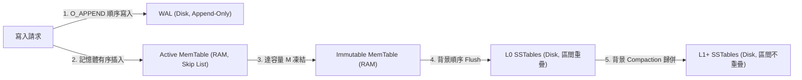
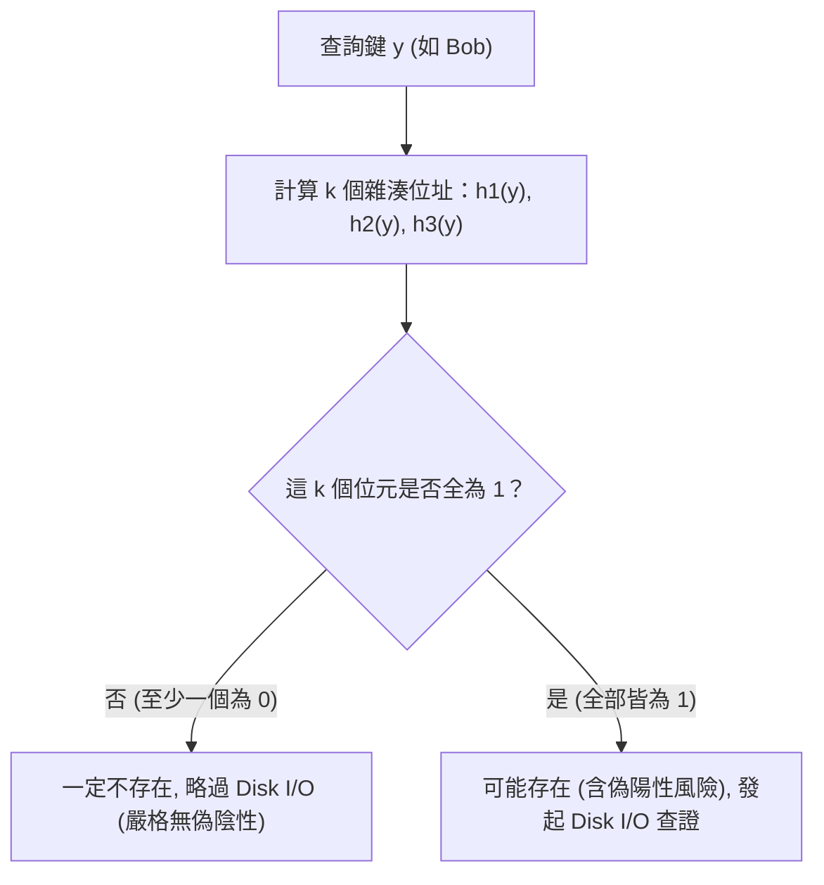
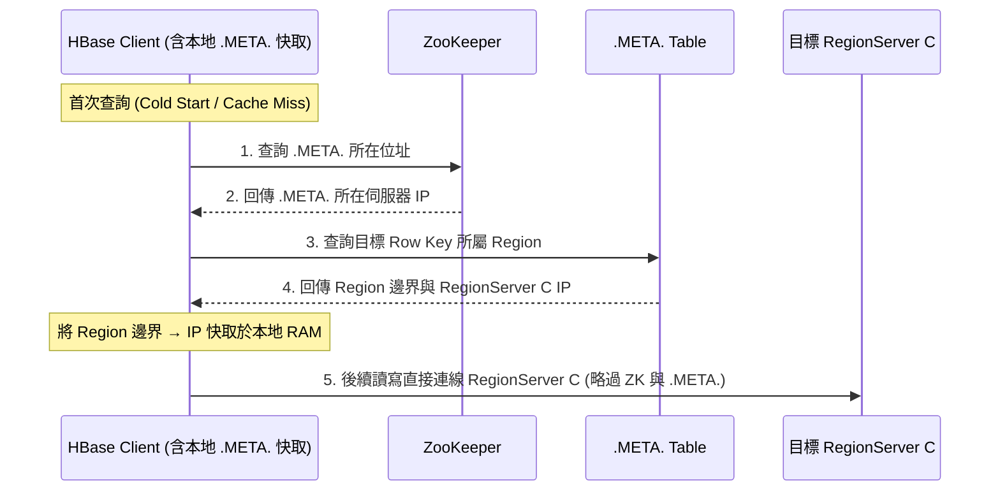

# Chapter 06 — 儲存引擎與分散式寬欄資料庫 (LevelDB & HBase: Distributed Storage Engines)

## 1. 外部記憶體模型與 B+ Tree 的寫入放大困境

前五章從邏輯時鐘, 共識與一致性合約看分散式系統如何對外承諾正確性. 本章深入單機與分散式儲存引擎內部, 回答一個核心工程問題: **面對高速連續寫入的工作負載, 傳統 B+ Tree 為何成為瓶頸, LSM-Tree 與 HBase 如何重設計讀寫路徑?** (成大講義 P156–P160).

### 1.1 External Memory Model: 隨機與順序 I/O 的鴻溝

在 **外部記憶體模型 (External Memory Model)** 中, CPU 與 RAM 運算極快, 真正的絕對瓶頸是磁碟 I/O, 且資料以固定大小的 **區塊 (Block)** (大小 $B$) 作為最小讀寫單位 (P159):

- **隨機 I/O (Random I/O)**: 每次存取散落於磁碟各處的紀錄, 迫使磁頭反覆尋道或破壞閃存寫入聚集, 每筆紀錄耗費 $O(1)$ 次區塊 I/O.
- **順序 I/O (Sequential I/O)**: 將多筆紀錄連續批次寫滿整個區塊再一次落盤, 每筆紀錄的均攤成本降至 $O(1/B)$ 次區塊 I/O.

### 1.2 B+ Tree 的寫入放大 (Write Amplification)

B+ Tree 的根節點與內部節點通常常駐記憶體的 Buffer Pool, 查詢只需極少次磁碟讀取, 非常適合**讀取密集 (Read-Heavy)** 負載 (P160). 但它採用 **就地更新 (In-Place Update)**: 當應用只需修改某個葉節點裡 $100\text{ bytes}$ 的紀錄時, 硬體仍強制讀出並覆寫整個 $4096\text{ bytes}$ ($4\text{ KB}$) 的磁碟頁!

套用講義 P160 原例計算頁面級 **寫入放大 (Write Amplification, WA)**:

$$
\mathrm{WA}_{\text{page}} = \frac{\text{實體磁碟寫入大小}}{\text{邏輯資料更新大小}} = \frac{4096\text{ bytes}}{100\text{ bytes}} \approx 40.96\times \approx 40\times
$$

這代表每寫入 $100\text{ bytes}$ 的有效更新, 磁碟必須承擔約 $40$ 倍的實體寫入量, 且大量隨機分散的葉節點覆寫完全浪費了磁碟的順序頻寬.

## 2. LSM-Tree 寫入路徑: 順序追加, WAL Group Commit 與 Skip List

為了逼近均攤 $O(1/B)$ 的順序寫入效率, **日誌結構合併樹 (Log-Structured Merge-Tree, LSM-Tree, O'Neil et al., 1996)** 徹底放棄就地更新, 改將所有寫入與刪除都轉換為**純追加 (Append-Only)** 的順序寫入 (P161–P162).

### 2.1 LSM-Tree 寫入四步驟

當一筆寫入請求進入 LevelDB 時, 系統依序經過記憶體與磁碟組件 (P161–P162):

1. **順序追加預寫日誌 (Write-Ahead Log, WAL)**: 以 `O_APPEND` 將更新順序寫入磁碟上的 WAL, 確保記憶體斷電後仍可重播恢復 (Durability).
2. **更新記憶體排序表 (Active MemTable)**: 將鍵值插入 RAM 中的 Active MemTable (以 Skip List 實作, 維持鍵值有序), 此時即可回覆寫入成功.
3. **凍結為不可變表 (Immutable MemTable)**: 當 Active MemTable 大小達到記憶體上限 $M$ 時, 將其凍結為只讀的 Immutable MemTable, 並立即配置一個新的 Active MemTable 繼續接收新寫入.
4. **背景順序刷寫 (Sequential Flush)**: 背景執行緒將整份已排序的 Immutable MemTable 一次順序寫成磁碟上不可變的 **排序字串表 (Sorted String Table, SSTable)**, 落入 **Level 0 (L0)**, 隨後釋放對應舊 WAL.

圖 6.1 - LSM-Tree 將隨機更新轉為 WAL 追加與批次順序刷寫 SSTable, 消除 B+ Tree 的隨機葉節點就地覆寫 (成大講義 P161–P162).

從技術邊界角度來看, LSM-Tree 大幅降低了 B+ Tree 在前景隨機就地更新的寫入放大與磁頭尋道延遲, 獲得極高的寫入吞吐量; 但它並非零寫入放大 — 後續背景 **Compaction** 會將同一筆資料隨層級下降重複歸併寫入, 這正是 §4 所討論的讀寫空間權衡 (RUM Conjecture).

### 2.2 WAL 效能悖論: Group Commit 與雙觸發機制

一個常見疑問隨之而來: 既然每筆寫入在進 MemTable 前都要先寫磁碟上的 WAL, 慢速磁碟豈不是立刻拖垮記憶體效能? (P164–P165).

真正的效能殺手不是順序寫入緩衝區, 而是強制將核心緩衝刷入實體磁碟的 `fsync` 系統呼叫. 系統透過 **群組提交 (Group Commit)** 化解此矛盾: 刻意將首筆到達的寫入延遲極短時間窗口, 將窗口內並行到達的多筆寫入累積成同一個連續區塊, 只呼叫**一次 `fsync`** 便同時提交整批交易, 均攤順序 I/O 成本.

但若系統處於低流量時期, 乾等批次填滿會造成無法接受的尾延遲. 因此實務採用 **雙觸發機制 (Dual Triggers)** (P165):

- **容量門檻觸發 (Size-Bound)**: 高流量下批次迅速填滿門檻立即刷盤, 最大化批次均攤吞吐量.
- **時間上限觸發 (Time-Bound)**: 低流量下只要計時器到期, 即使批次內僅有一筆孤立交易也立即刷盤; 此時磁碟本就閒置, 不會成為瓶頸, 同時守住低延遲.

### 2.3 MemTable 實作: Skip List 與無鎖並行 (CAS)

MemTable 需要在記憶體中維持鍵值有序以便後續直接順序刷寫成 SSTable. 傳統平衡二元樹 (如紅黑樹, AVL 樹) 插入時常觸發跨多節點的全域旋轉 (Tree Rotation), 必須鎖定較大範圍的樹結構才能保護並行執行緒 (P166–P167).

LevelDB 改用 **跳躍表 (Skip List)**: 在有序鏈結串列之上建立多層機率式快車道 (講義 P166 原例: L1 有 `10, 20, 30, 50, 70, 90`, L2 有 `20, 50, 70`, L3 有 `50`), 將搜尋時間從鏈結串列的 $O(N)$ 降至期望 $O(\log N)$. 因為插入新節點只需調整相鄰局部指標而不做全域旋轉, 可搭配硬體原子指令 `CAS(Memory_Address, Expected_Value, New_Value)` 實現無鎖指標切換: 執行緒先在私有記憶體建好節點, 再以 `CAS` 嘗試原子切換前驅指標; 若另一執行緒搶先改動, `CAS` 失敗並重試. 在 LevelDB 實作中, 這讓並行讀取者完全無需加鎖就能安全遍歷 MemTable, 而多寫入者則由內部寫入佇列協調順序.

## 3. 讀取路徑, MANIFEST 與 Bloom Filter 無偽陰性

LSM-Tree 為了極致寫入效能把資料分散到記憶體與多層 SSTable 中, 代價是讀取變得複雜 (P163, P168–P171).

### 3.1 六步驟讀取路徑與 L0 讀取危機

當系統收到查詢鍵 $k$ 的讀取請求時, 依"從新到舊"順序搜尋 (P163):

1. 查詢 **Active MemTable**.
2. 查詢 **Immutable MemTable**.
3. 查詢記憶體中的 **Block Cache (LRU)**, 若命中資料區塊直接回傳.
4. 查詢 **MANIFEST** 鍵值範圍與 **Bloom Filter** (皆常駐 RAM), 過濾掉不可能包含 $k$ 的 SSTable.
5. 僅對通過檢查的 SSTable 發起 **Disk I/O** 讀取目標 Data Block.
6. 若未找到則繼續往下層級聯搜尋 (Cascade Search).

為何單靠 MANIFEST 還不夠? 因為 **MANIFEST** (LevelDB) 記錄每個 SSTable 的 File ID, Level 與鍵值邊界 `[Min Key, Max Key]` (P168). 在 L1 及更深層, 同層 SSTable 的鍵區間彼此不重疊, 最多只會命中 1 個檔案; 然而 **L0 的 SSTable 直接來自不同時間點的 MemTable Flush, 鍵值區間高度重疊** (P169). 若應用查詢一個**根本不存在的鍵**, 該鍵可能同時落入多個 L0 SSTable 的 `[Min Key, Max Key]` 區間, 迫使系統對 $K$ 個重疊檔案全部執行磁碟讀取 ($O(K)$ 讀取災難).

### 3.2 Bloom Filter 原理與"無偽陰性"證明

LevelDB 以記憶體換 I/O, 為每個 SSTable 維護一個常駐 RAM 的 **布隆過濾器 (Bloom Filter)**, 實作"先 MANIFEST 區間過濾, 再 Bloom Filter 過濾, 最後才碰磁碟"的兩階段過濾 (P168–P171).

Bloom Filter 由長度為 $m$ 的位元陣列 (初始全為 `0`) 與 $k$ 個雜湊函數 $h_1, h_2, \dots, h_k$ 組成:

- **插入 (Insertion)**: 講義 P170 原例 ($m=8$, $k=3$), 插入鍵 `"Alice"` 時計算 $h_1(\text{"Alice"})=1$, $h_2(\text{"Alice"})=4$, $h_3(\text{"Alice"})=7$, 將陣列對應位元設為 `1`. 假設陣列位置 `3` 已被其他鍵設為 `1`, 當前位元陣列為 `[0, 1, 0, 1, 1, 0, 0, 1]`.
- **查詢 (Query)**: 對目標鍵 $y$ 計算 $h_1(y), \dots, h_k(y)$, 檢查這 $k$ 個位元:
  - **任一位元為 `0` (回傳 Negative)**: 鍵 $y$ **百分之百不存在於該 SSTable**, 直接跳過磁碟 I/O!
  - **全部位元皆為 `1` (回傳 Positive)**: 鍵 $y$ **可能存在**, 必須繼續執行磁碟讀取查證.

圖 6.2 - Bloom Filter 查詢決策: 位元只會從 0 變 1 絕不歸零, 因此回傳 0 絕對正確 (無偽陰性), 回傳 1 則可能因雜湊碰撞發生偽陽性 (成大講義 P170–P171).

#### 為什麼嚴格不存在偽陰性 (False Negative), 卻可能出現偽陽性 (False Positive)?

1. **無偽陰性 (No False Negatives)**: 標準 Bloom Filter 的每個位元只允許從 `0` 設為 `1`, **永不被清除回 `0`** (而且每個 SSTable 本身是不可變的, 建好後內容不再增刪!). 若鍵 $x$ 確實存在於該 SSTable 中, 建表時它的 $k$ 個雜湊位置一定都已設成 `1`, 之後也不可能變回 `0`; 因此查詢 $x$ 時絕不可能看到任何一個 `0`. 這保證 LSM-Tree **永遠不會誤判漏讀已存在的資料**, 守住儲存正確性.
2. **允許偽陽性 (False Positives Possible)**: 講義 P171 原例中, `"Bob"` 從未插入, 但它的三個雜湊位置剛好也落在索引 `1, 4, 7` — 全都是先前 `"Alice"` 或其他鍵設成的 `1`! 此時過濾器誤判 `"Bob"` 存在. 但偽陽性的代價**僅僅是多做一次無效的 Disk I/O** (去磁碟打開該 SSTable 確認真的沒有 `"Bob"`), 絕不會回傳錯誤資料.

#### 偽陽性機率公式與數值驗算

在理想獨立均勻雜湊假設下, 將 $n$ 個鍵插入長度 $m$ bits, 使用 $k$ 個雜湊函數的 Bloom Filter 後, 任意單一位元仍保持為 `0` 的機率為:

$$
\left(1 - \frac{1}{m}\right)^{kn} \approx e^{-kn/m}
$$

查詢一個未插入鍵時, 其 $k$ 個位元恰好全為 `1` 的偽陽性機率近似為:

$$
p_{\mathrm{fp}} \approx \left(1 - e^{-kn/m}\right)^k
$$

在固定每鍵配置位元數 $m/n$ 時, 令導數為零可得最佳雜湊函數個數 $k^* = \frac{m}{n}\ln 2$. 以 LevelDB 常見預設每鍵配置 $m/n = 10$ bits 為例: 最佳 $k^* \approx 10 \times 0.693 \approx 7$, 代入得偽陽性率約為:

$$
p_{\mathrm{fp}} \approx \left(1 - e^{-7/10}\right)^7 \approx (1 - 0.4966)^7 \approx 0.0082 \approx 0.82\%
$$

亦即每個鍵僅花費 $10\text{ bits}$ 的 RAM, 就能擋掉超過 $99\%$ 針對不存在鍵的無效磁碟讀取!

## 4. Compaction, K-Way Merge 與 RUM Conjecture

若任由 L0 SSTable 無限累積, 讀取延遲與空間浪費 (保留大量已覆蓋舊版本與已刪除鍵的墓碑標記 Tombstone) 會持續惡化. 系統靠背景 **壓縮合併 (Compaction)** 恢復秩序 (P172–P173).

### 4.1 層級歸併與 Min-Heap 引擎

講義 P172 原例展示 L0 三個重疊檔案 `[10..50]`, `[40..90]`, `[80..120]` 經 **K-Way Merge-Sort** 歸併並切分後, 輸出為 L1 三個**互不重疊**的新檔案 `[10..39]`, `[40..79]`, `[80..120]`. 合併過程中, 同鍵只保留最新版本, 已刪除的資料在到達最底層後可安全清除.

當要同時合併 $K$ 個龐大的有序 SSTable 時, 記憶體裝不下全部檔案 (P173). 系統為每個輸入檔配置小型讀取緩衝區 (講義原例: Buffer 1 `[15, 40]`, Buffer 2 `[10, 45]`, Buffer 3 `[25, 30]`), 並將 $K$ 個緩衝區的當前最小頭端元素放入一個大小為 $K$ 的 **最小堆積 (Min-Heap)**:

1. `Pop Min`: 從 Min-Heap 頂端取出全域最小鍵 `10` (來自 Buffer 2), 寫入輸出緩衝區.
2. `Fetch Next`: 從 Buffer 2 補入下一個元素 `45` 進 Min-Heap 並重新調整.

使用 Min-Heap 讓每輸出一個元素的比較成本從 $O(K)$ 線性掃描降至 $O(\log K)$, 且記憶體佔用只與輸入檔案數 $K$ 成正比, 與檔案總大小無關.

### 4.2 RUM Conjecture (讀寫記憶體三難猜想)

Athanassoulis 等人 (2016) 提出的 **RUM Conjecture** 指出, 任何資料存取結構都無法同時最小化三種開銷 (P174):

- **Read Overhead (R)**: 讀取資料額外存取的 I/O 成本.
- **Update Overhead (U)**: 寫入與維護結構的 I/O 成本.
- **Memory Overhead (M)**: 額外消耗的記憶體與空間索引成本.

B+ Tree 選擇最小化 **R**, 犧牲 **U** (就地隨機寫入放大); LSM-Tree 選擇最小化 **U** (順序追加), 犧牲原生 **R** (多檔級聯查表), 再投入額外 **M** (Bloom Filters 與 Block Cache) 來彌補讀取效能.

## 5. 分散式寬欄架構: Apache HBase 與 `.META.` 快取

LevelDB 是單機嵌入式儲存引擎; **Apache HBase** 則將這套 LSM-Tree 引擎擴展為分散式寬欄 (Wide-Column) NoSQL 資料庫, 底層將不可變檔案存放在 HDFS 上, 並與 [Chapter 03](03-zookeeper.md) 的 ZooKeeper 協同運作 (P157, P175–P181).

### 5.1 寬欄資料模型與術語對照

HBase 的資料模型是一個**稀疏, 分散式, 持久的多維排序映射 (Multi-dimensional Sorted Map)** (P175):

$$
(\text{Row Key}, \text{Column Family}:\text{Qualifier}, \text{Timestamp}) \mapsto \text{Value}
$$

- **無固定綱要且稀疏**: 同一列可動態擁有數百萬個欄位, `NULL` 欄位不佔任何實體儲存空間.
- **內建多版本 (MVCC)**: 講義 P175 原例中 `user_999` 同時存在 `t=105` (`city: "TPE", clicks: 42`) 與 `t=101` (`city: "TNN", clicks: 10`) 兩個歷史版本.
- **LSM 元件術語對照** (P179): LevelDB 的 `WAL` 對應 HBase 的 `HLog` (新版文件通稱 WAL); `MemTable` 對應 `MemStore`; `SSTable` 對應 `HFile`.

### 5.2 分區策略: Range Partitioning (Regions) vs DHT

要將巨型資料表分散到數百台伺服器, 為何 HBase 不用 [Chapter 04](04-peer-to-peer-gossip.md) 的 Chord/CAN DHT? (P176).

- **DHT (雜湊分區)**: 將 Row Key 雜湊到邏輯環上, 負載均勻但徹底**破壞資料局部性 (Data Locality)**. 若要執行範圍查詢 (如掃描 `user_100` 到 `user_200`), 相鄰的鍵散落於全球不同節點, 無法高效執行 Range Scan.
- **HBase Regions (範圍分區)**: 依 Row Key 字典序將整張表切成連續區間, 每個區間稱為一個 **Region**, 由單一台 **RegionServer** 負責. 相鄰的列存放在同一台機器且有序排列, Range Scan 極為高效. (工程注意事項: 若設計單調遞增的 Row Key 如純時間戳, 所有新寫入會擠向最後一個 Region 造成寫入熱點, 實務常需加鹽 Salting 或反轉前綴分散.)

### 5.3 `.META.` 路由表架構與用戶端快取 (`.META.` Cache)

既然不走 DHT 跳躍路由, HBase 用戶端如何找到某個 Row Key 落在哪一台 RegionServer? 答案是透過 ZooKeeper 與特殊的系統表 **`.META.`** (HBase 0.96+ 更名為 `hbase:meta`, 講義 P177–P179 沿用經典命名 `.META.`).

圖 6.3 - HBase 透過 ZooKeeper 定位 `.META.`, 查詢一次後快取於 Client RAM, 穩態讀寫皆直接發往目標 RegionServer (成大講義 P177, P179).

#### `.META.` 表的兩項核心設計邊界

1. **架構邊界 — 只記錄 Region 邊界, 絕不記錄個別 HFile (SSTable)** (P178): `.META.` 本身是一張標準 HBase 表, 鍵值嚴格依 `[Table Name],[Region Start Key],[Region ID]` 排序 (講義原例 Row Key `User,Alice,123`, `regioninfo=[Alice, Bob)`, `server=192.168.1.50`), 方便客戶端以二元前綴搜尋快速鎖定所屬 Region. 它**絕對不追蹤單一 RegionServer 內部的 HFile 鍵範圍**, 因為 MemStore Flush 與背景 Compaction 每秒都在建立與刪除 HFile; 若把這些本地檔案異動全寫回 `.META.`, 會立刻癱瘓整個叢集.
2. **用戶端 `.META.` 快取與失效恢復生命週期** (P179):
   - **本地快取 (Local Caching)**: 用戶端**不會**為每次讀寫都詢問 ZooKeeper 與 `.META.`! 取得"Region 邊界 -> RegionServer IP"映射後, 會重度快取在用戶端本機 RAM 中.
   - **直接 I/O (Direct I/O)**: 穩態下用戶端直接查本地快取, 將 LSM 讀寫請求直送目標 RegionServer, 使 ZooKeeper 與 `.META.` 徹底脫離資料熱路徑 (Hot Path).
   - **過時快取恢復 (Stale Cache Recovery)**: 若某 Region 因負載平衡被搬遷, 分裂 (Split) 或原 RegionServer 當機, 用戶端直連會收到連線失敗或 Region 已移走的錯誤訊息; 此時用戶端才被動清空該筆過時快取, 重新詢問 `.META.` (若 `.META.` 本身也搬移則重問 ZooKeeper) 刷新位址並重試請求.

### 5.4 HMaster 協調與一致性邊界

HBase 的高可用協調與一致性邊界直接串連前幾章理論 (P180–P181):

- **HMaster 與 ZooKeeper 協調**: **HMaster** 負責 Region 分配, 負載平衡與故障復原, 但不介入一般資料讀寫. 叢集可部署多台備援 HMaster, 透過 ZooKeeper (ZAB 共識) 選出唯一 Active HMaster 防止腦裂; 每台 RegionServer 在 ZooKeeper 建立 **Ephemeral Node** 維持心跳, 一旦伺服器當機導致 Session 到期, 暫存節點消失, Active HMaster 透過 Watch 立刻偵測並將該機的 Regions 重新指派至存活節點 (對照 [Chapter 03 §5–§7](03-zookeeper.md#5-session-斷線與-ephemeral-的時間軸)).
- **單列強一致 (Row-Level Strict Consistency / Linearizability)**: 與 Cassandra/Dynamo 的最終一致性不同, HBase 對單一列提供線性一致性 — 關鍵原因在於**每個 Region 同一時間只由唯一一台 RegionServer 獨佔負責**, 針對該列的所有讀寫全在同一台機器上排隊序列化, 不存在多主並發寫入分歧.
- **不原生支援跨列分散式交易 (No Multi-Row 2PC)**: HBase 刻意放棄跨多列/多 Region 的原生 Two-Phase Commit, 因為 2PC 搭配跨網路 2PL 鎖定會嚴重拖垮延遲與鎖競爭, 直接摧毀 LSM-Tree 為高吞吐寫入所換來的架構優勢.

## 6. 銜接下一章: HFile 的底層歸宿與大數據運算

HBase RegionServer 將不可變的 HFile 與 HLog 交給底層分散式檔案系統持久化, 使單台 RegionServer 當機時資料不至於遺失. [Chapter 07](07-hdfs-mapreduce-yarn-spark.md) 將展開這套底層檔案系統 **HDFS** 的設計與瓶頸, 以及運行在其上的批次運算 (MapReduce), 資源排程 (YARN) 與記憶體計算框架 (Apache Spark).

## 7. 英文選擇題與逐項解析

### Q1 — LSM-Tree and Write Amplification

Why does an LSM-Tree outperform a traditional B+ Tree on write-heavy workloads under the External Memory Model?

- A. An LSM-Tree updates every 4 KB disk leaf block in place without using RAM.
- B. An LSM-Tree converts random in-place updates into append-only sequential writes (WAL and batched MemTable flushes to immutable SSTables), amortizing disk I/O toward $O(1/B)$ per record.
- C. An LSM-Tree eliminates disk storage completely and keeps all historical data only in CPU registers.
- D. An LSM-Tree forbids background compaction so disk space is never rewritten.

**答案: B.** A: 就地覆寫 4 KB 葉區塊正是 B+ Tree 寫入放大的根源. B: 順序追加 WAL 並批次刷寫有序不可變 SSTable, 大幅降低隨機尋道與單次更新頁面放大. C: 資料仍持久於磁碟 SSTable. D: LSM-Tree 需要背景 Compaction 歸併重疊檔案並回收舊版本.

### Q2 — LevelDB Bloom Filter guarantee

In LevelDB's read path, why can a Bloom Filter safely allow the engine to skip reading an SSTable from disk when the filter returns `0` (negative)?

- A. Because a Bloom Filter has zero false positives and zero false negatives.
- B. Because bits in a standard Bloom Filter are only set from `0` to `1` and never cleared for an immutable SSTable, so False Negatives are strictly impossible.
- C. Because the Bloom Filter stores a full copy of every key-value pair in RAM.
- D. Because L0 SSTables never have overlapping key ranges.

**答案: B.** A: 允許偽陽性, 不是雙零誤差. B: 若鍵確實存在於該 SSTable, 其對應 $k$ 個位元必全為 `1`, 絕不可能出現 `0`, 因此嚴格無偽陰性. C: 它只是精簡位元陣列而非完整鍵值副本. D: L0 正是鍵值區間重疊才最需要 Bloom Filter 擋下無效磁碟 I/O.

### Q3 — Bloom Filter False Positive impact

Suppose a key `"Bob"` was never written to a LevelDB SSTable, yet all $k$ hash positions of `"Bob"` happen to be `1` in that SSTable's Bloom Filter. What is the consequence?

- A. LevelDB returns corrupted data belonging to `"Alice"`.
- B. LevelDB permanently deletes `"Alice"` from the SSTable.
- C. LevelDB performs an extra unnecessary disk read on that SSTable, discovers `"Bob"` is absent, and still returns the correct result.
- D. The SSTable must be immediately discarded as corrupted.

**答案: C.** A: 進磁碟比對實際鍵名後會確認無 `"Bob"`, 不會回傳別人的資料. B: SSTable 不可變且查詢不刪資料. C: 偽陽性只造成多餘一次 Disk I/O, 不影響正確性. D: 雜湊碰撞屬正常機率事件, 非檔案損毀.

### Q4 — HBase `.META.` table caching and boundary

Which statement accurately describes how HBase uses the `.META.` table and client-side caching?

- A. Clients query ZooKeeper and `.META.` on every single read and write to locate individual HFiles.
- B. `.META.` tracks Region-to-RegionServer mappings (not individual HFiles); clients cache these mappings in local RAM for direct RegionServer I/O and refresh only upon stale-cache errors.
- C. `.META.` uses a Chord DHT ring so adjacent Row Keys are hashed to random servers.
- D. HMaster proxies every client read and write payload after consulting `.META.`.

**答案: B.** A: 每次讀寫都查 ZK/`.META.` 會癱瘓叢集, 且 `.META.` 不追蹤個別 HFile. B: 完整符合講義 P178–P179 的架構邊界與快取恢復機制. C: HBase 採 Range Partitioning 保留範圍掃描局部性, 不用 DHT 雜湊打散. D: Client 直連 RegionServer, 不經 HMaster 轉發資料流量.

### Q5 — WAL Group Commit dual triggers

Why does WAL Group Commit combine a Size-Bound trigger with a Time-Bound trigger?

- A. Size-Bound maximizes batch amortization under high traffic, while Time-Bound bounds latency under low traffic so an isolated write does not wait indefinitely.
- B. Time-Bound disables `fsync` permanently during high traffic.
- C. Size-Bound guarantees zero disk usage even under heavy writes.
- D. Dual triggers are only used when reading from the Block Cache.

**答案: A.** A: 高流量靠容量門檻湊滿整批均攤 `fsync`, 低流量靠計時器防孤立請求乾等. B: 仍需 `fsync` 保持久性. C: 寫入仍須落盤. D: 雙觸發用於寫入路徑的 WAL 刷盤.

## 8. 來源與投影片對照

| 講義 | 主題 | 算例與圖解 |
| --- | --- | --- |
| P156–P160 | 外部記憶體模型與 B+ Tree 寫入放大 | $100\text{ B}$ 更新覆寫 $4096\text{ B}$ 頁 ($\approx 40\times$ WA) |
| P161–P165 | LSM-Tree 讀寫路徑, WAL Group Commit 與雙觸發 | 圖 6.1, MemTable -> Immutable -> L0 SSTable |
| P166–P167 | Skip List 與 CAS 無鎖並行 | 3 層跳躍表 `10..90`, `CAS` 指標切換 |
| P168–P171 | MANIFEST 兩段過濾與 Bloom Filter | 圖 6.2, `"Alice"` 寫位元 `1,4,7`, `"Bob"` 偽陽性 |
| P172–P174 | Compaction, Min-Heap K-Way Merge 與 RUM Conjecture | L0 重疊併入 L1 切分, 3 緩衝區 Min-Heap |
| P175–P179 | HBase 寬欄模型, Range Partitioning 與 `.META.` 快取 | 圖 6.3, `user_999` 多版本, `User,Alice,123` |
| P180–P182 | HMaster/ZooKeeper 協調與單列線性一致性 | Active/Backup HMaster 選主, 放棄跨列 2PC |

- 成大講義: Prof. Hung-Chang Hsiao, *Distributed Systems* (Fall 2026), `reference/整包.pdf` P156–P182.
- 經典論文背景: O'Neil et al. (1996) 提出 LSM-Tree; Pugh (1990) 提出 Skip List; Bloom (1970) 提出 Bloom Filter; Chang et al. (2006) Google Bigtable 奠定 HBase 寬欄與 `.META.` 路由架構; Athanassoulis et al. (2016) 提出 RUM Conjecture.

執行 `python3 tools/verify-remaining-chapters.py` 可核算本章的 B+ Tree 寫入放大, Bloom Filter 模擬與偽陽性率, 以及 K-Way Min-Heap 歸併算例.
