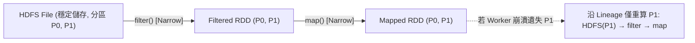

# Chapter 07 — 大數據儲存與運算堆疊 (HDFS, MapReduce, YARN & Spark)

## 1. 從單機硬碟物理極限到檔案系統配置演進

[Chapter 06](06-leveldb-hbase.md) 說明 HBase 將不可變的 HFile 寫入底層分散式儲存. 要理解大數據堆疊的設計取捨, 必須回到傳統硬碟 (HDD) 的物理限制與作業系統檔案配置方式 (成大講義 P183–P188).

### 1.1 硬碟物理瓶頸與三種傳統配置

機械硬碟的存取時間由三個因素主導 (P186):

- **尋道時間 (Seek Time)**: 讀寫頭移動至目標磁軌, 耗時約 $O(10^{-3})$ 秒 (毫秒級).
- **旋轉延遲 (Rotation Time)**: 等待目標磁區旋轉至讀寫頭下方, 取決於硬碟轉速 (RPM).
- **連續頻寬 (Bandwidth)**: 順序傳輸速率約 $100\text{ MB/s}$ 等級.

一旦進行大量隨機 I/O, 時間幾乎全浪費在機械移動; 唯有大區塊的**順序 I/O (Sequential I/O)** 才能吃滿頻寬. 為了將邏輯檔案對應到實體磁碟區塊, 傳統檔案系統歷經三種配置方式 (P187–P188):

| 配置方式 | 運作方式 | 核心優點 | 關鍵限制 |
| --- | --- | --- | --- |
| 連續配置 (Contiguous) | 檔案佔用一段連續區塊 | 順序讀取最快 | 檔案建立與刪除後產生嚴重外部碎裂 (External Fragmentation) |
| 鏈結串列 (Linked List, 如 FAT) | 每塊紀錄指向下一塊的指標 | 消除外部碎裂 | 隨機存取需 $O(N)$ 追蹤; 單一指標損毀即破壞檔案 |
| 索引配置 (Indexed / UFS Inode) | 集中索引區塊 (Inode) 存資料區塊指標 | 快速隨機存取且無外部碎裂 | 需額外索引結構空間 |

在 **Unix 檔案系統 (UFS)** 中, 每個檔案由一個 **Inode (File Control Block)** 紀錄權限, 時間戳與多層指標: 直接指標 (Direct Blocks, 快速存取前數 KB), 單層間接 (Single Indirect, 延伸至 MB 級), 雙層間接 (Double Indirect, 延伸至 GB 級) 與三層間接 (Triple Indirect, 延伸至 TB 級), 使任意巨大檔案中的任何區塊都能在最多三層間接磁碟查找內定位 (P188).

## 2. HDFS 架構, 副本放置與 NameNode 小檔案記憶體瓶頸

當資料量超出單機容量, **Hadoop 分散式檔案系統 (Hadoop Distributed File System, HDFS)** 建構於宿主作業系統檔案系統之上 (透過 JVM 運作的使用者空間檔案系統), 目標橫向擴展至上萬台普通商用伺服器 (P189–P193).

### 2.1 控制面與資料面分離: NameNode, DataNodes 與 Data Pipelining

HDFS 將中繼資料管理與實際資料讀寫徹底拆開 (P189–P191):

- **NameNode (Master)**: 掌管命名空間目錄樹, 維護"檔名 -> 區塊清單 (Blocks)"與"區塊 -> DataNodes 位置"的映射. 為了極致查詢速度, **全部中繼資料常駐 NameNode 主記憶體 (RAM)**.
- **DataNode (Worker)**: 負責在本地磁碟保存資料區塊並直接對用戶端提供讀寫服務, 定期向 NameNode 回報心跳 (Heartbeat) 與區塊報告 (Block Reports).
- **類 POSIX 用戶端介面** (P190): 提供 `open`, `creat`, `close`, `read`, `write`, `lseek`, `stat`, `unlink` 等檔案操作概念 (注意 HDFS 針對一次寫入, 多次串流讀取優化, 並不支援任意位置就地修改).
- **資料管線寫入 (Data Pipelining)** (P191): 用戶端寫入一個區塊時, 不需要自己把三份副本分別傳給三台 DataNode, 而是寫給第一台 DataNode, 再由第一台邊收邊串流轉發給第二台, 第二台轉發給第三台, 最大化網路介面利用率.

### 2.2 機架感知副本放置策略 (Default Replication Factor = 3)

面對單機與整個機架交換器/電源故障, HDFS 預設保存 $3$ 份副本並採機架感知 (Rack-Aware) 放置 (P192):

1. **Replica 1**: 放在用戶端所在的本地 DataNode (若用戶端不在叢集內則隨機挑選節點).
2. **Replica 2**: 放在**不同機架 (Remote Rack)** 的節點, 確保單一機架交換器或斷電不致遺失資料.
3. **Replica 3**: 放在**與 Replica 2 同一個遠端機架**的另一台節點, 避免消耗第二次昂貴的跨機架核心網路頻寬, 在容錯與頻寬成本之間取得平衡.

圖 7.1 - HDFS 預設三副本機架感知放置與 Pipeline 寫入路徑: 兩份跨機架容錯, 第三份留在同遠端機架以節省跨機架頻寬 (成大講義 P191–P192).

### 2.3 NameNode 瓶頸: 小檔案問題 (The Small File Problem)

**NameNode 小檔案記憶體瓶頸** 是 HDFS 最關鍵的架構限制 (P193). 因為 NameNode 將所有中繼資料全部保存在實體 RAM 中且不做磁碟需求分頁 (Demand Paging), 整個叢集所能容納的**檔案與區塊總數**被單台 NameNode 的實體記憶體上限死死卡住!

#### 講義原例數值推演

每個檔案, 目錄或區塊在 NameNode 的 JVM 記憶體中約佔用 $150\text{ bytes}$ 的中繼資料物件 (P193). 假設一座工廠每小時產生 $100{,}000$ 個僅 $10\text{ KB}$ 的微小日誌檔:

1. **每小時新增單一 Inode 中繼資料量** (依講義單物件下界估算):

$$
100{,}000 \times 150\text{ bytes} = 15{,}000{,}000\text{ bytes} = 15\text{ MB/hour}
$$

2. **一年累計消耗 NameNode RAM** ($365 \times 24 = 8{,}760$ 小時):

$$
15\text{ MB/hour} \times 8{,}760\text{ hours} = 131{,}400\text{ MB} \approx 131.4\text{ GB} \approx 130\text{ GB}
$$

實際儲存的日誌總量一年才約 $100{,}000 \times 10\text{ KB} \times 8{,}760 \approx 8.76\text{ TB}$, 在數百 TB 的 DataNode 磁碟群上微不足道, 卻光靠中繼資料就把一台 $128\text{ GB}$ RAM 的 NameNode 直接撐爆!

從實務工程精確度來看, 每個非空小檔案在 NameNode RAM 中實際上同時包含 **1 個 File Inode 物件** (約 $150\text{ B}$) 加上 **1 個 Block 物件** (約 $150\text{ B}$) 與 **3 份副本的映射紀錄**, 真實記憶體開銷甚至會是上述下界估算的兩倍以上. 此外, 上百萬個小檔案還會迫使後續 MapReduce/Spark 啟動大量極短命的 Map Tasks, 讓排程開銷遠超實際計算時間. 因此 HDFS 專為 **GB/TB 級大檔案與大區塊** (常見 $128\text{ MB}$) 串流設計; 面對大量小檔案時, 實務須在寫入前合併成大檔 (例如 Parquet, ORC, SequenceFile 或 HAR 封存檔).

## 3. MapReduce 批次計算框架與 Classic Hadoop 1.0

在 MapReduce 出現之前, 平行運算主要分成兩派: **共享記憶體 (Shared Memory)** 易發生競爭條件且需嚴密鎖定, **訊息傳遞 (Message Passing)** 則要求開發者手動處理非同步事件與節點失敗 (P194). **MapReduce (Dean & Ghemawat, 2004)** 將分散式並行, 資料切分與容錯重試全收進框架層, 只對開發者暴露 `map(key, value)` 與 `reduce(key, values)` 兩個函式.

### 3.1 WordCount 資料流與 Mapper/Reducer 細節

以講義 P195 的 WordCount 原例追蹤資料流: 輸入兩份文件 `Doc 1: "good bad"` 與 `Doc 2: "bad"`:

1. **Mapping**: `map` 將每個單字輸出 `(w, 1)` -> 產生 `(good, 1)`, `(bad, 1)` 與 `(bad, 1)`.
2. **Mapper 端最佳化與分區** (P197):
   - **Combiner (本地預聚合)**: 在傳上網路前先於 Mapper 本地將重複鍵合併, 例如把多個 `(the, 1)` 預先加成 `(the, 2)`, 顯著節省跨節點網路頻寬. (注意 Combiner 必須滿足交換律與結合律, 例如"加總"可直接複用 Reducer, 但"求算術平均"不能直接拿平均函式當 Combiner.)
   - **Partitioner (分區器)**: 預設以 $\mathrm{hash}(\text{key}) \bmod R$ (其中 $R$ 為 Reducer 總數) 決定每個鍵送往哪一位 Reducer, 保證相同鍵必匯聚至同一台 Reducer.
   - **中間輸出落地位置**: Mapper 的中間輸出寫在 Worker 自己的**本地檔案系統 (Local File System)**, **不寫入 HDFS**, 因為它屬於暫存結果, 若遺失重跑該 Map Task 即可.
3. **Reducer 端三階段 (Shuffle, Sort, Reduce)** (P198):
   - **Shuffling (Pull)**: 各 Reducer 主動透過網路從已完成的各 Mapper 本地磁碟拉取屬於自己的分區 (早期 Mapper 一完成即可提早開始拉取, 與 Map 階段重疊節省時間).
   - **Sorting**: Reducer 在本地將拉回的資料依鍵排序分組, 得到 `good -> [1]` 與 `bad -> [1, 1]`.
   - **Reducing**: 串流送入 `reduce()` 加總輸出 `(good, 1)` 與 `(bad, 2)`, 將最終結果寫回持久化的 **HDFS**.

### 3.2 Classic Hadoop 1.0 架構與 Data Locality

在 Classic Hadoop 1.0 中 (P196), 主節點運行 **JobTracker**, 各工作節點運行 **TaskTracker** 與 HDFS DataNode. 系統盡可能實踐 **資料局部性 (Data Locality, 移動計算而非移動資料)**: JobTracker 查詢 NameNode 得知 HDFS 區塊位置後, 優先把 Map Task 派發到該區塊所在的同一台 TaskTracker, 省下龐大的跨網路輸入讀取流量.

但 Classic Hadoop 1.0 存在兩大致命瓶頸 (P196, P199):
1. **JobTracker 單體瓶頸**: 單一程序同時負責"全域叢集資源排程"與"所有作業的任務生命週期監控", 叢集規模達數千節點時成為嚴重效能瓶頸.
2. **綁死單一運算模型**: 叢集只認 MapReduce, 難以在同一套硬體與 HDFS 上直接執行迭代式圖計算或即時串流引擎.

## 4. Apache YARN 資源管理與多維排程理論

**Apache YARN (Yet Another Resource Negotiator)** 將 JobTracker 拆解為兩層職責, 讓 MapReduce, Spark, Flink 等多種框架以多租戶模式共享同一叢集與 HDFS (P199–P200):

- **ResourceManager (RM)**: 全域資源仲裁者 (含 Scheduler 與 ApplicationsManager), 僅負責跨應用的資源分配, 不追蹤個別任務進度.
- **NodeManager (NM)**: 執行於各工作節點的代理, 監控本機 CPU/RAM 並啟動隔離的 **Containers**.
- **ApplicationMaster (AM)**: **每個應用程式專屬一個** AM (運行於某個 Container 內), 負責向 RM 協商申請 Containers, 聯絡 NM 啟動任務並監控重試失敗任務.

### 4.1 Capacity Scheduler vs Fair Scheduler

講義 P201 比較 YARN 兩種經典多租戶排程器:

| 面向 | Hadoop Capacity Scheduler (HCS) | Hadoop Fair Scheduler (HFS) |
| --- | --- | --- |
| 分配哲學 | 依組織部門切分階層式佇列 (如 `Prod 50%`, `Dev 50%` 再分 `D1 25%`, `D2 25%`) | 動態將叢集資源均分給所有活躍作業/資源池 (僅 Job A 時佔 `100%`, Job B 到達後平分各 `50%`) |
| 閒置借用 | 支援彈性借用其他閒置佇列的空閒資源 | 單一活躍作業可吃滿全叢集 |
| 搶佔 (Preemption) | 講義介紹其基本模式不強殺運行中任務, 等待自然結束回收 (註: 實務新版 HCS 亦可透過設定啟用搶佔) | 支援搶佔: 若某資源池未達保證最低份額, 強殺超額池中近期啟動的任務回收資源 |
| 任務要求 | 一般批次重試 | 因搶佔會重啟被殺任務, 應用任務必須具備 **冪等性 (Idempotence)** |

### 4.2 多維資源排程: Dominant Resource Fairness (DRF)

實務作業對 CPU 與 RAM 的需求比例差異懸殊, 單一維度公平無法適用. **主導資源公平 (DRF, Ghodsi et al., 2011)** 先計算每位使用者在所有資源維度上佔叢集總量的最大比例, 稱為 **主導份額 (Dominant Share)**, 排程目標為**使所有競爭使用者的主導份額盡可能相等** (P202).

核對講義 P202 原例: 叢集總資源為 $\langle 18\text{ CPUs}, 36\text{ GB RAM}\rangle$.

- **Job 1 單任務需求** $\langle 2\text{ CPUs}, 8\text{ GB}\rangle$:
  - CPU 佔比 $= \frac{2}{18} = \frac{1}{9} \approx 11.1\%$, RAM 佔比 $= \frac{8}{36} = \frac{2}{9} \approx 22.2\%$.
  - 主導資源為 **RAM** (每任務佔 $2/9$).
- **Job 2 單任務需求** $\langle 6\text{ CPUs}, 2\text{ GB}\rangle$:
  - CPU 佔比 $= \frac{6}{18} = \frac{1}{3} \approx 33.3\%$, RAM 佔比 $= \frac{2}{36} = \frac{1}{18} \approx 5.6\%$.
  - 主導資源為 **CPU** (每任務佔 $1/3$).
- **DRF 平衡解**: 設分配 $x$ 個任務給 Job 1, $y$ 個任務給 Job 2, 令主導份額相等 $\frac{2}{9}x = \frac{1}{3}y \Rightarrow y = \frac{2}{3}x$, 受限於 CPU 約束 $2x + 6y \le 18$ 與 RAM 約束 $8x + 2y \le 36$. 代入 $x = 3, y = 2$:
  - Job 1 獲得 $3$ 任務: 耗 $6\text{ CPUs}, 24\text{ GB RAM}$, 主導份額 $\frac{24}{36} = \frac{2}{3} \approx 66.7\%$.
  - Job 2 獲得 $2$ 任務: 耗 $12\text{ CPUs}, 4\text{ GB RAM}$, 主導份額 $\frac{12}{18} = \frac{2}{3} \approx 66.7\%$.
  - 總消耗 $\langle 18\text{ CPUs}, 28\text{ GB RAM}\rangle \le \langle 18, 36\rangle$, 既不超額又讓兩者的主導份額精確平分在 $66.7\%$!

### 4.3 排程理論: Hazard Rate, Exponential 與 Pareto (DFR)

若想用最短任務優先 (STF) 降低平均完成時間, 需評估"已經跑了時間 $t$ 的任務, 下一瞬間完成的條件機率速率", 定義為 **風險率函數 (Hazard Rate Function)** (P203–P204):

$$
r(t) = \frac{f(t)}{\bar{F}(t)}, \quad \text{其中 } \bar{F}(t) = P(T > t) \text{ 為存活函數 (Survival Function)}
$$

- **指數分佈 (Exponential Distribution, 無記憶性)** (P203): $f(t) = \lambda e^{-\lambda t}$, $\bar{F}(t) = e^{-\lambda t}$, 推得:

$$
r(t) = \frac{\lambda e^{-\lambda t}}{e^{-\lambda t}} = \lambda
$$

  風險率恆為常數 $\lambda$: 任務過去跑了多久對剩餘時間毫無預測力, 因此搬移 (Migrate) 舊任務在統計上無額外收益.

- **帕累托分佈 (Pareto Distribution, 重尾分佈)** ($t \ge 1, \alpha > 0$, P204): $\bar{F}(t) = t^{-\alpha}$, $f(t) = \alpha t^{-\alpha-1}$, 推得:

$$
r(t) = \frac{\alpha t^{-\alpha-1}}{t^{-\alpha}} = \frac{\alpha}{t}
$$

  風險率隨執行時間 $t$ 嚴格遞減, 稱為 **遞減失敗率 (Decreasing Failure Rate, DFR)**. 統計含義是: **一個已經執行很久的任務, 接下來還會跑非常久**. 因此在重尾工作負載下, 將老舊大任務搬移到閒置節點通常是划算的, 因為其漫長的剩餘執行時間足以均攤搬移開銷.

## 5. Apache Spark 記憶體運算與 RDD Lineage 容錯重算

MapReduce 之所以安全, 是因為每個步驟之間都將中間結果寫入實體磁碟; 但這對反覆掃描同一資料集的**迭代式演算法 (Iterative Algorithms, 如機器學習梯度下降與圖演算法)** 造成毀滅性的磁碟 I/O 瓶頸 (P205). **Apache Spark (Zaharia et al., 2012)** 透過記憶體運算與彈性 DAG 排程突破這道瓶頸.

### 5.1 RDD 與惰性求值 (Lazy Execution)

Spark 的核心抽象是 **彈性分散式資料集 (Resilient Distributed Dataset, RDD)**: 一個**不可變 (Immutable)**, 分區化 (Partitioned) 並散布於叢集記憶體中的物件集合 (P206). 操作嚴格區分為兩類:

- **轉換 (Transformations, 惰性 Lazy)**: 如 `sc.textFile()`, `filter()`, `map()`. 呼叫時**不會立刻運算資料**, 只是將新的轉換規則登記到 DAG 中.
- **動作 (Actions, 觸發執行)**: 如 `count()`, `collect()`. 直到遇見 Action, Spark 的 `DAGScheduler` 才把累積的轉換圖最佳化並派發給 Executors 真正執行.
- **顯式快取 (`cache()` / `persist()`)**: 對後續會多次重用的 RDD (例如講義 P206 的 `errs.cache()`), 指示 Executor 將計算好的分區留在記憶體中, 避免下次 Action 重複讀取 HDFS.

### 5.2 RDD Lineage 容錯重算機制 (Fault Tolerance via Lineage)

這引出 Spark 最經典的架構提問 (P207): **HDFS 靠磁碟保存 3 份實體副本容錯; 如果記憶體計算引擎也為了容錯而在跨節點 RAM 間即時複製所有 RDD 狀態, 昂貴的記憶體與網路頻寬會立刻被吃光. Spark 如何在不複製大量 RAM 資料的前提下實現容錯?**

答案是維護 **血緣圖 (Lineage Graph)** — 紀錄每個 RDD 是由穩定儲存 (如 HDFS) 出發, 經過哪些**確定性粗粒度轉換 (Deterministic Coarse-Grained Transformations)** 一步步衍生而來的配方 (Recipe).

圖 7.2 - Spark RDD 透過 Lineage 記錄確定性轉換序列; 單一分區遺失時只重算該分區的祖先鏈, 不需預先在 RAM 複製多份副本 (成大講義 P207).

當某台 Worker 當機導致記憶體中的某個 RDD 分區遺失時:
1. Spark 檢視該 RDD 的 **Lineage Graph**, 回溯至上游仍存在的父分區或底層 HDFS 區塊.
2. **僅針對遺失的那個分區**重新套用確定性轉換 (例如 `HDFS(P1) -> filter() -> map()`), 由於 RDD 不可變且轉換具確定性, 重算結果與遺失前完全一致, 且不需要重跑其他未受影響的健康分區.

### 5.3 Narrow Dependencies vs Wide Dependencies

Lineage 重算的代價與 DAG 排程邊界, 取決於父子 RDD 之間的相依型態 (P208):

| 相依類型 | 分區對應關係 | 代表運算子 | 執行與 DAG 排程行為 | 節點失敗時的 Lineage 重算代價 |
| --- | --- | --- | --- | --- |
| **窄相依 (Narrow Dependency)** | 每個父分區最多被**一個**子分區使用 | `map`, `filter`, `union` | 在單一節點內**管線化 (Pipelined)** 連續執行, 無需網路 Shuffle | **極低**: 單一子分區遺失, 只需獨立重算對應的單一父分區 |
| **寬相依 (Wide Dependency)** | 每個父分區被**多個**子分區共同使用 | `groupByKey`, `reduceByKey`, `join` | 必須跨網路執行 **Shuffle**, `DAGScheduler` 在此處將 DAG 切分為不同 **Stages** | **較高**: 若無 Shuffle 輸出檔或 Checkpoint, 單一子分區遺失可能回溯重算全部上游父分區 (實務上 Spark 保留 Map 端 Shuffle 檔並允許對長血緣呼叫 `checkpoint()` 落盤截斷) |

### 5.4 Spark on YARN 執行架構

結合本章所有元件, 講義 P209 串連出完整大數據執行圖: **Driver Node** (`SparkContext`, `DAGScheduler`, `TaskScheduler`) 將 RDD 程式碼編譯為 DAG 與 Stages, 查詢 **HDFS** 區塊位置爭取 Data Locality, 同時向 **YARN ResourceManager** 協商啟動 ApplicationMaster 與 Containers; 各工作節點 (NodeManager) 在分配到的 Container 中啟動 **Spark Executor**, 負責執行 Tasks, 維護記憶體 Cache 並直接讀寫 HDFS.

## 6. 銜接下一章: 從批次運算走向無限即時串流

HDFS, MapReduce 與 Spark 皆以"有限的靜態資料集 (Batch)"為出發點, 面對信用卡詐欺偵測或即時遙測等毫秒級反應需求仍力有未逮. [Chapter 08](08-kafka-stream-processing.md) 將進入分散式串流架構 **Apache Kafka**, 剖析它如何用順序日誌, `sendfile()` 零拷貝與 Changelog 狀態還原承載無界即時事件流.

## 7. 英文選擇題與逐項解析

### Q1 — HDFS NameNode Small File Problem

Why does storing millions of 10 KB files severely degrade an HDFS cluster even when DataNodes still have plenty of free disk space?

- A. HDFS cannot store any file smaller than 128 MB on disk.
- B. The NameNode keeps the entire filesystem namespace and block metadata in physical RAM without demand paging, so each tiny file consumes metadata objects (roughly 150 bytes per inode/object) and exhausts NameNode memory.
- C. DataNodes refuse to send heartbeats for files smaller than 1 MB.
- D. HDFS replicates small files 100 times by default instead of 3 times.

**答案: B.** A: 小於一個區塊大小仍可存入 HDFS, 只佔實際磁碟空間而非吃掉整塊 128 MB. B: NameNode 全量中繼資料常駐 RAM, 大量小檔案迅速耗盡 NameNode 記憶體成為整個叢集的擴展瓶頸. C: Heartbeat 與檔案大小無關. D: 預設複製因子一律為 3.

### Q2 — Spark RDD Lineage fault tolerance

How does Apache Spark recover a lost in-memory RDD partition after a worker node crashes without maintaining full replicated copies of every RDD in cluster RAM?

- A. By re-running the entire cluster from scratch via ZooKeeper consensus.
- B. By consulting the RDD's Lineage graph of deterministic transformations and recomputing only the lost partition from its surviving parent partitions or stable storage (e.g., HDFS).
- C. By relying on HDFS to automatically mirror JVM heap pages across racks every millisecond.
- D. By dropping the lost partition permanently and returning partial results.

**答案: B.** A: 不需要全叢集重跑, 也非 ZooKeeper 職責. B: 記錄不可變 RDD 的確定性轉換譜系 (Lineage), 故障時只重算遺失分區. C: HDFS 不負責同步執行期 JVM 記憶體頁. D: 不可丟失資料破壞計算正確性.

### Q3 — Narrow vs Wide dependencies in Spark

Which statement correctly distinguishes Narrow Dependencies from Wide Dependencies in Spark?

- A. `groupByKey` is a Narrow Dependency that runs in a single-node pipeline without network transfer.
- B. `map` and `filter` are Narrow Dependencies (each parent partition feeds at most one child partition, allowing pipelining and cheap local recovery), whereas `groupByKey` is a Wide Dependency requiring a network shuffle that splits the DAG into stages.
- C. Wide Dependencies never trigger network shuffles, while Narrow Dependencies always flush to HDFS.
- D. Both dependency types prohibit lazy evaluation.

**答案: B.** A: `groupByKey` 屬寬相依, 須跨網路 Shuffle. B: 精確區分窄/寬相依在管線執行, Stage 切分與故障重算上的差異. C: 敘述完全顛倒. D: 兩者皆屬惰性 Transformations, 直到遇見 Action 才執行.

### Q4 — Dominant Resource Fairness (DRF)

A cluster has `18 CPUs` and `36 GB RAM`. Job 1 needs `(2 CPUs, 8 GB)` per task, and Job 2 needs `(6 CPUs, 2 GB)` per task. Under DRF, what is each job's dominant resource and balanced task allocation?

- A. Both jobs are CPU-dominant; Job 1 gets 2 tasks and Job 2 gets 2 tasks.
- B. Job 1 is RAM-dominant (`2/9` per task) and Job 2 is CPU-dominant (`1/3` per task); allocating 3 tasks to Job 1 and 2 tasks to Job 2 equalizes both dominant shares at `2/3`.
- C. Job 1 is CPU-dominant and gets all 9 tasks while Job 2 starves.
- D. DRF ignores RAM completely and splits CPUs equally (9 CPUs each).

**答案: B.** A: Job 1 單任務 CPU 佔 `2/18 = 1/9`, RAM 佔 `8/36 = 2/9`, 主導資源是 RAM 而非 CPU. B: 3 個 Job 1 任務耗 `24/36 = 2/3` RAM, 2 個 Job 2 任務耗 `12/18 = 2/3` CPU, 總計 `18 CPUs, 28 GB RAM` 合法且主導份額完全相等. C: 違反公平原則且 `9 x 8 GB = 72 GB` 超出總記憶體. D: DRF 正是為了多維資源公平而設計.

### Q5 — HDFS block placement and YARN decoupling

Why does HDFS default placement put Replica 2 and Replica 3 on different nodes within the SAME remote rack rather than on two separate remote racks?

- A. To eliminate cross-rack write traffic for the third replica while still surviving a single-rack failure.
- B. Because HDFS clusters are limited to at most two racks.
- C. Because Replica 3 is stored only in NameNode RAM.
- D. Because Data Pipelining only works within a single node.

**答案: A.** A: Replica 1 在本地機架, Replica 2 與 3 在遠端同一機架的不同節點, 既可抵擋單機架故障, 寫入管線也只需跨機架一次. B: 叢集可擁有數十至數百機架. C: NameNode 不存實際資料區塊. D: Pipeline 跨多台 DataNode 串流轉發.

## 8. 來源與投影片對照

| 講義 | 主題 | 算例與圖解 |
| --- | --- | --- |
| P183–P188 | HDD 物理瓶頸, 傳統配置與 UFS Inode | 直接與一/二/三層間接指標 |
| P189–P193 | HDFS 架構, 副本放置與 NameNode 小檔案瓶頸 | 圖 7.1, 每小時 $100{,}000$ 小檔一年耗 $\approx 130\text{ GB}$ RAM |
| P194–P198 | MapReduce, Data Locality, Combiner 與 Shuffle-Sort | WordCount (`good bad`, `bad`), $\mathrm{hash}(k) \bmod R$ |
| P199–P204 | YARN 解耦, Capacity/Fair, DRF 與排程理論 | $\langle 18\text{ CPU}, 36\text{ GB}\rangle$ DRF 解, Exponential vs Pareto DFR |
| P205–P210 | Spark RDD, Lazy Execution, Lineage 與 Narrow/Wide | 圖 7.2, `filter()->map()` 血緣重算, Spark on YARN |

- 成大講義: Prof. Hung-Chang Hsiao, *Distributed Systems* (Fall 2026), `reference/整包.pdf` P183–P210. 備註: 抽取 P205, P207, P208 時出現 PDF 裝飾 XObject 缺失警告, 經逐頁渲染核對確認所有文字, Lineage 圖與 Narrow/Wide 相依圖皆完整無缺.
- 經典論文背景: Ghemawat et al. (2003) GFS 與 Shvachko et al. (2010) HDFS; Dean & Ghemawat (2004) MapReduce; Vavilapalli et al. (2013) Apache YARN; Ghodsi et al. (2011) DRF; Zaharia et al. (2012) Spark RDDs.

執行 `python3 tools/verify-remaining-chapters.py` 可核算本章的 NameNode 小檔案記憶體計算, DRF 資源平衡解, Exponential/Pareto 風險率與 Spark Lineage 局部重算模擬.
