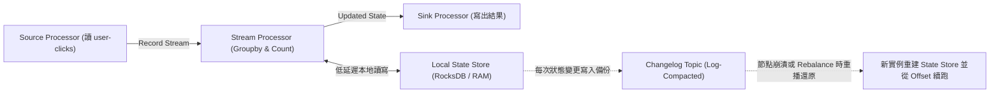

# Chapter 08 — 分散式資料串流架構 (Apache Kafka & Stream Processing)

## 1. 從批次處理走向即時串流與 Publish-Subscribe

[Chapter 07](07-hdfs-mapreduce-yarn-spark.md) 的 MapReduce 與 Spark 處理的是已靜止於磁碟的有限資料集 (Batch Processing), 適合小時或天級的離線分析, 卻無法即時攔截詐欺交易或處理連續遙測流 (成大講義 P211–P214). **資料串流典範 (Data Streaming Paradigm)** 面對的是**無限, 無界的連續事件序列**, 要求在毫秒到秒級內可靠地攝取, 緩衝, 路由與計算.

### 1.1 Request/Response vs Publish/Subscribe

傳統 REST/RPC 採 **請求/回應 (Request/Response)** 模式: 呼叫端與服務端同步緊耦合, 接收者一旦當機或過載, 傳送端隨即阻塞或失敗 (P215–P216). **發布/訂閱 (Publish/Subscribe)** 引入中介事件服務 (Event Broker):

- **空間與匿名解耦**: 發布者 (Producers) 只需將事件送往主題, 無需知道下游有誰訂閱.
- **時間解耦與削峰填谷 (Buffering)**: 當突發流量超過消費者處理速度, Broker 以持久化日誌緩衝流量尖峰, 下游消費者短暫當機恢復後仍能從斷點繼續追趕.

## 2. Apache Kafka 架構, 分區全序與理論橋樑

**Apache Kafka** 本質上是一個分散式, 分區化, 可容錯的**追加式提交日誌 (Append-Only Commit Log)** (P217–P219).

- **Brokers**: 構成 Kafka 叢集的伺服器節點, 負責持久化日誌並服務讀寫.
- **Topics 與 Partitions**: 邏輯事件流稱為 **Topic**, 每個 Topic 橫向切分為多個 **Partitions** 作為平行處理與擴展的基本單位. 每個 Partition 內部是一條不可變的順序日誌, 每筆寫入紀錄獲配單調遞增的整數編號 **Offset**.
- **Leader-Follower 複寫**: 每個 Partition 有多份副本分布在不同 Broker 上 (1 個 Leader 與數個 Followers) 以容忍節點當機.

### 2.1 理論橋樑: Total Order Broadcast 與因果性取捨

對照 [Chapter 05](05-consistency-replication-transactions.md) 的 **全序廣播 (Total Order Broadcast, TOB)**: 單一 Kafka Partition 就像一面獨立的公佈欄, 所有消費者讀取該 Partition 時, 必定依相同的連續 Offset 順序觀測事件; 單一 Producer 寫往同一 Partition 的事件因果順序 ($e_i \to e_j$) 自然獲得保留, 不需昂貴的 Vector Clocks (P219).

Kafka 的關鍵架構取捨在於**只保證單一 Partition 內的全序, 刻意放棄跨 Topic 與跨 Partition 的全域全序**. 正因為解除跨分區全域排序的鎖鏈, 不同 Partition 可由不同 Broker 與不同 Consumer 完全平行吞吐. (實務上若同一位使用者的事件必須保序, Producer 只需將 `user_id` 作為 Key, 讓相同 Key 雜湊進同一個 Partition.)

## 3. 共識, ISR 複寫, `acks` 語義與 Consumer Groups

### 3.1 ZooKeeper / KRaft 與 In-Sync Replicas (ISR)

Kafka 如何決定哪台 Broker 是 Partition Leader, 並避免網路分區腦裂? (P220–P221).

- **控制面共識**: 傳統 Kafka 依賴 [Chapter 03](03-zookeeper.md) 的 **ZooKeeper** (ZAB 共識) 追蹤 Broker 存活與選主; 新版 Kafka 導入 **KRaft (Kafka Raft)** 將中繼資料共識直接內建於叢集, 移除對外部 ZooKeeper 的依賴.
- **同步副本集合 (In-Sync Replicas, ISR)**: 針對每個 Partition, 緊跟 Leader 日誌進度且保持心跳的副本組成 **ISR 集合** (包含 Leader 本身). 若某 Follower 落後過久或失聯, 會被移出 ISR, 避免拖慢提交延遲.

### 3.2 Producer 確認層級 (`acks`) 與安全邊界

Producer 透過 `acks` 參數在寫入延遲與持久性之間做精確選擇 (P222):

| `acks` 設定 | 運作方式 | 延遲與持久性取捨 |
| --- | --- | --- |
| `acks = 0` | 發後不理 (Fire-and-forget), 送進網路緩衝就回成功 | 最低延遲, 最高遺失風險 (At-most-once) |
| `acks = 1` | 等待 Partition Leader 寫入本地日誌即回覆 | 折衷延遲; 若 Leader 回覆後尚未複製給 Follower 就永久故障, 已確認訊息仍會遺失 |
| `acks = all` (亦作 `-1`) | 等待當前 ISR 集合確認寫入才回覆 | 最高安全保障; 講義 P220 與 P222 將其類比 Paxos Phase 2 達多數確認語義 |

在工程實務邊界上需特別留意: Kafka 的 `acks = all` 實際上是等待**當前整個 ISR 集合**確認, 而非固定總副本數的多數; 如果副本數為 $3$ 但兩台 Follower 都故障掉出 ISR, 此時 ISR 僅剩 Leader 1 台, `acks = all` 仍會立刻成功並退化回單點風險. 因此生產環境必須同時設定 `min.insync.replicas` (例如副本數 $3$ 配 `min.insync.replicas = 2`), 當存活 ISR 人數低於下限時拒絕寫入, 才能真正守住類似 Quorum 的零資料遺失安全邊界.

### 3.3 Client APIs 與 Consumer Group 獨佔規則

Kafka 用戶端分成兩套核心介面 (P223–P224):
- **Producer API (`KafkaProducer`)**: 將事件封裝為 `ProducerRecord(topic, key, value)`, 以非同步 `Future<RecordMetadata>` 與批次傳送追求高吞吐.
- **Consumer API (`KafkaConsumer`)**: 採 **拉取模式 (Pull-based)**, 在持續的 `poll()` 迴圈中依自身消化能力拉取訊息, 並自行控制自動或手動提交 Offset, 避免快生產者把慢消費者灌爆.

**Consumer Groups** 決定消費端的平行度與順序保護 (講義 P224 原例: Topic 有 `P0, P1, P2, P3` 共 $4$ 個 Partitions):

- **Consumer Group A** ($2$ 位消費者 `C1, C2`): `C1` 負責讀取 `P0, P1`, `C2` 負責讀取 `P2, P3`, 每人分擔 $2$ 個分區.
- **Consumer Group B** ($4$ 位消費者 `C3, C4, C5, C6`): 嚴格 $1$ 對 $1$ 對應 (`C3->P0`, `C4->P1`, `C5->P2`, `C6->P3`), 達到該 Topic 的最大平行度.
- **鐵律**: **同一個 Consumer Group 內, 任何一個 Partition 同一時間絕對只能被一位 Consumer 讀取**, 以維持單分區內的嚴格處理順序! 若同一組內增加到 $5$ 位消費者, 第 $5$ 位只能閒置待命. 反之, Group A 與 Group B 屬於不同群組, 各自獨立維護 Offset 並完整消費同一份 Topic 資料 (一個設計同時涵蓋點對點佇列負載均衡與多訂閱者廣播).

## 4. Kafka 為何如此快? 順序 I/O, Page Cache 與 `sendfile()` Zero-Copy

Kafka 在普通商用硬碟上即可達到每秒數百萬筆吞吐量, 背後依靠三大系統工程支柱 (P228–P230):

### 4.1 順序追加日誌與 OS Page Cache

1. **Sequential Disk I/O (與 LSM-Tree 同源)** (P229): 每個 Partition 的底層檔案段 (Segments) 都是純追加的 Commit Log, 與 [Chapter 06](06-leveldb-hbase.md) 的 WAL/SSTable 共享完全相同的外部記憶體原則 — 避開 $O(10^{-3})$ 秒隨機尋道與 B+ Tree 就地覆寫放大, 逼近均攤 $O(1/B)$ 順序頻寬.
2. **OS Page Cache (作業系統頁快取)** (P228): Kafka 刻意**不把大量訊息快取在 JVM Heap 中**, 而是直接交給 Linux 核心的 Page Cache 管理. 這避免了 JVM 物件標頭開銷與龐大 Heap 引起的 Garbage Collection 長停頓; 而且即使 Kafka Broker 行程重啟, 作業系統的 Page Cache 依然溫熱, 不需重新預熱快取.

### 4.2 `sendfile()` Zero-Copy 資料傳輸 (核心原理)

在傳統伺服器將磁碟日誌檔案送給遠端 Consumer 時, 呼叫標準 `read()` 與 `write()` 會引發沉重的資料搬運與上下文切換 (Context Switches) (P230):

- **傳統 `read()` + `write()` 路徑 (4 次資料拷貝, 4 次上下文切換)**:
  1. `Disk -> Kernel Page Cache` (DMA Copy 1).
  2. `Kernel Page Cache -> User Space (JVM Buffer)` (**CPU Copy 1**, 需切進使用者空間).
  3. `User Space (JVM Buffer) -> Kernel Socket Buffer` (**CPU Copy 2**, 又切回核心空間).
  4. `Kernel Socket Buffer -> Network NIC` (DMA Copy 2).

Broker 根本不需要在 JVM 裡解開或修改這批已經序列化的位元組, 卻白白花費兩次 CPU 拷貝把資料搬進 User Space 又搬回 Kernel Space!

- **Kafka Zero-Copy (`sendfile()`, Java 透過 `FileChannel.transferTo()` 呼叫)**:
  1. 若資料尚未在快取中, 透過 DMA 從 `Disk -> Kernel Page Cache` (若熱資料剛由 Producer 寫入並留在 Page Cache, 連這次磁碟讀取都省下!).
  2. 應用程式呼叫 `sendfile()`, 核心**完全繞過 User Space (JVM)**! 搭配支援 Scatter-Gather DMA 的網卡, 核心僅將指向 Page Cache 記憶體位址與長度的輕量**描述子 (Descriptor)** 寫入 Socket Buffer.
  3. 網卡引擎直接透過 **Direct DMA** 從 Kernel Page Cache 讀取資料並送上網路!

```mermaid
flowchart TB
    subgraph Trad["傳統 read() + write()：4 次拷貝，經 User Space"]
        T1["Disk"] -->|"DMA"| T2["Kernel (Page Cache)"]
        T2 -->|"CPU Copy 1"| T3["User Space (JVM)"]
        T3 -->|"CPU Copy 2"| T4["Socket Buffer"]
        T4 -->|"DMA"| T5["Network NIC"]
    end
    subgraph Zero["Kafka Zero-Copy (sendfile)：繞過 JVM，消除 CPU 拷貝"]
        Z1["Disk"] -->|"DMA (若未命中快取)"| Z2["Kernel (Page Cache)"]
        Z2 -->|"僅傳 Descriptor / Direct DMA"| Z3["Socket Buffer (Desc)"]
        Z3 -->|"Direct DMA"| Z4["Network NIC"]
    end
```

圖 8.1 - 傳統路徑資料來回穿越 User Space 造成兩次 CPU 拷貝與四次上下文切換; `sendfile()` Zero-Copy 直接在核心層以 DMA 將資料從 Page Cache 送往網卡 (成大講義 P230).

Zero-Copy 將使用者空間的 **2 次 CPU 拷貝完全歸零**, 上下文切換從 $4$ 次減半為 $2$ 次, 讓 CPU 解放並直接打滿網卡頻寬. (技術適用邊界: `sendfile()` 要求核心不改動原始位元組流; 若 Kafka 啟用軟體層 TLS/SSL 傳輸加密, 或 Broker 因新舊版本不相容必須在 JVM 內解壓縮/轉換訊息格式, 資料仍須進入 User Space 處理而無法走完整零拷貝路徑.)

## 5. 有狀態串流處理與 Kafka Streams Changelog 狀態還原

僅做無狀態過濾 (Stateless Filter) 很簡單, 真正困難的是**有狀態串流運算 (Stateful Stream Processing)** — 例如滑動視窗聚合, 累計點擊計數或串流 Join (P225–P227, P231–P235).

### 5.1 理論根基: 從 Chandy-Lamport 快照到串流恢復線

當執行有狀態算子的工作節點突然當機, 其本地記憶體或本機磁碟中的累計狀態隨即遺失. 如何在不暫停整個無界串流的前提下確保狀態一致恢復? 講義 P225–P227 直接回扣 [Chapter 01](01-logical-clocks-checkpointing.md):

- **Consistent Global State**: $GS = \{\bigcup_i LS_i, \bigcup_{i,j} SC_{ij}\}$, 同時涵蓋各節點本地狀態 $LS_i$ 與通道在途訊息 $SC_{ij}$.
- **一致切面條件 (C1 與 C2, 避免孤兒訊息)**: 若某筆訊息的接收事件 $\mathrm{rec}(m_{ij})$ 落在檢查點過去側, 其發送事件 $\mathrm{send}(m_{ij})$ 也必須在過去側, 絕不可出現發送端已回滾遺忘, 接收端卻保留處理結果的孤兒狀態 (Orphan Messages).
- **Recovery Line**: 透過類似 Chandy-Lamport Marker 與依賴圖剪枝所決定的最新一致全域快照, 構成最小化重算成本的恢復線.

### 5.2 Processor Topology, KStream 與 KTable

**Kafka Streams** 透過聲明式 DSL (`StreamsBuilder`) 將商業邏輯編譯為可執行的 **處理器拓撲 (Processor Topology, DAG)**, 由底層標準 Consumer 與 Producer 驅動事件流 (P231–P234):

- **KStream**: 代表無界的**個別事件插入流** (例如 `user-clicks-topic` 中每一筆新的點擊紀錄).
- **KTable**: 代表**變更日誌流 (Changelog Stream)**, 記錄每個 Key 的當前最新狀態 (例如每位使用者的累計點擊總數).

講義 P234–P235 的經典點擊計數管線:
`user-clicks-topic` -> `stream()` (KStream) -> `groupByKey().count()` (KTable) -> 編譯為運行時 DAG:
`Source Processor (讀 user-clicks)` -> `Stream Processor (Groupby & Count)` -> `Sink Processor (寫輸出)`.

### 5.3 Local State Store 與 Changelog Topic 狀態還原機制

Stream Processor 如何兼顧低延遲存取與故障復原? 答案是 **Local State Store + Changelog Topic** 雙層架構 (P227, P235):

圖 8.2 - Kafka Streams 將即時聚合狀態保存在本地 RocksDB State Store 以降低延遲, 並將變更同步備份至 Kafka Changelog Topic; 故障時重播 Changelog 還原狀態 (成大講義 P235).

完整正常路徑與故障還原步驟如下:

1. **正常執行 (本地讀寫 + 遠端變更日誌備份)**:
   - Stream Processor 收到點擊事件時, 直接讀寫同機的 **Local State Store** (預設為嵌入式 **RocksDB**, 採 [Chapter 06](06-leveldb-hbase.md) 的 LSM-Tree 架構, 讀寫極快且不需每次走跨網路資料庫查詢).
   - 同時, State Store 的每一次狀態更新都會同步寫入 Kafka 叢集中對應的專屬 **Changelog Topic** (設定為 **Log-Compacted**, 針對同一個 Key 定期壓縮保留最新狀態值, 避免日誌無限膨脹).
   - 系統定期提交輸入 Topic 的消費 Offset 與狀態檢查點, 標定恢復線.
2. **當機與 Rebalance 狀態還原 (Changelog Replay)**:
   - 當某台執行該 Task 的機器崩潰, 其本機 RocksDB 狀態遺失, Kafka Streams 觸發 Consumer Group Rebalance, 將該分區 Task 指派給另一台存活實例 (或等本機重啟).
   - 接手的新實例**不需要從頭重新消費並重算整個歷史的原始 `user-clicks-topic` 輸入事件**! 它只需從頭讀取對應分區的壓縮型 **Changelog Topic**, 逐筆重播 (Replay) 還原出故障前的完整 Local State Store 狀態.
   - 狀態還原完成後, 再從最後提交的輸入 Offset 繼續處理新進來的點擊事件.
3. **進階工程強化**: 若部署時配置 **Standby Replicas**, 備援節點在平時就持續尾隨讀取 Changelog Topic 維護熱備份 State Store, 發生故障時可近乎即時接管; 若應用要求嚴格的端到端精確一次語義 (Exactly-Once Semantics, EOS), Kafka Streams 則利用 Kafka 交易將"輸出結果寫入, Changelog 寫入與輸入 Offset 提交"綁成單一原子提交.

### 5.4 Kafka Connect 與全章理論總結

除了處理串流, **Kafka Connect** 提供標準化框架, 透過 **Source Connectors** 將外部資料庫/檔案系統變動匯入 Kafka, 透過 **Sink Connectors** 將串流結果匯出外部儲存 (P236). 講義 P237 精準總結了 Kafka 工程實作背後的四大持久理論根基:

| 系統概念 | Kafka 工程機制 | 對應分散式系統理論 (前序章節) |
| --- | --- | --- |
| Kafka Partition | Append-only Commit Log + Offset | Total Order Broadcast (Ch05) |
| ISR Replication | ISR 確認與 Leader 選舉 | Paxos / ZAB 共識 (Ch02, Ch03) |
| Stream Recovery | Local State Store + Changelog Checkpoints | Chandy-Lamport Snapshots 與 Recovery Line (Ch01) |
| Broker Storage | Sequential Segments + OS Page Cache | External Memory Model 與 LSM-Tree/WAL (Ch06) |

## 6. 銜接下一章: 當節點彼此互不信任時

無論是 ZooKeeper, HBase 還是 Kafka, 背後都假設所有伺服器屬於同一受信任組織 (Crash-Stop / Crash-Recovery 故障模型). 如果參與者遍布全球且彼此互不信任, 甚至有惡意節點企圖偽造紀錄與竄改歷史, 我們該如何建立共同的不可變帳本? [Chapter 09](09-blockchain-foundations.md) 將進入 **Blockchain Foundations**, 解析公鏈如何在開放網路下達成共識與確定性執行.

## 7. 英文選擇題與逐項解析

### Q1 — Kafka `sendfile()` Zero-Copy

How does Linux `sendfile()` Zero-Copy accelerate Kafka's data delivery from a broker to consumers?

- A. It compresses messages inside the JVM garbage collector before sending.
- B. It allows the OS kernel to transfer file data directly from the Kernel Page Cache to the Network NIC (passing descriptors to the socket buffer for Direct DMA), bypassing CPU copies into and out of User Space (JVM).
- C. It bypasses the Network NIC and writes directly to the consumer's hard drive.
- D. It disables disk persistence so messages are stored only in CPU cache.

**答案: B.** A: Zero-Copy 正是為了繞開 JVM User Space 與 GC 開銷. B: 省略 `Page Cache -> User Space -> Socket Buffer` 兩次 CPU 拷貝並減少上下文切換. C: 網路傳輸仍經由 NIC 完成. D: Kafka 仍將訊息持久化於磁碟 Partition Segments.

### Q2 — Kafka Streams Changelog state recovery

In a stateful Kafka Streams application (e.g., maintaining running user click counts in a local RocksDB State Store), what is the primary purpose of the associated Changelog Topic?

- A. To store raw JVM heap dumps for debugging only.
- B. To durably back up State Store updates in Kafka so that after a worker crash or rebalance, a new instance can replay the changelog to restore the lost local state before resuming from the committed input offset.
- C. To enforce global total ordering across all unrelated Kafka topics.
- D. To replace consumer groups so multiple consumers in one group can read the same partition concurrently.

**答案: B.** A: 用於容錯狀態還原而非除錯傾印. B: 正確描述 Local State Store 與 Log-Compacted Changelog Topic 的容錯還原流程. C: Kafka 仍僅保證單一 Partition 內全序. D: 同一 Consumer Group 內仍禁止多消費者同時讀取同一 Partition.

### Q3 — Consumer Group partition exclusivity

A Kafka topic has 4 partitions (`P0`–`P3`). Consumer Group A has 2 consumers, and Consumer Group B has 5 consumers. Which statement is true?

- A. In Group A, both consumers read all 4 partitions simultaneously; in Group B, all 5 consumers share `P0`.
- B. In Group A, each consumer is assigned 2 partitions; in Group B, 4 consumers read 1 partition each and the 5th consumer remains idle, because a single partition can never be read by two consumers in the same group simultaneously.
- C. Group A and Group B cannot read the same topic at the same time.
- D. Adding a 5th consumer to Group B automatically splits `P3` into two new partitions.

**答案: B.** A: 違反同一 Group 內單一分區獨佔規則. B: 平行度上限受 Partition 數制約, 多出的第 5 位消費者將處於閒置. C: 不同 Consumer Groups 各自獨立消費同一 Topic. D: 增加消費者不會自動改變 Topic 的 Partition 數量.

### Q4 — Producer `acks` and ISR

Which producer acknowledgment configuration waits for the in-sync replica set (ISR) to acknowledge a write before reporting success?

- A. `acks = 0`
- B. `acks = 1`
- C. `acks = all` (combined with `min.insync.replicas` in production to guard against a shrunk single-node ISR)
- D. `acks = none`

**答案: C.** A: 發後不理, 不等待確認. B: 只等 Partition Leader 本地寫入, 尚無副本確認. C: 等待 ISR 確認才回覆成功, 提供最高持久性安全界線. D: 非標準高持久性設定.

### Q5 — KStream vs KTable

In the Kafka Streams DSL user-click example (`user-clicks-topic` -> `stream()` -> `groupByKey().count()`), how do `KStream` and `KTable` differ?

- A. `KStream` models an unbounded stream of individual insert events (raw clicks), whereas `KTable` models a changelog stream representing the latest aggregated state per key (current click count per user).
- B. `KTable` cannot be backed by a local state store.
- C. `KStream` only supports batch files stored in HDFS.
- D. `KTable` discards keys and stores only timestamps.

**答案: A.** A: 精確對應講義 P233–P234 的雙抽象定義. B: `KTable` 的狀態聚合正是由 Local State Store (如 RocksDB) 與 Changelog Topic 支撐. C: `KStream` 處理無界 Kafka 串流事件. D: `KTable` 依 Key 維護最新狀態值.

## 8. 來源與投影片對照

| 講義 | 主題 | 算例與圖解 |
| --- | --- | --- |
| P211–P216 | Batch vs Stream 與 Pub/Sub 解耦 | Request/Response vs Event Broker |
| P217–P219 | Kafka Brokers, Partitions 與 TOB 單分區全序 | 4 Brokers 分區副本配置 |
| P220–P224 | ISR 共識, `acks` 層級, APIs 與 Consumer Groups | 4 Partitions 對 Group A (2) / Group B (4) |
| P225–P227 | 有狀態串流與 Chandy-Lamport 快照/恢復線 | $GS = \{\bigcup_i LS_i, \bigcup_{i,j} SC_{ij}\}$, C1/C2 |
| P228–P230 | 順序 I/O, OS Page Cache 與 `sendfile()` Zero-Copy | 圖 8.1, 傳統 4 拷貝 vs `sendfile` Direct DMA |
| P231–P238 | Processor Topology, KStream/KTable, Changelog 與 Connect | 圖 8.2, `user-clicks-topic` + RocksDB + Changelog |

- 成大講義: Prof. Hung-Chang Hsiao, *Distributed Systems* (Fall 2026), `reference/整包.pdf` P211–P238.
- 經典論文與文件背景: Kreps et al. (2011) *Kafka: a Distributed Messaging System for Log Processing*; Apache Kafka 官方架構文件 (Zero-Copy `transferTo`, ISR/`min.insync.replicas`, KRaft 與 Kafka Streams State Stores/Changelog Topics).

執行 `python3 tools/verify-remaining-chapters.py` 可核算本章的 Consumer Group 分區指派規則, `sendfile()` 拷貝次數對照與 Changelog 狀態重播還原模擬.
