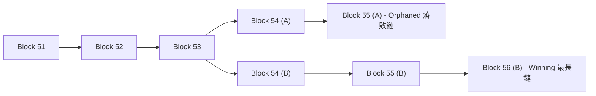
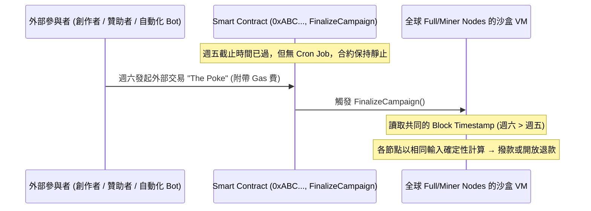

# Chapter 09 — 區塊鏈基礎與去中心化帳本 (Blockchain Foundations & Decentralized Ledgers)

## 1. 上帝視角: 去中心化帳本與五域讀寫工作流

前八章的系統 (Paxos/Raft, ZooKeeper, HBase, HDFS, Spark, Kafka) 皆運行在單一組織或受信任邊界內, 節點可能當機或失聯, 但不會刻意偽造帳目. 當多方互不信任且沒有中央清算機構 (Clearing House) 時, **區塊鏈 (Blockchain)** 結合密碼學, P2P 傳播, 共識機制與確定性虛擬機, 維護一份全球共識且抗篡改的分散式帳本 (Distributed Ledger) (成大講義 P239–P243).

### 1.1 Read 與 Write 的非對稱路徑

講義 P242–P243 以使用者的讀寫工作流將區塊鏈拆解為五個領域:

- **讀取路徑 (Read Path)**: 免費且即時. 應用程式直接向 RPC Node / Full Node 查詢本地已同步的鏈上狀態, **不需要數位簽章, 不消耗 Gas, 也不觸發全域共識**.
- **寫入路徑 (Write Path)**: 必須完整穿越五個領域 — **1. User Domain** (離線私鑰簽章) -> **2. Network Domain** (P2P Gossip 傳播進 Mempool) -> **3. Miner Domain** (PoW/PoS 共識競爭出塊) -> **4. Storage Domain** (串接區塊與 Merkle Tree 持久化) -> **5. Execution Domain** (所有節點於 VM 確定性執行智能合約更新 World State).

| 工作流領域 | 對應軟體堆疊層 | 核心技術與元件 (成大講義 P243) |
| --- | --- | --- |
| 1. User Domain | Application Layer / Data Layer (Crypto) | Wallets, DApps, `ethers.js`, 本地私鑰管理, ECC, ECDSA, SHA-256 |
| 2. Network Domain | Network Layer | P2P 覆疊網路, Gossip 傳播, Mempool, RPC Gateways, TLS |
| 3. Miner Domain | Consensus Layer | PoW, PoS, PBFT, Raft |
| 4. Storage Domain | Data Layer (Ledger) | Append-only 區塊鏈, Merkle / Merkle Patricia Trees, UTXO vs Account 模型 |
| 5. Execution Domain | Control Layer | Smart Contracts, 沙盒虛擬機 (EVM, NeoVM), 鏈上狀態模型 |

## 2. 使用者與網路域: ECC 簽章, 節點分類與 Mempool

### 2.1 橢圓曲線密碼學 (ECC) 與 ECDSA 簽章

使用者參與公鏈前無須向中央註冊, 直接在離線裝置產生一組隨機數作為 **私鑰 (Private Key)**, 透過 **橢圓曲線密碼學 (Elliptic Curve Cryptography, ECC)** 導出對應的 **公鑰 (Public Key)** 與錢包位址 (P244–P245). 相比傳統 RSA 需要 $3072$-bit 金鑰才能達到的安全強度, ECC 僅需 $256$-bit 金鑰, 大幅縮減每筆交易的鏈上儲存空間.

寫入交易的簽驗流程如下 (P245):
1. **本地簽章**: 錢包對交易內容計算雜湊摘要 (Message Digest), 使用 **A 的私鑰 (永不離開本地裝置)** 進行 ECDSA 簽章, 將"原訊息 + 數位簽章"廣播出去.
2. **節點驗證**: 收到交易的礦工與全節點重算訊息雜湊, 並以 A 的公鑰驗證簽章是否對應同一摘要; 吻合才視為合法授權交易.

開發實務上 (講義 P246–P247 以 `ethers.js` 為例), `provider.getBalance(addr)` 屬直接向 RPC 查詢的免費 Read, 而 `wallet.sendTransaction(...)` 觸發本地簽章, 廣播與 `tx.wait()` 等待打包上鏈. 進階應用還包含載入 **ABI (Application Binary Interface)** 呼叫合約函式, 以 WebSocket 訂閱鏈上事件, 以及不花費 Gas 的鏈下訊息簽章身分登入.

### 2.2 三種節點分類與 Mempool 激勵

區塊鏈網路依參與者執行的工作流階段分為三類節點 (P248):

1. **輕節點 (Light Node, 如手機/瀏覽器錢包)**: 負責 Phase 1 簽章與 Phase 2 聯網, Phase 4 僅保存輕量區塊標頭 (含 Merkle Roots), 靠向全節點請求 Merkle Proof 驗證交易.
2. **全節點 (Full Node, 如 RPC Gateway)**: 下載並保存完整帳本 (Phase 4), 且在本地 VM 獨立重演所有交易與合約 (Phase 5) 以自行驗證共識規則, 不盲信礦工.
3. **礦工/驗證者節點 (Miner / Validator Node)**: 執行全節點的一切工作, **外加**參與 Phase 3 共識競爭 (如耗費算力解 PoW 謎題) 以爭取出塊權.

簽章通過驗證的未確認交易透過 [Chapter 04](04-peer-to-peer-gossip.md) 的 P2P Gossip 呈指數擴散, 暫存於各節點 RAM 中的 **記憶體池 (Mempool)** (P249–P250). 由於網路延遲, 不同礦工收到同一筆交易的順序可能不同; 使用者附加 **Gas Fee** 作為經濟誘因, 礦工優先挑選 Gas 費較高的交易打包, 勝出出塊者可獲得"區塊內全部交易的 Gas 費 + 系統新鑄區塊獎勵".

## 3. 共識與儲存域: PoW 分叉與最長鏈原則

不同於 ZooKeeper 或 Kafka 由固定單一 Leader 排序寫入, 開放公鏈面臨 **多重寫入者問題 (Multiple Writers Problem)** — 任何匿名礦工都能嘗試出塊, 等同於每產出一個區塊就重新進行一次去中心化選主 (P251–P252).

### 3.1 Proof-of-Work (PoW) 與 Nonce 非對稱難度

在 **工作量證明 (Proof-of-Work, PoW)** 中, 礦工將候選區塊的標頭資料 (含交易清單的 Merkle Root, 前一區塊雜湊 `HashPrev`, 時間戳等) 與可變整數 **Nonce (Number used ONCE)** 串接後反覆計算密碼學雜湊 (如 SHA-256), 直到輸出滿足當前難度目標 (例如前導出現指定數量的 `0`) (P252):

$$
\mathrm{Hash}(\text{BlockHeader} \parallel \text{Nonce}) < \text{Target}
$$

講義 P252 簡化原例將目標設為前導 `"00"`: Nonce $= 1$ 得 `8b1a9953c461...` (失敗), Nonce $= 2$ 得 `f42c13d9a102...` (失敗), 直到嘗試 Nonce $= 42$ 才命中 `00a1b839c314...` (成功出塊). PoW 的核心威力在於 **非對稱難度 (Asymmetric Difficulty)**: 找到合格 Nonce 需耗費海量暴力雜湊運算, 但全網任何節點只需**一次雜湊計算**即可瞬間驗證 `Hash(Data + 42)` 是否符合規則.

隨著產業演進 (P253), Bitcoin 仍堅守 PoW 的熱力學安全與極致去中心化, 而 Ethereum (於 2022 年完成 The Merge) 及 Solana, Cardano 等現代公鏈轉向 **權益證明 (Proof-of-Stake, PoS)** — 將能耗降低約 $99.95\%$, 導入對作惡驗證者直接銷毀質押資產的 **罰沒機制 (Slashing)**, 並提供更可預測的出塊時間與更快的最終確定性 (Finality).

### 3.2 鏈式防篡改, 儲存剖析與 Merkle Tree

每個區塊由 **Block Header** (`Hash(Prev Header)`, `Timestamp`, `Nonce`, `Merkle Root Hash`) 與 **Block Body** (交易清單) 組成 (P254–P256):

- **雜湊串鏈防篡改**: 若企圖修改過去任一筆交易, 該區塊的 Merkle Root 隨之改變, 進而改變整個 Block Hash, 立刻斷裂後續所有區塊的 `Hash(Prev Header)` 指標!
- **節點儲存分層** (P255): 全節點依存取模式混用不同技術 — 歷史原始區塊存於順序追加的 **Flat Files (`.blk`)**; 當前帳戶餘額與合約變數 (**World State**) 以及 **Chain Index** 則存於 **LevelDB / RocksDB** (直接應用 [Chapter 06](06-leveldb-hbase.md) 的 LSM-Tree 引擎以應付高頻隨機狀態更新!); Mempool 放於易失性 RAM.
- **Merkle Tree** (P256): 將所有交易兩兩雜湊層層匯聚成單一 **Merkle Root** (`H0=Hash(Tx0)`, `H1=Hash(Tx1)`, `H4=Hash(H0,H1)`, `Root=Hash(H4,H5)`). 輕節點只需保存區塊標頭中的 Root Hash, 查詢某筆交易 (如 `Tx0`) 是否被收錄時, 向全節點索取 $O(\log N)$ 個兄弟雜湊 (本例僅需 `H1` 與 `H5`), 即可自行重算 Root 比對驗證, 無須下載整個區塊鏈.

### 3.3 PoW 分叉, CAP 取捨與最長鏈原則 (核心機制)

由於全球 P2P 網路存在傳播延遲甚至暫時分區 (Partition), 兩位誠實礦工幾乎同時在不同的網路區域解出各自合法的新區塊是完全正常的事. 區塊鏈在此如何處理寫入衝突? (P257–P258).

圖 9.1 - 網路延遲或分區導致 Block 53 後出現暫時分叉; 網路癒合後全網依最長鏈原則 (最大累積工作量) 切換至 B 分支, A 分支成為孤鏈且其未收錄交易退回 Mempool (成大講義 P257).

對照講義 P257 原例與 [Chapter 05](05-consistency-replication-transactions.md) 的 CAP 定理:

1. **分區期間優先選擇可用性 (AP / Eventual Consistency)**: 當網路發生分區 (P) 時, PoW 區塊鏈不像 Paxos/ZooKeeper 停擺少數側, 而是允許兩側礦工獨立繼續出塊 (A), 在 Block 53 之後同時長出 `54(A) -> 55(A)` 與 `54(B) -> 55(B) -> 56(B)` 兩條合法但互相衝突的 **暫時分叉 (Temporary Fork)**.
2. **最長鏈原則 (Longest Chain Rule / Most Cumulative PoW)**: 當分區癒合或節點收到另一分支時, 所有誠實節點遵守統一共識規則 — 採納**累積工作量最大 (Most Cumulative PoW, 在相同難度下即高度最長)** 的有效鏈! 本例中 B 分支高度達 56 勝出, 網路最終收斂至單一共同歷史 (Eventual Consistency).
3. **孤鏈丟棄與交易回退**: 較短的 A 分支 (`54(A), 55(A)`) 成為 **孤鏈 (Orphaned / Stale Chain)** 被棄置; A 分支中已打包但未出現在 B 分支的合法交易不會憑空消失, 而是退回 **Mempool** 等待後續新區塊重新收錄 (但原 A 分支礦工的出塊獎勵會失效!).
4. **機率性最終性 (Probabilistic Finality) 與安全邊界**: 因為較短分支可能被後來居上的重鏈翻盤 (Chain Reorganization), PoW 交易被打包進最新區塊後並非立刻絕對不可逆, 實務須等待數個後續確認區塊 (例如 Bitcoin 常見等待 6 個確認). 此外, 講義 P258 區分了**正常分叉**與**惡意篡改**: 若惡意節點修改舊區塊資料 (如篡改 Block 99), 其 Merkle Root 與 Block Hash 立刻違反密碼學驗證或缺乏合格 PoW, 誠實節點直接拒絕並隔離之; 然而需注意算力假設的界線 — 若單一攻擊者掌握全網超過 $50\%$ 的算力 (51% Attack), 它就能秘密打造一條**密碼學完全合法且累積工作量更大**的替代分叉來覆寫近期歷史達成雙花.

### 3.4 區塊高度 Watermark 與 Headers-First 同步

節點間如何快速對齊彼此擁有的區塊進度? (P259–P260).

- **區塊高度 (Block Height) 如同比擬 Kafka High Watermark**: 節點透過 Gossip 宣告自身高度 (例如 Node Y 與 Node Z 宣告 Height 105, 而 Node X 停在 Height 100), Node X 即可推斷對方擁有完整 `0..105` 歷史, 並分散向 Node Y 請求 `101..103`, 向 Node Z 請求 `104..105`.
- **標頭優先同步 (Headers-First Sync)**: 現代公鏈不會逐塊串行下載龐大的完整區塊. Step 1 先循序下載僅 $80\text{ bytes}$ 的輕量 **Block Headers**, 瞬間驗證 PoW 鏈條並確認最長鏈藍圖; Step 2 再依據已驗證的標頭清單, 同時向多個 Peer 非同步平行下載 $1$ 至 $4\text{ MB}$ 的交易主體 (Tx Bodies), 徹底消除單點下載瓶頸.

## 4. 執行域: 智能合約的被動觸發與確定性執行

區塊鏈不只記錄單純的轉帳收據, 還能在帳本上部署可自動執行的程式 — **智能合約 (Smart Contract)**, 落實"Code is Law"的無信任數位託管 (Digital Escrow) (P261–P266).

### 4.1 眾籌託管原例與合約生命週期

講義 P261–P264 以群眾募資 (`KickstarterContract`, 目標 `FundingGoal = 10000`) 說明智能合約如何取代抽成 $5\%$ 的中心平台:
- 贊助者 (Backer A 轉 `5 ETH`, Backer B 轉 `5 ETH`) 不是口頭承諾, 而是發送交易將資金**實際鎖定在合約位址 (`0xABC...`)** 中; 合約在其專屬的鏈上狀態儲存寫下 `balances[BackerA] = 5`, `balances[BackerB] = 5`, `TotalPool = 10 ETH`.
- 在期限條件被嚴格驗證前, 無論創作者或贊助者都無法私自挪用鎖定資金.

合約的完整生命週期包含四個階段 (P262):
1. **Deploy (一次性部署)**: 開發者發送包含合約位元組碼的交易上鏈.
2. **Stored on Ledger**: 合約獲配永久鏈上位址 (`0xABC...`) 與獨立狀態空間.
3. **Trigger (隨時觸發)**: 往後任何使用者都可向該位址發送交易呼叫其公開函式 (如 `FinalizeCampaign`).
4. **Execute (全網獨立執行)**: 合約**不是**跑在某台雲端伺服器上, 而是由全球**每一台 Full Node 與 Miner Node** 各自在本地沙盒虛擬機 (如 EVM, NeoVM) 中重新執行一次!

### 4.2 被動觸發特性 (Reactive Nature — No Cron Jobs!)

這是最常被誤解的核心考點 (P265): "如果眾籌截止日是星期五, 區塊鏈會在星期五午夜自動醒來執行撥款或退款嗎?" **答案是否定的!**

區塊鏈系統本質上是 **完全被動 (Passive / Reactive)** 的狀態機, 協議層 **沒有內建定時器或背景排程 (No Cron Jobs)** — 智能合約永遠無法 "自己喚醒自己" 執行程式. 即使星期五截止日已經過去, 合約依然紋風不動.

圖 9.2 - 智能合約缺乏內建排程, 必須由外部參與者付費發起交易 ("The Poke") 喚醒, 並於沙盒 VM 內讀取區塊時間戳確定性驗證執行 (成大講義 P265).

時間條件邏輯在鏈上的實際運作依賴兩步驟:
1. **外部戳動 (The Poke)**: 截止時間過後, 必須由 **任何外部參與者 (External Actor)** — 例如想領款的創作者, 想退費的贊助者, 或收費代跑的鏈下自動化 Bot — 主動發起一筆附帶 Gas 費的交易呼叫 `FinalizeCampaign()`.
2. **區塊時間驗證 (Validation)**: 合約被喚醒後, VM 讀取打包該筆交易的當下 **區塊時間戳 (Block Timestamp)**, 驗證 `CurrentTime > Deadline` 成立後, 才執行撥款給創作者或解鎖退款的邏輯.

### 4.3 確定性執行 (Deterministic Execution) 與禁止來源

為什麼講義 P262–P263 反覆強調沙盒 VM 必須確保 **給定相同輸入, 地球上每一個節點都算出完全相同的結果**?

因為區塊鏈透過**所有全節點各自重演同一筆交易並比對最終 World State (State Root)** 來維持共識! 如果智能合約的執行結果在不同機器上有哪怕 1 bit 的差異, 節點就會算出不同的狀態雜湊, 立即導致全網共識破裂與永久分叉! 因此智能合約在沙盒 VM 內**嚴格禁止直接存取任何非確定性來源**:

- **不可讀取本機系統時鐘**: 不同機器在不同時刻重演同一歷史區塊 (包含數年後新加入節點的同步重演!), 本機時間完全不同 -> 必須統一讀取區塊標頭中寫死的共識 `Block Timestamp`.
- **不可直接呼叫外部網路 API (如查即時匯率或天氣)**: 不同節點查詢時外部網站可能回應不同數值, 逾時甚至關站 -> 外部世界資料必須透過 **預言機 (Oracle)** 以標準鏈上交易的形式寫入區塊成為所有節點的共同確定輸入.
- **不可使用真隨機數或硬體相依浮點數運算**: 必須使用確定性整數算術與鏈上可驗證隨機機制 (如 VRF 或 Commit-Reveal).

### 4.4 帳本 (Ledger) vs 世界狀態 (World State) 的邏輯分離

講義 P266 釐清了一個極關鍵的儲存觀念: 合約的"狀態儲存"和區塊鏈的"區塊儲存"雖然位於同一台全節點的硬碟上, 邏輯上卻是**兩種截然不同的資料結構**:

- **Phase 4 — The Ledger (歷史帳本)**: 不可變, 追加寫入的區塊序列 (如銀行的交易收據簿: `"Alice sent 5 ETH"`), 記錄發生過的每一筆歷史交易, 永不覆寫.
- **Phase 5 — World State (當前世界狀態)**: 可變的鍵值快照資料庫 (如銀行的當前資產負債表: `Alice = 0 ETH, ContractA = 10 ETH`). 每當新區塊到達, VM 依序吃進區塊內的交易並**確定性地更新** World State; 即使刪除本地 World State, 理論上只要從創世區塊 (Genesis Block) 重新依序執行整條 Ledger 仍可重建出完全一致的現況.

## 5. 資料庫與區塊鏈比較, 區塊鏈分類與全學期總結

### 5.1 傳統資料庫 vs 區塊鏈 (P267)

| 比較面向 | Traditional Databases | Blockchains |
| --- | --- | --- |
| 管理與控制權 | 中央管理者與單一機構控制 | 無單一管理者或中央權威 |
| 存取控制 | 基於 ACL 與權限控管 | 公鏈允許任何人匿名參與驗證與讀取 |
| 所有權與稽核 | 資料紀錄缺乏內建密碼學所有權鏈 | 完整密碼學簽章與歷史所有權追溯 ("Your Keys = Your Data") |
| 吞吐量與延遲 | 極高吞吐量, 低延遲 | 天生較慢 (受限於全球共識與全節點重複執行) |

### 5.2 公有鏈, 私有鏈與聯盟鏈分類 (P268–P269)

| 特徵 | Public Chain (公鏈) | Private Chain (私鏈) | Consortium Chain (聯盟鏈) |
| --- | --- | --- | --- |
| 准入權限 | 無須許可 (Permissionless): 任何人可匿名跑輕/全/礦工節點 | 許可制 (Permissioned): 中央管理者指定誰能跑驗證節點 | 聯邦制 (Federated): 僅預先核准的跨機構組織能運行驗證節點 |
| 去中心化與效能 | 去中心化高, 吞吐慢 (需 PoW/PoS) | 去中心化低, 吞吐快 (受信任環境) | 去中心化中, 效能中至快 |
| 代表案例 | Bitcoin (價值儲存), Ethereum / Solana (智能合約與 DeFi) | 企業內部稽核 (Hyperledger Fabric 內部部署) | 跨境結算與供應鏈 (R3 Corda, Quorum, 跨企業 Hyperledger Fabric) |

### 5.3 全學期分散式系統知識鏈總結

從 P1 到 P270, 整門課程串起一條完整的工程演進主線:
- **時間與狀態 ([Ch01](01-logical-clocks-checkpointing.md))**: 無全域實體時鐘下用 Lamport/Vector Clocks 捕捉因果, 用 Chandy-Lamport Marker 拍出一致快照與恢復線.
- **共識與協調 ([Ch02](02-fault-tolerance-paxos-raft.md), [Ch03](03-zookeeper.md))**: 面對非同步故障與 FLP 邊界, 用 Paxos/Raft/ZAB 與多數 Quorum 建立單一順序, 並在 ZooKeeper 之上組裝設定管理與無驚群分散式鎖.
- **去中心化散布與路由 ([Ch04](04-peer-to-peer-gossip.md))**: 解除中心目錄後用 Gossip 流行病式擴散與 Chord $O(\log N)$ DHT 定位資源.
- **一致性合約與交易 ([Ch05](05-consistency-replication-transactions.md))**: 權衡 Strict/Sequential/Causal/Eventual 一致性光譜, 以 ACID Isolation, 2PL/OCC/MVCC 與 2PC 守護跨節點交易.
- **大規模儲存, 批次與串流 ([Ch06](06-leveldb-hbase.md), [Ch07](07-hdfs-mapreduce-yarn-spark.md), [Ch08](08-kafka-stream-processing.md))**: 以 LSM-Tree 與 Bloom Filter 擊破磁碟隨機寫入放大, 用 HDFS/YARN/Spark Lineage 撐起大數據批次與記憶體運算, 再用 Kafka `sendfile()` 零拷貝與 Changelog 還原實現高吞吐有狀態串流.
- **開放無信任帳本 (本章 Ch09)**: 將 Gossip, LSM-Tree (World State), Watermark 同步與密碼學共識匯聚成去中心化帳本與確定性智能合約平台.

## 6. 英文選擇題與逐項解析

### Q1 — PoW Forks and the Longest Chain Rule

During a temporary network partition in a Proof-of-Work blockchain, Branch A grows to Block 55 while Branch B grows to Block 56 (same per-block difficulty). Once the partition heals, how do honest nodes resolve the fork?

- A. Honest nodes permanently merge both branches so transactions in both Block 55(A) and Block 56(B) remain in two active tips forever.
- B. Honest nodes adopt Branch B as the winning chain (most cumulative PoW); Branch A is orphaned, and valid transactions unique to Branch A are returned to the Mempool.
- C. A central Clearing House votes to pick Branch A and deletes Branch B.
- D. All nodes halt permanently because PoW chooses CP over AP during a partition.

**答案: B.** A: 網路癒合後不會維持雙主鏈並存, 必須收斂至單一鏈. B: 依最長鏈原則 (最大累積工作量), 高度 56 的 B 分支勝出, A 分支成孤鏈且其未收錄交易退回 Mempool. C: 公鏈無中央清算機構裁決. D: PoW 分區期間允許兩側繼續產塊, 傾向可用性與最終一致性 (AP).

### Q2 — Reactive nature of Smart Contracts

A crowdfunding smart contract has a deadline of Friday at 23:59. After Friday passes with funding below the goal, why do refunds NOT execute automatically at midnight without external interaction?

- A. Because smart contracts are passive/reactive and blockchains have no built-in cron jobs or timers; an external actor (creator, backer, or bot) must send a gas-paying transaction to trigger the contract, which then checks the current Block Timestamp.
- B. Because smart contracts can only run once during deployment and can never be invoked again.
- C. Because smart contract code is stored only on the creator's laptop.
- D. Because funds are never actually locked inside the contract address.

**答案: A.** A: 正確對應講義 P265 的被動觸發 (The Poke) 與區塊時間戳驗證機制. B: 部署是一次性, 但後續可透過交易多次觸發呼叫. C: 合約部署於全網帳本並由所有全節點執行. D: 贊助資金確實鎖定在合約地址託管.

### Q3 — Deterministic execution of Smart Contracts

Why must a Smart Contract Virtual Machine (e.g., EVM or NeoVM) guarantee deterministic execution and prohibit direct calls to external HTTP APIs or local wall-clock time?

- A. Because external HTTP APIs are too fast for blockchain nodes to handle.
- B. Because every Full Node and Miner worldwide independently re-executes the contract transaction to verify the resulting World State; any non-deterministic output would cause nodes to compute divergent states and break consensus.
- C. Because smart contracts are only executed on a single Light Node.
- D. Because determinism eliminates the need for digital signatures.

**答案: B.** A: 問題在於各節點取得結果可能不一致 (甚至歷史重演時 API 已改變), 而非速度太快. B: 全球全節點獨立重演驗證同一狀態轉換, 必須確保給定相同輸入必得完全相同輸出. C: 輕節點不執行完整合約驗證, 全節點與礦工才執行. D: 交易授權仍必須依賴 ECC 數位簽章.

### Q4 — Merkle Tree and Light Nodes

How does a Merkle Tree in each Block Header help a mobile Light Node verify that a specific transaction `Tx0` was included in a block?

- A. The Light Node downloads every transaction in the entire blockchain history and runs PoW mining.
- B. The Light Node stores only Block Headers (including Merkle Roots) and verifies `Tx0` using a compact set of sibling hashes ($O(\log N)$ Merkle Proof) that recomputes the matching Merkle Root.
- C. The Merkle Tree encrypts the user's private key inside the block header.
- D. The Merkle Tree guarantees that no temporary forks can ever occur.

**答案: B.** A: 那是全節點/礦工的負擔, 非輕節點. B: 透過兄弟節點雜湊重算比對 Merkle Root 即可驗證包含性, 無須下載完整區塊體. C: Merkle Tree 用於雜湊摘要聚合, 非加密私鑰. D: 分叉由網路延遲與多礦工競爭造成, 由最長鏈原則收斂.

### Q5 — Ledger vs World State

In a Full Node's architecture, what is the logical distinction between the Ledger (Phase 4) and the World State (Phase 5)?

- A. The Ledger is a mutable balance sheet stored in RAM, while the World State is an immutable history of flat `.blk` files.
- B. The Ledger is the immutable, append-only history of all blocks and transactions, whereas the World State is the mutable current snapshot (e.g., account balances and contract storage, often backed by LevelDB/RocksDB) updated as the VM executes blocks.
- C. They are identical copies of the Mempool.
- D. World State is only maintained by Light Nodes.

**答案: B.** A: 兩者定義完全寫反. B: 精確區分歷史收據簿 (Immutable Ledger) 與當前資產負債快照 (Mutable World State). C: Mempool 存的是尚未確認的待打包交易. D: 輕節點僅保存標頭, 全節點才維護 World State.

## 7. 來源與投影片對照

| 講義 | 主題 | 算例與圖解 |
| --- | --- | --- |
| P239–P243 | 去中心化帳本與五域讀寫工作流 | Read (免費直查) vs Write (五域全路徑), 軟體堆疊對照表 |
| P244–P250 | ECC/ECDSA 簽章, `ethers.js`, 節點分類與 Mempool | 256-bit ECC vs 3072-bit RSA, Light/Full/Miner, Gas 誘因 |
| P251–P253 | 多重寫入者, PoW Nonce 謎題與 PoW vs PoS 演進 | 前導 `"00"` 原例 (Nonce $= 42$), PoS 節能與 Slashing |
| P254–P256 | 區塊雜湊鏈, 節點儲存剖析與 Merkle Tree | Flat Files + LevelDB/RocksDB, `Tx0..Tx3` Merkle Tree |
| P257–P260 | PoW 分叉, 最長鏈原則, 篡改拒絕與 Headers-First 同步 | 圖 9.1, Block 53 分叉 (`55(A)` 孤鏈 vs `56(B)` 勝出), Watermark |
| P261–P266 | Smart Contract 託管, 被動觸發, 確定性執行與帳本/狀態分離 | 圖 9.2, `KickstarterContract` 週五截止 + 週六外部觸發 |
| P267–P270 | 傳統 DB vs Blockchain, 公/私/聯盟鏈與全章總結 | Public / Private / Consortium 比較表 |

- 成大講義: Prof. Hung-Chang Hsiao, *Distributed Systems* (Fall 2026), `reference/整包.pdf` P239–P270.
- 經典論文與文件背景: Nakamoto (2008) *Bitcoin: A Peer-to-Peer Electronic Cash System*; Buterin (2014) / Wood (2014) Ethereum Whitepaper & Yellow Paper (EVM 確定性執行與狀態轉換模型); Merkle (1987) 數位簽章與 Merkle Tree 認證結構.

執行 `python3 tools/verify-remaining-chapters.py` 可核算本章的 Merkle Root 計算與包含證明, 簡化 PoW Nonce 搜索與分叉最長鏈重組退回 Mempool 模擬.
